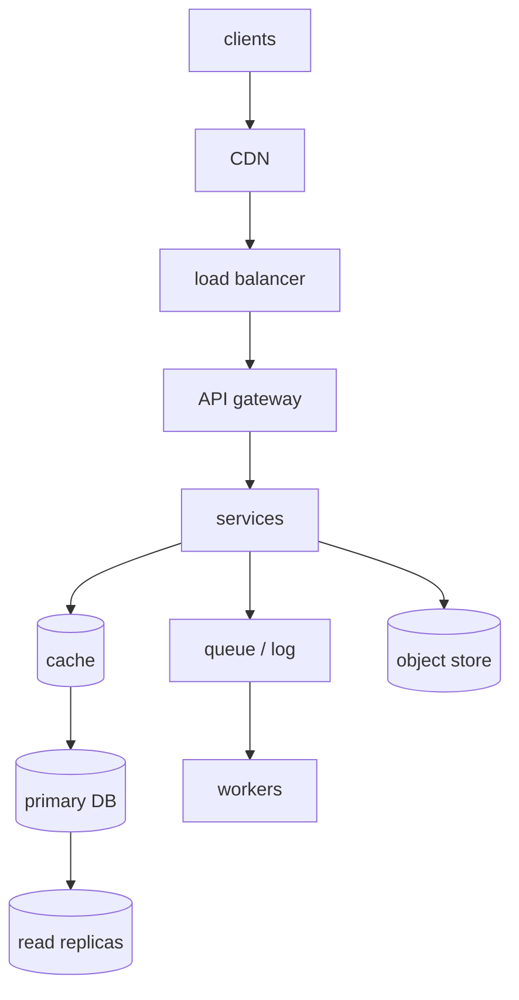
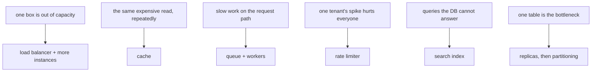
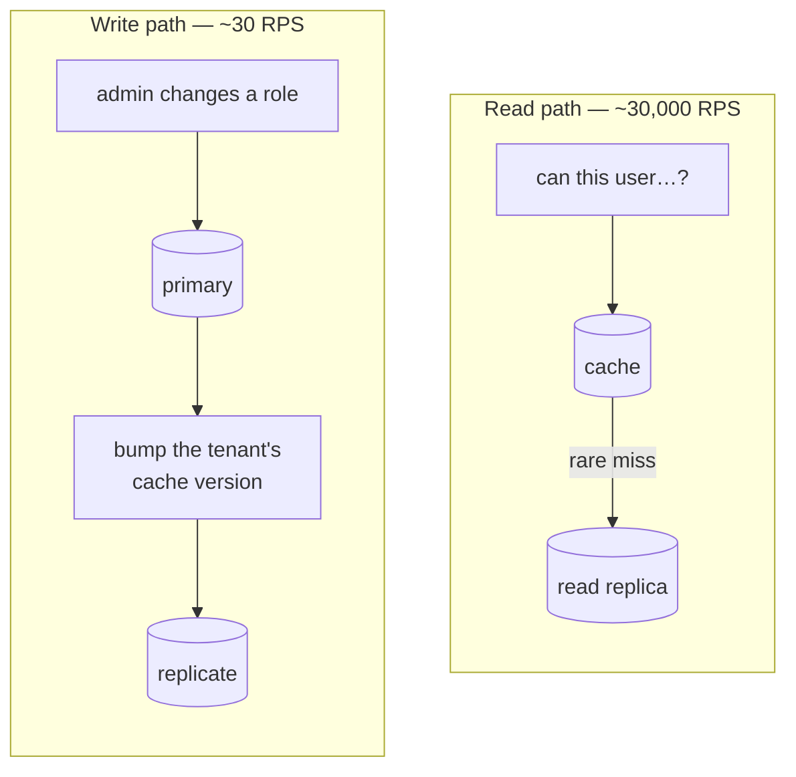

# Building blocks

*In the interview: draw the standard architecture in under two minutes, then spend the time on the block the role cares about — for a security team, the control plane that produces and closes findings.*

The vocabulary of a design round. Each block below is a thing you *place* on
the whiteboard, and each one is placed for a reason and paid for in
complexity. The chapter is organised around the four questions an interviewer
actually asks about a box you have just drawn: what does it do, why is it
there, when would you *not* add it, and what does it cost you.

---

## In brief

- **Draw the subset you need, not the whole chain** — the full
  clients → CDN → LB → gateway → services → cache → DB → replicas → queue →
  workers → object store diagram is most designs' superset. Opening with all of it leaves
  nowhere to go in the deep dive.
- **Health checks trade two failure modes against each other**: shallow
  checks miss grey failure (up but malfunctioning); deep checks that
  actually exercise dependencies can cascade, draining every instance when
  one shared dependency wobbles. The usual split is shallow for liveness,
  deep for readiness, with hysteresis.
- **An API gateway can only do coarse authorization** (valid token, correct
  audience) — only the owning service knows ownership, tenancy, and state.
  Treating the gateway as the *only* check turns the internal network into
  an implicit trust zone.
- **Choose a database from access patterns, not data shape** — "how is
  this read?" decides more than "what does it look like?" It's normal and
  not indecisive to use several stores for one system: Postgres for core
  entities, Redis for sessions, Elasticsearch for search.
- **The read and write paths in an auth system can be orders of magnitude
  apart** (30 RPS writes vs. 30,000 RPS reads) and deserve genuinely
  different designs — the write path bumps a cache version so stale reads
  become unreachable, which is where the real correctness risk lives: a
  cached "allow" for a just-removed role is a security bug, not a stale
  read.
- **Every cache layer (CDN, in-process, shared, database-level) has a
  different invalidation problem** — decide the invalidation strategy
  *before* adding the cache, not after, and use versioned keys for
  anything security-relevant.
- **Knowing when *not* to add a block is the senior half.** "The database
  handles this load fine, so I wouldn't add a cache yet" and "a table with a
  status column is a good enough queue here" are strong answers, because they
  show you price a block as well as justify it.
- **Reach for a block from a symptom you can name** — out of capacity, the same
  expensive read repeatedly, slow work on the request path, one tenant hurting
  the rest. A block with no symptom behind it is a shopping list.

---

## The standard architecture

*Most designs are a subset of this. Start with the subset you need — opening with the whole chain leaves you nowhere to go in the deep dive.*

The full chain, top to bottom: **clients → CDN → load balancer → API gateway →
services**, with services reading through a **cache** to a **primary DB** that
replicates to **read replicas**, pushing side effects onto a **queue/log** for
**workers**, and putting blobs in an **object store**.

Most designs are a subset of that. Start with the subset you need and add
under pressure — starting complex leaves nowhere to go in the deep dive.

---

## Which block solves which symptom

Blocks are answers to symptoms, and naming the symptom first is what separates
a design from a shopping list. The order you add them as a system grows is in
[system design: start here](31-design-round-start-here.md); this chapter is
what each one *is*, and when it earns its place.

*Reach for a block because of a symptom you can name. "We would add a cache" with no symptom behind it is the answer interviewers discount.*

Each block below has the same six parts: what it is, what it solves, when to
add it, when **not** to, what it costs, and what an interviewer is listening
for. The fourth is the one candidates skip and the one that reads as senior.

Which *product* to use inside a block — Postgres or Mongo, Kafka or SQS — is
[the technology toolbox](34-the-technology-toolbox.md). This chapter names the
generic block.

---

## Load balancer

**What it is.** A component in front of several identical instances that picks
one per request. **L4** routes on IP and port — fast, protocol-agnostic. **L7**
understands HTTP, so it can route on path, terminate TLS, retry and rewrite
headers. Most API traffic wants L7.

**What it solves.** One machine running out of capacity, and the inability to
deploy or lose an instance without downtime.

**Add it when** you want more than one instance of anything — which is the
moment you want zero-downtime deploys, not the moment you run out of CPU.

**Don't add it when** there is one instance and no redundancy requirement; a
load balancer in front of a single box adds a hop and a failure mode and solves
nothing.

**What it costs.** A hop (sub-millisecond in a region), a component that must
itself be redundant, and sticky-session problems if instances hold state.
Algorithms matter here: round-robin is fine for uniform requests,
least-connections for uneven ones, consistent hashing when you want cache
locality or affinity.

**Health checks are the interesting part.** Shallow checks miss grey failure
(up but malfunctioning); deep checks that exercise dependencies can cascade,
draining every instance when one shared dependency wobbles. The usual answer
is shallow for liveness, deep for readiness, with hysteresis so a flapping
dependency does not flap the fleet.

**Interviewers listen for** whether you mention health checks and draining at
all, and whether you know that "stateless services" is what makes this block
trivial and session state in memory is what makes it painful.

---

## API gateway / edge proxy

**What it is.** One layer in front of all services doing the cross-cutting
work: TLS, authentication, rate limiting, routing, request shaping, and the
request id everything else logs.

**What it solves.** Reimplementing the same six concerns in every service, and
inconsistently.

**Add it when** you have more than a couple of services, or an external API
with untrusted callers.

**Don't add it when** there is one service — its middleware *is* the gateway,
and a separate deployment is pure operational cost.

**What it costs.** A tier-0 component on every request path, a deployment
bottleneck if every team needs to change its config, and the temptation to put
business logic in it.

**Interviewers listen for** the authorization boundary. A gateway can do
*coarse* authorization — valid token, correct audience, right tenant — but only
the owning service knows ownership, state and row-level rules. Treating the
gateway as the only check turns the internal network into an implicit trust
zone, which is the finding a security reviewer writes up.

---

## CDN

**What it is.** A cache of your content in hundreds of locations near users,
with your origin behind it.

**What it solves.** Latency for users far from your region, and origin load for
anything requested many times.

**Add it when** you serve static assets, media, or any cacheable response to a
geographically spread audience. For media-heavy products, the CDN hit rate is
the number that drives both origin load and bill.

**Don't add it when** every response is per-user and uncacheable — you get the
hop and the invalidation problem and none of the benefit. Putting a per-user
cookie in the cache key has exactly this effect, and it is the most common way
a CDN gets accidentally disabled.

**What it costs.** A second place where content is stale, cache-key design as a
real design problem, and egress pricing that rewards getting the hit rate
right.

**Interviewers listen for** how you publish a new version: versioned URLs
(`app.a3f9c1.js`) rather than invalidation, because invalidation is slow,
rate-limited and easy to get wrong.

---

## Cache

**What it is.** A faster copy of an answer: in-process (per instance), shared
(one Redis for the fleet), or in front of the database.

**What it solves.** The same expensive read computed over and over — a query, a
policy evaluation, a fan-out.

**Add it when** you can name the read, its rate, and why it is expensive. "The
permission check runs 30,000 times a second and takes 40ms" is a reason; "we'd
add a cache for performance" is not.

**Don't add it when** the database handles the load comfortably. Saying "the
database is fine at this volume, so I wouldn't add a cache yet" is one of the
strongest things you can say in a design round — it shows you count the cost of
a block, not just its benefit.

**What it costs.** A second copy of the truth, which means an invalidation
problem; a new failure mode (what happens when it is empty, or down); and a
stampede when a hot key expires and a thousand requests miss at once.

**Interviewers listen for** the invalidation strategy, decided *before* the
cache is added. For anything security-relevant, use versioned keys: bump a
per-tenant or per-user version so every stale entry becomes unreachable at
once. A cached *allow* for a role you just removed is a security bug, not a
stale read. Depth: [caching at scale](28-caching-at-scale.md).

---

## The database types

**What it is.** The system of record. The type is a choice, not a default.

| Type | Model | Fits |
| --- | --- | --- |
| **Relational** | Tables, joins, ACID | Relationships, transactions, ad-hoc queries |
| **Document** | JSON documents | Nested data, flexible schema, one-document reads |
| **Key-value** | Hash | Sessions, caches, simple lookups |
| **Wide-column** | Rows with dynamic columns | Huge write volume, time series |
| **Graph** | Nodes and edges | Traversals — social graphs, permission graphs |
| **Search** | Inverted index | Full text, faceting, relevance |

**What it solves.** Durable state with the query shape your access patterns
actually need.

**Choose from access patterns, not data shape.** "How is this read?" decides
more than "what does it look like?" Establish the read/write ratio, whether
queries are known ahead of time or ad-hoc, whether there are relationships to
traverse, and what consistency the writes need.

**Don't** reach for a second database type to avoid learning the first one's
features — Postgres does JSON, full text and queues passably well, and one
system you operate properly beats three youhalf-operate. But using several
deliberately is normal, not indecisive: Postgres for core entities, Redis for
sessions, a search index for search.

**What it costs.** Each additional store is another thing to back up, monitor,
migrate, secure and page someone about.

**Interviewers listen for** a choice defended by access pattern, and for
knowing when your default is the wrong answer.

---

## Read replicas

**What it is.** Copies of the primary that serve reads and lag it by
milliseconds to seconds.

**What it solves.** A read-heavy workload saturating the primary, and reporting
queries competing with production traffic.

**Add it when** reads dominate and the primary's CPU or IO is the ceiling. It
is usually the cheapest real scaling step after a cache.

**Don't add it when** the workload is write-heavy — replicas multiply writes
rather than absorbing them — or when every read must see the latest write, in
which case you are buying a correctness problem.

**What it costs.** Replication lag, and the read-your-own-writes bug it causes:
a user updates something, the next request hits a replica, and the change has
"disappeared". The fix is to route reads that follow a write to the primary, or
to carry a version the read must be at least as fresh as.

**Interviewers listen for** whether you name the lag and say which reads are
allowed to be stale. Depth:
[replication and partitioning](24-replication-partitioning.md).

---

## Partitioning / shard router

**What it is.** Splitting one logical dataset across several nodes by a key,
with a routing layer that knows where each key lives.

**What it solves.** A dataset or write volume that no single machine can hold
or absorb.

**Add it when** vertical scaling and replicas are exhausted, and the growth is
in writes or in data size rather than reads.

**Don't add it when** a cache, replicas or a cheaper index would do. Sharding
is the step that makes every later query harder, and it is very hard to undo.

**What it costs.** Cross-shard queries and transactions become hard or
impossible; rebalancing when you add a node; and **hot partitions** — the
multi-tenant case is the classic one, where a composite key
(`tenant:entity`) and per-tenant isolation are what keep one large customer
from owning a node.

**Interviewers listen for** the shard-key choice and its failure mode, and for
"what happens when you add a node" — consistent hashing, so only a fraction of
keys move.

---

## Object storage

**What it is.** Durable, effectively unlimited blob storage addressed by key,
with lifecycle tiering to colder, cheaper classes.

**What it solves.** Files — images, video, exports, backups, logs — that have no
business in a database row.

**Add it when** the system handles anything file-shaped. Store the blob here
and a reference in the database, never the blob itself.

**Don't add it when** you need to query inside the content; that needs a search
index or a database, with the object store behind it.

**What it costs.** Eventual-consistency surprises on overwrite in some systems,
per-request pricing that punishes chatty access, and public-bucket
misconfiguration, which is one of the most common cloud findings there is.

**Interviewers listen for** presigned URLs — uploads and downloads going
straight between client and store rather than through your service, so a 2GB
file never touches your request path.

---

## Queue

**What it is.** A buffer between a producer and one of several interchangeable
consumers, where each message is handled once.

**What it solves.** Slow or spiky work on the request path — sending email,
generating a thumbnail, calling a flaky third party.

**Add it when** a response does not need the work finished, or when the
downstream cannot absorb the arrival rate.

**Don't add it when** the caller needs the result to respond. Then you are
building a synchronous call out of asynchronous parts, with extra latency and
nowhere to put the error. A database table with a `status` column is also a
perfectly respectable queue for low volumes — and a better answer than a broker
you cannot operate.

**What it costs.** At-least-once delivery, so every consumer must be
idempotent; ordering that is no longer guaranteed; retries that can amplify an
outage; and a queue depth that is now a thing you must alert on.

**Interviewers listen for** idempotency, retry with backoff, and what happens
to a message that fails forever — which is the next block.

---

## Stream / commit log

**What it is.** An append-only, partitioned, replayable log of events that many
independent consumer groups read at their own positions.

**What it solves.** Several consumers needing the same events, replaying
history to rebuild state, and ordering within a key.

**Add it when** events have more than one interested consumer, or when you want
to rebuild a projection by replaying from the beginning.

**Don't add it when** you need one worker pool to drain a task list — that is a
queue, and running a log instead costs you operational weight for nothing.

**What it costs.** Real operational burden (partitions, consumer groups, lag
monitoring, rebalances), ordering only *within* a partition, and retention as a
capacity decision.

**Interviewers listen for** partition-key choice, consumer lag, and knowing the
difference between this and a queue without being prompted. Depth:
[messaging, queues and streams](27-messaging-streams.md) and
[messaging in practice](../03-backend/06-messaging-in-practice.md).

---

## Worker pool

**What it is.** Processes that consume from a queue or stream and do the work,
scaled independently of the web tier.

**What it solves.** Keeping slow work off the request path, and scaling it on
its own curve.

**Add it when** there is a queue. One implies the other.

**Don't add it when** the work is fast and bounded — an in-process background
task is fine until it is not, and "we'd spawn a worker fleet" for 50ms of work
is over-engineering.

**What it costs.** A second deployment with its own config, scaling rules and
dashboards; poison messages that stall a partition; and the question of what
happens to in-flight work during a deploy.

**Interviewers listen for** graceful shutdown (finish or return in-flight
messages), concurrency control, and backpressure when the pool cannot keep up.

---

## Dead-letter queue

**What it is.** A separate queue that holds messages which failed after N
attempts.

**What it solves.** One permanently broken message blocking the pipeline, or
being retried forever.

**Add it when** you have a queue consumed by anything that can fail on the
content of a message, which is every queue.

**Don't add it when**... there is no such case. The real failure mode is adding
one and never looking at it: a DLQ with no alarm on depth and no replay path is
a landfill.

**What it costs.** An alarm, a runbook, and a tool to replay messages after the
bug is fixed.

**Interviewers listen for** the operational half — who gets paged on DLQ depth,
and how a fixed message gets reprocessed.

---

## Scheduler and delayed jobs

**What it is.** Something that runs work at a time: cron-style recurring jobs,
and "do this in 30 minutes" delayed tasks.

**What it solves.** Nightly reports, retry-after-an-hour, expiring a trial,
sending a reminder.

**Add it when** work is time-triggered rather than event-triggered.

**Don't add it when** an event would do. A nightly job that sweeps for changes
is usually a worse version of reacting to the change — slower and harder to
reason about.

**What it costs.** The two classic bugs: **it ran twice** (two instances both
fired, so jobs must be idempotent or leader-elected) and **it did not run at
all** (nobody alerts on the absence of a job, which is why a "last successful
run" metric matters). Long jobs also overlap their next invocation unless
locked.

**Interviewers listen for** exactly-once-ish execution across instances, and
for monitoring that a job *did not* happen.

---

## Idempotency store

**What it is.** A record of request keys already processed, with the result, so
a duplicate is answered instead of re-executed.

**What it solves.** Retries, double-clicks and at-least-once delivery causing
the same payment, order or email twice.

**Add it when** an operation has an external effect and the caller may retry —
which, with any queue or any mobile client, is always.

**Don't add it when** the operation is naturally idempotent (a `PUT` of a full
resource, a `SET` of a value). Say so rather than adding machinery.

**What it costs.** Storage with a TTL, a key the client must supply, and a
decision about concurrent duplicates — the second request has to wait for or
reject the in-flight first one, not sail past it.

**Interviewers listen for** where the key comes from, how long it is kept, and
what happens when two duplicates arrive at the same instant. Depth:
[idempotency and transactions](26-idempotency-transactions.md).

---

## Rate limiter

**What it is.** A counter that rejects or delays requests over a budget, per
key — user, tenant, IP, API key.

**What it solves.** One caller degrading the service for everyone, brute-force
attempts, and cost runaway on paid downstreams.

**Add it when** the service is multi-tenant or publicly reachable. For a shared
dependency like auth, per-tenant limiting is what stops one customer's spike
from becoming everyone's outage.

**Don't add it when** the traffic is trusted internal and bounded; a limiter
there mostly produces incidents of its own. And don't add a *library* when five
lines of token-bucket maths in your existing Redis will do.

**What it costs.** State shared across instances (so Redis, and a script to
make the check-and-increment atomic), a decision about what to do at the limit
(429 plus `Retry-After`, or queue), and a tail of false positives behind
corporate NAT.

**Interviewers listen for** the algorithm named and justified — fixed window is
simplest and bursts at boundaries; sliding window is fairer and costlier; token
bucket allows controlled bursts and is usually the right answer. Depth:
[resilience and rate limiting](29-resilience-rate-limiting.md).

---

## Search index

**What it is.** An inverted index built from your data, serving text queries,
facets and relevance ranking.

**What it solves.** Queries the database cannot answer well — free text,
typo tolerance, faceted filtering, "most relevant" rather than "most recent".

**Add it when** users search in a way `LIKE '%term%'` cannot serve, or when
search traffic is heavy enough to hurt the primary.

**Don't add it when** Postgres full-text or a well-chosen index would do. A
second system that must be kept in sync is a large cost for a `WHERE` clause.

**What it costs.** It is a **derived store**, so it can be rebuilt — and it can
drift. You need an indexing pipeline, a reindex plan that does not take search
down (build a new index, swap an alias), and an answer for the window where the
index and the database disagree.

**Interviewers listen for** "it is derived, not the source of truth", and the
zero-downtime reindex.

---

## Pub/sub and the WebSocket fan-out layer

**What it is.** Two related things: a pub/sub channel for broadcasting events
to whoever is listening, and the connection layer that holds open client
connections (WebSocket or SSE) to push to users.

**What it solves.** Live updates — notifications, presence, a collaborative
cursor, a dashboard that ticks.

**Add it when** clients must learn about something they did not ask for, and
polling is too slow or too expensive.

**Don't add it when** a 30-second poll is acceptable. Polling is dramatically
simpler, and SSE beats WebSockets when traffic is one-directional.

**What it costs.** Connections are state: a user is attached to *one* instance,
so a message produced elsewhere needs a pub/sub layer to reach them. Add
reconnect-and-resume (a client that misses messages while offline), connection
limits per instance, and load balancers that must support long-lived
connections.

**Interviewers listen for** the cross-instance problem being named unprompted —
"with several instances, the server that has the message isn't the server that
has the connection, so it goes over Redis pub/sub" — and for what happens to
messages sent while a client is disconnected.

---

## Service discovery

**What it is.** The mechanism by which a service finds a healthy instance of
another — DNS, a registry, or the platform's own service objects.

**What it solves.** Hard-coded addresses in a world where instances come and go
every deploy.

**Add it when** services call each other and instances are not fixed, which any
container platform guarantees.

**Don't add it when** the platform already provides it. Running a registry
beside Kubernetes or ECS, which both do this for you, is a classic
over-engineering answer.

**What it costs.** DNS caching that outlives an instance (the stale-endpoint
bug), a registry that becomes a tier-0 dependency, and health information that
is only as good as the checks behind it.

**Interviewers listen for** the TTL/caching failure mode, and for knowing that
client-side load balancing and a service mesh are the next steps, not the first
one.

---

## Config and feature flags

**What it is.** Values a running system reads without a deploy: configuration,
and flags that turn behaviour on for a percentage or a cohort.

**What it solves.** Separating *deploy* from *release*, so new code ships dark
and is enabled gradually — and can be turned off without a rollback.

**Add it when** a change is risky, needs a gradual rollout, or must be
reversible in seconds. Any migration, any new write path.

**Don't add it when** the flag will never be removed. Permanent flags multiply
code paths until no combination is tested; every flag needs an owner and a
removal date.

**What it costs.** A dependency on the request path (so cache the values and
have a default for when the service is unreachable), untested path
combinations, and flag debt.

**Interviewers listen for** the flag as the *rollback mechanism* in a migration
or risky deploy, and for a kill switch on anything new on a critical path.

---

## Secrets store

**What it is.** A service holding credentials and keys, handing them to
workloads that authenticate as themselves, with rotation and an audit trail.

**What it solves.** Secrets in environment files, in images and in git, and
credentials that have never been rotated.

**Add it when** there is a secret, which is immediately.

**Don't add it when**... again, there is no such case — but prefer the identity
your platform already gives a workload (an instance role, a task role, a
service account, OIDC federation in CI) over a long-lived secret the store must
hand out. The best secret is the one that does not exist.

**What it costs.** A tier-0 dependency at startup (cache the value, and know
what happens when the store is unreachable mid-rotation), and rotation that
applications must actually support.

**Interviewers listen for** "no long-lived credentials — the workload
authenticates as itself", and for baked-into-the-image secrets being named as
the thing never to do, since a later build step removing one does not remove it
from the layer history.

---

## Diagrams to draw fast

**1. Request path** — clients → LB → service → cache → DB. The default opener.

*Three orders of magnitude apart, so they get different designs. The version bump on the left is where the correctness risk lives: a cached allow for a role you just removed is a security bug, not a stale read.*

**2. Read vs write path split** — worth drawing when they differ, which for an
auth system they dramatically do. The **write path** (an admin changes a role)
is ~30 RPS: hit the primary, bump the tenant's cache version so stale keys
become unreachable, replicate. The **read path** (every product service asking
"can this user…?") is ~30,000 RPS: served from cache, falling through to a read
replica only on a rare miss.

Three orders of magnitude apart, so they get different designs. The version
bump on write is where the correctness risk lives — a cached *allow* for a role
you just removed is a security bug, not a stale read.

**3. Sharding** — how keys map to nodes, and what happens when you add one.

**4. Failure** — what happens when each component dies. Interviewers love this
and candidates rarely volunteer it.

## Reference stack

The concrete technology behind each block, worth naming instead of the
generic term when the interviewer asks "with what":

| Block | Name this |
| --- | --- |
| Load balancer | Nginx, an AWS ALB, or Envoy |
| API gateway | Kong, or a hand-rolled Express/NestJS layer for a smaller system |
| Cache | Redis (`ioredis` client) — see [caching-at-scale](28-caching-at-scale.md) |
| Primary DB | PostgreSQL for anything relational and consistent; MongoDB when the shape is document-first |
| Read replicas | The managed primitive — RDS/Aurora replicas, Mongo secondaries — not a hand-rolled copy |
| Queue | SQS, or RabbitMQ when you need routing; a Postgres table with `status` at low volume |
| Stream / log | Kafka (`kafkajs`), or Kinesis on AWS, when replay and multiple consumer groups matter |
| Dead-letter queue | The broker's own DLQ feature, with a CloudWatch alarm on depth |
| Scheduler | EventBridge Scheduler or Kubernetes CronJob; BullMQ for delayed jobs with Redis already present |
| Idempotency store | Redis with a TTL, or a unique-constrained table when the result must be durable |
| Rate limiter | Five lines of token-bucket maths in a Redis Lua script, before any library |
| Search index | Elasticsearch/OpenSearch; Postgres full-text first if the queries are simple |
| Pub/sub + sockets | Socket.IO with the Redis adapter, or SSE when traffic is one-directional |
| Service discovery | Whatever the platform gives you — Kubernetes Services, ECS service discovery |
| Feature flags | LaunchDarkly or Unleash; a config table with a cached read for a small system |
| Secrets store | AWS Secrets Manager or Parameter Store, with workload identity rather than issued keys |
| CDN | CloudFront, Fastly |
| Object storage | S3 |

Naming a real product signals you've operated one of these, not just drawn
the box.

---

## Interview Q&A

### Q: How do you choose a database for a system?
**Level:** intermediate · **Tags:** databases, design

Model answer

From access patterns rather than data shape, which is the mistake people make.
The question isn't "what does this data look like" but "how will it be read and
written".

The things I'd establish: read/write ratio; whether queries are known ahead of
time or ad-hoc; whether there are relationships to traverse; what consistency
each operation needs; and the scale, since that decides whether one node is
viable.

Then the fit. Relational when there are relationships, transactions, and
queries you can't fully predict — and it's the right default, because it's
flexible and well understood. Document when data is naturally nested and
usually read as one unit. Key-value for sessions and caches. Wide-column for
very high write volumes with known query patterns. Graph when traversals are
the workload. Search when it's full text.

Two things I'd add. It's normal to use several — Postgres for entities, Redis
for sessions, Elasticsearch for search — and that's not indecision, it's
matching the tool to the pattern. And I'd default to Postgres unless there's a
specific reason not to: it does JSON, full text and geospatial adequately, and
"boring, well-understood, and one system to operate" is worth a lot.

**Follow-ups:**

1. Q: When would you actually need NoSQL rather than Postgres?
   

Answer

   Fewer situations than people assume, and the honest version is that Postgres
   scales further than its reputation suggests.

   Genuine cases: write volume beyond what one primary can take, where you need
   horizontal write scaling and the data partitions cleanly — Cassandra-shaped
   workloads like metrics or event streams. A schema that genuinely varies per
   record. Very large scale with simple, known access patterns, where DynamoDB's
   operational model is worth the query limitations. Or a workload that's
   basically graph traversal.

   What isn't a reason: "we might need flexibility later", or read scale, which
   replicas and caching handle. Choosing a distributed database before you need
   one buys operational complexity and gives up joins, transactions and ad-hoc
   queries — usually a bad trade made early.

   I'd also note you can defer: Postgres with JSONB handles semi-structured data
   well, so you can keep flexibility without leaving relational.

   

### Q: Where would you put a cache, and what breaks?
**Level:** senior · **Tags:** caching, architecture

Answer

Several layers, and each has a different invalidation problem, which is really
the question.

**CDN** for static and public cacheable content — the biggest win for media,
invalidated by versioned URLs rather than purging.

**In-process** in the application — fastest, no network. The cost is that every
instance has its own copy, so invalidation must reach all of them, and they're
the invisible layer that makes "immediate" revocation not immediate.

**Shared cache**, Redis or Memcached — one copy, survives restarts, one network
hop. The usual home for sessions and computed results.

**Database-level** — query cache, materialised views.

What breaks: **stampede** when a hot key expires and every request misses at
once; **hot keys** saturating one shard; **stale reads**, which for content is
cosmetic and for authorization is a security bug; and **invalidation
complexity**, which grows fast once you have several layers.

The design rule I'd state: cache the thing that's expensive to compute, at the
layer closest to where it's consumed, with an invalidation strategy decided
*before* you add the cache — not after. And for anything security-relevant, use
versioned keys so a change invalidates everything derived at once.

---

## Quiz

### MCQ: What makes "the database handles this load fine, so I wouldn't add a cache yet" a strong answer in a design round?
- [ ] It shows you prefer simple technology
- [x] It shows you price a block's cost — a second copy of the truth, an invalidation problem, a new failure mode — rather than only its benefit
- [ ] Caches are rarely useful in practice
- [ ] It avoids having to discuss invalidation
**Why:** Every block is a trade. Naming the cost of one you chose *not* to add is the clearest evidence that you are designing rather than listing components.

### MCQ: You have several service instances holding WebSocket connections. A message for user X is produced on an instance that does not hold X's connection. What is needed?
- [ ] A sticky load balancer, so X always reconnects to the same instance
- [x] A pub/sub layer the instances share, so the instance holding X's connection receives the message and forwards it
- [ ] A longer WebSocket timeout
- [ ] Nothing — the load balancer routes the message to the right instance
**Why:** A connection is state pinned to one instance. Stickiness helps reconnection, not delivery: the producing instance has no socket to X, so the message must travel between instances, which is what a shared pub/sub channel is for.

### MCQ: What is the failure mode a scheduled job needs monitoring for that an API endpoint does not?
- [ ] Elevated latency
- [x] Not running at all — nobody notices an absent job, so a "last successful run" metric and an alarm on its staleness are required
- [ ] A rise in 500s
- [ ] Cache misses
**Why:** Silence from a cron job is indistinguishable from success unless you measure its last completion. The other classic is the opposite — two instances both firing it — which is why such jobs need idempotency or leader election.

### MCQ: Why is a search index described as a derived store rather than a source of truth?
- [ ] Because it cannot be queried transactionally
- [x] Because it is built from the database and can be rebuilt from it — which also means it can drift, so a reindex path and an answer for the disagreement window are part of the design
- [ ] Because it only holds text
- [ ] Because it is always eventually consistent with the CDN
**Why:** Treating the index as authoritative is how data loss happens. Treating it as derived forces the two questions interviewers want: how it gets rebuilt without downtime (new index, alias swap) and what happens while it lags.

### MCQ: Why does the chapter recommend drawing only the subset of the standard architecture you actually need, rather than the full chain?
- [ ] The full chain is too complex to draw correctly
- [x] Opening with the whole chain leaves nowhere to go when the interviewer pushes for a deep dive — adding complexity under pressure is the stronger structure
- [ ] Interviewers only ask about one component anyway
- [ ] The full chain is only relevant for read-heavy systems
**Why:** Starting simple and adding pieces as bottlenecks are identified demonstrates the same forced-progression reasoning as the scaling ladder — starting complex wastes the deep-dive time you'll need later.

### MCQ: What's the trade-off between shallow and deep health checks?
- [ ] Shallow checks are always sufficient; deep checks are unnecessary
- [x] Shallow checks miss grey failure (a node that's up but malfunctioning); deep checks that exercise real dependencies can cascade, draining every instance when one shared dependency wobbles
- [ ] Deep checks are faster to execute
- [ ] Shallow checks require more infrastructure to implement
**Why:** Neither extreme is safe alone — the usual answer splits liveness (shallow) from readiness (deep), with hysteresis to avoid overreacting to a blip.

### MCQ: Why can't an API gateway alone provide fine-grained authorization?
- [ ] Gateways don't support authentication at all
- [x] Only the owning service knows ownership, tenancy, and state — the gateway can only do coarse checks like valid token and correct audience
- [ ] Gateways are too slow for authorization checks
- [ ] Fine-grained authorization requires a database the gateway can't access
**Why:** Treating the gateway as the *only* authorization check makes the internal network an implicit trust zone — defense in depth means the owning service still enforces its own rules.

### MCQ: What should primarily drive the choice of database type for a given piece of data?
- [ ] The data's shape (how nested or flat it is)
- [x] Access patterns — how the data will actually be read and written
- [ ] Whichever database the team has used before
- [ ] The total data volume alone
**Why:** "How is this read?" decides more than "what does it look like?" — two datasets with identical shape can need very different databases depending on their query patterns.

### MCQ: Is using multiple different databases within one system (Postgres for entities, Redis for sessions, Elasticsearch for search) a sign of poor decision-making?
- [ ] Yes, a well-designed system should use exactly one database
- [x] No — it's normal and reflects matching the tool to the specific access pattern, not indecision
- [ ] Only acceptable in microservices architectures
- [ ] Only acceptable if each database is managed by a different team
**Why:** Different data has different access patterns; using the datastore that fits each one is a sign of deliberate design, not a failure to commit to a single technology.

### MCQ: In an auth system, why might the write path (role changes) and read path (permission checks) deserve genuinely different designs?
- [ ] They should always use identical infrastructure for consistency
- [x] They can differ by orders of magnitude in volume (e.g. ~30 RPS writes vs ~30,000 RPS reads), which changes what's worth optimizing for on each side
- [ ] Write paths are always more important to optimize
- [ ] Read paths never need any caching
**Why:** At three orders of magnitude apart, the write path can afford to bump a cache version synchronously while the read path needs to be served almost entirely from cache — a single unified design would be wrong for one side or the other.

### MCQ: In an authorization system, why is a cached "allow" for a role that was just removed treated as a security bug rather than an ordinary stale read?
- [ ] Because caches should never be used for authorization data
- [x] Because the user retains access they should no longer have — unlike stale content, this has a real security consequence, not just a freshness inconvenience
- [ ] Because it always causes a system crash
- [ ] Because it violates HTTP caching standards
**Why:** This is why write-path role changes bump a versioned cache key rather than relying on TTL alone — the correctness risk on this specific path is qualitatively different from ordinary staleness.

### MCQ: Why does each layer of caching (CDN, in-process, shared cache, database-level) have a "different invalidation problem"?
- [ ] They all use the exact same invalidation mechanism, so this isn't actually true
- [x] Each layer has different scope and visibility — e.g. in-process caches are per-instance and invisible to other instances, while a shared Redis cache is one copy that all instances see
- [ ] Only the database-level cache needs invalidation
- [ ] CDN caches never need invalidation
**Why:** An in-process cache requires reaching every instance to invalidate, which is easy to forget or delay; a shared cache is one target — understanding which layer you're at changes what "immediate" invalidation actually requires.

### MCQ: According to the design rule stated in this chapter, when should a cache's invalidation strategy be decided?
- [ ] After the cache is added, once invalidation bugs start appearing
- [x] Before the cache is added — invalidation strategy should be part of the initial design, not a reactive fix
- [ ] Invalidation strategy is optional if the TTL is short enough
- [ ] Only for caches storing authorization data
**Why:** Treating invalidation as an afterthought is how stampedes and stale-data bugs get discovered in production — deciding it upfront is part of deliberately placing the cache, not a follow-on task.

### MCQ: Why does naming a specific product (e.g. "Kafka" or "an AWS ALB") signal more than naming the generic block ("load balancer" or "queue")?
- [ ] Specific product names are required by interview scoring rubrics
- [x] It signals that you've actually operated the technology, not just drawn a generic box on a diagram
- [ ] Generic terms are considered incorrect answers
- [ ] Product names are always more technically precise
**Why:** A candidate who names "an AWS ALB" and can speak to its specific behavior demonstrates real operational familiarity beyond knowing the category of tool that belongs in that slot.

---

## Glossary

- **L4 / L7 load balancing** — transport-level / application-level routing.
- **API gateway** — cross-cutting authn, rate limiting and routing.
- **Read replica** — a copy serving reads; lags the primary.
- **Object storage** — blob storage with lifecycle tiering.
- **CDN** — edge caching; the hit rate drives origin load and cost.
- **Materialised view** — a precomputed query result, refreshed on a schedule.
- **Sidecar** — a helper process alongside a service; keeps calls on localhost.
- **Blast radius** — how much breaks when one thing fails.
- **Grey failure** — an instance that is up and answering health checks but malfunctioning; what shallow checks miss.
- **Derived store** — a store that can be rebuilt from the source of truth (a search index, a projection); it may drift, and that is a design problem.
- **Dead-letter queue** — where messages go after N failed attempts, so one bad message cannot block the pipeline.
- **Idempotency key** — a caller-supplied id that lets a retry be answered rather than re-executed.
- **Token bucket** — a rate-limiting algorithm that permits controlled bursts while bounding the average rate.
- **Hot partition** — one shard taking a disproportionate share of traffic; the multi-tenant default failure.
- **Presigned URL** — a time-limited signed link letting a client read or write object storage directly, keeping large files off your request path.
- **Workload identity** — a service authenticating as itself (instance role, task role, OIDC) instead of holding a long-lived secret.
- **Deploy vs release** — shipping code and enabling its behaviour as two separate events; what feature flags buy.
