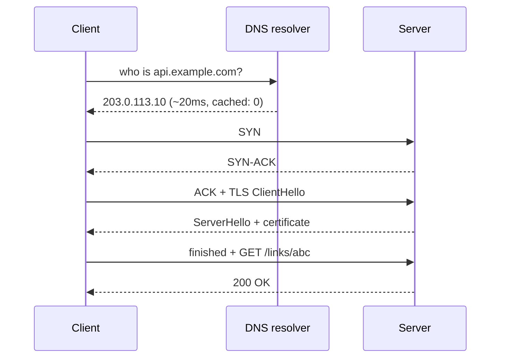
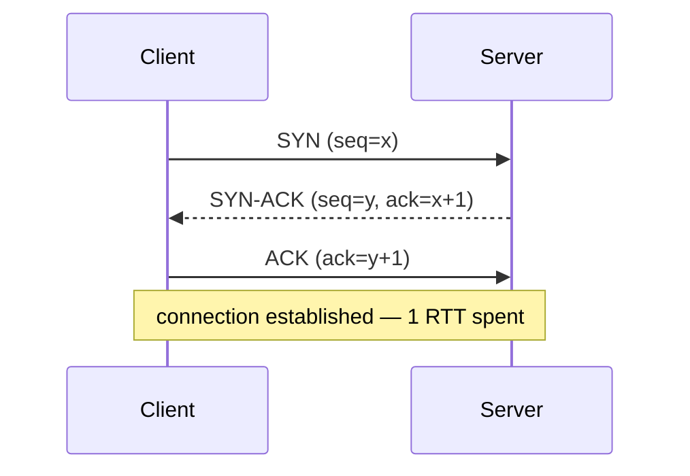
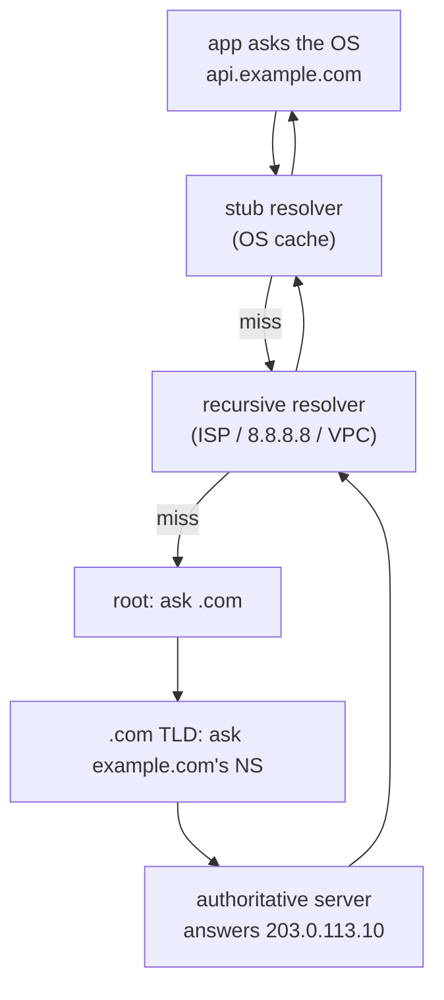

# Networking for backend engineers

Every chapter after this one assumes it. A request crossing a network is the
unit of work in a distributed system, and most of what "goes wrong at scale"
is a networking fact leaking upwards: a timeout that is really a TCP
retransmission, a latency floor that is really the speed of light, an outage
that is really an expired certificate.

You do not need to implement TCP. You need to be able to say what happens
between a user typing a URL and your handler running, and what each step costs.

---

## In brief

- **One request to a new host costs several round trips before any work
  happens** — DNS, the TCP handshake, then the TLS handshake. On a 70ms link
  that is ~200ms spent before your server reads a byte, which is why connection
  reuse is the single biggest client-side win available.
- **Latency has a floor and bandwidth does not.** Light in fibre covers roughly
  200km per millisecond, so London↔New York is ~35ms one way at best. You can
  buy more bandwidth; you cannot buy a shorter round trip, which is why
  cross-region synchronous writes are a design decision rather than a tuning
  problem.
- **TCP guarantees order, and that guarantee is also a failure mode.** One lost
  packet stalls everything behind it (head-of-line blocking), and HTTP/2's
  multiplexing does not fix it because the blocking is a layer below.
- **Every client call needs a connect timeout, a read timeout and a bounded
  pool.** A call with no timeout does not fail — it hangs, holds a connection,
  and turns one slow dependency into an exhausted pool and a dead service.
- **TLS certificate expiry is one of the most common self-inflicted outages**,
  because it breaks everything at once, on a schedule nobody is watching.
- **L4 load balancers move connections, L7 load balancers understand requests.**
  Only an L7 can route on path, retry a request safely, or add a header — and
  only an L4 is cheap enough to not care what is inside.
- **DNS is a cache with a TTL, not a switch.** Changing a record does not move
  traffic until the TTLs expire, which is why DNS is for planned moves and a
  load balancer is for failover in seconds.

---

## What one request actually does


*Three round trips of setup before the request is even sent. Every one of them disappears on the next request over the same connection, which is what keep-alive and connection pools buy.*

Step by step, with the cost of each:

1. **Resolve the name.** The client asks a resolver for `api.example.com`. If
   it is cached anywhere along the way, this is free; if not, it walks the
   hierarchy (below). Typically 0–50ms.
2. **Open a TCP connection.** SYN, SYN-ACK, ACK — one full round trip before
   any data can be sent.
3. **Negotiate TLS.** One more round trip in TLS 1.3 (two in 1.2), during which
   the server presents its certificate and both sides derive keys.
4. **Send the HTTP request**, and wait one more round trip for the first byte
   of the response.
5. **Reuse the connection** for the next request, which now costs only step 4.

On a link with 70ms round-trip time, a cold request is ~280ms of waiting and a
warm one is ~70ms. Nothing about your code changed.

---

## IP, packets and what a hop costs

The network layer (IP) moves **packets** between addresses, and does not
promise to deliver them, keep them in order, or deliver each one once. Routers
forward each packet towards its destination independently; a packet can be
dropped when a router's queue is full.

Two numbers describe any link, and they are independent:

- **Latency** — how long one packet takes to arrive. Bounded below by distance:
  light travels ~300km/ms in vacuum and ~200km/ms in fibre, and the route is
  never a straight line. Same-datacentre is ~0.5ms, same-region ~1–2ms,
  cross-continent 70–150ms.
- **Bandwidth** — how much data per second fits. You can buy more of this.

The practical consequence: **a chatty protocol is slow regardless of
bandwidth**. Ten sequential round trips over a 70ms link is 700ms whether the
link is 1Mbps or 10Gbps. Batching ten calls into one is a 10× improvement that
no amount of hardware delivers.

**MTU and fragmentation.** A link carries packets up to a maximum size
(typically 1500 bytes). Anything larger is split, and a lost fragment costs the
whole datagram. This is why "we send a 4MB JSON document" is not one event on
the wire but thousands of packets, any of which can be lost.

---

## TCP

TCP builds a reliable, ordered byte stream on top of an unreliable packet
service. Everything it gives you costs something.

### The handshake


*The cost is one round trip before a single byte of your request moves. It is also why a connection is worth keeping: the second request pays none of this.*

The three steps exchange initial sequence numbers so both sides can detect loss
and reordering. The important fact for a backend engineer is the cost: **1 RTT,
every time you open a connection to a host you are not already talking to.**

### Reliability, and head-of-line blocking

Every byte is numbered. The receiver acknowledges what it has; the sender
retransmits what is not acknowledged within a timeout derived from the measured
round-trip time.

This is where the guarantee bites. The receiver must deliver bytes **in order**,
so if packet 5 is lost, packets 6–20 sit in the kernel buffer, already arrived,
waiting. Your application sees nothing until the retransmission of 5 arrives,
one round trip later. That is **head-of-line blocking**, and it belongs to TCP,
not to HTTP. Remember this for HTTP/2 below.

### Congestion control and slow start

TCP does not know the capacity of the path, so it discovers it: it starts by
sending a small number of packets (**slow start**), doubles each round trip
while acknowledgements keep arriving, and backs off sharply when it detects
loss.

Two consequences people meet in production:

- **A new connection is slow even when the network is fast**, because the
  congestion window has not grown yet. Another argument for connection reuse.
- **Loss is interpreted as congestion.** On a lossy mobile link, TCP slows down
  in response to interference that has nothing to do with congestion.

### Sockets, ports and `TIME_WAIT`

A connection is identified by four things: source IP, source port, destination
IP, destination port. A client connecting repeatedly to one server varies only
the source port, and there are ~28,000 ephemeral ports by default.

When a connection closes, the side that closed first keeps it in **`TIME_WAIT`**
for about 60 seconds, so late packets from the old connection are not delivered
to a new one reusing the same tuple. A service opening and closing thousands of
connections per second to one upstream **runs out of ports** and starts failing
to connect — while the CPU is idle and the network is quiet. The fix is almost
never kernel tuning; it is connection pooling.

### UDP, in one paragraph

UDP is the packet service with nothing added: no handshake, no ordering, no
retransmission. You use it when late data is worthless (live audio and video),
when you want to implement your own reliability (QUIC, below), or for small
request/response protocols where a retry is cheaper than a connection (DNS).

---

## DNS

DNS turns a name into an address, through a hierarchy of caches.


*Every box is a cache with its own TTL. That is why a DNS change is a slow, uneven rollout rather than a switch you flip.*

**The record types that matter:** `A` (name → IPv4), `AAAA` (name → IPv6),
`CNAME` (name → another name, illegal at a zone apex), `TXT` (verification and
policy), `MX` (mail), and cloud-specific alias records that point at a managed
resource and are legal at the apex.

**TTL is the whole operational story.** A resolver caches an answer for its TTL,
and so does the OS, and so does the application runtime in some cases. A record
with a 3600-second TTL takes up to an hour to stop sending traffic to the old
address — and some clients cache beyond the TTL regardless. The standard move
is to **lower the TTL days before** a planned migration, not when you need it.
The same argument, applied to failover, is in
[the AWS ecosystem](../06-cloud-devops/01-aws-ecosystem.md) §Route 53: DNS is a
coarse, slow load balancer, fine for a region-level move and wrong for a canary.

**Where it bites in a service:** a runtime that resolves a hostname once at
startup and caches the result forever will keep hammering a replaced instance.
Long-lived processes should respect TTLs or re-resolve periodically.

---

## TLS

TLS gives you three things — confidentiality, integrity, and **identity** — and
the third is the one that causes outages.

### The handshake

In TLS 1.3 the handshake costs **one round trip** (1.2 cost two):

1. The client sends `ClientHello` with the versions and cipher suites it
   supports, plus a key share.
2. The server replies with its choice, its **certificate chain**, and its own
   key share.
3. Both derive the same symmetric key. Everything after this is encrypted with
   fast symmetric crypto — the expensive asymmetric work happens once.

**Session resumption** lets a returning client skip most of this with a ticket
from the previous session, and TLS 1.3's 0-RTT can send data in the first
packet — at the cost of replay risk, so it must only carry idempotent requests.

### Certificates, chains and expiry

A certificate binds a name to a public key and is signed by an intermediate,
which is signed by a root the client already trusts. The client checks: is the
chain valid, is the name right, is it in date, has it been revoked.

**Expiry is the outage.** A certificate works perfectly until a timestamp
passes, then fails for every client simultaneously. It is unusual among
failures in being completely predictable and still routinely missed. The
controls are automated renewal, and an alert on *days remaining* rather than on
failure.

### Where termination happens

- **Terminate at the edge** (load balancer or CDN): the expensive handshake
  happens once at the edge, close to the user, and your service speaks plain
  HTTP inside the perimeter. Simple and fast.
- **Re-encrypt to the origin**: the edge terminates, then opens its own TLS
  connection to your service. Costs more; required when the internal network is
  not a trust boundary, which is the zero-trust position (see
  [zero trust](../01-auth-identity/10-zero-trust-idps.md)).
- **Mutual TLS (mTLS)**: both sides present certificates, so the server knows
  which service is calling. This is service identity, and it is how a service
  mesh authenticates internal traffic.

---

## HTTP/1.1, 2 and 3

| | HTTP/1.1 | HTTP/2 | HTTP/3 |
| --- | --- | --- | --- |
| Transport | TCP | TCP | QUIC (over UDP) |
| Concurrency | One request per connection at a time; browsers open ~6 | Many streams multiplexed on one connection | Many streams, independent |
| Headers | Plain text, repeated every request | Binary, compressed (HPACK) | Binary, compressed (QPACK) |
| Head-of-line blocking | Per connection, at the HTTP layer | **Still present, at the TCP layer** | Solved: one stream's loss does not stall others |
| Server push | No | Yes (largely abandoned in practice) | Yes |

**Keep-alive** is the HTTP/1.1 feature that matters most: the connection stays
open after a response, so the next request skips TCP and TLS entirely. It is on
by default; the thing to check is that your client library actually pools and
reuses connections rather than creating one per call.

**Pipelining** — sending several HTTP/1.1 requests without waiting — exists on
paper and is effectively dead, because a slow first response blocks the rest.

**HTTP/2's multiplexing** lets many requests share one connection with no
blocking at the HTTP layer. But all those streams ride one TCP connection, and
TCP still delivers bytes in order — so **one lost packet stalls every stream**.
Under loss, HTTP/2 can be slower than HTTP/1.1 with six connections.

**HTTP/3** fixes exactly that by rebuilding reliability on UDP (QUIC), where
each stream is independent: loss on one does not block the others. It also
folds the TLS handshake into the transport handshake, so a connection costs one
round trip instead of two, and it survives a client changing network (a phone
moving from wifi to cellular keeps its connection id).

---

## Connection pooling and timeouts

This is the section that shows up in incidents.

**Every outbound call needs three bounds:**

| Bound | What it stops | Sane starting point |
| --- | --- | --- |
| **Connect timeout** | Hanging while opening a socket to a dead host | 1s inside a region |
| **Read/request timeout** | Hanging waiting for a response that will never come | Tighter than your own caller's timeout |
| **Pool size** | Unbounded concurrency to one dependency | Match the dependency's capacity, not your own |

**The cascade.** A dependency slows from 20ms to 5s. Requests pile up holding
pooled connections. The pool empties; new requests queue to acquire one; your
own callers' timeouts expire; your health check (if it is deep) starts failing;
the orchestrator restarts healthy instances. One slow dependency became an
outage, and the root cause is a missing timeout.

**Timeout budgets.** If your caller gives you 2s, you cannot spend 2s on one
dependency and still have time to respond. Each layer's timeout should be
strictly shorter than its caller's, with the remainder reserved for your own
work and a retry if you intend to make one.

**Retries need care**, because a retry storm is how a degraded service becomes
a dead one: retry only idempotent operations (see
[idempotency](26-idempotency-transactions.md)), bound the attempts, use
exponential backoff **with jitter**, and stop retrying when a circuit breaker
says the dependency is down ([resilience](29-resilience-rate-limiting.md)).

---

## L4 and L7 load balancing

- **L4** forwards TCP connections based on IP and port. It cannot see inside, so
  it cannot route on a path, retry a request, or add a header — and because it
  does not parse anything, it is extremely fast and protocol-agnostic.
- **L7** terminates the connection and understands HTTP. It can route on host
  and path, retry an idempotent request on another instance, add a request id,
  terminate TLS, enforce rate limits and shape headers.

Use L7 at the edge for anything HTTP, which is nearly always. Use L4 when you
need raw throughput or are balancing a non-HTTP protocol. The health-check
behaviour behind either is the part that decides whether a bad instance is
removed or your whole fleet is drained — that argument is in
[building blocks](35-building-blocks.md) §Load balancer.

---

## Building it

**Libraries**

| Need | Reach for | Why |
| --- | --- | --- |
| HTTP client with pooling | `undici` (Node), `net/http` with a tuned `Transport` (Go), `httpx` (Python) | All three pool by default; the defaults are the thing to check |
| Per-request deadline | `AbortSignal.timeout()` (Node), `context.WithTimeout` (Go), `httpx.Timeout` (Python) | A deadline that propagates beats a per-call timeout |
| Retry with backoff | A small hand-rolled helper, or the client's own policy | Five lines of backoff-with-jitter beats a dependency |
| TLS certificate expiry | An external monitor, not your own service | A service cannot alert on a certificate that stops it starting |

**Pseudocode — a client that cannot take the service down**

```ts
import { Agent, request } from 'undici';

// One agent for the process, not one per call. The agent owns the pool, so
// reusing it is what makes requests skip DNS, TCP and TLS on every call after
// the first.
const agent = new Agent({
  connections: 32,            // bound: never open more than this to one origin
  connect: { timeout: 1_000 },// stop hanging on a dead host
  keepAliveTimeout: 30_000,   // keep sockets warm between requests
});

async function getLink(id: string, budgetMs: number) {
  // The deadline comes from the caller's remaining budget, not a constant:
  // a timeout longer than your own caller's is a timeout that never fires.
  const signal = AbortSignal.timeout(budgetMs);
  const res = await request(`https://api.example.com/links/${id}`, {
    dispatcher: agent,
    signal,
    headers: { 'x-request-id': currentRequestId() },  // carry the trace through
  });
  if (res.statusCode >= 500) throw new UpstreamError(res.statusCode);
  return res.body.json();
}
```

**Checking the network, not guessing at it**

```bash
dig +trace api.example.com          # walk the DNS hierarchy, see every TTL
curl -w '%{time_namelookup} %{time_connect} %{time_appconnect} %{time_starttransfer}\n' \
     -o /dev/null -s https://api.example.com/healthz   # split the latency by phase
openssl s_client -connect api.example.com:443 | openssl x509 -noout -dates
ss -tan state time-wait | wc -l     # how close to port exhaustion
```

The `curl` line is the one worth memorising: it tells you whether 300ms was
DNS, the TCP handshake, TLS, or your own code — four very different bugs that
look identical from the outside.

---

## Interview Q&A

### Q: What happens, in order, between a user requesting your API and your handler running?
**Level:** foundation · **Tags:** networking, http, tls

<details><summary>Model answer</summary>

DNS first: the client resolves the hostname, through a chain of caches — the
OS stub resolver, a recursive resolver, and the authoritative server if nothing
has it. Cached, that is free; cold, it is tens of milliseconds.

Then TCP: a three-way handshake, one round trip, before any data can move.

Then TLS, if it is HTTPS: one round trip in 1.3, during which the server
presents its certificate chain and both sides derive a symmetric key.

Then the request itself, and one more round trip to the first byte of the
response. In between there is usually a load balancer terminating TLS at the
edge and forwarding to an instance, so what my handler sees is a plain HTTP
request with the client's details in headers.

The number that matters: on a 70ms link, a cold request spends about 280ms
before any work happens and a warm one about 70ms. That gap is why connection
reuse is the biggest client-side win there is, and why I check that a client
library is actually pooling rather than opening a connection per call.

</details>

**Follow-ups:**

1. Q: Which of those steps disappear on the second request?
   <details><summary>Answer</summary>

   DNS, if the answer is still cached, and both handshakes — the connection is
   kept open by keep-alive and reused from the pool, so the second request
   costs one round trip. That is also why a connection that has just been
   opened is slower than a warm one even beyond the handshakes: TCP's
   congestion window starts small and grows.

   </details>

### Q: A service gets slow and then starts failing entirely when one downstream dependency degrades. Why, and what prevents it?
**Level:** senior · **Tags:** networking, timeouts, resilience

<details><summary>Model answer</summary>

Almost always a missing or too-generous timeout plus an unbounded pool. The
dependency slows from 20ms to several seconds; requests to it do not fail, they
wait, and each one holds a pooled connection and a request-handling slot. The
pool empties, new requests queue to acquire a connection, and the service stops
responding to traffic that has nothing to do with that dependency.

The fixes, in order of effect: a connect timeout and a request timeout on every
outbound call, with the request timeout derived from the caller's remaining
budget so each layer is strictly tighter than the one above. A bounded pool
sized to what the dependency can actually absorb. A circuit breaker so that
once failures cross a threshold you stop sending calls and fail fast rather
than queueing. Bulkheads — separate pools per dependency — so a slow
non-critical call cannot consume the capacity that the critical path needs.

And retries done carefully: only on idempotent operations, bounded, with
exponential backoff and jitter, because synchronised retries turn a degraded
dependency into a dead one.

</details>

**Follow-ups:**

1. Q: Your service is healthy but cannot open new connections, and the CPU is idle. What would you check?
   <details><summary>Answer</summary>

   Ephemeral port exhaustion. A connection is identified by the four-tuple of
   source and destination IP and port, and talking to one upstream leaves only
   the source port varying — roughly 28,000 of them. A connection that closes
   sits in `TIME_WAIT` for about a minute on the side that closed first, so a
   service opening and closing thousands of connections a second to one host
   runs out.

   `ss -tan state time-wait | wc -l` shows it. The fix is connection pooling
   and keep-alive rather than kernel tuning: reuse a few hundred connections
   instead of creating a million.

   </details>

### Q: Why doesn't HTTP/2 eliminate head-of-line blocking, and what does?
**Level:** senior · **Tags:** networking, http, performance

<details><summary>Model answer</summary>

Because the blocking HTTP/2 removes and the blocking that remains are at
different layers. HTTP/1.1 blocks at the HTTP layer: one request per connection
at a time, so a slow response blocks the next request on that connection.
HTTP/2 fixes that with multiplexing — many streams interleaved on one
connection.

But all of those streams ride a single TCP connection, and TCP guarantees
in-order delivery of the byte stream. If one packet is lost, the kernel holds
back everything that arrived after it until the retransmission lands, no matter
which stream those bytes belong to. So a single loss stalls every stream at
once. Under packet loss, HTTP/2 on one connection can be slower than HTTP/1.1
across six.

HTTP/3 solves it by moving to QUIC over UDP and implementing reliability
per-stream, so loss on one stream does not block the others. It also merges the
TLS and transport handshakes into a single round trip, and identifies
connections by an id rather than by the four-tuple, so a client switching from
wifi to cellular keeps its connection.

</details>

### Q: What's the practical difference between an L4 and an L7 load balancer?
**Level:** intermediate · **Tags:** networking, load-balancing

<details><summary>Model answer</summary>

An L4 balancer forwards connections based on IP and port without looking
inside, so it is fast and works for any protocol — but it cannot route on a
path, cannot safely retry a request on another instance, and cannot add or read
a header.

An L7 balancer terminates the connection and parses HTTP, which buys path and
host routing, TLS termination, request ids, header manipulation, rate limiting
and retries of idempotent requests. It costs more CPU and is protocol-specific.

For an HTTP API I want L7 at the edge, essentially always. L4 is for raw
throughput, non-HTTP protocols, or a layer in front of the L7s.

The thing I would volunteer either way is the health-check behaviour, because
it decides what happens in a partial failure: shallow checks for liveness so a
dependency wobble does not drain the fleet, deeper checks for readiness so an
instance that cannot serve is taken out of rotation.

</details>

### Q: Why is DNS a poor mechanism for failover, and what do you use instead?
**Level:** intermediate · **Tags:** networking, dns, failover

<details><summary>Model answer</summary>

Because DNS is a hierarchy of caches with TTLs, not a routing switch. When you
change a record, every resolver, operating system and runtime that already has
the answer keeps using it until its copy expires — and some clients ignore the
TTL and cache longer. So a change takes effect unevenly over minutes to hours,
and you cannot pull traffic back quickly if the new target is bad.

That makes DNS right for planned, coarse moves: shifting a region, migrating a
whole stack, a weighted split you are happy to let roll out slowly. Lower the
TTL days in advance if you know a move is coming.

For failover in seconds you want something that holds the connection: a load
balancer with health checks taking an instance out of rotation, or a service
mesh. For a canary you want the load balancer to split traffic by percentage,
because you can reverse it instantly.

</details>

---

## What a weak answer sounds like

- **"It's just HTTP."** Not knowing that a cold request pays DNS, TCP and TLS
  before anything happens is the gap behind most "why is this slow" questions.
- **No timeouts named** when describing a call to another service.
- **"We'd add a retry"** with no mention of idempotency, backoff or jitter.
- **Confusing bandwidth and latency** — proposing a bigger pipe for a problem
  that is round trips.
- **"HTTP/2 fixes head-of-line blocking"** without the TCP qualifier.
- **Treating DNS as instant**, and proposing it as the failover mechanism.
- **Not knowing where TLS terminates** in their own architecture.

---

## Quiz

### MCQ: On a link with 70ms round-trip time, roughly how much time passes before your handler sees a brand-new HTTPS request, assuming an uncached DNS lookup?
- [ ] About 70ms — one round trip
- [x] Around 250–280ms — DNS, then the TCP handshake, then the TLS handshake, then the request itself, each costing roughly a round trip
- [ ] Under 10ms, because setup happens in parallel
- [ ] It depends only on bandwidth
**Why:** Setup is sequential: each step needs the previous one finished. This is the arithmetic behind connection reuse being the largest client-side win available — every one of those round trips disappears on the next request over the same connection.

### MCQ: Why does a single lost packet stall every stream on an HTTP/2 connection?
- [ ] HTTP/2 processes streams one at a time
- [x] All streams share one TCP connection, and TCP must deliver bytes in order — so the kernel holds back everything that arrived after the lost packet, regardless of which stream it belongs to
- [ ] HPACK header compression cannot recover from loss
- [ ] Because HTTP/2 disables retransmission
**Why:** The multiplexing HTTP/2 adds is above TCP, and the blocking is below it. HTTP/3 solves it by moving reliability into QUIC, where each stream recovers independently.

### MCQ: A service that talks to one upstream starts failing to open connections, while CPU and network are idle. What is the most likely cause?
- [ ] The upstream is rate limiting it
- [x] Ephemeral port exhaustion — connections closed by this side sit in `TIME_WAIT` for about a minute, and only the source port varies in the four-tuple, so a high connection churn runs out of ports
- [ ] DNS caching returned a stale address
- [ ] The TLS certificate expired
**Why:** The giveaway is that resources look healthy. The fix is connection pooling and keep-alive — reusing a few hundred connections rather than opening and closing thousands per second — not kernel tuning.

### MCQ: Why is lowering a DNS record's TTL *before* a planned migration the standard practice?
- [ ] It reduces the load on the authoritative server
- [x] Resolvers serve the cached answer for the length of the TTL, so a change only takes effect as caches expire — the TTL must already be low when you make the change, or the rollout takes as long as the old TTL
- [ ] It forces clients to use IPv6
- [ ] A low TTL makes DNS responses faster
**Why:** Lowering the TTL at the moment you need the change is too late: everyone who resolved before that still holds the long-lived answer. This is the same reason DNS is wrong for failover and fine for planned moves.

### MCQ: Which timeout relationship is correct between a service and the dependency it calls?
- [ ] The dependency timeout should match the caller's timeout exactly
- [x] The dependency timeout must be strictly shorter than the budget the caller gave you, leaving time for your own work and any retry you intend to make
- [ ] The dependency timeout should be longer, so slow calls still succeed
- [ ] Timeouts should be removed from internal calls, which are reliable
**Why:** A timeout equal to or longer than your caller's means your caller gives up first, so the work is wasted and you have no chance to return a useful error or fall back. Budgets shrink as you go down the call stack.

### MCQ: What does mutual TLS add over ordinary TLS?
- [ ] Stronger encryption of the payload
- [x] The server authenticates the client too, by requiring a client certificate — so a service knows which service is calling it rather than only that the connection is encrypted
- [ ] It removes the need for certificate rotation
- [ ] It allows TLS to run over UDP
**Why:** Ordinary TLS proves the server's identity to the client. mTLS makes identity bidirectional, which is how service meshes authenticate internal traffic and how the network stops being an implicit trust boundary.

### MCQ: Why can a new TCP connection be slow even on a fast, uncongested network?
- [ ] The DNS lookup is repeated per packet
- [x] TCP slow start begins with a small congestion window and grows it over several round trips, so a fresh connection cannot use the available bandwidth immediately
- [ ] TLS re-negotiates after every packet
- [ ] The MTU must be discovered byte by byte
**Why:** TCP has no way to know the path's capacity, so it probes for it. This is a second, less obvious reason to keep connections warm — not just skipping handshakes, but keeping a congestion window that has already grown.

---

## Glossary

- **RTT (round-trip time)** — how long a packet takes to reach the other side and its acknowledgement to come back; the unit of cost for everything in this chapter.
- **Three-way handshake** — SYN, SYN-ACK, ACK; TCP's one-RTT connection setup.
- **Head-of-line blocking** — later data waiting on earlier data; in TCP it is per connection and affects every HTTP/2 stream riding it.
- **Slow start** — TCP's probe for available capacity; why a fresh connection underperforms a warm one.
- **`TIME_WAIT`** — the ~60s state a closed connection lingers in on the closing side; the cause of port exhaustion under connection churn.
- **MTU** — the largest packet a link carries, typically 1500 bytes; larger payloads are split.
- **TTL (DNS)** — how long a resolver may cache an answer; the reason DNS changes roll out slowly.
- **Authoritative server** — the server that actually holds a zone's records, as opposed to the resolvers that cache them.
- **TLS termination** — where encryption ends and plain HTTP begins; at the edge, or re-encrypted to the origin.
- **mTLS** — mutual TLS; both sides present certificates, giving the server a verified caller identity.
- **QUIC** — the UDP-based transport under HTTP/3, with per-stream reliability and a merged TLS handshake.
- **Keep-alive** — holding a connection open for reuse after a response.
- **Connection pool** — a bounded set of reused connections to one upstream; the main defence against handshake cost and port exhaustion.
- **Timeout budget** — the remaining time a request has, shrinking at each layer so every call is bounded by its caller.
- **L4 / L7** — load balancing on connections versus on parsed HTTP requests.
