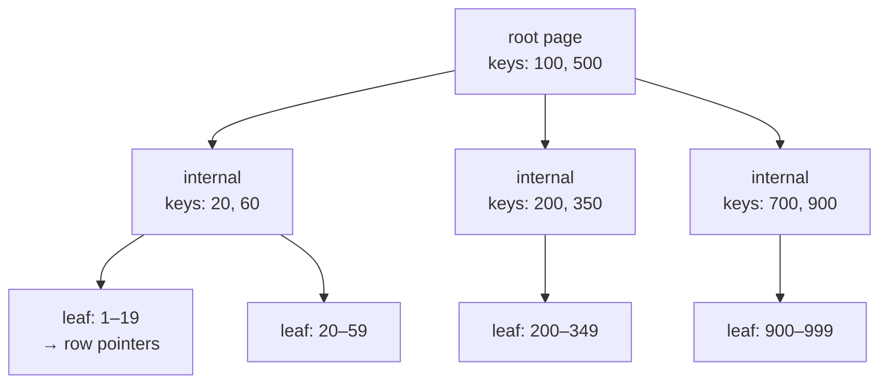
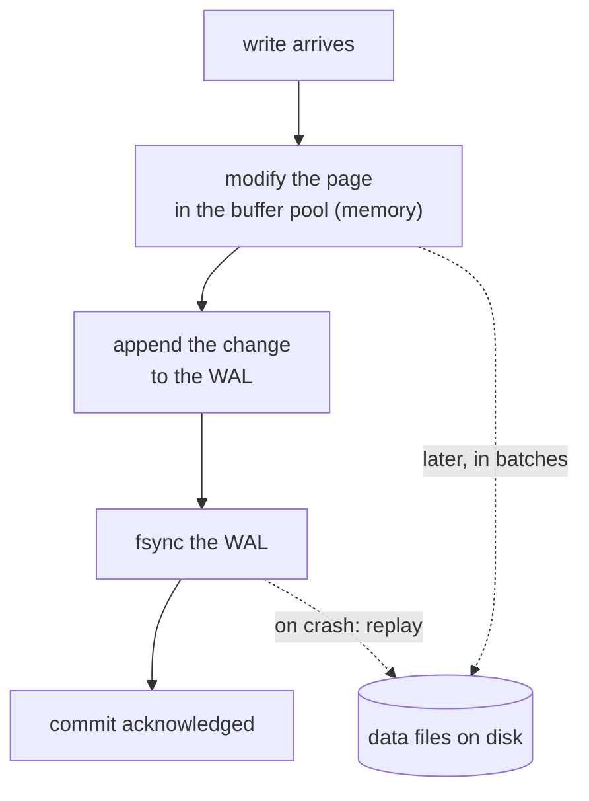

# Storage engines and transactions

Before you can reason about replicating a database, you need to be able to say
what the database does on one machine: how a row is found, how a write survives
a crash, and what a transaction actually promises.

This is also where a large share of "the database is slow" turns out to live.
An index, a lock and a long-running transaction explain more production
incidents than any distributed-systems subtlety.

---

## In brief

- **An index is a trade, not a free win**: it turns a scan into a lookup for
  reads, and makes every write do extra work to keep it current. "Add an index"
  is an answer that should come with "and here is what it costs".
- **B-tree and LSM are the two shapes**, and the choice is read versus write
  amplification. B-trees update in place and favour reads; LSM trees append and
  compact, favouring writes — which is why write-heavy and time-series stores
  are LSM-based.
- **Durability is a log append.** A database does not write your row to its
  final home before telling you it committed — it appends to a **write-ahead
  log** and `fsync`s that. The same log is what replication ships and what
  crash recovery replays.
- **Isolation levels are defined by the anomalies they permit**, not by how
  "strong" they sound. Read committed still allows non-repeatable reads;
  snapshot isolation still allows write skew; only serializable forbids
  everything.
- **MVCC lets readers not block writers** by keeping old row versions — and the
  bill arrives as bloat and vacuum work, which a long-running transaction makes
  worse by pinning versions nothing can clean up.
- **A deadlock is not a bug in the database**; it is two transactions taking
  the same locks in different orders. The database detects it and kills one.
  The fix is ordering discipline in your code.
- **"Fast" and "durable" are the same dial.** Group commit, `fsync` settings
  and synchronous replication all trade how much you lose on a crash against
  how many writes per second you get.

---

## How a row is found

A table's rows live in fixed-size **pages** (commonly 8KB) in a file. The
database reads and writes whole pages, and keeps recently used ones in memory
in the **buffer pool**. Everything below follows from that: the unit of IO is a
page, and the thing you are trying to avoid is reading pages you do not need.

Without an index, finding `WHERE email = 'x'` means a **sequential scan** —
read every page, check every row. That is fine for a thousand rows and
catastrophic for ten million.

### The B-tree


*Three or four page reads reach any row in a table of hundreds of millions, because each level multiplies the keys covered by hundreds. That shallow depth is the whole reason an index is fast.*

A B-tree keeps keys **sorted** in a shallow, wide tree. Each internal page
holds many keys and pointers, so a tree of depth 4 covers hundreds of millions
of rows. A lookup is: read the root, pick a child, read it, descend — three or
four page reads instead of a scan, and the top levels are almost always already
in the buffer pool.

Because the leaves are in sorted order and linked, a B-tree also serves
**ranges** (`WHERE created_at > …`) and **ordering** (`ORDER BY`) without a
sort. That is why the same index that speeds a lookup can remove a sort step.

### What indexes cost

Every index is a second structure that must be updated on every insert, update
of an indexed column, and delete. Five indexes mean a write does roughly six
writes' worth of structural work. The symptoms of over-indexing are slow
writes, a bigger buffer pool fighting over the same memory, and longer
vacuum/compaction.

### The index facts that decide query plans

- **Composite key order matters.** An index on `(tenant_id, created_at)` serves
  `WHERE tenant_id = ?`, and `WHERE tenant_id = ? AND created_at > ?`, and
  ordering by `created_at` within a tenant. It does **not** serve
  `WHERE created_at > ?` alone — the leading column must be constrained. This
  is the single most common index mistake.
- **A covering index** contains every column the query needs, so the database
  answers from the index alone and never touches the table pages. A huge win on
  hot queries, at the cost of a wider index.
- **Selectivity decides whether the index is used at all.** An index on a
  boolean that is 90% `true` is worse than a scan for that value, and the
  planner knows it: reading an index and then jumping to scattered table pages
  is more expensive than reading pages in order.
- **A function on the column disables the index.**
  `WHERE lower(email) = ?` cannot use an index on `email`; it needs an index on
  `lower(email)`.
- **`EXPLAIN ANALYZE` is the answer to "why is this slow"**, not intuition.
  What you are looking for: a sequential scan where you expected an index, a
  row-count estimate far from reality (stale statistics), and a nested loop
  over far more rows than expected.

---

## B-tree versus LSM

The second shape. An **LSM tree** (log-structured merge tree) never updates in
place:

1. Writes go to an in-memory sorted structure (the **memtable**) and to a log
   for durability. This is fast — no page to find, no page to rewrite.
2. When the memtable is full it is flushed to disk as an immutable sorted file
   (an **SSTable**).
3. Background **compaction** merges SSTables, discarding superseded values and
   tombstones for deletes.

A read may have to check the memtable and several SSTables, newest first, which
is why LSM engines keep **bloom filters** per file to skip the ones that
certainly do not contain the key.

| | B-tree | LSM tree |
| --- | --- | --- |
| Write path | Find the page, modify it, log it | Append to memory and a log |
| Write amplification | Lower per write, but random IO | Higher overall (compaction rewrites data repeatedly) but sequential |
| Read path | Direct, predictable | May check several files; bloom filters mitigate |
| Space | Fragmentation from in-place updates | Temporarily holds superseded versions until compaction |
| Hurts when | Write-heavy random inserts | Compaction competes with live traffic for IO |
| Found in | PostgreSQL, MySQL/InnoDB, most relational engines | Cassandra, RocksDB, LevelDB, HBase, Elasticsearch's segments |

The interview-sized version: **B-trees favour reads and predictable latency;
LSM trees favour sustained write throughput and pay for it with background
work.** This is the mechanism under the "wide-column — huge write volume, time
series" row in [building blocks](35-building-blocks.md) §The database types.

---

## The write-ahead log


*The commit is the log append, not the data-file write. Everything else — replication, point-in-time recovery, the outbox pattern — is built on that one fact.*

The rule is **write-ahead**: the change is in the log, and the log is on disk,
*before* the commit is acknowledged. The actual data pages are written later, in
batches, when it is efficient. If the process dies, recovery replays the log
from the last checkpoint and the committed changes reappear.

Three consequences worth carrying:

- **`fsync` is the durability boundary.** An `fsync` forces the OS to actually
  put bytes on the device, and it is slow — on spinning disks milliseconds, on
  SSDs tens of microseconds, but never free. Databases amortise it with **group
  commit**: many concurrent transactions share one `fsync`. Turning `fsync`
  down (`synchronous_commit = off` and friends) buys throughput by accepting
  that the last fraction of a second of commits can vanish in a crash.
- **A checkpoint** flushes dirty pages and lets the log be trimmed. Checkpoints
  are an IO spike, which is why "the database stalls periodically" is often a
  checkpoint tuning question.
- **The log is the replication stream.** A replica applies the primary's WAL —
  which is why replication lag is measured in log position, and why a replica
  is always a little behind. It is the same mechanism behind change-data
  capture and the outbox pattern in
  [idempotency and transactions](26-idempotency-transactions.md).

---

## Transactions

A transaction groups statements so they succeed or fail together. **ACID**, said
precisely:

- **Atomicity** — all of it applies, or none. Not about concurrency; about a
  partial failure not leaving half a change.
- **Consistency** — the database's own constraints (keys, uniqueness, checks)
  hold before and after. This is the weakest of the four and is mostly your
  schema's job, not the engine's.
- **Isolation** — concurrent transactions do not see each other's intermediate
  states. The interesting one, and the one with levels.
- **Durability** — once committed, it survives a crash. The WAL, above.

### Isolation levels, by the anomaly each allows

Define levels by what they **permit**, not by how strong they sound:

| Anomaly | What happens | Read uncommitted | Read committed | Repeatable read / snapshot | Serializable |
| --- | --- | --- | --- | --- | --- |
| **Dirty read** | You read a value another transaction has not committed, and it rolls back | allowed | prevented | prevented | prevented |
| **Non-repeatable read** | You read a row twice in one transaction and get different values | allowed | allowed | prevented | prevented |
| **Phantom read** | You run the same `WHERE` twice and new matching rows appear | allowed | allowed | prevented in snapshot engines | prevented |
| **Write skew** | Two transactions each read, each decide, each write — and together break an invariant neither broke alone | allowed | allowed | **allowed** | prevented |

**Write skew is the one that surprises people**, so it is worth the concrete
case. Rule: at least one doctor must be on call.

```
T1: SELECT count(*) FROM shifts WHERE on_call   -- sees 2, fine
T2: SELECT count(*) FROM shifts WHERE on_call   -- also sees 2, fine
T1: UPDATE shifts SET on_call = false WHERE doctor = 'alice'   -- ok, 1 left
T2: UPDATE shifts SET on_call = false WHERE doctor = 'bob'     -- ok, 1 left
both commit                                      -- 0 doctors on call
```

Both transactions read a consistent snapshot, both made a valid decision, and
the result violates the rule. Snapshot isolation does **not** stop this: they
touched different rows, so nothing conflicts. The fixes are serializable
isolation, an explicit lock (`SELECT … FOR UPDATE` on the rows the decision
depends on), or a constraint the database can enforce directly.

**The defaults differ**, which matters when you move between databases:
PostgreSQL and Oracle default to read committed; MySQL/InnoDB defaults to
repeatable read; PostgreSQL's "repeatable read" is snapshot isolation. Never
assume; check.

### MVCC

Multi-version concurrency control is how a database gives you a consistent
snapshot without making readers wait:

- Every row version is tagged with the transaction that created it and the one
  that deleted it.
- A transaction sees the versions that were committed when it started (or when
  its statement started, at read committed).
- **Readers never block writers, and writers never block readers.** Two writers
  touching the same row still conflict — one waits.

The cost arrives later: superseded versions accumulate and must be cleaned up
(PostgreSQL's `VACUUM`, InnoDB's purge). **A long-running transaction is the
classic self-inflicted wound**: while it is open, nothing newer than its
snapshot can be removed, so dead versions pile up, tables bloat, and scans get
slower across the whole database. An analytics query left open for an hour, or
a connection that began a transaction and went idle, does real damage.

### Optimistic versus pessimistic

- **Pessimistic**: take a lock first (`SELECT … FOR UPDATE`), so nobody else
  can change the row while you decide. Correct, simple, and it serialises the
  hot row — fine for low contention, a bottleneck for high.
- **Optimistic**: read a version number with the row, do the work, and write
  with `WHERE version = <what I read>`. If zero rows updated, someone beat you;
  re-read and retry. No locks held across think time; costs a retry loop.

Optimistic is usually right when conflicts are rare and the work between read
and write is slow (a user editing a form). Pessimistic is right when conflicts
are common and short (decrementing stock). The same version-number idea appears
as a cache key version in [caching at scale](28-caching-at-scale.md) and as a
zookie in [the identity subsystem](../10-design-cases/06-design-identity-subsystem.md).

### Deadlocks

Two transactions each hold a lock the other needs:

```
T1: UPDATE accounts WHERE id = 1   -- holds lock on 1
T2: UPDATE accounts WHERE id = 2   -- holds lock on 2
T1: UPDATE accounts WHERE id = 2   -- waits for T2
T2: UPDATE accounts WHERE id = 1   -- waits for T1  → deadlock
```

The database detects the cycle and kills one transaction with a deadlock error.
That is correct behaviour, not a fault: your side must retry. The prevention is
**ordering discipline** — always take locks in a consistent order (ascending
id, for instance) so a cycle cannot form — plus short transactions, because the
longer a lock is held the wider the window.

---

## Building it

**The things to actually do**

| Need | Do this | Why |
| --- | --- | --- |
| Find the slow query | `EXPLAIN (ANALYZE, BUFFERS)` | Estimates versus reality, and how many pages were actually read |
| Catch unindexed queries | `pg_stat_statements` / slow query log | Ranks by total time, which is where the win is — not by worst single run |
| Keep transactions short | Open late, commit early; never hold one across a network call | A transaction held across an HTTP call pins MVCC versions and holds locks |
| Avoid the N+1 | One query with a join or `IN`, not one per row | The classic 200ms-per-request cause that no index fixes |
| Bound a connection pool | Pool size ≈ what the database can serve, not what your app wants | Each connection is a backend process or thread on the server |
| Enforce an invariant | A constraint, if the database can express it | A unique index is cheaper and more reliable than any application check |

**Pseudocode — the two concurrency strategies, in the same place**

```ts
// Pessimistic: take the row lock, decide, write, commit. Other writers of this
// row wait. Right when contention is high and the decision is quick.
await db.tx(async (t) => {
  const item = await t.one(
    'SELECT stock FROM items WHERE id = $1 FOR UPDATE', [id]);   // lock held
  if (item.stock < qty) throw new OutOfStock();
  await t.none('UPDATE items SET stock = stock - $1 WHERE id = $2', [qty, id]);
});   // lock released at commit — keep this block free of network calls

// Optimistic: no lock across think time. The WHERE clause is the check —
// if someone else wrote first, version no longer matches and 0 rows change.
const doc = await db.one('SELECT body, version FROM docs WHERE id = $1', [id]);
const edited = await slowUserEdit(doc.body);          // seconds; no lock held
const { rowCount } = await db.result(
  'UPDATE docs SET body = $1, version = version + 1 WHERE id = $2 AND version = $3',
  [edited, id, doc.version]);
if (rowCount === 0) throw new ConflictError();        // caller re-reads and retries
```

**Reading a plan, in three lines**

```sql
EXPLAIN (ANALYZE, BUFFERS) SELECT * FROM links WHERE tenant_id = 7 ORDER BY created_at DESC LIMIT 20;
-- Seq Scan on links  (rows=2000000 ... actual rows=1998... )   <- wanted an index
-- Index Scan using links_tenant_created_idx  (actual rows=20)  <- composite index, no sort step
```

The second plan is what an index on `(tenant_id, created_at DESC)` buys: the
rows come out already ordered, so the `ORDER BY` and the `LIMIT` cost nothing
beyond reading twenty rows.

---

## Interview Q&A

### Q: A query that was fast is now slow, and nothing in the code changed. How do you work out why?
**Level:** intermediate · **Tags:** databases, indexes, performance

<details><summary>Model answer</summary>

Start with `EXPLAIN ANALYZE` on the real query with real parameters, and
compare the estimated row counts against the actual ones. A large gap means the
planner is working from stale statistics, and it has probably switched from an
index scan to a sequential scan because it thinks the table is a different
shape than it is.

The usual causes, in the order I would check them. Data growth crossing a
threshold: at a thousand rows a scan is fine, at ten million it is not, and the
plan may have been bad all along and only now visible. Statistics being stale
after a bulk load, which an `ANALYZE` fixes. A parameter that is unusually
unselective, so the index genuinely is worse for that value. Bloat from dead
tuples, which makes every scan read more pages — often caused by a long-running
transaction stopping vacuum from cleaning up.

And the two that are not about the query at all: lock contention, where the
query is waiting rather than working, and a buffer pool now too small for the
working set, so what used to be memory reads are disk reads. `BUFFERS` in the
plan distinguishes those.

</details>

**Follow-ups:**

1. Q: You have an index on `(tenant_id, created_at)`. Which of these use it — filtering on tenant, filtering on created_at, or both?
   <details><summary>Answer</summary>

   Tenant alone: yes. Both: yes, and it also serves ordering by `created_at`
   within a tenant without a sort step. `created_at` alone: no — a composite
   index is sorted by its leading column first, so without constraining
   `tenant_id` the rows you want are scattered across the whole index.

   That is the most common composite-index mistake, and the fix is either
   reordering the columns or adding a second index for the other access
   pattern — paying the write cost deliberately.

   </details>

### Q: Explain isolation levels by what each one allows.
**Level:** senior · **Tags:** databases, transactions, isolation

<details><summary>Model answer</summary>

Each level is defined by the anomalies it still permits.

Read uncommitted allows dirty reads — seeing another transaction's uncommitted
data, which may roll back. Almost nobody runs this deliberately.

Read committed prevents dirty reads: you only see committed data. But each
statement gets its own snapshot, so reading the same row twice in one
transaction can give different answers — a non-repeatable read. This is
PostgreSQL's default.

Repeatable read, or snapshot isolation, gives the whole transaction one
consistent snapshot, so repeated reads agree and phantoms are prevented in
snapshot-based engines. What it still allows is write skew: two transactions
each read a consistent state, each make a decision that is valid given what
they read, and write to different rows — and together they break an invariant.
The on-call example is the standard one: both see two doctors on call, both
remove one, and nobody is on call.

Serializable forbids all of it: the result must be equivalent to some serial
order. Modern implementations do it optimistically — they track read and write
sets and abort a transaction that would violate serializability — so the cost
is retries under contention rather than locking.

The practical point is that defaults differ between databases, so I check
rather than assume, and where an invariant spans rows I either go serializable
for that transaction, take an explicit lock on what the decision depends on, or
express the invariant as a constraint.

</details>

**Follow-ups:**

1. Q: How would you fix the on-call write skew without going serializable?
   <details><summary>Answer</summary>

   Lock what the decision depends on, so the second transaction cannot decide
   on stale information: `SELECT … FOR UPDATE` over the rows being counted, so
   the two transactions serialise on them. Or materialise the invariant into a
   single row that both must update — a counter of on-call doctors — because a
   conflict on one row is something the database can detect. Or express it as a
   constraint the database enforces directly, which is the most reliable
   version because it cannot be bypassed by a future code path.

   </details>

### Q: What does a database actually do when you commit, and why is that fast?
**Level:** intermediate · **Tags:** databases, durability, wal

<details><summary>Model answer</summary>

It appends the change to the write-ahead log and makes sure that log record is
on disk — an `fsync` — and then acknowledges the commit. The data pages
themselves are modified in the buffer pool in memory and written out later, in
batches, when it is efficient.

It is fast because an append to a log is sequential IO, and one `fsync` can
cover many concurrent transactions through group commit, where transactions
committing at the same moment share a single flush.

If the process dies, recovery replays the log forward from the last checkpoint,
so anything acknowledged is restored and anything not acknowledged is not
there. That is exactly what durability promises.

The same log does three other jobs worth naming: it is what replicas consume,
so replication lag is a log position; it is what point-in-time recovery replays
against a base backup; and it is what change-data-capture reads, which is the
reliable alternative to dual-writing to a queue.

</details>

**Follow-ups:**

1. Q: What do you give up by relaxing `fsync` on commit?
   <details><summary>Answer</summary>

   The last window of acknowledged commits — typically a fraction of a second —
   if the machine loses power or the OS crashes. The database stays consistent,
   because the log is still ordered and recovery still replays it; you just
   lose the tail that was acknowledged but not yet flushed.

   That is an acceptable trade for things like analytics ingestion or
   regenerable data, and not acceptable for anything a user was told succeeded —
   a payment, an order. It is a per-workload decision, and in Postgres it can
   be set per transaction rather than globally.

   </details>

### Q: When would you choose an LSM-based store over a B-tree one?
**Level:** senior · **Tags:** databases, storage-engines

<details><summary>Model answer</summary>

When the workload is write-heavy and the writes are spread across the key
space, which is where a B-tree hurts most: every insert has to find and modify
a page, so random inserts mean random IO and page splits.

An LSM tree turns that into an append to memory plus a sequential flush, and
defers the sorting work to background compaction. Time-series data, event
logs, metrics, high-volume counters — anything where ingest rate is the
constraint — are the natural fits, which is why Cassandra, RocksDB and
Elasticsearch's segment model are built that way.

What I would give up and should say out loud: read latency is less predictable,
because a read may check the memtable and several SSTables, and bloom filters
reduce but do not eliminate that. Compaction competes with live traffic for
disk IO, so you get periodic latency bumps unless it is tuned. And space usage
is temporarily higher, since superseded versions and tombstones live until
compaction removes them.

For a general-purpose transactional workload with mixed reads and writes and a
need for predictable latency, a B-tree engine is still the default, and I would
need a reason to move off it.

</details>

### Q: Your API holds a transaction open while calling a payment provider. What's wrong with that?
**Level:** senior · **Tags:** databases, transactions, locks

<details><summary>Answer</summary>

Two separate problems, both serious.

The lock problem: any rows the transaction touched are locked for the duration
of a network call you do not control. If the provider takes five seconds, every
other transaction wanting those rows waits five seconds, and with any
concurrency the queue grows faster than it drains.

The MVCC problem: while that transaction is open, the database cannot clean up
row versions newer than its snapshot. Vacuum stalls, dead tuples accumulate,
tables bloat and scans across the *whole database* get slower — a global effect
caused by one slow handler.

There is also a correctness problem: the external call is not transactional. If
the payment succeeds and the transaction then rolls back, you have taken money
and have no record of it.

The shape I would use instead: a short transaction to record the intent with a
pending state and an idempotency key, commit, make the external call outside
any transaction, then a second short transaction to record the outcome. A
background job reconciles anything stuck pending. That is the same reasoning as
the outbox pattern in the idempotency chapter.

</details>

---

## What a weak answer sounds like

- **"Add an index"** with no mention of what it costs on writes, or which
  columns in which order.
- **Listing ACID as four words** without being able to say what isolation
  levels permit.
- **"We use transactions, so it's safe"** — against write skew, at the default
  isolation level, it is not.
- **Not knowing the default isolation level** of the database they use daily.
- **Treating a deadlock as a database bug** rather than a lock-ordering problem
  with a retry.
- **"Durability means it's written to disk when I commit"** — the row is not;
  the log is.
- **Holding a transaction across a network call**, and not seeing the problem.

---

## Quiz

### MCQ: You have an index on `(tenant_id, created_at)`. Which query can use it efficiently?
- [ ] `WHERE created_at > now() - interval '1 day'`
- [x] `WHERE tenant_id = 7 ORDER BY created_at DESC LIMIT 20`
- [ ] `WHERE lower(name) = 'acme'`
- [ ] None — composite indexes only serve exact matches on all columns
**Why:** A composite index is sorted by its leading column first, so the leading column must be constrained. The bonus is that rows come out already ordered by `created_at` within the tenant, so the sort and limit cost almost nothing.

### MCQ: Two transactions each check that at least one doctor is on call, each see two, and each take a different doctor off call. Both commit under snapshot isolation. What happened?
- [ ] A dirty read
- [x] Write skew — both read a consistent snapshot, wrote to different rows so nothing conflicted, and together broke an invariant neither broke alone
- [ ] A phantom read
- [ ] A deadlock that the database resolved incorrectly
**Why:** Snapshot isolation only detects conflicts on the *same* rows. Fixing it needs serializable isolation, an explicit lock on the rows the decision depends on, or an invariant the database can enforce as a constraint.

### MCQ: What has actually been made durable when a database acknowledges a commit?
- [ ] The modified data pages, written to their final location on disk
- [x] The write-ahead log record for the change, flushed with `fsync`; the data pages are written later in batches, and recovery replays the log
- [ ] Nothing — durability is provided by the replica
- [ ] The entire table file, rewritten atomically
**Why:** Committing is a sequential log append plus a flush, which is why it is fast and why group commit helps. It is also why the same log can drive replication, point-in-time recovery and change-data capture.

### MCQ: Why does a long-running read transaction slow down the whole database under MVCC?
- [ ] It holds an exclusive lock on every table it reads
- [x] Its snapshot stops the cleanup of row versions newer than it, so dead versions accumulate, tables bloat, and every scan reads more pages
- [ ] It forces all other transactions to serializable isolation
- [ ] It disables the buffer pool
**Why:** MVCC keeps old versions so readers never block writers; the cost is garbage that vacuum must collect. An open snapshot pins that garbage, and the effect is global rather than limited to the tables that transaction touched.

### MCQ: What is the right response to a deadlock error from the database?
- [ ] Increase the lock timeout so it resolves itself
- [x] Retry the transaction, and separately make the code take locks in a consistent order so the cycle cannot form
- [ ] Switch the transaction to read uncommitted
- [ ] Drop the indexes involved
**Why:** Detecting the cycle and killing one transaction is correct behaviour, not a fault. The durable fix is ordering discipline — always locking rows in a deterministic order — plus keeping transactions short so the window is narrow.

### MCQ: When is an LSM-based engine the better choice over a B-tree?
- [ ] When reads must have the most predictable possible latency
- [x] When sustained write throughput across a wide key space is the constraint, and you can accept compaction's background IO and less predictable reads
- [ ] When the dataset is small enough to fit in memory
- [ ] When the workload needs serializable transactions
**Why:** LSM converts random writes into sequential ones and defers the ordering work to compaction. The price is read amplification (mitigated by bloom filters) and compaction competing with live traffic — which is why B-trees remain the default for mixed transactional workloads.

### MCQ: Optimistic concurrency control is usually the better fit when…
- [ ] Many transactions contend for the same row constantly
- [x] Conflicts are rare and there is slow "think time" between reading and writing, so holding a lock across it would be wasteful
- [ ] The database does not support transactions
- [ ] You need to avoid retries entirely
**Why:** Optimistic control holds no lock across the gap; it detects the conflict at write time via a version check and retries. Under heavy contention on one row the retry loop becomes the bottleneck, and a pessimistic lock is cheaper.

---

## Glossary

- **Page** — the fixed-size unit (commonly 8KB) a database reads and writes; the reason query cost is counted in pages, not rows.
- **Buffer pool** — the in-memory cache of pages; a working set that no longer fits is a common cause of sudden slowness.
- **Sequential scan** — reading every page of a table; fine when small, catastrophic when not.
- **B-tree** — a shallow, wide, sorted tree; three or four page reads reach any row, and the sorted leaves also serve ranges and ordering.
- **LSM tree** — writes appended to memory then flushed as immutable sorted files, merged by compaction; favours write throughput.
- **SSTable / memtable / compaction** — the on-disk file, the in-memory buffer, and the background merge of an LSM engine.
- **Bloom filter** — a probabilistic set membership test used to skip SSTables that certainly lack a key.
- **Covering index** — an index containing every column a query needs, so the table itself is never read.
- **Selectivity** — how much of the table a predicate eliminates; low selectivity is why the planner ignores an index.
- **Write-ahead log (WAL)** — the durable, ordered record of changes written before commit is acknowledged; also the replication and recovery stream.
- **`fsync`** — forcing bytes to the device; the durability boundary, and the reason group commit exists.
- **Checkpoint** — flushing dirty pages so the log can be trimmed; a periodic IO spike.
- **ACID** — atomicity, consistency, isolation, durability.
- **Dirty / non-repeatable / phantom read** — the three classic anomalies, prevented at successively stronger isolation levels.
- **Write skew** — two transactions each valid alone that together break an invariant; permitted by snapshot isolation.
- **MVCC** — keeping multiple row versions so readers never block writers; paid for with vacuum and bloat.
- **Vacuum / purge** — reclaiming superseded row versions; blocked by long-running transactions.
- **Optimistic vs pessimistic locking** — detect the conflict at write time with a version check, versus take the lock up front.
- **Deadlock** — a cycle of lock waits; detected and broken by the database, prevented by consistent lock ordering.
