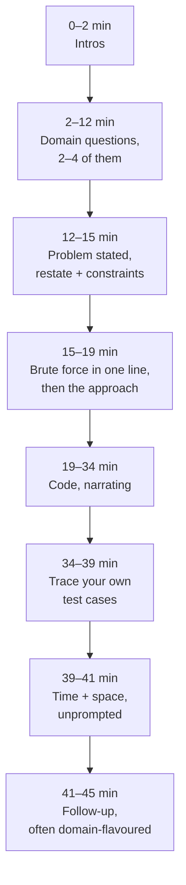

# The hybrid round

Some loops do not give coding its own slot. Security, infrastructure and
platform teams in particular often run a single forty-five minutes that is
*both* a domain-knowledge conversation and a coding problem, with one
interviewer and one write-up covering both. The invitation usually says so
in as many words — a round titled "domain knowledge and programming", or
"technical: area plus DSA".

That title changes how you should prepare, because it changes the arithmetic.
[The coding round](03-the-coding-round.md) teaches a clean forty-five minutes
in which the code is about a third of the time. Here the domain half takes
ten to fifteen of those minutes before the problem is even stated, and
nothing else shrinks to compensate — you still have to restate, still have to
give complexity, still have to test. The candidate who runs this round on the
standard script arrives at minute forty with a half-written function.

---

## In brief

- One interviewer, forty-five minutes, two things being graded: Role-Related
  Knowledge from the domain half and General Cognitive Ability from the problem.
- The domain half runs first and takes ten to fifteen minutes. Assume you get
  about twenty-five to thirty minutes of problem time, not forty-five.
- Answer domain questions in sixty to ninety seconds and *stop*. Over-answering
  the first question is the most common way to lose the coding time.
- Compress the approach phase, not the discipline. Brute force gets one
  sentence with its complexity, then you move; restating, complexity and
  testing all still happen, just faster.
- Aim to be typing by minute eighteen to twenty of the round.
- The two halves are often the same question wearing different clothes — a
  problem phrased in your domain's vocabulary. That is a gift: it lets you show
  judgement and code in the same breath.
- One write-up covers both halves, so a strong domain answer does not rescue a
  half-finished function, and vice versa.

---

## The 45 minutes, split

*Compared with the standalone round, the whole approach phase is squeezed into four minutes and the code starts nineteen minutes in — everything after it is unchanged.*

| Minute | Step | What changes versus the standalone round |
| --- | --- | --- |
| 2–12 | **Domain questions** | New. Two to four questions, each answered in 60–90 seconds. Offer one concrete example per answer, not three. Stop talking and let them pick the next thread |
| 12–15 | **Restate + constraints** | Unchanged in substance, faster in delivery. Ask the three questions that change your approach — size of *n*, duplicates/empties, sorted or not — and skip the ones that don't |
| 15–19 | **Brute force, then approach** | **This is what compresses.** One sentence: "the obvious version is nested loops, O(*n*²), too slow at 10⁵ — I'll index with a map instead." Do not enumerate three candidate approaches |
| 19–34 | **Code** | Unchanged. Narrate intent, name variables, leave a `// TODO` rather than stalling |
| 34–39 | **Test** | Unchanged and non-negotiable. Trace one real input and one edge case out loud |
| 39–41 | **Complexity** | Unchanged. Say it before being asked |
| 41–45 | **Follow-up** | Often reaches back into the domain half — "now the rules arrive as a stream", "now there are ten million of them" |

Two things to notice. **The interviewer is not trying to rush you** — they
have a fixed agenda and the domain questions are on it, so the time they take
is time they expect to take. And **you control the length of the domain half**
far more than you control anything else in the round.

---

## What the domain half actually asks

The questions are rarely trivia. They ladder, and the ladder is the same
every time:

1. **"What is *X*?"** — a definition. Sixty seconds. Name the mechanism, not
   the marketing phrase.
2. **"How would you detect that at scale?"** — now it's an engineering
   question. Inventory, signal, where the data comes from, what you'd
   evaluate it against.
3. **"What breaks?"** — failure modes, false positives, the cost of the
   control, who complains. This rung is where senior shows.
4. Sometimes **"and how would you fix it across ten thousand of them?"** —
   remediation at scale, which is the design round in miniature.

Most candidates answer rung 1 at length and never reach rung 3. The fix is
structural: answer rung 1 in two sentences, then *volunteer* the step to rung
2 — "the detection problem is the interesting part, want me to go there?" —
and let the interviewer either follow you or redirect. Either way you have
shown you know the ladder exists.

**The shape of a good answer.** Mechanism, then a concrete instance, then the
trade-off. "Workload identity means the platform vouches for the workload and
hands it a short-lived token, so there is no key file to leak. The instance:
federating a CI job into a cloud account instead of storing a service-account
key in the runner. The trade-off is that it only works where the platform can
attest — a box in a cupboard still needs a credential, and that's the one you
have to rotate."

**On not knowing.** The invitation says it explicitly, and it is true: saying
"I don't know" and then doing something useful with it scores. The useful
something is a comparison — "I haven't worked with that directly; it sounds
like the same problem as *Y*, which I have — is the mechanism similar?" That
turns a gap into a demonstration of how you learn, which is the attribute
actually being graded.

---

## The compressed coding half

What you drop, and what you must not:

| Drop | Keep |
| --- | --- |
| Enumerating three approaches and comparing them | Naming the one you chose **and why**, in a sentence |
| A worked trace of the brute force | Its complexity, stated |
| Asking every clarifying question on the list | The two or three whose answers change your code |
| Narrating syntax | Narrating intent |
| Tidying variable names at the end | Naming them properly the first time |
| A second optimisation pass | Saying what the next optimisation would be |

**The one-sentence brute force.** Practise it as a sentence, not as a stage.
"Brute force is compare every pair, O(*n*²) time and O(1) space; correct but
too slow at the size you gave me, so I'll trade space for time with a map and
get one pass." That is the entire approach phase. The interviewer heard that
you can characterise the naive solution — which is all the rubric line asks —
and you bought yourself eleven minutes.

**Start coding before you feel ready.** In a compressed round the cost of
thinking in silence is much higher than the cost of a function you refactor
once at minute twenty-eight. If you are still planning at minute twenty-two,
say "let me start writing the structure and fill the hard part in" and type
the signature, the loop skeleton and a `// TODO: the merge step`. Visible
progress keeps the interviewer writing.

**Name the thing you skipped.** Once, late, when you have working code:
"I kept this at O(*n* log *n*) with the sort — the linear-time version uses
counting because the keys are bounded, but it wasn't worth the risk in the
time." That sentence recovers almost everything a second pass would have
earned, and it costs ten seconds.

---

## When the two halves are the same question

The most common form of this round: the domain conversation ends and the
problem turns out to be a domain problem. Evaluate a policy. Resolve effective
permissions down a hierarchy. Match an address against ten thousand rules.
Find the shortest path by which a principal reaches something it shouldn't.
Diff two inventories. Those are all in
[security-flavoured problems](18-security-flavoured-problems.md), and all of
them are ordinary data-structure problems underneath — the vocabulary is a
costume.

Two moves pay off here:

**Strip the costume first, out loud.** "So underneath, this is reachability
over a directed graph where the edges are grant relationships — I'll do BFS
from the principal and stop when I touch the target set." Saying the mapping
proves you weren't pattern-matching on keywords, and it is the single
clearest signal of the attribute this round is built to measure.

**Then put the costume back on, once.** When you pick a default, choose the
one the domain demands and say why: deny wins over allow; an unknown is
treated as unsafe, not as absent; the window is inclusive at the start
because that's how the log records it. One such remark converts a correct
function into evidence of domain judgement — and it lands in the same
write-up as the domain half, reinforcing it.

What not to do is let the costume drive the algorithm. "It's about
certificates so I'll need crypto" is the trap; the problem is almost always a
walk over a map keyed by issuer. Ask yourself what the shape would be if the
nouns were renamed to `a`, `b` and `c`.

---

## Interview Q&A

### Q: The round is billed as domain knowledge plus coding in forty-five minutes. How do you budget it?
**Level:** senior · **Tags:** hybrid-round, time-management, process

Model answer

Assume the domain half takes ten to fifteen minutes and plan for twenty-five
to thirty minutes of problem time. Concretely: answer each domain question in
sixty to ninety seconds with mechanism, instance, trade-off, and stop rather
than filling silence. Once the problem arrives, restate and ask only the
clarifying questions whose answers change the code — typically the size of the
input, whether duplicates or empties occur, and whether it's sorted. Give the
brute force as one sentence with its complexity and move straight to the
approach you intend to write. Target typing by minute eighteen to twenty.

Keep everything after the code unchanged: trace a real input and an edge case,
and give time and space unprompted. Those are cheap and they are explicit
rubric lines — dropping them to buy coding time is the worst available trade.
If I'm running late I'd rather say "the linear version uses counting, I've
kept the sort for safety" than skip the test.

The thing I would actively manage is my own first answer. Over-answering
question one is how this round gets lost, and it's entirely within my control.

**Follow-ups:**
1. Q: The interviewer is still asking domain questions at minute twenty. What do you do?
   

Answer

   Nothing unilateral — their agenda is their business and the time is
   theirs to spend. But I'd make the trade explicit once, at a natural
   break: "happy to keep going on this; I also want to leave us enough
   room for the problem — which would you rather?" That is a collaborative
   question rather than a complaint, and it shows I'm tracking the clock,
   which is itself a signal. If they want to continue, I continue, and I
   accept that the problem will be scoped smaller. Interviewers who
   deliberately over-run usually intend to.
   

2. Q: Does a strong domain half compensate for unfinished code?
   

Answer

   Partly, and less than people hope. One interviewer writes one piece of
   feedback covering both, so the halves do inform each other — but they map
   to different attributes, Role-Related Knowledge and General Cognitive
   Ability, and a panel reading the packet sees a gap in the second one
   regardless of how the first went. The practical implication is that the
   coding half is the one to protect when time is tight, because the domain
   half is the easier of the two to demonstrate in a few sentences.
   

### Q: A domain question comes up that you genuinely don't know. Walk me through what you say.
**Level:** intermediate · **Tags:** hybrid-round, ambiguity, communication

Model answer

Say so immediately and briefly — "I haven't worked with that directly" — and
then do something with it rather than stopping. The useful move is to reach
for the nearest thing I do know and ask whether it transfers: "it sounds like
it's solving the same problem as *Y*, where the mechanism is *Z* — is that the
right analogy?" If the analogy holds, I can reason from it out loud and get
most of the way there, and the interviewer sees how I onboard onto something
unfamiliar, which is closer to the actual job than recall is. If it doesn't
hold, they'll correct me in one sentence and I've learned the thing.

The two failure modes are both worse than not knowing. Guessing confidently
gets found out on the follow-up and costs credibility on everything else I
said. Going silent produces nothing for them to write down. Hedged
waffle — using the vocabulary without the mechanism — is the version
interviewers spot fastest, because the next question is always "how?"

**Follow-ups:**
1. Q: How much hinting is it reasonable to ask for before it counts against you?
   

Answer

   Asking for a hint once, specifically, after you have made a real attempt,
   is close to free and is explicitly invited. "I can see the O(*n*²) version;
   I suspect there's a way to avoid re-scanning but I haven't spotted it —
   can you nudge me?" names what you tried and what you want. What costs you
   is asking before attempting anything, or asking repeatedly in a way that
   turns the interviewer into the author of the solution. Solving it with one
   hint is a good outcome; being walked through it is not.
   

### Q: The problem is stated in your domain's vocabulary. How do you open?
**Level:** senior · **Tags:** hybrid-round, problem-solving, pattern-recognition

Model answer

I translate it out loud before touching the algorithm: say what the nouns are
underneath and what the shape is. "Principals, roles and assume-role edges —
so this is reachability over a directed graph; I'd BFS from the principal and
stop when I reach the admin set, and I need to handle cycles because roles can
assume each other." Stating the mapping is the highest-value sentence in the
round, because the whole point of phrasing a problem this way is to see
whether you can strip the domain and find the structure.

Then I use the domain deliberately, but only for the defaults. Where a
behaviour is underspecified I pick the one the domain demands and say why in a
few words: a matching deny beats a matching allow, an unknown principal is
treated as unauthorised rather than ignored, a window is inclusive at its
start because that's how the log is written. Those remarks cost seconds and
they're what distinguishes someone who works in the area from someone who
read about it.

The trap is letting the vocabulary pick the technique — assuming a question
about certificates requires cryptography when it's a walk over a map keyed by
issuer. A useful check is to mentally rename the nouns to `a`, `b`, `c` and
see whether the problem gets easier. If it does, the domain was a costume.

### Q: How does preparing for this round differ from preparing for a standalone coding round?
**Level:** intermediate · **Tags:** hybrid-round, preparation, process

Model answer

Three differences. First, I practise problems on a twenty-five minute clock
rather than forty-five, because that's the real window — which mostly trains
the approach phase to be a sentence instead of a discussion. Second, I drill
the domain answers to a fixed shape and a fixed length, mechanism then
instance then trade-off in about ninety seconds, out loud, because an
unrehearsed domain answer expands to fill whatever time is available and the
time it eats is coding time. Third, I practise the two together in one sitting
— ten minutes of domain questions straight into a timed problem — because the
context switch is its own skill and doing it cold for the first time in the
round is expensive.

What I deliberately don't do is broaden. The temptation with a domain-plus-DSA
round is to revise more patterns; the constraint is almost never breadth, it's
the pacing. One extra pattern I half-know is worth less than the fifteen
minutes I reliably save by not over-answering question one.

---

## What a weak answer sounds like

- **A five-minute answer to the first domain question.** Everything that
  follows is now rushed, and nothing in the write-up says "thorough".
- **Vocabulary without mechanism.** Naming the acronym and then not being able
  to say what it does when asked "how?".
- **Running the standalone script anyway.** Three candidate approaches
  compared at minute twenty, code started at twenty-eight, no test.
- **Treating the domain framing as the algorithm.** Reaching for crypto
  because the nouns are certificates.
- **Dropping the test to finish the function.** An untested function and no
  complexity reads worse than a slower one with both.
- **Silence during the switch.** The problem arrives and the candidate thinks
  for ninety seconds without saying anything, in the round that can least
  afford it.
- **"I'd look that up."** True on the job, and an empty feedback line here.
  Look it up *out loud* — say what you'd compare it to.

---

## Quiz

### MCQ: In a 45-minute round combining domain questions and a coding problem, how much problem time should you plan for?
- [ ] The full 45 minutes; the domain questions run in parallel
- [x] About 25–30 minutes, because the domain half takes 10–15
- [ ] About 40 minutes; domain questions are usually a two-minute warm-up
- [ ] It varies too much to plan for
**Why:** The domain half is on the interviewer's agenda and takes the time it takes; planning for the standalone 45 is how candidates arrive at minute 40 with half a function.

### MCQ: What is the single best target length for an answer to a domain-knowledge question in this round?
- [ ] As long as it takes to be thorough
- [x] 60–90 seconds: mechanism, a concrete instance, the trade-off
- [ ] Under 15 seconds, to protect coding time
- [ ] Long enough to cover every related topic you know
**Why:** Over-answering question one is the most common way this round is lost, and it is the part of the clock the candidate actually controls; the three-part shape is what reaches the rung where senior shows.

### MCQ: Which part of the standard coding script is it correct to compress hardest?
- [x] The approach phase — brute force becomes one sentence with its complexity
- [ ] The test phase — skip tracing to buy coding time
- [ ] The complexity statement — wait to be asked
- [ ] The restatement — start from the interviewer's wording
**Why:** Testing and complexity are explicit rubric lines that cost seconds; enumerating and comparing candidate approaches is the expensive part that buys the least.

### MCQ: The domain-question ladder runs definition → detection at scale → what breaks. Where do most candidates stop?
- [ ] They skip the definition and go straight to failure modes
- [x] At the definition, having answered it at length
- [ ] At detection, because remediation needs design experience
- [ ] They reach the end but can't handle the follow-up
**Why:** The definition is the comfortable rung and expands to fill the time; the "what breaks" rung is where senior judgement is actually visible.

### MCQ: A problem is phrased with principals, roles and assume-role edges. What is the highest-value thing to say first?
- [ ] Which cloud provider's IAM semantics you're assuming
- [x] That it's reachability over a directed graph, and how you'll handle cycles
- [ ] That you'd use a library for graph traversal
- [ ] The time complexity of the brute-force version
**Why:** Stating the mapping from domain nouns to the underlying structure is exactly what a domain-flavoured problem is designed to test; the costume is there to see whether you can strip it.

### MCQ: You are at minute 22, still planning, and have written nothing. Best move?
- [ ] Keep planning silently until the approach is fully formed
- [ ] Ask the interviewer to extend the round
- [x] Say you'll write the structure now and fill the hard part in, then type the signature, loop and a `// TODO`
- [ ] Switch to the brute force and code that instead
**Why:** In a compressed round, silence costs more than a refactor; visible structure keeps the interviewer writing and usually surfaces the missing step anyway.

---

## Glossary

- **Hybrid round** — a single interview slot graded on both domain knowledge and a coding problem, with one interviewer and one write-up.
- **Domain half** — the first ten to fifteen minutes: two to four questions about the team's subject area.
- **The ladder** — the standard escalation of a domain question: definition, then detection at scale, then failure modes, then remediation.
- **One-sentence brute force** — stating the naive approach and its complexity in a single sentence, instead of working it through, to protect coding time.
- **Costume** — domain vocabulary wrapped around an ordinary data-structure problem; strip it to find the shape.
- **Role-Related Knowledge (RRK)** — the attribute the domain half feeds; depth in the area the team works in.
- **General Cognitive Ability (GCA)** — the attribute the problem feeds; how you approach and solve something unfamiliar.
