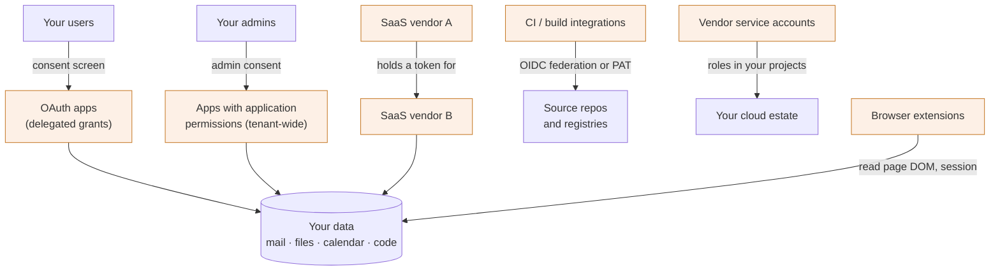
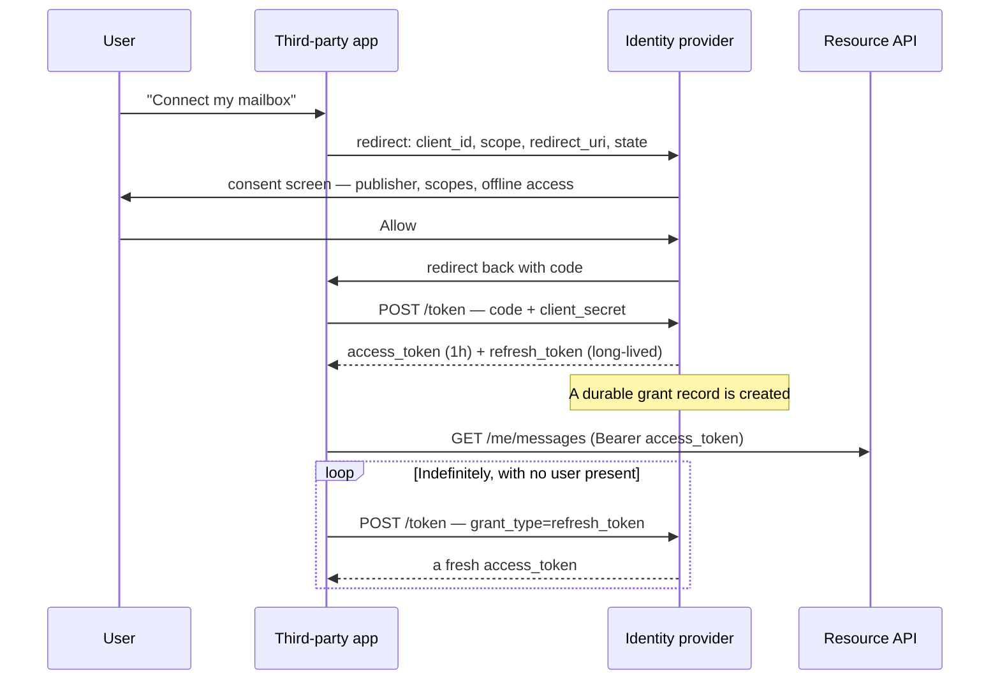

# Third-party platform security

Most organisations spend a decade building an identity perimeter — SSO,
MFA, conditional access, joiner-mover-leaver automation — and then hand a
standing copy of their data to four hundred vendors through a consent screen
that a user clicked in nine seconds.

That is the problem this chapter is about. It is not vendor risk management in
the procurement sense (questionnaires, attestations, contract clauses). It is
the engineering question underneath: *which external parties hold live access
to our data right now, what exactly can they reach, how would we know if that
changed, and how fast can we take it away?* Every one of those is an
inventory, authorization or token-lifecycle problem, which is why it belongs
next to [auth and identity](../01-auth-identity/01-foundations.md) rather than
in a compliance chapter.

The framing that makes this click: **a third-party integration is an identity
in your directory that you did not create, that no human reviews, that
survives the departure of the person who authorised it, and that is operated
by someone whose security you cannot inspect.** Treat it as a principal and
every control follows from least privilege, lifecycle and audit.

---

## In brief

- The surface is not just SaaS vendors. It is OAuth apps users have granted,
  SaaS-to-SaaS integrations, vendor service accounts inside your cloud,
  marketplace add-ons, browser extensions and CI integrations.
- **You cannot govern what you cannot list.** Grant inventory across the
  identity provider *and* every SaaS admin API is the foundational control;
  every other control is an opinion until it exists.
- A delegated grant is a standing credential. Unlike a session it does not
  expire at the end of the day, it is not covered by your MFA policy, and it
  usually survives the user being deprovisioned.
- Consent phishing bypasses every credential control you own: nothing is
  stolen, the user genuinely authorises a genuinely registered app.
- Scope is the blast radius. `mail.read` on one mailbox and `mail.read` across
  the tenant are the same string in different grant types — application
  permissions are the dangerous ones.
- Revocation is not one call. A token already issued may remain valid for its
  lifetime, SaaS-to-SaaS tokens held downstream are not yours to revoke, and
  caches lag.
- The question that arrives at 2am is *"vendor X was breached — what could
  they reach?"*, and answering it in an hour is purely a function of the
  inventory you built before.

---

## The surface

*Every shaded box is a principal outside your control holding live access inside it; the two paths that bypass your identity provider entirely are the vendor-to-vendor token and the browser extension.*

The categories, and what makes each one its own problem:

| Category | How access is obtained | Why it's hard |
| --- | --- | --- |
| **Delegated OAuth apps** | A user clicks consent; the app gets a token bounded by that user's own permissions | Granted by individuals at scale, invisible without an inventory, survives the user |
| **Apps with application permissions** | An *admin* consents; the app acts tenant-wide with no user context | One click grants org-wide reach; far rarer and far more dangerous |
| **SaaS-to-SaaS** | Vendor A is configured with a token for Vendor B | The token lives in A's infrastructure. You cannot see it, rotate it, or revoke it from your side |
| **Vendor service accounts in your cloud** | A role binding in your project, or a key file you issued | Often `Editor`-shaped because the narrow role wasn't obvious; see [cloud security](41-security-domain-knowledge.md#cloud-security) |
| **Marketplace add-ons** | Installed into a SaaS tenant by an admin or a user | Governed by that SaaS's own permission model, not yours; each platform differs |
| **Browser extensions** | Installed on a managed device; reads the DOM of any page the user opens | Sees post-authentication content and sometimes session material. No OAuth record exists at all |
| **CI and build integrations** | OIDC federation, a deploy key, or a long-lived PAT | Reaches source and artefacts — the supply-chain path, see [supply chain](41-security-domain-knowledge.md#software-supply-chain) |
| **Contractors and partner tenants** | Guest identities, cross-tenant access policies | Lifecycle is owned by someone else's HR system |

Two observations worth having ready. **The riskiest grant is rarely the
riskiest vendor** — a tiny utility with `files.readwrite.all` outranks a major
platform with one narrow scope. And **the distribution is long-tailed**: a
typical organisation has a handful of vendors under contract and hundreds of
grants nobody authorised centrally, which is exactly why procurement-driven
vendor registers miss the actual exposure.

---

## How the grant actually works

Delegated OAuth is the mechanism underneath most of this surface, so it is
worth walking once in full. The protocol itself is in
[OAuth 2](../01-auth-identity/02-oauth2.md); what matters here is which
artefacts persist afterwards, because those are what you govern.

*The loop at the bottom is the whole security problem: after one click the app renews its own access forever, with no user, no MFA and no session.*

### Who's who

- **Resource owner** — the user who clicks Allow. Can usually only grant what
  they themselves can reach.
- **Client** — the third-party app, identified by a `client_id` and
  authenticated with a secret it holds. Its *publisher* may or may not be
  verified by the platform.
- **Authorization server / IdP** — issues tokens and, crucially, **stores the
  grant**. This record is the thing your inventory reads.
- **Resource server** — the API that accepts the token and enforces scope.
- **You, the security team** — not a party to the exchange at all. You see it
  only afterwards, through admin APIs.

### The artefacts, and what breaks without each

| Artefact | What it is | What governs it | What breaks without control of it |
| --- | --- | --- | --- |
| `client_id` | The app's identity | App registration / allowlist policy | Any app can ask any user for anything |
| **Scopes** | What the token may do | Consent policy, admin review | Over-scoped apps become breach amplifiers |
| **Grant record** | The durable "user U allowed app A these scopes" | IdP admin API | No inventory, therefore no governance at all |
| `access_token` | Short-lived bearer credential, typically ~1h | Token lifetime policy | Minor on its own — it expires |
| `refresh_token` | Long-lived; mints new access tokens with no user | Rotation, revocation, lifetime policy | **Access outlives the user, the session, the password reset and often the leaver process** |
| `offline_access` / equivalent | The scope that *asks* for the refresh token | Consent policy | You cannot tell persistent integrations from one-off ones |
| **Publisher verification** | Platform attestation of who wrote the app | Platform policy, your allowlist | A look-alike app is indistinguishable from the real one |
| **Tenant / consent policy** | Who may consent to what | Your configuration | Users grant tenant data unilaterally |

The two rows to internalise: the **grant record** is what makes governance
possible, and the **refresh token** is why a grant is a standing credential
rather than a session. Nearly every attack path below is one of those two
being mishandled.

### Delegated versus application permissions

A distinction interviewers probe because it separates people who have
operated these platforms from people who have read about them.

| | Delegated | Application |
| --- | --- | --- |
| Acts as | The user, bounded by *their* access | Itself, bounded only by the grant |
| Consented by | The user (unless restricted) | An administrator |
| Blast radius | That user's data | Every mailbox / file / repo in the tenant |
| Typical use | A calendar assistant | A backup or e-discovery tool |
| Review priority | By scope sensitivity and user population | **Every single one, individually** |

Application permissions should be a short, hand-curated list with a named
owner each. If that list is long or unowned, that is the finding.

---

## The attack paths

**Consent phishing (illicit consent grant).** The attacker registers a real
app with a plausible name, sends a real link to a real consent screen, and the
user genuinely authorises it. No credential is stolen, so MFA, password
policy, impossible-travel detection and credential-stuffing defences are all
irrelevant — the control plane was never touched. Detection is behavioural:
a newly registered app acquiring grants from many users in a short window,
especially one requesting `mail.read` plus `offline_access`. The structural
fix is to stop users consenting unilaterally: restrict consent to verified
publishers and low-risk scopes, and route everything else to admin review.

**The over-scoped app whose vendor is breached.** The app did nothing wrong;
its vendor did. Your exposure equals the union of its scopes across every user
who granted it — which you can only compute if you have the inventory. This is
the common case and the one the 2am call is about.

**Access that outlives the user.** A user is deprovisioned; SCIM disables the
account; the app keeps refreshing. Whether that works depends on the platform
and the token type, and the honest answer in an interview is "it depends, and
you must verify it for each platform rather than assume" — some invalidate
refresh tokens on account disable, some do not, and application permissions
are not tied to a user at all. The control is to make grant revocation an
explicit step in the leaver process rather than a hoped-for side effect. This
is the [SCIM](../01-auth-identity/05-scim.md) lifecycle problem pointed
outward.

**SaaS-to-SaaS token chaining.** You authorise vendor A. An administrator at
vendor A connects vendor B to pull the same data. B is now processing your
data and you have no relationship with B, no grant record, and no revocation
path except asking A. This is where inventory genuinely runs out: you can only
discover it from A's own integration settings, which is why the control is
contractual plus configuration review rather than technical.

**Publisher takeover and the look-alike.** Either an attacker compromises a
legitimate app's publisher account and ships an update, or they register
something one character away from a trusted name. The first is a supply-chain
problem with no clean client-side answer beyond narrow scopes and detection;
the second is solved almost entirely by allowlisting rather than blocklisting.

**Over-privileged vendor service accounts.** The integration guide said
`Editor` because narrow roles are fiddly, so the vendor can now modify
anything in the project. Permission-usage analysis is the direct counter:
"this account used 6 of its 340 permissions in 90 days" is an argument no
vendor refuses.

**The extension nobody counted.** An extension with broad host permissions
reads the DOM of every page, after authentication, including data no API would
return. There is no OAuth grant, so grant inventory shows nothing. Governance
is device management and an extension allowlist — a different control plane,
which is exactly why extensions get missed.

---

## Governance controls

**Inventory first, and it is a join.** No single source has the whole picture,
so the inventory is assembled:

- IdP grant records — the authoritative list of OAuth grants and their scopes.
- Each SaaS platform's own admin API — marketplace add-ons and app installs
  that never touched your IdP.
- Cloud IAM bindings filtered to external principals and vendor accounts.
- Device management — installed extensions.
- Source-control and registry integrations, deploy keys, long-lived tokens.
- Procurement's vendor register — useful only for joining a `client_id` to a
  contract, a data classification and an owner.

The joined record you want per integration: app identity, publisher and
verification status, scopes, grant type, **how many and which users granted
it**, when each grant was created, when it was last used, the internal owner,
and the classification of the data it can reach. Last-used is the field that
turns the inventory into a remediation queue.

**Scope minimisation and consent policy.** The highest-leverage control, and
secure-by-design applied to consent: make the dangerous grant impossible
rather than detected. Concretely — users may consent only to verified
publishers and only to a low-risk scope list; anything touching mail, files,
or whole-tenant reads goes to admin review; application permissions are
individually approved and owned.

**Access reviews with expiry, not reviews alone.** A review that produces a
report changes nothing. Grants unused for *N* days are revoked automatically;
exceptions carry an owner and an expiry date rather than living forever. Do
not revoke on first run — start by notifying owners, because auto-revoking a
grant some team's production pipeline depends on is how the programme gets
cancelled.

**Token hygiene.** Short access-token lifetimes, refresh-token rotation with
reuse detection, and revocation that you have *tested* rather than assumed.
See [OAuth 2](../01-auth-identity/02-oauth2.md#how-it-actually-works) for the
mechanics.

**Prefer federation to keys.** Where a vendor or CI system needs access to
your cloud, OIDC federation beats an issued key file for the same reason
workload identity beats service-account keys: there is nothing durable to
leak. Covered in [cloud security](41-security-domain-knowledge.md#cloud-security).

**Vendor assessment is a floor.** SOC 2 and ISO 27001 tell you a vendor has a
programme, not that your data is safe. What you can verify yourself — scopes,
grant types, token lifetimes, whether they support federation, whether their
breach-notification clause has a number of hours in it — is worth more than
the questionnaire. Say that and then do not overcorrect into dismissing
compliance: it is how you get leverage to demand the technical controls.

---

## Incident readiness

The exercise that justifies the whole programme: **a vendor announces a
breach at 02:00. Within an hour, answer — what could they reach, whose data,
since when, and is their access cut off now?**

The hour, in order:

1. **Identify the principals.** Every `client_id`, service account, key and
   integration belonging to that vendor. From the inventory. If you are
   grepping configuration at this point, the answer will not arrive in an hour.
2. **Compute the exposure.** Union of scopes across every grant, mapped to
   data classes, with the user population per grant. "Read access to the
   mailboxes of 1,400 users since March" is the sentence leadership needs.
3. **Contain.** Revoke grants and disable service accounts. Then *verify*:
   issued access tokens may stay valid for their remaining lifetime, so note
   the window rather than claiming instant cut-off.
4. **Look for use.** Audit logs filtered by that `client_id`: volume against
   its baseline, new source IPs or regions, access to resources it never
   touched before. A per-app baseline built in advance is what makes this
   minutes rather than days.
5. **Scope the downstream.** Did that vendor hold tokens for others? Ask, and
   accept that you are relying on their answer.
6. **Decide on re-enablement** with an owner, narrower scopes and a date.

The thing to say out loud in an interview: steps 1 and 2 are *entirely*
determined by work done before the incident. There is no incident-time
substitute for the inventory, and that is the argument for funding it.

---

## Building it

If you had to build grant governance from nothing, in the order that delivers
value soonest:

- **Collectors per source** (IdP, each SaaS admin API, cloud IAM, MDM) —
  small, independent, scheduled pollers, each normalising into one integration
  record. Independent because every API differs in pagination, rate limits and
  freshness, and one flaky vendor API must not block the rest.
- **Storage** — a relational store. The access pattern is joins and reviews
  ("grants by scope sensitivity, unused 90 days, owner unset"), not key
  lookups. Keep raw payloads in object storage for replay when a schema
  surprises you.
- **Normalisation** — the hard part, and worth saying so: every platform names
  scopes differently, so you need a mapping from vendor scope strings to your
  own data classes and a sensitivity rank. Hand-curated, reviewed, versioned.
  This is where the project actually lives.
- **Policy evaluation** — rules over the normalised records
  ([OPA/Rego](../01-auth-identity/09-opa-rego.md) if you want them declarative
  and reviewable): unverified publisher with a sensitive scope; application
  permission without an owner; grant unused for 90 days; vendor account with
  wildcard cloud roles.
- **Workflow, not findings** — an owner per integration, a ticket with an SLA,
  auto-revoke only where safe and reversible, exceptions with expiry. A
  findings list with no owner column is a dashboard nobody opens.
- **Detection** — stream IdP and SaaS audit logs for new-app-acquiring-grants
  velocity, first-seen app with sensitive scopes, and per-app volume anomalies.
- **Deprovisioning hook** — grant revocation as an explicit step in the leaver
  workflow, with verification.

The design-round version of this, with capacity numbers, is
[design security systems](40-design-security-systems.md).

---

## Interview Q&A

### Q: How would you find out what third-party apps have access to your organisation's data?
**Level:** senior · **Tags:** third-party, inventory, oauth

Model answer

It's a join across sources, because no single one has the whole picture. The
identity provider's grant records are the backbone — they give app identity,
scopes, grant type and which users consented. But they miss a lot: each SaaS
platform has its own marketplace installs that never touched the IdP, so you
need every admin API separately; vendor service accounts show up only in cloud
IAM bindings; browser extensions have no OAuth record at all and come from
device management; CI integrations, deploy keys and long-lived tokens come
from source control. Procurement's vendor register is useful for joining a
`client_id` to a contract and a data classification, not for discovery —
most grants were never procured.

The record I want per integration: app identity, publisher and whether it's
verified, scopes, delegated versus application permission, how many and which
users granted it, when, **when it was last used**, the internal owner, and
what data class those scopes reach. Last-used is what turns an inventory into
a remediation queue, and owner is what makes anything actionable.

Then I'd rank by blast radius rather than by vendor size — a tiny utility with
tenant-wide file read outranks a major platform with one narrow scope. And
I'd treat the normalisation of scope strings to data classes as the real
project: every platform names things differently, and without that mapping
you can't compare two integrations or answer "who can read mail".

**Follow-ups:**
1. Q: The IdP shows 400 apps. Where do you start?
   

Answer

   Two filters first. Every app with *application* permissions, regardless of
   scope — those act tenant-wide with no user context, there should be few,
   and each needs a named owner. Then delegated grants ranked by scope
   sensitivity × user count. That's usually a few dozen that matter and a long
   tail of single-user grants to small utilities, which I'd handle with a
   blanket unused-in-90-days revocation rather than individually. I'd also
   explicitly separate "unverified publisher" as its own bucket — it's cheap
   to filter on and highly predictive.
   

2. Q: What can't this inventory see?
   

Answer

   SaaS-to-SaaS chaining, mainly: if vendor A has connected vendor B to pull
   the same data, there's no grant in my IdP and no record on my side at all.
   I can only find it by reviewing A's own integration settings, so the
   control is contractual and process-based rather than technical. Also:
   anything on unmanaged devices, extensions if MDM coverage is incomplete,
   and access via credentials shared out of band rather than granted. I'd
   state those gaps explicitly in any report, because an inventory presented
   as complete when it isn't is worse than one with known holes.
   

### Q: What is consent phishing, and why does it defeat controls that stop credential phishing?
**Level:** senior · **Tags:** third-party, oauth, phishing, detection

Model answer

The attacker registers a real OAuth app with a plausible name and sends a user
a link to a genuine consent screen on the real identity provider. The user
clicks Allow and the app receives a legitimate token, typically with
`offline_access` so it gets a refresh token and can renew indefinitely.

It defeats credential controls because no credential is involved. There's no
password to steal, so password policy and credential stuffing defences don't
apply. MFA is satisfied — the user authenticated properly. Impossible-travel
and anomalous-sign-in detection see nothing, because the subsequent access
comes from the app's own infrastructure using a valid token, not from a
suspicious sign-in. The domain in the URL is the real identity provider, so
URL-based phishing detection and user training that teaches "check the domain"
actively work against you here. And a password reset doesn't revoke it; only
revoking the grant does.

Detection is behavioural rather than credential-based: a newly registered app
acquiring grants from many users in a short window, unverified publishers
requesting sensitive scopes, `offline_access` combined with mail or file read.

But the real answer is structural — stop users consenting unilaterally. Users
may consent only to verified publishers and a low-risk scope list; anything
sensitive routes to admin review. That makes the attack impossible rather
than detectable, which is the same secure-by-design argument as org policy in
cloud: prevent the configuration rather than alert on it.

**Follow-ups:**
1. Q: Admin review for every sensitive-scope app sounds like it won't scale. Does it?
   

Answer

   It scales better than people expect, because the volume is long-tailed —
   the number of *distinct* apps requesting sensitive scopes is small even
   when the number of grant events is large, and once an app is approved it's
   approved for everyone. What doesn't scale is reviewing from a standing
   start with no context, so the queue needs the inventory data attached:
   publisher verification, what the app is, who else requested it, what the
   scopes map to. The failure mode to design against is review latency
   driving people to shadow workarounds — so there needs to be a fast path
   and a published turnaround, otherwise the control gets routed around.
   

### Q: A vendor you integrate with announces a breach. Walk me through the first hour.
**Level:** senior · **Tags:** third-party, incident-response, inventory

Model answer

First, identify every principal belonging to that vendor — `client_id`s,
service accounts, keys, integrations. That comes straight from the inventory;
if I'm grepping configuration at this point the hour is already lost, which is
the argument for having built it.

Second, compute exposure: the union of scopes across every grant, mapped to
data classes, with the user population per grant. Leadership needs one
sentence — "read access to the mailboxes of 1,400 users since March" — and
regulators need the same thing with dates.

Third, contain: revoke the grants, disable the service accounts. Then verify
rather than assume, because already-issued access tokens can stay valid for
their remaining lifetime; I'd state that window explicitly rather than claim
instant cut-off. I'd also check whether revocation actually propagated, since
caches lag.

Fourth, look for use. Audit logs filtered by that client: request volume
against its own baseline, new source IPs or regions, resources it never
touched before. A per-app baseline built in advance is what makes this minutes
instead of days.

Fifth, scope downstream — did that vendor hold tokens for anyone else? I can
only ask them, and I'd flag that dependency honestly.

Then a re-enablement decision with an owner, narrower scopes and a date rather
than leaving it off indefinitely and letting someone quietly re-grant it.

The thing I'd want to say explicitly: steps one and two are entirely
determined by work done before the incident. There's no incident-time
substitute.

**Follow-ups:**
1. Q: You revoke the grant. Is the vendor's access gone?
   

Answer

   Not necessarily, and overstating this is a credibility risk. Revoking the
   grant stops new access tokens being minted from the refresh token, but an
   access token already issued typically remains valid until it expires unless
   the resource server checks revocation on every call, which many don't for
   performance reasons. So there's a window — often up to an hour — and I'd
   report it as a window rather than as "access terminated". Beyond that:
   revocation propagation through caches isn't instant, application
   permissions may need separate handling, and anything the vendor already
   copied is gone regardless. Containment reduces future access; it doesn't
   undo past access.
   

### Q: What's the difference between delegated and application permissions, and why does it matter for review?
**Level:** senior · **Tags:** third-party, oauth, authorization

Model answer

A delegated permission lets the app act *as the user*, so the effective access
is the intersection of the granted scope and what that user can already reach.
A user without access to a given mailbox can't grant an app access to it. An
application permission lets the app act *as itself*, bounded only by the
grant — `mail.read` as an application permission means every mailbox in the
tenant, with no user context and no per-user intersection.

That changes review completely. Delegated grants I can triage statistically:
rank by scope sensitivity times user count, blanket-revoke the unused tail,
and accept that the blast radius of any one grant is one user's data.
Application permissions I review individually, every one, because a single
grant is tenant-wide. The population should be short, hand-curated, and every
entry should have a named internal owner who can say why it exists. If that
list is long or has unowned entries, that's the finding — it usually means
admin consent was granted ad hoc during integrations and never revisited.

The related trap is that the scope *string* is often identical between the
two, so an inventory that records scopes without recording the grant type is
actively misleading. Grant type has to be a first-class field.

### Q: Does deprovisioning a user remove the access they granted to third-party apps?
**Level:** senior · **Tags:** third-party, lifecycle, scim, oauth

Model answer

It depends on the platform and the grant type, and I'd be careful not to
assume. Some identity providers invalidate refresh tokens when an account is
disabled; others leave the grant intact so the app keeps refreshing. Anything
with application permissions isn't tied to a user at all, so a leaver process
can't touch it by definition. And where the app cached data or holds a token
in its own infrastructure, disabling the account does nothing to that.

So the safe design is to treat grant revocation as an explicit step in the
leaver workflow rather than a hoped-for side effect — enumerate that user's
grants, revoke them, and verify. That's the SCIM deprovisioning problem
pointed outward: we already built joiner-mover-leaver for internal access and
then left a class of external standing access outside it.

The way I'd actually establish the behaviour is to test it per platform rather
than read the documentation: disable a test account that holds a grant, then
try refreshing. That's a half-day of work and it replaces an assumption that
would otherwise sit under the whole leaver process. I'd also treat "access
seen from an app after its granting user was deprovisioned" as a detection
rule, because it catches the cases where the assumption was wrong.

### Q: How would you reduce the risk from over-scoped apps without blocking the business?
**Level:** senior · **Tags:** third-party, least-privilege, remediation

Model answer

Prevention first for anything new: restrict user consent to verified
publishers and a low-risk scope list, so over-scoped grants mostly stop being
created. That's cheap and it caps the growth of the problem, which matters
because the existing backlog is finite but the inflow isn't.

For what already exists, I'd use data rather than argument. Last-used per
grant and, where the platform exposes it, per-permission usage: "this
integration used 6 of its 340 permissions in 90 days" is a conversation
vendors and internal owners don't really argue with. Unused grants get
revoked on a notify-then-revoke cycle. Used-but-over-scoped gets a ticket to
the owner to request narrower scopes at the vendor, which is slower because it
depends on the vendor supporting granular scopes at all — and plenty don't,
which is itself a procurement input for renewal.

The thing I'd be deliberate about is not auto-revoking on the first run.
Revoking a grant some team's production pipeline depends on is how the
programme loses its mandate, and the political cost of one such incident
outweighs the risk reduction of acting a week sooner. Notify owners, give a
window, then revoke — and publish the schedule so it's predictable.

Where a vendor needs cloud access specifically, I'd push federation instead of
issued keys, which removes the durable credential entirely rather than
shrinking it.

### Q: What is SaaS-to-SaaS risk and what can you actually do about it?
**Level:** senior · **Tags:** third-party, saas, limits

Model answer

You authorise vendor A. An administrator at vendor A connects vendor B — say
an analytics or backup tool — which now processes the same data. You have no
relationship with B, no grant record for B, no contract with B, and no
technical revocation path except asking A to disconnect it.

What's genuinely hard is that this is invisible to every inventory source you
own. It didn't touch your IdP, it isn't in your cloud IAM, it isn't on a
device. The only place it exists is in A's own integration settings.

So the honest answer is that the controls are mostly non-technical. Contract
terms requiring disclosure and approval of sub-processors, with
breach-notification obligations that flow down. Periodic review of each major
vendor's integration configuration, which means someone actually logging into
A's admin console and reading the connected-apps list. Data minimisation at
the source — if A only ever receives what it needs, B's reach is bounded by
that regardless. And treating sub-processor lists as an input to vendor
selection rather than paperwork.

I'd also say plainly that this is a residual risk you manage rather than
eliminate, and that pretending the inventory covers it is the bigger mistake.
Being clear about the boundary of what a control covers is part of the job.

### Q: How would you detect a malicious OAuth app in your tenant?
**Level:** senior · **Tags:** third-party, detection, oauth

Model answer

Grant-time signals first, because they're the earliest. The strongest is
velocity: a newly registered app acquiring consent from many users in a short
window looks nothing like organic adoption, which is slow and clustered by
team. Then first-seen app requesting sensitive scopes, unverified publisher
plus `offline_access`, a redirect URI on a domain that doesn't match the
claimed publisher, and display names that are near-duplicates of apps already
in the tenant.

Use-time signals next, from the audit logs, keyed by `client_id`: request
volume against that app's own baseline rather than a global threshold,
first-ever access to a resource type, access from new source IPs or regions,
bulk enumeration patterns like reading every mailbox in sequence, and access
continuing after the granting user was deprovisioned.

The per-app baseline is the part worth building in advance — without it every
threshold is either noisy or useless, since a backup tool legitimately reads
everything and a calendar widget legitimately reads one thing.

That said, I'd rather prevent than detect here. Consent restricted to verified
publishers and low-risk scopes removes most of this attack surface outright,
and detection is the backstop for what policy allows through. Detection-only
means you're always finding out after the user clicked Allow.

### Q: How do you prioritise a list of 400 third-party integrations?
**Level:** intermediate · **Tags:** third-party, risk, remediation

Model answer

By blast radius, not by vendor reputation or contract value. Concretely I'd
rank on the data class the scopes reach, times the user population, weighted
up for application permissions since those are tenant-wide by definition, and
weighted up for unverified publishers.

That ordering usually produces three groups. Application permissions —
individually reviewed, every one, owner named. High-sensitivity delegated
grants across many users — reviewed as a set, scope reduction requested from
owners. And a long tail of single-user grants to small utilities, which isn't
worth individual attention and gets handled by a blanket unused-in-90-days
revocation.

Two adjustments I'd make to the naive ranking. Last-used, because an unused
grant is both high risk and *free to remove* — those jump the queue regardless
of score since there's no business conversation to have. And owner-unset,
because an integration nobody owns can't be remediated at all until that's
fixed, so it's a prerequisite rather than a finding.

Deliberately not a factor: vendor size. A two-person utility with tenant-wide
file read is a bigger exposure than a major platform with one narrow scope,
and ranking by brand recognition gets that exactly backwards.

---

## What a weak answer sounds like

- **"We'd review our vendors annually."** Procurement's list is not the
  exposure; most grants were never procured.
- **"SOC 2 means they're secure."** It means they have a programme. It says
  nothing about the scopes you granted them.
- **Confusing delegated and application permissions**, or recording scopes
  without the grant type — the inventory is then actively misleading.
- **"We'd just revoke access."** Without saying that issued access tokens
  survive for their lifetime, that application permissions need separate
  handling, or that data already copied is gone.
- **"MFA protects us from that."** The specific point of consent phishing is
  that the user authenticated correctly.
- **Auto-revoking on first run.** Technically right, organisationally fatal;
  one broken production pipeline ends the programme.
- **Claiming the inventory is complete.** SaaS-to-SaaS and extensions are not
  in it, and saying so is the senior move.
- **Treating this as a compliance exercise.** It is an identity, authorization
  and lifecycle problem that happens to have auditors interested in it.

---

## Quiz

### MCQ: What is the foundational control for third-party platform security?
- [ ] Vendor security questionnaires at onboarding
- [x] An inventory of every integration, its scopes, grant type, users and last use
- [ ] Blocking the OAuth consent screen entirely
- [ ] Requiring MFA before any consent
**Why:** You cannot govern, prioritise or respond to an incident over integrations you cannot list; every other control is an opinion until the inventory exists.

### MCQ: Why does consent phishing bypass MFA?
- [ ] It exploits a flaw in the MFA protocol
- [ ] It steals the session cookie after authentication
- [x] No credential is involved — the user authenticates correctly and genuinely authorises the app
- [ ] It only targets accounts where MFA is not enrolled
**Why:** The attack obtains a legitimate token through a legitimate flow, so every credential-centric control — MFA, password policy, impossible travel — is simply not in the path.

### MCQ: Which token artefact makes an OAuth grant a standing credential rather than a session?
- [ ] The access token
- [x] The refresh token
- [ ] The authorization code
- [ ] The client secret
**Why:** The refresh token lets the app mint new access tokens indefinitely with no user present, which is why a grant survives sessions, password resets and often the leaver process.

### MCQ: An app has `mail.read` as an *application* permission. What is the blast radius?
- [ ] The mailbox of the user who consented
- [ ] The mailboxes of every user who consented
- [x] Every mailbox in the tenant, with no user context
- [ ] Nothing until a user signs in to the app
**Why:** Application permissions let the app act as itself bounded only by the grant; there is no per-user intersection, which is why each one needs individual review and a named owner.

### MCQ: Your inventory is built from IdP grants, SaaS admin APIs, cloud IAM and MDM. What is still invisible?
- [ ] Apps with application permissions
- [ ] Browser extensions on managed devices
- [x] SaaS-to-SaaS integrations, where one vendor has connected another
- [ ] Delegated grants from deprovisioned users
**Why:** A vendor-to-vendor connection creates no record on your side at all; it exists only in that vendor's own integration settings, which is why the control is contractual rather than technical.

### MCQ: You revoke a grant during an incident. What should you tell leadership?
- [ ] Access was terminated immediately
- [x] New tokens can no longer be minted, but an issued access token may remain valid until it expires
- [ ] Access continues until the vendor confirms deletion
- [ ] The refresh token must also be rotated before access stops
**Why:** Many resource servers do not check revocation on every call, so there is a window — usually up to the access-token lifetime — and reporting it as a window rather than a clean cut-off is the accurate answer.

### MCQ: Why rank integrations by blast radius rather than by vendor size?
- [ ] Large vendors are breached less often
- [x] A small utility with tenant-wide scopes is a larger exposure than a major platform with one narrow scope
- [ ] Vendor size is not available in the inventory
- [ ] Contract value correlates poorly with uptime
**Why:** Exposure is a function of what the grant can reach and for how many users, not of the vendor's brand; ranking by recognition inverts the actual risk order.

### MCQ: Which field turns a grant inventory into a remediation queue?
- [ ] Publisher verification status
- [ ] The redirect URI
- [x] Last used
- [ ] The client secret's age
**Why:** An unused grant is both high risk and free to remove — there is no business conversation to have — so it jumps the queue regardless of its other attributes.

### MCQ: What is the strongest *grant-time* signal of a malicious OAuth app?
- [ ] A long list of requested scopes
- [x] A newly registered app acquiring consent from many users in a short window
- [ ] A redirect URI using HTTPS on a subdomain
- [ ] An app whose display name contains the company's name
**Why:** Organic adoption is slow and clusters by team; velocity from a first-seen app is the pattern that does not occur legitimately, and it fires before any data is read.

### MCQ: Why notify owners before auto-revoking unused grants?
- [ ] Revocation cannot be undone
- [ ] Regulations require advance notice
- [x] Revoking a grant a production pipeline depends on costs the programme its mandate
- [ ] The inventory's last-used field is unreliable
**Why:** The risk reduction from acting a week sooner is small; the organisational cost of one broken pipeline is large and lasting, so notify-then-revoke on a published schedule is the durable design.

---

## Glossary

- **Delegated permission** — a grant letting an app act as the consenting user, bounded by that user's own access.
- **Application permission** — a grant letting an app act as itself, tenant-wide, with no user context.
- **Grant record** — the durable "user U allowed app A these scopes" entry in the identity provider; the backbone of any inventory.
- **Consent phishing (illicit consent grant)** — obtaining a legitimate OAuth token by persuading a user to authorise an attacker-registered app.
- **`offline_access`** — the scope that requests a refresh token, and therefore the marker of a persistent rather than one-off integration.
- **Publisher verification** — a platform's attestation of who authored an app; the cheapest high-signal filter for allowlisting.
- **SaaS-to-SaaS** — one vendor holding credentials for another, processing your data with no record or revocation path on your side.
- **Sub-processor** — a third party a vendor shares your data with; disclosed contractually, not technically discoverable.
- **Blast radius** — the data class reachable by a grant multiplied by the user population it covers.
- **Notify-then-revoke** — remediating unused grants by warning owners on a published schedule before automatic revocation.
