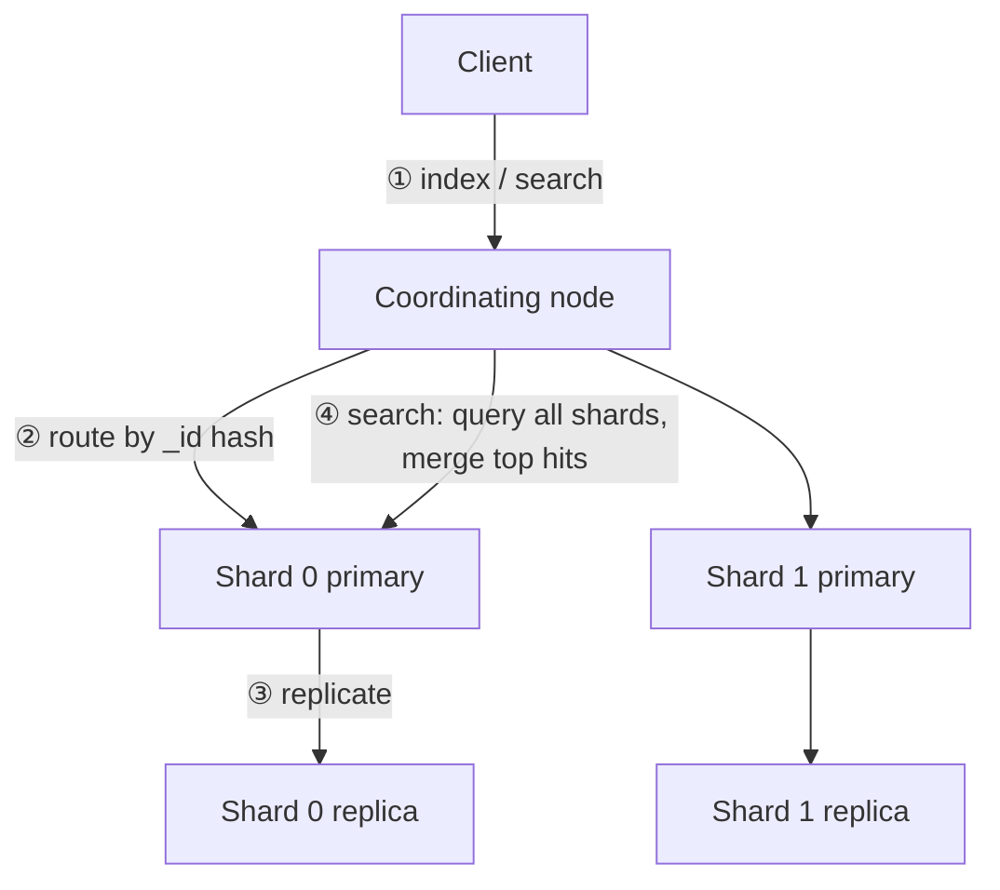

# Elasticsearch and OpenSearch

Search engines show up in interviews in two ways: as the answer to "how do you search or filter this at scale" in a design round, and as the logging and analytics store behind an observability stack. This chapter covers how Elasticsearch works, how to model data for it, and what goes wrong in production. Everything here applies to OpenSearch, the AWS-backed fork, except where noted.

---

## In brief

- **Elasticsearch is a distributed search engine built on Lucene.** Its core structure is the inverted index: a map from each term to the documents containing it. That is why full-text search, filtering and aggregations over millions of documents are fast, and why it is a poor primary database.
- **It is a derived read model, not a source of truth.** Keep the system of record in a database and feed the index from it (outbox or change data capture). It has no multi-document transactions, and writes become searchable only after a refresh.
- **Writes are near-real-time.** A document is searchable after the next *refresh* (default every second), durable after the *translog* is flushed, and segments are immutable, so updates and deletes rewrite or tombstone documents.
- **Mappings decide behaviour.** `text` fields are analyzed (tokenized) for full-text search; `keyword` fields are exact values for filters, sorting and aggregations. Choosing wrong is the most common modelling bug.
- **Scale is shards.** An index is split into primary shards (fixed at creation) with replicas for availability and read throughput. Too many small shards waste heap; too few cap parallelism.
- **Know the production failure modes:** mapping explosion, deep pagination, hot shards, heap pressure, and unbounded index growth for logs.

---

## How it works

### Data layout


*A request hits any node, which routes writes to the primary shard that owns the document and fans searches out to one copy of every shard, then merges the results.*

1. A client sends a request to any node; that node acts as the coordinating node.
2. A write is routed to a primary shard by `hash(_routing or _id) % number_of_primary_shards`. That modulus is why the primary shard count cannot change after creation (you can split or shrink with APIs, or reindex).
3. The primary applies the write, then forwards it to its replicas, and acknowledges once the in-sync copies have it.
4. A search runs on one copy of every shard in parallel (query phase), then fetches the winning documents (fetch phase), and the coordinating node merges them.

| Term | Meaning |
| --- | --- |
| Index | A named collection of documents, with a mapping and settings |
| Shard | A Lucene index; the unit of distribution |
| Primary / replica | The writable copy / a copy for failover and read scaling |
| Node roles | Master-eligible (cluster state), data, ingest, coordinating |
| Cluster health | Green (all shards assigned), yellow (a replica unassigned), red (a primary unassigned) |

### Near-real-time writes and durability

| Stage | What happens | Default |
| --- | --- | --- |
| Index request | Written to an in-memory buffer and the **translog** | |
| **Refresh** | Buffer becomes a searchable Lucene segment | Every 1 s |
| **Flush** | Segments committed to disk; translog truncated | Automatic |
| **Merge** | Small segments merged; deleted docs purged | Background |

Consequences to say aloud: a just-written document may not appear for up to a second; updates are "delete old, index new" because segments are immutable; heavy bulk loads should raise `refresh_interval` (or set it to `-1`) and restore it afterwards.

### Text, keyword and analysis

| Field type | Use for | Query with |
| --- | --- | --- |
| `text` | Full-text search | `match`, `match_phrase` (analyzed at index and query time) |
| `keyword` | IDs, enums, tags, exact filters, sorting, aggregations | `term`, `terms`, `range` |
| numeric, `date` | Ranges, sorting, histograms | `range` |
| `nested` | Arrays of objects that must be matched as units | `nested` query |
| `dense_vector` | Embeddings for vector (kNN) search | `knn` |

An **analyzer** is a char filter, then a tokenizer, then token filters (lowercase, stop words, stemming, synonyms). The text "Running Shoes" in a `text` field becomes terms like `running` and `shoes` (and with stemming, `run`). A common trick is a multi-field: index the same string as `text` for search and as `keyword` for sorting and aggregations.

### Relevance and queries

Results are scored with **BM25** (term frequency, inverse document frequency, field length). Compose queries with `bool`:

| Clause | Scores? | Cached? | Use for |
| --- | --- | --- | --- |
| `must` | Yes | No | Required relevance conditions |
| `should` | Yes | No | Optional boosts |
| `filter` | No | Yes | Exact conditions: category, price range, in stock |
| `must_not` | No | Yes | Exclusions |

Put everything that does not need scoring in `filter`: it is faster and cacheable. Aggregations (terms, range, date histogram, stats) power facets and dashboards and run on columnar `doc_values`, not on analyzed text.

### Pagination

`from + size` is limited by `index.max_result_window` (10,000 by default) because every shard must build and the coordinator must merge `from + size` hits. For deep or exhaustive paging use `search_after` with a **point in time (PIT)** and a tiebreaker sort; the scroll API is for old-style exports and is discouraged for user-facing paging.

### Operating it

| Concern | Guidance |
| --- | --- |
| Shard size | Often 10 to 50 GB per shard; avoid thousands of tiny shards (each costs heap and cluster state) |
| Heap | At most about half of RAM and under roughly 31 GB so the JVM keeps compressed object pointers; the rest is for the OS file cache |
| Time-series and logs | Data streams with **rollover** and **ILM** (hot, warm, cold, frozen, delete) so old data moves to cheaper storage and is dropped |
| Backups | Snapshots to object storage (S3) |
| Mapping explosion | Dynamic mapping on user-supplied keys creates unbounded fields; default limit is 1,000 fields per index. Map explicitly or use `flattened` |
| Backpressure | Rejected bulk or search requests return 429; slow down, retry with backoff |
| Split brain | Prevented in modern versions by voting configurations and quorum-based master election; run three master-eligible nodes |

### Elasticsearch versus OpenSearch

OpenSearch forked from Elasticsearch 7.10 in 2021 after Elastic moved off the Apache 2.0 license. Amazon OpenSearch Service is the managed AWS offering. APIs are similar for the basics but have diverged on newer features (security plugins, vector search, client libraries). When an interviewer says "Elasticsearch" on AWS, they usually mean OpenSearch Service in practice; say you are aware of the difference.

### Where it fits

| Use | Pattern |
| --- | --- |
| Product or document search | Database as truth, change events to an indexer, versioned upserts (see the catalog deep dive in [the e-commerce case](../10-design-cases/04-design-ecommerce-platform.md)) |
| Log and metric analytics | Shippers (Beats, Fluent Bit, Firehose) to data streams with ILM |
| Vector and hybrid search | `dense_vector` plus keyword scoring, used in retrieval for LLM apps (see [RAG and LLM bots](../07-ai-tooling/03-rag-and-llm-bots.md)) |
| Not a fit | Primary transactional store, strongly consistent counters, joins across large datasets |

---

## Building it

**Libraries**

| Need | Library | Why |
| --- | --- | --- |
| Elasticsearch client | `@elastic/elasticsearch` (v8) | Official, typed, supports bulk helpers |
| OpenSearch client | `@opensearch-project/opensearch` | Official client for OpenSearch and the AWS service |
| Bulk loading | the client's `helpers.bulk` | Batches, retries and backpressure handled |
| Sync from a DB | Outbox plus consumer, or Debezium CDC | Avoids dual writes |

**Setting it up (local, development only)**

1. `docker run -p 9200:9200 -e discovery.type=single-node -e xpack.security.enabled=false docker.elastic.co/elasticsearch/elasticsearch:8.15.0` (security off is for local use only; never expose it).
2. Check `curl localhost:9200` returns cluster info.
3. For AWS, create an Amazon OpenSearch Service domain, restrict access with a VPC and a resource policy, and use fine-grained access control rather than a public endpoint.

**Pseudocode: explicit mapping, bulk indexing, filtered search, deep paging**

```ts
import { Client } from '@elastic/elasticsearch';
const es = new Client({ node: process.env.ES_URL });

await es.indices.create({
  index: 'products-v1',
  settings: { number_of_shards: 3, number_of_replicas: 1 },
  mappings: {
    dynamic: 'strict',                       // no surprise fields, avoids mapping explosion
    properties: {
      id:       { type: 'keyword' },
      title:    { type: 'text', fields: { raw: { type: 'keyword' } } },
      category: { type: 'keyword' },
      price:    { type: 'scaled_float', scaling_factor: 100 },
      in_stock: { type: 'boolean' },
    },
  },
});

// Idempotent upsert keyed by id, guarded by the source row's version
await es.index({ index: 'products-v1', id: p.id, document: p, version: p.version, version_type: 'external' });

const res = await es.search({
  index: 'products',                         // an alias, so reindexing is a swap
  query: { bool: {
    must:   [{ match: { title: 'running shoes' } }],
    filter: [{ term: { category: 'footwear' } }, { range: { price: { lte: 100 } } }],
  } },
  sort: [{ _score: 'desc' }, { id: 'asc' }], // tiebreaker needed for search_after
  size: 20,
});
// next page: pass search_after: lastHit.sort, inside a point-in-time (pit) for stable results
```

`dynamic: 'strict'` and an alias are the two lines that prevent the most common production surprises. The external `version` makes out-of-order events harmless.

---

## Interview Q&A

### Q: Why is Elasticsearch fast for search but unsuitable as a primary database?
**Level:** intermediate · **Tags:** elasticsearch, search, architecture

<details><summary>Model answer</summary>

Search is fast because of the inverted index: looking up a term gives the matching documents directly, and filters and aggregations run on columnar doc values, across shards in parallel. It is unsuitable as a system of record because writes are only near-real-time, there are no multi-document transactions or joins, schema changes often mean reindexing, and recovery semantics are about availability of copies, not strict durability guarantees across documents. So I keep the truth in a database and treat the index as a rebuildable read model.

**Follow-ups:**

1. Q: How do you keep the index in sync with the database?
<details><summary>Answer</summary>

Write the change and an outbox row in one transaction, publish it, and have an indexer upsert with the row's version as an external version so older events cannot overwrite newer ones. Monitor indexer lag and keep a full reindex path. Avoid dual writes from the application: if one write fails the two stores diverge.
</details>

</details>

### Q: What is the difference between `text` and `keyword`, and when does it bite?
**Level:** foundation · **Tags:** elasticsearch, mapping

<details><summary>Model answer</summary>

`text` is analyzed into tokens for full-text matching; `keyword` stores the exact value for filters, sorting and aggregations. It bites when you filter with `term` on a `text` field (it compares against analyzed tokens, so "Running Shoes" will not match) or try to sort or aggregate on `text`. The usual fix is a multi-field with both, or choosing the type deliberately up front.
</details>

### Q: A search with `from: 50000, size: 20` is slow or rejected. Why, and what do you do?
**Level:** senior · **Tags:** elasticsearch, pagination, performance

<details><summary>Model answer</summary>

Each shard must collect `from + size` hits and the coordinator merges and discards all but the last 20, so cost grows with the offset; beyond `max_result_window` (10,000) it is rejected. Use `search_after` with a sort that includes a unique tiebreaker, inside a point in time for a consistent view. For product UX, also question the requirement: nobody pages to result 50,000, and a better filter or ranking is usually the answer.
</details>

### Q: How would you decide the number of shards for a new index?
**Level:** senior · **Tags:** elasticsearch, sizing

<details><summary>Model answer</summary>

Estimate the final data size and aim for shards in the tens of gigabytes, with enough primaries to spread indexing and search across the data nodes, but not so many that each is tiny, since every shard costs heap and cluster-state overhead. Primary count is fixed at creation, so for time-series data use rollover so each backing index is sized right, and for fixed catalogs leave headroom and plan a reindex through an alias. Replicas add availability and read capacity and can change at any time.

**Follow-ups:**

1. Q: What goes wrong with thousands of small shards?
<details><summary>Answer</summary>

Heap and cluster state bloat, slow master operations, slow recovery and many tiny segments to search. The fix is fewer, larger shards, rollover by size, and shrinking or force-merging old indices.
</details>

</details>

### Q: How do you reindex with zero downtime?
**Level:** senior · **Tags:** elasticsearch, operations

<details><summary>Model answer</summary>

Applications read and write through an alias. Create a new index with the new mapping, backfill it with the reindex API or from the source database, keep applying live changes to both, verify counts and queries, then switch the alias atomically and keep the old index for rollback.
</details>

### Q: How is a log analytics cluster managed differently from a search cluster?
**Level:** intermediate · **Tags:** elasticsearch, logs, ilm

<details><summary>Model answer</summary>

Logs are append-heavy, time-ordered and rarely updated, so I use data streams with rollover and index lifecycle management: recent data on fast hot nodes, older data moved to warm and cold tiers, and deleted after the retention period. Mappings are controlled to avoid explosion from arbitrary log fields, and ingest uses bulk with backpressure. Cost is driven by retention and cardinality, so what you log and how long you keep it is a cost decision.
</details>

## What a weak answer sounds like

> "I'd just put the data in Elasticsearch and query it. It's fast and scalable."

It treats the engine as the source of truth, gives no sync strategy, ignores mappings, shards, refresh latency and failure modes, and offers no reason it beats the database for this workload.

## Quiz

### MCQ: Which clause should hold conditions that do not need relevance scoring, such as `category = footwear`?
- [ ] `must`
- [x] `filter`
- [ ] `should`
- [ ] `boost`
**Why:** Filters skip scoring and are cached, so they are faster.

### MCQ: A document was indexed a moment ago but a search does not return it. Most likely reason?
- [ ] The document was lost
- [x] It is not searchable until the next refresh (default one second)
- [ ] Replicas must be restarted
- [ ] The mapping is dynamic
**Why:** Near-real-time search: segments become visible on refresh.

### MCQ: Why can the number of primary shards not simply be changed on an existing index?
- [ ] It can be, with no cost
- [x] Documents are routed by hashing against the primary shard count, so changing it would misplace documents; use split, shrink or reindex
- [ ] Replicas prevent it
- [ ] Only OpenSearch forbids it
**Why:** Routing depends on the shard count.

### MCQ: Which approach pages deeply through results safely?
- [ ] Increase `from` indefinitely
- [x] `search_after` with a tiebreaker sort, inside a point in time
- [ ] Raise `max_result_window` to a huge value
- [ ] Use wildcard queries
**Why:** Offset paging costs grow with the offset on every shard.

### MCQ: Dynamic mapping on user-supplied JSON keys is dangerous because...
- [ ] It makes searches slower by 1 ms
- [x] It can create an unbounded number of fields, causing mapping explosion and heap pressure
- [ ] It disables replicas
- [ ] It forces keyword fields
**Why:** Each new field adds cluster state; the default limit is 1,000 fields.

### MCQ: What is the safest way to change a mapping for a large live index?
- [ ] Delete and recreate during peak hours
- [x] Create a new index, backfill and sync it, then swap the alias
- [ ] Edit the mapping in place
- [ ] Restart the cluster
**Why:** Most mapping changes are not allowed in place; the alias swap avoids downtime.

## Glossary

| Term | Meaning |
| --- | --- |
| Inverted index | Map from terms to the documents that contain them |
| Analyzer | Char filters, tokenizer and token filters that turn text into terms |
| Shard | A Lucene index; unit of distribution and parallelism |
| Refresh | Making recent writes searchable (default 1 s) |
| Translog | Write-ahead log protecting writes not yet flushed to disk |
| BM25 | The default relevance scoring function |
| doc_values | Columnar on-disk structure used for sorting and aggregations |
| ILM | Index lifecycle management: hot, warm, cold, delete phases |
| PIT | Point in time: a consistent snapshot for paging |
| Alias | A name pointing to one or more indices, swappable atomically |
