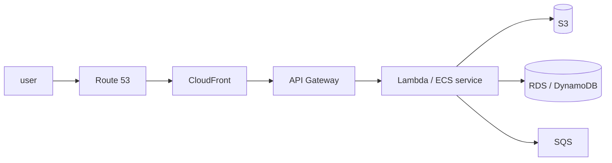

# The AWS ecosystem

Breadth matters more than depth here for a backend or platform role: know what
each service is for, the one or two gotchas per thing, and — the part most
candidates skip — what calling it from Node actually looks like.

---

## In brief

- **Prefer IAM roles over IAM users for anything programmatic** — a user's
  long-lived access keys leak (git, logs, laptops) and work until someone
  notices; a role's temporary credentials expire on their own, so the
  exposure window is small even if they escape. IAM policy evaluation is
  the same shape as any policy engine: explicit deny beats explicit allow,
  default is deny.
- **Lambda's constraints are what decide the choice, not vibes**: cold
  starts (bad on a latency-sensitive path), a 15-minute execution limit
  (rules out long jobs), and genuinely awkward connection management
  (thousands of concurrent invocations can exhaust a database's connection
  limit — RDS Proxy exists specifically for this). Cost inverts at volume:
  cheap idle, can exceed a plain server under sustained high load.
- **CloudFront's cache hit rate is the number that matters** — it
  determines both origin load and egress cost. Including a header or
  cookie that varies per user in the cache key means every request misses,
  producing a CDN that costs money and caches nothing. Since invalidation
  is slow and rate-limited, versioned URLs are the standard practice
  instead of purging.
- **DNS is a coarse, slow load balancer** — Route 53 weighted routing
  shifts traffic between stacks, but clients cache responses for the TTL,
  so you cannot pull traffic back instantly. A canary needs a load
  balancer or service mesh doing the split; DNS is for region-level or
  whole-stack moves.
- **API Gateway's job is coarse**: it validates a token and throttles, but it
  cannot know whether this user owns this record — so the owning service still
  authorizes. A gateway treated as the only check turns the internal network
  into an implicit trust zone.
- **A private subnet has no way out without a NAT gateway**, which is why
  putting a Lambda "in the VPC" to reach a database breaks its calls to
  external APIs. VPC endpoints keep S3 and Secrets Manager traffic off the
  internet and off the NAT bill.
- **Prefer an identity to a secret.** Every compute service has a role, and CI
  can federate with OIDC; the secrets store is for the credentials you cannot
  avoid, fetched at startup and never baked into an image.

---

## Which service for which job

Before the tour, the shape of the platform. Almost every AWS design answer is
drawn from this list, and knowing the one-line job of each is worth more than
deep knowledge of any one of them.

| Job | Service | The one thing to know |
| --- | --- | --- |
| Run a VM | **EC2** | Instance families and spot pricing; an instance role, never access keys |
| Run a container | **ECS / Fargate**, EKS | Fargate removes the host; see [containers, properly](06-containers.md) |
| Run a function | **Lambda** | Cold starts, 15-minute limit, connection exhaustion |
| Store files | **S3** | Presigned URLs; never make the bucket public |
| Serve an HTTP API | **API Gateway** | Authorizers and throttling live here, fine-grained authz does not |
| Cache at the edge | **CloudFront** | The cache key decides the hit rate |
| Resolve names | **Route 53** | Alias records, and TTL as the reason failover is slow |
| Decide who may do what | **IAM** | Explicit deny wins; roles over users |
| Queue work | **SQS** | At-least-once, so consumers must be idempotent |
| Fan out events | **SNS**, EventBridge | SNS for push to subscribers, EventBridge for routing on content |
| Hold secrets | **Secrets Manager**, Parameter Store | Rotation, and workload identity instead of issued keys |
| Private networking | **VPC** | Security groups, NACLs, and why a Lambda in a VPC needs a NAT |
| Watch it | **CloudWatch**, CloudTrail, X-Ray | Metrics/logs, audit, traces — [chapter 3](03-cloudwatch-cloudtrail-xray-cloudfront.md) |


*The default AWS request path. Each hop is a decision with a cost: CloudFront buys latency and origin relief, API Gateway buys authn and throttling, and the compute choice decides your connection-management problem.*

---

## The AWS services worth knowing

### EC2

Virtual machines. Know the shape of the offering rather than instance names:
compute-optimised, memory-optimised, general purpose.

**On-demand** (pay per hour), **reserved** (commit for a discount), **spot**
(cheap, can be reclaimed with two minutes' notice — good for batch and stateless
workers, bad for anything holding state).

**Auto Scaling Groups** add and remove instances based on a metric. The
practical trap: scaling on CPU when the real constraint is something else —
connection pool, memory, downstream latency. Scale on the thing that's actually
saturating.

### S3

Object storage. Effectively unlimited, very durable, cheap.

- **Storage classes** — Standard, Infrequent Access, Glacier. **Lifecycle
  rules** move objects between them automatically, which is usually the biggest
  cost lever you have.
- **Pre-signed URLs** — the pattern worth knowing: instead of proxying an
  upload or download through your servers, generate a time-limited signed URL
  and let the client talk to S3 directly. Saves bandwidth and load.
- **Never make a bucket public** unless you genuinely mean to. Public buckets
  are one of the most common cloud breaches.

### Lambda

Run a function without a server. Good for event-driven work, glue, scheduled
jobs and spiky traffic.

The gotchas:

- **Cold starts** — an idle function pays initialisation cost on first
  invocation. Worse for large bundles and JVM-style runtimes. Matters on a
  latency-sensitive path.
- **Time limit** (15 minutes) — not for long jobs.
- **No persistent state or connections.** Database connection pooling is
  genuinely awkward, because each concurrent invocation is its own environment.
  Thousands of concurrent Lambdas can exhaust a database's connection limit —
  RDS Proxy exists specifically for this.
- **Cost** at sustained high volume can exceed a plain server; Lambda is
  cheapest for spiky or low-volume work.

### API Gateway

A managed front door for HTTP APIs: it terminates TLS, authenticates, throttles
and routes to Lambda, a container service or any HTTP backend.

- **Two flavours.** **HTTP API** is cheaper and faster with a smaller feature
  set; **REST API** adds request/response transformation, API keys, usage plans
  and WAF integration. Default to HTTP API and move up only for a feature you
  can name.
- **Authorizers** are the interesting part. A **JWT authorizer** validates a
  token's signature, issuer and audience at the edge; a **Lambda authorizer**
  runs your own code and can cache its decision by token for a TTL. Either way
  this is *coarse* authorization — the gateway does not know whether this user
  owns this record, so the owning service still checks. Treating the gateway as
  the only check is how the internal network becomes an implicit trust zone.
- **Throttling** is per-stage and per-key, and it returns `429`. It is the
  cheapest rate limiter you will ever configure, and it protects the backend
  rather than the caller.
- **The timeout.** API Gateway caps a request at 30 seconds regardless of what
  the backend is willing to do, which is why long work goes on a queue and
  returns a job id.

### AWS IAM

Worth being precise about, given your background.

- **Users, roles, policies.** A **role** is assumed temporarily and issues
  short-lived credentials; a **user** has long-lived keys.
- **Prefer roles over users.** Long-lived access keys leak — into git, into
  logs, into laptop backups. Roles with temporary credentials remove that
  entire class of problem.
- **Policy evaluation:** explicit deny beats everything, then explicit allow,
  and the default is deny. Worth knowing because it's the same evaluation model
  as any policy engine.
- **Least privilege** — start with nothing and add. The common failure is
  `Action: "*"` because it was quicker.

A nice connection to make: AWS IAM is policy-as-data authorization at cloud
scale — the same shape as an application RBAC or OPA model, with resources,
actions, principals and conditions.

### VPC, in the five minutes it actually comes up

- A **VPC** is a private network; **subnets** divide it per availability zone,
  and are public (route to an internet gateway) or private (no direct route).
- **Security groups** are stateful allow-only rules attached to a resource —
  return traffic is automatically allowed. **NACLs** are stateless subnet-level
  rules with explicit deny. Reach for security groups; NACLs are for coarse
  subnet bans.
- **A private subnet has no outbound internet** without a **NAT gateway**,
  which is why a Lambda you put "in the VPC" to reach a database suddenly
  cannot call an external API. That is one of the most common AWS surprises,
  and it costs money per gigabyte.
- **VPC endpoints** let traffic to S3, DynamoDB or Secrets Manager stay on the
  AWS network instead of going out through NAT — cheaper and not internet-
  exposed.

### Secrets Manager and Parameter Store

Both store configuration; **Secrets Manager** adds managed rotation and costs
per secret, **Parameter Store** is effectively free for standard parameters and
does not rotate for you.

The rule that matters is the same one as IAM: **prefer an identity over a
secret.** An EC2 instance, an ECS task and a Lambda all have a role; a GitHub
Actions job can federate with OIDC. Use the store for the credentials you
genuinely cannot avoid — a third-party API key, a database password — fetch
them at startup rather than baking them into an image, cache the value, and
know what your service does if the store is unreachable mid-rotation.

### SQS, SNS and EventBridge

The messaging primitives, in one paragraph each, because the mechanics are in
[messaging in practice](../03-backend/06-messaging-in-practice.md).

- **SQS** — a queue. At-least-once delivery, so consumers must be idempotent;
  a visibility timeout that must exceed your processing time or the message is
  redelivered while you are still working on it; and a **DLQ** after N failed
  receives, which needs an alarm on its depth. FIFO queues add ordering and a
  throughput ceiling.
- **SNS** — push fan-out to subscribers (queues, Lambdas, HTTP, email). The
  standard pattern is **SNS → several SQS queues**, so each consumer gets its
  own buffer and retry behaviour.
- **EventBridge** — routing on event *content*, with schemas and a scheduler.
  Use it when "who cares about this event" is a rule rather than a hard-coded
  subscriber list.

### Route 53

DNS, plus health checks and routing policies. The parts that come up:

- **Records:** `A` to an IP, `CNAME` to another name, and AWS's **alias**
  record, which points at an AWS resource (ALB, CloudFront, S3 site). Alias is
  the one to know — it works at the zone apex, where `CNAME` is illegal, and
  it's free to query.
- **TTL is the thing that bites you.** A record cached at a resolver for its
  TTL means a failover doesn't take effect until it expires. Lowering TTL
  *before* a planned migration is the standard move; doing it after you need it
  is too late.
- **Routing policies** — weighted (send 10% to the new stack), latency-based,
  failover (primary with a health-checked standby), geolocation (data residency
  for enterprise tenants), and multivalue.
- **Health checks** watch an endpoint and take an unhealthy target out of
  rotation, which is what makes failover routing automatic.

The senior point: **DNS is a coarse, slow load balancer.** Route 53 weighted
routing is
a legitimate way to shift traffic between stacks, but because clients cache,
you cannot pull traffic back instantly — so for a canary you want a load
balancer or service mesh doing the split, and DNS for the region-level or
whole-stack move. Getting that distinction right is what the question is
usually testing.

### CloudFront and CloudWatch

Both are covered properly in
[CloudWatch, CloudTrail, X-Ray and CloudFront](03-cloudwatch-cloudtrail-xray-cloudfront.md).
The two sentences to carry into a design round:

- **CloudFront** is the CDN, and the **cache hit rate** is the number that
  drives both origin load and egress cost. Forward only what genuinely varies
  the response, and publish new assets at new versioned URLs rather than
  invalidating.
- **CloudWatch** is the default metrics, logs and alarms. Retention defaults to
  *never expire*, and **metric cardinality** — a dimension per tenant — is the
  cost driver.

---

## Building it

The question behind every AWS answer in a Node interview: what does the code
actually look like?

**Libraries**

| Need | Library | Why |
| --- | --- | --- |
| AWS APIs | `@aws-sdk/client-s3`, `@aws-sdk/client-sqs`, … | v3 is modular: import the one client you use, so the Lambda bundle stays small |
| Large uploads | `@aws-sdk/lib-storage` | Multipart upload with retries, instead of hand-rolling part management |
| Presigned URLs | `@aws-sdk/s3-request-presigner` | Signs a time-limited URL so clients transfer directly to S3 |
| Lambda plumbing | `@aws-lambda-powertools/*` | Structured logging, metrics and tracing with the conventions CloudWatch and X-Ray expect |
| Lambda middleware | `middy` | Composable before/after handlers — parsing, validation, error shaping |
| Types | `@types/aws-lambda` | `APIGatewayProxyEvent`, `SQSEvent`, `Context` — the handler signatures |
| Infrastructure as code | Terraform, or AWS CDK for TypeScript | CDK keeps IAM roles and function config in the same language as the app |

**Setting it up — an IAM role for a Lambda**

1. IAM console → **Roles → Create role** → trusted entity **AWS service →
   Lambda**. The trust policy is what lets the Lambda service assume the role;
   without it the function cannot start.
2. Attach a policy scoped to exactly what the function touches — one bucket's
   `GetObject`/`PutObject`, one queue's `ReceiveMessage` — never
   `AdministratorAccess` for a single-purpose function.
3. Add the managed `AWSLambdaBasicExecutionRole` so it can write its own logs,
   and `AWSLambdaVPCAccessExecutionRole` only if the function runs in a VPC.
4. Attach the role at creation, or
   `aws lambda update-function-configuration --role <arn>`.

**Pseudocode — the three things worth getting right**

```ts
import { S3Client, GetObjectCommand, PutObjectCommand } from '@aws-sdk/client-s3';
import { getSignedUrl } from '@aws-sdk/s3-request-presigner';
import type { APIGatewayProxyEvent, APIGatewayProxyResult } from 'aws-lambda';

// 1. Module scope, not inside the handler. A warm invocation reuses this
// client, its connection pool and its credentials; constructing it per request
// throws that away and re-resolves credentials every time.
const s3 = new S3Client({
  requestHandler: { requestTimeout: 3_000, connectionTimeout: 1_000 },
  maxAttempts: 3,          // SDK retries with exponential backoff and jitter
});

// 2. No credentials in code. The default provider chain resolves, in order:
// env vars -> shared config -> container/ECS task role -> EC2 instance role.
// On Lambda that means the execution role, so nothing is ever issued or stored.

export const handler = async (e: APIGatewayProxyEvent): Promise<APIGatewayProxyResult> => {
  const key = `uploads/${e.requestContext.requestId}`;

  // 3. Presigned URL: the client PUTs straight to S3. A 2GB file never passes
  // through the function, so you are not billed for the transfer time and the
  // 30-second API Gateway timeout is irrelevant.
  const url = await getSignedUrl(s3, new PutObjectCommand({ Bucket: process.env.BUCKET!, Key: key }), {
    expiresIn: 900,        // short: a leaked URL stops working
  });

  return { statusCode: 200, body: JSON.stringify({ url, key }) };
};
```

Two more rules that come up as follow-ups. **Set a timeout shorter than the
caller's** — a function that waits 30 seconds on a dependency behind a
30-second gateway guarantees a 504 with no useful error. And **make the handler
idempotent**: SQS and EventBridge deliver at least once, so a duplicate
invocation must be safe (see
[idempotency](../02-interview-core/26-idempotency-transactions.md)).

---

## Interview Q&A

### Q: When would you use Lambda instead of a container?
**Level:** intermediate · **Tags:** aws, serverless

<details><summary>Model answer</summary>

Lambda for event-driven and spiky work: reacting to an S3 upload or a queue
message, scheduled jobs, glue between services, or anything where traffic is
low or very uneven. You pay per invocation, so idle costs nothing, and there's
no capacity to manage.

Containers for steady traffic, long-running processes, anything latency-
sensitive, and anything needing persistent connections.

The constraints that decide it: **cold starts** add latency on the first
invocation after idle, which is bad on a user-facing path; the **15-minute
limit** rules out long jobs; and **connection management** is genuinely awkward,
because each concurrent invocation is its own environment, so thousands of
Lambdas can exhaust a database's connection limit — which is what RDS Proxy
exists to solve.

Cost inverts at volume too. Lambda is cheap when idle and can be more expensive
than a plain server under sustained load.

For an auth service at 30,000 requests per second I'd use containers without
hesitating — steady high volume, latency-sensitive, and it needs connection
pooling.

</details>

**Follow-ups:**

1. Q: Your Lambda behind API Gateway starts returning 504s under load. Where do you look?
   <details><summary>Answer</summary>

   In order: concurrency, then the timeouts, then connections. Account
   concurrency limits and reserved concurrency cause throttles that surface as
   errors rather than queuing; the function timeout must be *shorter* than the
   gateway's 30 seconds or the gateway gives up first and you never see the real
   error; and if each invocation opens its own database connection, a few
   thousand concurrent invocations exhaust the connection limit, which is what
   RDS Proxy exists for.

   Then cold starts: a large bundle and a VPC attachment both lengthen
   initialisation, and under a traffic spike most invocations are cold. Trimming
   the bundle with the modular SDK clients and provisioned concurrency on the
   latency-sensitive path are the usual fixes.

   </details>

### Q: What's the difference between an IAM user and an IAM role?
**Level:** intermediate · **Tags:** aws, iam, security

<details><summary>Model answer</summary>

A user is a permanent identity with long-lived credentials — an access key and
secret. A role is a set of permissions that something *assumes* temporarily,
receiving short-lived credentials that expire.

The security difference is the important one. Long-lived access keys leak —
committed to git, printed in logs, left on laptops — and once leaked they work
until someone notices and rotates them. Temporary credentials from a role
expire on their own, so the window is small even if they escape.

So the guidance is: roles for anything programmatic. An EC2 instance gets an
instance profile, a Lambda gets an execution role, a service in another account
assumes a cross-account role. Users mainly for humans, and even then federated
through SSO rather than with static keys.

Policy evaluation is worth knowing too: explicit deny always wins, then
explicit allow, and the default with no matching statement is deny. That's the
same evaluation model as any policy engine, which is a nice parallel to the
Rego work — resources, actions, principals and conditions, evaluated
deny-by-default.

</details>

---

## What a weak answer sounds like

- **Long-lived IAM access keys** for services when every compute service has a
  role.
- **No mention of cold starts** when advocating Lambda for user-facing traffic.
- **Treating the API gateway as the authorization boundary** — it can validate
  a token, not decide whether this user owns this row.
- **"We'd put it in the VPC"** with no mention of the NAT gateway the private
  subnet now needs.
- **A public S3 bucket** where a presigned URL or Origin Access Control was the
  answer.
- **Scaling on CPU** when CPU isn't the constraint.

---

## Quiz

### MCQ: Why is an IAM role generally preferred over an IAM user for programmatic access?
- [ ] Roles are free while users incur an hourly charge
- [x] A role issues short-lived credentials that expire on their own, while a user's long-lived access keys work indefinitely until someone notices they leaked and rotates them
- [ ] Users can't be granted the same permissions as roles
- [ ] Roles don't require any policy to be attached
**Why:** Long-lived keys leak into git, logs, and laptop backups; a role's temporary credentials bound the exposure window even if they do escape.

### MCQ: What does AWS IAM's policy evaluation order prioritize when multiple statements apply?
- [ ] The most recently created policy always wins
- [x] Explicit deny always beats explicit allow, and the default with no matching statement is deny
- [ ] Explicit allow always overrides explicit deny
- [ ] Policies are evaluated in alphabetical order by name
**Why:** This is the same deny-by-default, deny-wins evaluation model used by policy engines generally — an explicit deny can never be overridden by an allow elsewhere.

### MCQ: Why can thousands of concurrent Lambda invocations exhaust a database's connection limit in a way a traditional server wouldn't?
- [ ] Lambda functions can't close database connections properly
- [x] Each concurrent invocation runs in its own separate environment, so connection pooling across invocations doesn't work the way it does within one long-running server process
- [ ] Databases have a hard limit of 100 total connections
- [ ] Lambda doesn't support any database drivers
**Why:** This is exactly the problem RDS Proxy exists to solve — pooling connections on the database's behalf across many independent, short-lived Lambda environments.

### MCQ: Why does including a per-user cookie or header in the CloudFront cache key effectively disable caching for that content?
- [ ] CloudFront doesn't support cookies at all
- [x] CloudFront caches per unique key combination — if the key includes something that varies per user, every request produces a different key, so every request misses the cache
- [ ] Cookies are stripped by CloudFront automatically
- [ ] It only affects HTTPS traffic, not HTTP
**Why:** This turns a CDN that should absorb most traffic into one that costs money while caching effectively nothing — only forward what genuinely varies the response.

### MCQ: Why does this chapter recommend versioned URLs (e.g. `app.a3f9c1.js`) over cache invalidation for updating CDN content?
- [ ] Versioned URLs are required by the CloudFront API
- [x] CDN invalidation is slow and rate-limited; a versioned URL simply stops being requested once new content ships under a new URL, with no invalidation needed
- [ ] Invalidation doesn't work for JavaScript files specifically
- [ ] Versioned URLs are cheaper to store in S3
**Why:** New content gets a new URL and old cached copies simply age out or stop being referenced — sidestepping the latency and rate limits of active invalidation entirely.

### MCQ: Why is DNS (like Route 53 weighted routing) described as "a coarse, slow load balancer" rather than a substitute for a real load balancer?
- [ ] DNS can only route to a single destination at a time
- [x] Clients and resolvers cache DNS answers for the TTL, so traffic shifted via DNS can't be pulled back instantly — unsuitable for a fine-grained, fast canary rollout
- [ ] DNS doesn't support percentage-based traffic splitting
- [ ] Route 53 specifically doesn't support weighted routing
**Why:** A load balancer or service mesh can adjust traffic split instantly; DNS-based routing is better suited to region-level or whole-stack moves where the caching delay is acceptable.

---

## Glossary

- **Spot instance** — cheap, reclaimable with two minutes' notice.
- **Pre-signed URL** — time-limited direct access to an S3 object.
- **Lifecycle rule** — automatic movement between storage classes.
- **Cold start** — initialisation latency on a first invocation.
- **IAM role** — assumed temporarily; issues short-lived credentials.
- **CloudWatch alarm** — a metric threshold breached for N consecutive
  evaluation periods; the consecutive part is what stops 03:00 noise.
- **Metric cardinality** — distinct dimension combinations; the CloudWatch
  cost driver, and why a per-tenant dimension is expensive.
- **Alias record** — Route 53's pointer to an AWS resource; legal at the
  zone apex where `CNAME` is not, and free to query.
- **TTL** — how long a resolver caches a DNS answer; the reason failover
  is never instant.
- **Presigned URL** — a signed, time-limited URL letting a client read or write S3 directly, keeping large transfers off your compute.
- **Authorizer** — the API Gateway component that validates a token (JWT) or runs your code (Lambda) before the request reaches the backend.
- **Security group vs NACL** — stateful allow-only rules on a resource, versus stateless allow/deny rules on a subnet.
- **NAT gateway** — what gives a private subnet outbound internet access, per-gigabyte and easy to forget.
- **VPC endpoint** — a private route to an AWS service, so the traffic never traverses the internet or the NAT.
- **Credential provider chain** — the SDK's ordered search for credentials, ending at the instance or task role; the reason production code holds no keys.
- **Workload identity** — a service authenticating as itself rather than holding a secret; OIDC federation is the CI version.
