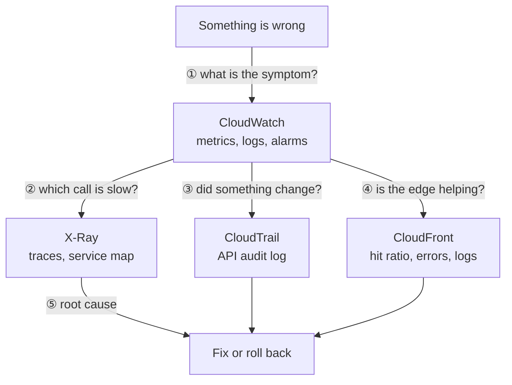
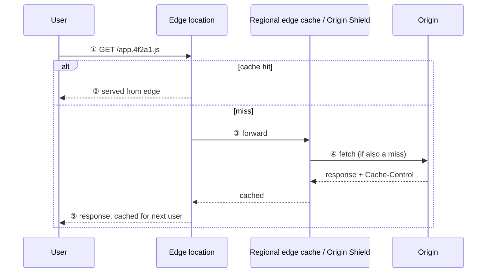

# CloudWatch, CloudTrail, X-Ray and CloudFront

Four AWS services that interviewers lump together because they answer the questions you ask when something is wrong: *what is happening* (CloudWatch), *who changed it* (CloudTrail), *where is the time going* (X-Ray) and *how is content reaching users* (CloudFront). The [AWS ecosystem](01-aws-ecosystem.md) chapter tours the platform and introduces CloudWatch and CloudFront briefly; this chapter goes to the depth a senior interview probes, and adds CloudTrail and X-Ray.

---

## In brief

- **Pick the tool by the question.** "What is the error rate and is it alarming?" is CloudWatch. "Who deleted that bucket or changed that security group?" is CloudTrail. "Which downstream call made this request slow?" is X-Ray. "Why are users in Asia slow and my origin overloaded?" is CloudFront.
- **CloudWatch cost is cardinality and ingestion.** Every unique metric (name plus dimension combination) is billed, and logs cost per GB ingested and per GB scanned by Logs Insights. A dimension per tenant or per user id is the classic bill shock.
- **CloudTrail is the audit log of the AWS control plane**, not an application log. It records API calls: who, what, when, from where. The free Event history keeps 90 days of management events; for anything longer or for data events you need a trail delivering to S3.
- **X-Ray stitches one request across services.** A trace is made of segments and subsegments; sampling controls cost; annotations are indexed and searchable, metadata is not. New instrumentation increasingly goes through OpenTelemetry (the AWS Distro for OpenTelemetry) rather than the older X-Ray SDKs.
- **CloudFront's key number is the cache hit ratio.** The cache key decides it: include anything that varies per user (cookies, many headers) and every request misses. Version asset URLs instead of invalidating.
- **They fit together in an incident:** alarm fires (CloudWatch), a trace shows the slow dependency (X-Ray), CloudTrail shows the config change that preceded it, and CloudFront metrics show whether the edge absorbed or amplified the load.

---

## Which tool answers which question


*Start from the CloudWatch symptom, then use X-Ray for latency inside a request, CloudTrail for configuration changes, and CloudFront data for edge behaviour.*

| Question | Tool | Data type |
| --- | --- | --- |
| Is error rate or latency above threshold? | CloudWatch alarms | Metrics |
| What did the application log at 14:03? | CloudWatch Logs Insights | Logs |
| Who changed this IAM policy or deleted this table? | CloudTrail | Audit events |
| Which service in the chain adds 800 ms? | X-Ray | Traces |
| Is the CDN cache effective? | CloudFront metrics and logs | Metrics and logs |

---

## CloudWatch

### Metrics

- A metric is a time series identified by **namespace, name and dimensions**. Each unique combination is a separate (billed) metric.
- Default resolution is **1 minute** for most services (EC2 basic monitoring is 5 minutes). **High-resolution custom metrics** go down to 1 second, at higher cost.
- Retention rolls up automatically: 1-second data for 3 hours, 1-minute for 15 days, 5-minute for 63 days, 1-hour for 455 days.
- **Statistics:** average hides tail latency. Use percentiles (p95, p99) and maximum for latency; use sum for counts.
- **Metric math** combines metrics (error rate = errors / requests) without emitting a new metric.
- Emit custom metrics cheaply from logs with the **Embedded Metric Format (EMF)**: write a structured JSON log line and CloudWatch extracts metrics from it. This is the usual pattern in Lambda.

### Alarms

| Setting | Meaning |
| --- | --- |
| Period | Length of each evaluation window |
| EvaluationPeriods / DatapointsToAlarm | "M out of N" breaches needed; stops one noisy point paging someone |
| TreatMissingData | Whether silence means OK, breaching, or ignore; critical for sparse metrics |
| States | OK, ALARM, INSUFFICIENT_DATA |
| Composite alarm | Combines alarms with AND/OR to cut noise |
| Anomaly detection | Learns a band instead of a fixed threshold |
| Actions | SNS (to paging), Auto Scaling, EC2 actions, Lambda via SNS or EventBridge |

Alert on **symptoms users feel** (error rate, latency percentile, queue age), not causes (CPU at 80%). This matches the SLO approach in the [monitoring stack chapter](11-the-monitoring-stack.md).

### Logs

- **Log group** (retention and permissions) contains **log streams**. **Set retention**: the default is never expire, a common surprise bill.
- **Logs Insights** queries logs with a purpose-built language (`fields`, `filter`, `stats`, `sort`, `parse`); you pay per GB scanned, so narrow the time range and log groups.
- **Metric filters** turn log patterns into metrics; **subscription filters** stream logs in near real time to Kinesis, Firehose or Lambda (for example into OpenSearch or a SIEM).
- **Log classes:** Standard and Infrequent Access (cheaper ingestion, fewer features).
- **Contributor Insights** finds top talkers (which tenant or IP dominates).
- **Synthetics canaries** run scripted checks from outside; **Application Signals** and **RUM** add service-level and browser views.

```text
# Logs Insights: p99 latency and error count per route, last hour
fields @timestamp, route, durationMs, statusCode
| filter ispresent(route)
| stats pct(durationMs, 99) as p99, count(*) as requests,
        sum(statusCode >= 500) as errors by route
| sort p99 desc
| limit 20
```

### The cost model, stated plainly

| Cost driver | What inflates it | Control |
| --- | --- | --- |
| Custom metrics | High-cardinality dimensions (tenant id, user id, request id) | Aggregate; put identifiers in logs, not dimensions |
| Log ingestion | Debug logging in production, verbose payloads | Log levels, sampling, drop noisy fields |
| Log storage | No retention policy | Set retention per group; archive to S3 |
| Logs Insights | Scanning large groups over long ranges | Narrow scope; use metrics for dashboards |
| Alarms and dashboards | Thousands of per-resource alarms | Composite alarms, per-service alarms |

What you emit is a cost decision as well as an engineering one.

---

## CloudTrail

CloudTrail records **API activity in your AWS account**: console clicks, CLI, SDK, and calls made by other AWS services. Each event shows who (`userIdentity`), what (`eventName`, `requestParameters`), when, from where (`sourceIPAddress`, user agent), and whether it worked (`errorCode`).

### Event types

| Type | Records | Default |
| --- | --- | --- |
| **Management events** | Control-plane operations: create or delete resources, IAM changes, `AssumeRole`, security group edits | On, in Event history |
| **Data events** | Data-plane operations: S3 object `GetObject` or `PutObject`, Lambda `Invoke`, DynamoDB item operations | Off; high volume and billed |
| **Insights events** | Unusual API call rate or error rate compared with baseline | Optional |
| **Network activity events** | VPC endpoint activity (newer) | Optional |

### Event history versus a trail

| | Event history | Trail |
| --- | --- | --- |
| Retention | Last 90 days, management events only | As long as you keep the S3 objects |
| Cost | Free | First copy of management events free; data events and extra copies billed |
| Delivery | Console and API lookup | S3 (optionally CloudWatch Logs and EventBridge) |
| Scope | One region view | Multi-region trail; **organization trail** covers all accounts |

Events typically arrive within minutes, not instantly, so CloudTrail is a forensic and audit source, not a real-time monitor by itself. For real-time reactions to a specific API call (for example "someone disabled GuardDuty"), use an **EventBridge** rule on that CloudTrail event.

### Hardening the audit trail

- Send an organization trail to a **separate, locked-down logging account** so a compromised workload account cannot erase its own history.
- Turn on **log file integrity validation**: CloudTrail writes signed digest files (SHA-256 hashes, RSA signature) so tampering or deletion is detectable.
- Encrypt with **KMS**, restrict the bucket policy, enable S3 Object Lock or MFA delete for retention guarantees.
- Query with **Athena** over the S3 logs, or with **CloudTrail Lake** (an event data store queried with SQL, with its own retention).

```sql
-- CloudTrail Lake: who deleted a bucket in the last 7 days?
SELECT eventTime, userIdentity.arn, sourceIPAddress, requestParameters
FROM <event_data_store_id>
WHERE eventName = 'DeleteBucket'
  AND eventTime > timestamp '2026-01-01 00:00:00'
ORDER BY eventTime DESC
```

### CloudTrail versus CloudWatch Logs versus Config

| Service | Answers |
| --- | --- |
| CloudTrail | Who made which API call, and when |
| AWS Config | What is the resource's configuration now and how did it change; is it compliant |
| CloudWatch Logs | What did my application or service log |

---

## X-Ray

X-Ray gives **distributed tracing**: one request's path across services, with timing for each hop.

### Concepts

| Concept | Meaning |
| --- | --- |
| Trace | One request end to end, identified by a trace id propagated in the `X-Amzn-Trace-Id` header |
| Segment | The work done by one service for the request |
| Subsegment | A downstream call inside a segment: DynamoDB, an HTTP call, an SQL query |
| Service map | Graph of services with latency and error rates, built from traces |
| Annotations | Indexed key-value pairs you can filter by (tenant tier, feature flag) |
| Metadata | Non-indexed extra data for inspection |
| Groups and filter expressions | Slice traces, for example `responsetime > 2 and annotation.tier = "free"` |

### Sampling

Tracing every request is costly and unnecessary. **Sampling rules** decide how many traces are recorded. The default is a small reservoir per second (one request per second) plus a percentage of additional requests (5 percent). Add rules to trace more of the endpoints you care about (checkout) and less of the noisy ones (health checks). Remember that sampling means a specific bad request may not have a trace, so **log the trace id** with every error so you can find the trace when it exists.

### Instrumenting

- **Lambda:** enable *active tracing*; Lambda creates the segment, and the SDK adds subsegments for downstream calls.
- **API Gateway, ALB, SQS, SNS, Step Functions:** can pass or add trace headers; SQS carries the trace in the `AWSTraceHeader` message system attribute so a trace can continue through a queue.
- **Containers and EC2:** run the collector (the X-Ray daemon, or the ADOT collector) next to the app.
- **OpenTelemetry:** AWS now steers new work to the **AWS Distro for OpenTelemetry (ADOT)**, which exports to X-Ray and other backends and avoids vendor lock-in. Check the current status of the X-Ray SDKs before choosing one for a new service.

### What traces are good and bad at

Good: finding the slow or failing dependency, understanding fan-out, spotting N+1 calls, comparing fast and slow requests. Not good: aggregate trends (use metrics), audit questions (CloudTrail), or capturing every request (sampled). Traces are retained for 30 days.

---

## CloudFront

CloudFront is AWS's CDN: edge locations cache content close to users and forward misses to an **origin** (S3, an ALB, an API Gateway, or any HTTP server).

### Request flow


*A hit is answered at the edge; a miss travels through the regional cache (and optional Origin Shield) to the origin and is then cached for the next viewer.*

### Distribution building blocks

| Piece | What it does |
| --- | --- |
| **Origins and origin groups** | Where content comes from; a group enables failover to a secondary origin on errors |
| **Behaviors** | Path-pattern rules (`/api/*`, `/static/*`) choosing origin, cache policy, allowed methods, functions |
| **Cache policy** | Decides the **cache key** (which query strings, headers, cookies) and TTLs |
| **Origin request policy** | What is forwarded to the origin without being part of the cache key |
| **Response headers policy** | Adds security headers (HSTS, CSP) and CORS headers at the edge |
| **Origin Access Control (OAC)** | Lets CloudFront read a private S3 bucket so the bucket is not public |
| **Origin Shield** | An extra centralized cache layer that collapses misses from many edges, protecting the origin |
| **TLS** | ACM certificate for custom domains (must be in us-east-1 for CloudFront) |

### Caching rules to know cold

- **Cache key trap.** CloudFront caches per unique key. If you forward a per-user cookie or the whole `Authorization` header in the key, every user gets a separate cache entry and the hit ratio collapses. Include only what changes the response.
- **TTL.** The effective TTL comes from the cache policy's minimum, default and maximum, and from the origin's `Cache-Control` (`max-age`, `s-maxage`). Static, versioned assets get long TTLs (a year); HTML and APIs get short or zero.
- **Versioned URLs beat invalidation.** `app.4f2a1.js` changes name on every build, so nothing needs invalidating. Invalidation exists (the first 1,000 paths per month are free) but is slow-ish, per path, and a smell if used every deploy.
- **Stale content.** `stale-while-revalidate` and `stale-if-error` let the edge serve a stale object while refreshing it or when the origin is down.
- **Compression** (gzip, Brotli) and HTTP/2 and HTTP/3 are enabled per behavior.

### Compute at the edge

| | CloudFront Functions | Lambda@Edge |
| --- | --- | --- |
| Runs | At every edge location | At regional edge caches |
| Triggers | Viewer request and response only | Viewer and origin request and response |
| Runtime and limits | Lightweight JavaScript, sub-millisecond, no network access | Node.js or Python, more memory and time, network access |
| Good for | URL rewrites, header manipulation, simple redirects, A/B cookies | Auth with external calls, dynamic origin selection, heavier logic |
| Deploy | Associated in CloudFront | Deployed from us-east-1 and replicated |

Default to CloudFront Functions for simple header and URL logic; reach for Lambda@Edge only when you need network calls or more compute.

### Security

| Control | How |
| --- | --- |
| Private content | **Signed URLs or signed cookies** using trusted key groups; combine with OAC for S3 |
| Web attacks and bots | Attach AWS WAF and rate-based rules to the distribution |
| DDoS | Shield Standard is included at the edge; Shield Advanced is optional |
| Geo | Geo restriction allow or deny lists |
| Sensitive fields | Field-level encryption for specific POST fields |
| Origin lockdown | Only CloudFront can reach the origin (OAC for S3; a secret header or prefix list for ALB) |

### Observability

- CloudWatch metrics: requests, bytes, **4xx and 5xx error rates**, and (with additional metrics enabled) **cache hit rate** and origin latency.
- **Standard logs** to S3 (delayed) and **real-time logs** to Kinesis (seconds) for per-request data such as `x-edge-result-type` (Hit, Miss, RefreshHit, Error).
- Watch cache hit ratio, origin load, and 5xx at the edge versus at the origin to tell whether CloudFront is hiding or amplifying a problem.

### Cost levers

Data transfer from CloudFront to the internet is the main cost; transfer from AWS origins to CloudFront is free. Price classes limit edge locations to cheaper regions; a higher hit ratio and compression both reduce spend.

---

## Building it

**Libraries and tools**

| Need | Tool | Why |
| --- | --- | --- |
| AWS SDK | `@aws-sdk/client-cloudwatch`, `client-cloudtrail`, `client-cloudfront` | Modular v3 clients |
| Structured logs and EMF | `aws-embedded-metrics` or Powertools for AWS Lambda (TypeScript) | Metrics, logs and trace ids from one structured line |
| Tracing | AWS Distro for OpenTelemetry, or Powertools Tracer | Standard instrumentation exporting to X-Ray |
| Infrastructure as code | Terraform or AWS CDK | Alarms, trails and distributions as reviewed code |

**Setting it up: a multi-region organization trail**

1. CloudTrail console, **Trails, Create trail**; choose **Enable for all accounts in my organization** (from the management account) and **apply to all regions**.
2. Pick a new S3 bucket in a dedicated logging account; enable **SSE-KMS** and **Log file validation**.
3. Under event selectors, keep management events (read and write) and add **data events only for specific sensitive buckets** to control cost.
4. Optionally send to CloudWatch Logs and create metric filters and alarms for root login, IAM policy changes and console login failures.

**Setting it up: an alarm on error rate**

1. CloudWatch, **Alarms, Create alarm**, **Select metric**, then **Math expression**: `errors / requests * 100`.
2. Statistic: sum for both inputs; period 1 minute; condition greater than 2 for **3 of 5** datapoints.
3. Missing data: *treat as not breaching* for a low-traffic service (otherwise a quiet night pages someone).
4. Action: an SNS topic wired to your pager.

**Pseudocode: structured log with trace id and an EMF metric (Lambda, TypeScript)**

```ts
import { Logger } from '@aws-lambda-powertools/logger';
import { Metrics, MetricUnit } from '@aws-lambda-powertools/metrics';
import { Tracer } from '@aws-lambda-powertools/tracer';

const logger = new Logger({ serviceName: 'checkout' });   // adds the X-Ray trace id to every log line
const metrics = new Metrics({ namespace: 'Shop', serviceName: 'checkout' });
const tracer = new Tracer({ serviceName: 'checkout' });

export const handler = async (event: any) => {
  tracer.putAnnotation('tier', event.tier);               // annotation: indexed, searchable in X-Ray
  const t0 = Date.now();
  try {
    const order = await placeOrder(event);                 // downstream calls become subsegments
    metrics.addMetric('OrdersPlaced', MetricUnit.Count, 1);
    return order;
  } catch (e) {
    logger.error('place order failed', { err: e });        // trace id lets you find the trace if it was sampled
    metrics.addMetric('OrderErrors', MetricUnit.Count, 1);
    throw e;
  } finally {
    metrics.addMetric('LatencyMs', MetricUnit.Milliseconds, Date.now() - t0);
    metrics.publishStoredMetrics();                        // one EMF log line, no PutMetricData calls
  }
};
```

Note what is not here: no `tenantId` or `userId` dimension. Identifiers go in the log line (searchable with Logs Insights), not in a metric dimension that multiplies cost.

---

## Interview Q&A

### Q: What is the difference between CloudWatch, CloudTrail and X-Ray?
**Level:** foundation · **Tags:** aws, observability

<details><summary>Model answer</summary>

CloudWatch holds metrics, logs and alarms about how systems are behaving. CloudTrail is the audit log of API calls made against the AWS account: who did what, when, from where. X-Ray traces a single request across services to show where time or errors occur. I use CloudWatch to detect, X-Ray to localize within a request, and CloudTrail to find configuration or access changes that explain a change in behaviour or to investigate a security event.

**Follow-ups:**

1. Q: Where does AWS Config fit?
<details><summary>Answer</summary>

Config records resource configuration over time and evaluates compliance rules ("is this bucket public?"). CloudTrail tells you who made the API call; Config tells you what the resource looked like before and after.
</details>

</details>

### Q: Your CloudWatch bill tripled. How do you investigate and fix it?
**Level:** senior · **Tags:** cloudwatch, cost

<details><summary>Model answer</summary>

Use Cost Explorer or the usage breakdown to see whether it is custom metrics, log ingestion, log storage or Logs Insights scans. Custom metrics usually come from a high-cardinality dimension such as tenant or user id: remove it from the dimension set and put it in the log line instead. Log ingestion usually means debug logging or large payloads: lower log levels, sample, drop noisy fields. Storage means missing retention: set retention per group and archive to S3. Insights cost means broad queries over long ranges: narrow them. Then add a budget alarm so it cannot recur silently.
</details>

### Q: How would you detect and respond to someone disabling logging or changing a security group in production?
**Level:** senior · **Tags:** cloudtrail, security

<details><summary>Model answer</summary>

CloudTrail records the API call (`StopLogging`, `AuthorizeSecurityGroupIngress`). Because trail delivery has a delay and I want real-time reaction, I create an EventBridge rule matching those management events and route it to a notification and, for high-risk cases, an auto-remediation Lambda. The organization trail goes to a separate logging account with integrity validation, so an attacker in a workload account cannot erase the record.

**Follow-ups:**

1. Q: Why is the separate account important?
<details><summary>Answer</summary>

An attacker who compromises a workload account could otherwise stop or delete the trail. Keeping logs in a separate account with restrictive policies and Object Lock preserves evidence.
</details>

</details>

### Q: A request is slow only sometimes. How do you find out why?
**Level:** senior · **Tags:** xray, latency

<details><summary>Model answer</summary>

Check CloudWatch percentiles to confirm it is tail latency, then use X-Ray filter expressions on response time to pull slow traces and compare them with fast ones: usually one subsegment (a database query, a cold start, a retry to a downstream service) differs. Annotations such as tier or region help find a pattern. Because sampling may miss a given request, I log the trace id with errors, and temporarily raise the sampling rate for the affected route.
</details>

### Q: Users report stale JavaScript after a deploy and the origin load is high. What do you check on CloudFront?
**Level:** intermediate · **Tags:** cloudfront, caching

<details><summary>Model answer</summary>

Stale content points at TTLs and the lack of versioned file names: static assets should have content-hashed names with long TTLs so new builds use new URLs, while `index.html` has a short TTL. High origin load points at a poor cache hit ratio: check the cache key for per-user cookies or headers, query strings that should be ignored, and responses missing `Cache-Control`. Enable Origin Shield to collapse regional misses, and look at `x-edge-result-type` in logs to see hits versus misses.
</details>

### Q: CloudFront Functions or Lambda@Edge?
**Level:** intermediate · **Tags:** cloudfront, edge

<details><summary>Model answer</summary>

CloudFront Functions for lightweight viewer-side work: rewrites, redirects, header changes, simple cookie logic, with sub-millisecond execution and low cost. Lambda@Edge when I need network access, larger payload handling, origin-side triggers, or heavier logic, accepting more latency and cost and deploying from us-east-1.
</details>

## What a weak answer sounds like

> "We use CloudWatch for monitoring and CloudFront for caching."

It names the services without a single threshold, cost driver, cache-key detail or failure mode. A strong answer says what you alert on and why, how you control cardinality, how CloudTrail and X-Ray differ, and how the cache key and versioned assets determine hit ratio.

## Quiz

### MCQ: Which service answers "who deleted this S3 bucket last week?"
- [ ] CloudWatch Logs
- [ ] X-Ray
- [x] CloudTrail
- [ ] CloudFront
**Why:** CloudTrail records API calls, including who made them.

### MCQ: What most commonly causes a surprise CloudWatch custom metrics bill?
- [ ] Too many alarms in OK state
- [x] High-cardinality dimensions such as tenant or user id, since each unique combination is a billed metric
- [ ] Using percentiles
- [ ] Using EMF
**Why:** Cost scales with the number of distinct metrics.

### MCQ: How long does CloudTrail Event history keep management events, free of charge?
- [ ] 24 hours
- [ ] 30 days
- [x] 90 days
- [ ] Forever
**Why:** For longer retention or data events, create a trail delivering to S3.

### MCQ: Which X-Ray feature lets you filter traces by a business attribute such as customer tier?
- [ ] Metadata
- [x] Annotations
- [ ] Subsegment names
- [ ] The service map
**Why:** Annotations are indexed; metadata is not.

### MCQ: Why does forwarding a per-user cookie in the CloudFront cache key hurt?
- [ ] CloudFront rejects cookies
- [x] Each distinct cookie value creates a separate cache entry, so almost every request misses
- [ ] It disables compression
- [ ] It breaks TLS
**Why:** Cache hit ratio depends on a cache key that varies only with what changes the response.

### MCQ: What is the best way to publish a new version of a static JavaScript bundle on CloudFront?
- [ ] Invalidate `/*` on every deploy
- [x] Use content-hashed file names so the new build is a new URL, with a long TTL on assets
- [ ] Set TTL to zero for all assets
- [ ] Restart the distribution
**Why:** Versioned URLs avoid invalidation entirely and keep the cache effective.

### MCQ: Which pair is correct for real-time reaction to a risky API call recorded by CloudTrail?
- [ ] CloudTrail Event history polling
- [x] An EventBridge rule on the CloudTrail event, routed to notification or remediation
- [ ] A weekly Athena query
- [ ] X-Ray sampling
**Why:** Trail delivery is delayed, while EventBridge can trigger on the event as it is received.

### MCQ: Why log the X-Ray trace id with errors?
- [ ] It makes logs shorter
- [x] Sampling means not every request has a trace, so the id lets you jump to the trace when one exists
- [ ] It is required by CloudWatch
- [ ] It replaces metrics
**Why:** Correlating logs and traces speeds up diagnosis.

## Glossary

| Term | Meaning |
| --- | --- |
| Namespace / dimension | Grouping and labels that identify a CloudWatch metric |
| EMF | Embedded Metric Format: metrics extracted from structured log lines |
| Logs Insights | Query language and service for CloudWatch Logs |
| Management / data events | CloudTrail control-plane operations / data-plane operations |
| Trail | A CloudTrail configuration delivering events to S3 |
| Log file integrity validation | Signed digest files proving CloudTrail logs were not altered |
| Trace / segment / subsegment | X-Ray request path, a service's work, and a downstream call |
| Annotation | Indexed X-Ray key-value used for filtering |
| Sampling rule | Policy deciding which requests are traced |
| Cache key | The request attributes CloudFront uses to decide if two requests are the same object |
| OAC | Origin Access Control: lets CloudFront read a private S3 bucket |
| Origin Shield | An extra cache layer that reduces origin load |
