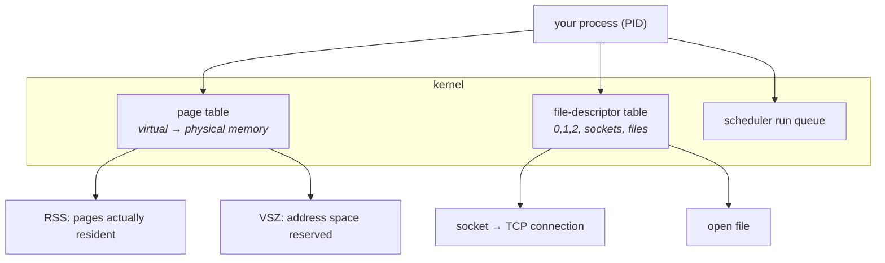
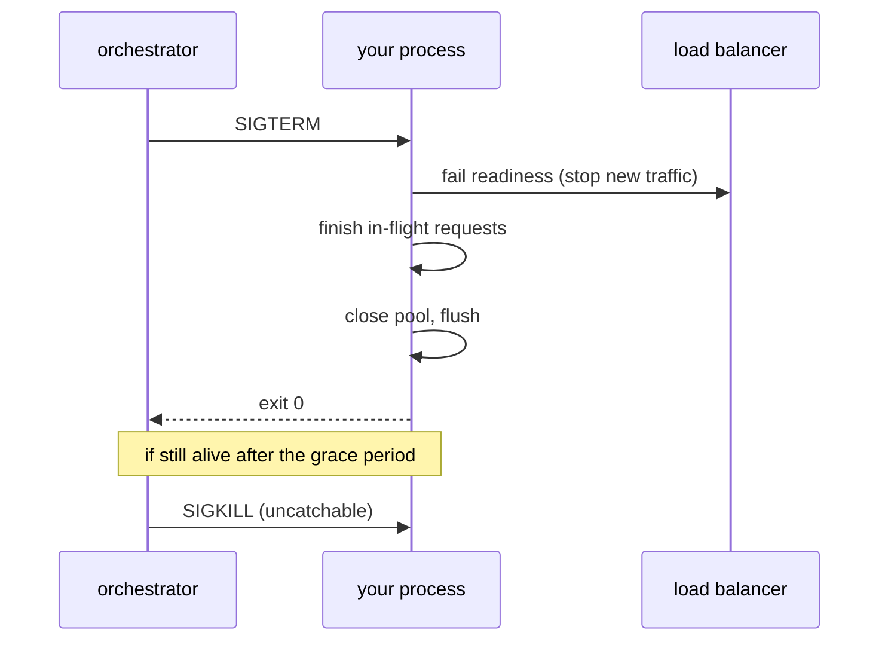

# Linux for operators

The round that fails most DevOps candidates is not a whiteboard. It is someone
saying "the service is slow, here is a terminal, show me." This chapter is the
model of a running Linux box you need to answer that — processes, memory, file
descriptors, and the handful of tools that turn a guess into a measurement.

---

## In brief

- **A process is a page table plus a file-descriptor table.** Almost every
  production mystery is one of those two running out: memory, or descriptors.
- **Load average is runnable processes, not CPU percentage.** A load of 8 on
  8 cores is fully used; a load of 8 with 2% CPU means eight processes stuck
  in uninterruptible IO wait, which is a disk or NFS problem, not a CPU one.
- **Memory is supposed to look full.** Linux spends free RAM on page cache and
  gives it back on demand, so "only 200MB free" is normal — the number that
  matters is `available`, not `free`.
- **The OOM killer picks a victim by score, not by culprit.** The process that
  allocated the last page is often not the one killed, which is why the
  database dies when the batch job leaks.
- **`ulimit -n` is the ceiling most services hit first.** Every socket is a
  file descriptor, so a default limit of 1024 caps you at roughly a thousand
  concurrent connections and fails with `EMFILE`, which looks like a bug in
  your code.
- **Signals are the deploy contract.** `SIGTERM` is "finish up", `SIGKILL`
  cannot be caught, and a process that ignores `SIGTERM` is a process your
  orchestrator will hard-kill mid-request 30 seconds later.
- **The debugging order is: is it the app, the box, or the network.** `top` and
  `ss` answer the first two in under a minute, and most engineers skip straight
  to guessing instead.

---

## The model: what a process actually is


*A process is bookkeeping the kernel does on your behalf. Nearly every production incident is one of these three tables full: the run queue (load), the page table (memory, OOM) or the descriptor table (`EMFILE`).*

Three numbers describe a process and interviewers like the distinction:

- **VSZ** — virtual size, the address space it has *reserved*. A Go runtime or
  a JVM reserves enormous VSZ and uses little of it. VSZ alarms are noise.
- **RSS** — resident set size, pages actually in physical RAM. This is what
  counts against a container's memory limit and what gets you OOMKilled.
- **Shared** — pages mapped by several processes (the libc text segment, for
  instance). Summing RSS across processes therefore double-counts, which is why
  "the sum of my processes exceeds total RAM" is not a paradox.

**Process states**, from `ps` or `top`, and what each one tells you:

| State | Meaning | What it implies |
| --- | --- | --- |
| `R` | Running or runnable | Counts toward load average |
| `S` | Interruptible sleep | Normal: waiting on a socket, a timer, a lock |
| `D` | **Uninterruptible** sleep | Waiting on disk or NFS. Counts toward load, cannot be killed. Many `D` processes means storage, full stop |
| `Z` | Zombie | Exited, but the parent never called `wait()`. Harmless in ones, a parent bug in thousands |
| `T` | Stopped | Someone sent `SIGSTOP`, or it is under a debugger |

The `D` state is the one worth memorising. A box with load 40, idle CPUs and a
screen of `D` processes is not overloaded — it is blocked on a device, and
adding capacity will not help.

### Parents, children and PID 1

Every process has a parent. When a process exits, the kernel keeps a small
record until the parent reads the exit status; if the parent never does, the
record is a **zombie**. When a parent dies first, its children are **reparented
to PID 1**, whose job includes reaping them.

This matters in containers more than on a VM. In a container your application
often *is* PID 1, and it probably was not written to reap orphans or to handle
the fact that **PID 1 does not get default signal handling** — the kernel will
not kill PID 1 with a signal it has no handler for. A shell-form `CMD` in a
Dockerfile makes `/bin/sh` PID 1, which does not forward `SIGTERM` to your app
at all, so every deploy hard-kills it. The fixes are the exec form, or a tiny
init like `tini`, both of which show up again in
[containers](06-containers.md).

---

## Memory, and why "free" is the wrong number

New operators read `free -m`, see a small number under `free`, and conclude the
box is out of memory. It almost never is.

```
              total        used        free      shared  buff/cache   available
Mem:          15998        4210         311         180       11476       11320
```

Linux uses otherwise-idle RAM as **page cache** for files it has read, because
unused memory is wasted memory. That cache is instantly reclaimable. So:

- **`free`** — truly untouched. Expect it to be near zero on a healthy
  long-running box.
- **`buff/cache`** — reclaimable file cache. Not a problem.
- **`available`** — the kernel's own estimate of what a new allocation could
  get without swapping. **This is the number to read.**

**Swap** is a release valve, not extra memory. A box swapping steadily is a box
whose latency has fallen off a cliff, because a page fault that hits disk is
roughly 100,000 times slower than one that hits RAM. `vmstat 1` and its `si`/`so`
columns (swap in, swap out) tell you whether swapping is actually happening —
non-zero sustained values are the alarm, not the mere existence of used swap.

### The OOM killer

When the kernel cannot satisfy an allocation and cannot reclaim, it does not
return an error to the allocating process — it picks a process and kills it.

The victim is chosen by `oom_score`, which is driven mostly by how much memory
the process uses, adjustable with `oom_score_adj`. The consequence is the one
people get wrong in interviews: **the process killed is usually the biggest
one, not the one responsible.** A leaking cron job pushes the box over, and the
database — the largest RSS on the machine — is what dies.

You find it after the fact in the kernel log, never in the application log:

```bash
dmesg -T | grep -i -E 'killed process|out of memory'
journalctl -k --since '1 hour ago' | grep -i oom
```

In a container the same mechanism runs inside the cgroup's memory limit, so the
cgroup's own biggest process dies and the container exits **137** (128 + signal
9). That is the `OOMKilled` status Kubernetes reports, covered in
[Kubernetes: operating it](08-kubernetes-operations.md).

---

## File descriptors: the limit you will actually hit

Every open file, every socket, every pipe is a small integer in the process's
descriptor table. A network service's descriptor count scales with its
concurrent connections, and the default per-process limit on many systems is
**1024**.

The symptom is an error your application layer reports as something else:
`EMFILE: too many open files`, or an accept loop that silently stops accepting,
or a connection pool that cannot open a new connection while the box looks
healthy. Teams routinely debug this as an application bug for hours.

```bash
ulimit -n                      # the soft limit for this shell
cat /proc/<pid>/limits         # the limits the running process actually has
ls /proc/<pid>/fd | wc -l      # how many it is currently using
ss -tanp | grep <pid> | wc -l  # how many of those are sockets
```

Raising it is per-process and inherited from whatever started the service, so
`ulimit -n` in your shell proves nothing about the running daemon — a systemd
unit needs `LimitNOFILE`, and a container needs the runtime's limit raised.
Read it from `/proc/<pid>/limits`, which is the only authoritative answer.

A descriptor leak and a legitimate load increase look identical in the count
and differ in the trend: a leak grows monotonically and never falls during
quiet periods. `ss -tan state close-wait` is the specific smoking gun for the
most common leak — **`CLOSE_WAIT` means the peer closed and your code never
called `close()`**, so the descriptor is held forever by a connection that can
never carry data again.

---

## Signals, and the deploy contract


*The grace period between SIGTERM and SIGKILL is the whole contract. Code that ignores SIGTERM does not get a graceful shutdown; it gets killed mid-request on every single deploy.*

The signals an operator needs:

| Signal | Number | Catchable | Use |
| --- | --- | --- | --- |
| `SIGTERM` | 15 | yes | "Shut down cleanly." The default of `kill`, and what every orchestrator sends first |
| `SIGKILL` | 9 | **no** | Kernel destroys the process immediately. No cleanup, no flush, no draining |
| `SIGINT` | 2 | yes | Ctrl-C |
| `SIGHUP` | 1 | yes | Historically "terminal closed"; by convention now "reload your config" |
| `SIGQUIT` | 3 | yes | Quit with a core dump. In Go, dumps all goroutine stacks — genuinely useful on a wedged binary |
| `SIGSTOP`/`SIGCONT` | 19/18 | no/— | Freeze and resume |

Two practical notes. `kill -9` as a reflex is a bad habit: it skips the
cleanup that prevents corrupt state and dropped requests, and if `SIGTERM` did
not work, *why* it did not work is the actual bug. And exit codes encode
signals — **137 is SIGKILL (128+9), 143 is SIGTERM (128+15)**, which is how you
read a container's death certificate at a glance.

---

## systemd, for the boxes that are not containers

Plenty of production still runs services directly on hosts, and systemd is how.
The unit file is the entire operational contract for that service:

```ini
[Unit]
Description=links api
After=network-online.target

[Service]
Type=notify
User=app                       # never root
WorkingDirectory=/srv/links
ExecStart=/srv/links/bin/api
Restart=on-failure             # not "always": a config error should stay down
RestartSec=2
LimitNOFILE=65535              # the descriptor limit discussed above
Environment=NODE_ENV=production
EnvironmentFile=/etc/links/env # secrets, mode 0600, not in the unit file
TimeoutStopSec=30              # the SIGTERM → SIGKILL grace period
KillSignal=SIGTERM

[Install]
WantedBy=multi-user.target
```

`Restart=always` versus `on-failure` is a real interview distinction: `always`
restarts a service that exited cleanly because its config was invalid, turning
a loud failure into an infinite quiet loop. The journal is the other half —
`journalctl -u links -f` follows it, `-p err` filters by priority, and
`--since` bounds it, which matters because the full journal on a busy box is
unreadable.

---

## The toolkit, by question

This is the part worth drilling until it is reflex. Each tool answers one
question, and knowing which tool answers which is most of being fast.

| Question | Tool |
| --- | --- |
| What is using the CPU, and is the box loaded? | `top` (press `1` for per-core), `htop`, `uptime` |
| Is it CPU, IO wait, or steal? | `vmstat 1` — the `wa` and `st` columns |
| What is the disk doing? | `iostat -xz 1` — `%util` and `await` |
| Is the disk full, or out of inodes? | `df -h`, then `df -i` |
| What is listening, and what is connected? | `ss -tlnp` (listening), `ss -tanp` (all), `ss -s` (summary by state) |
| Who holds this file or port? | `lsof -i :3000`, `lsof -p <pid>`, `fuser` |
| Where is the time going inside a request? | `strace -c -p <pid>` for a syscall histogram; `-f` to follow threads |
| Is DNS the problem? | `dig +short name`, `dig @8.8.8.8 name` to bypass the local resolver, `resolvectl status` |
| Is traffic arriving at all? | `tcpdump -ni any port 5432 -c 20` |
| What did the kernel do? | `dmesg -T`, `journalctl -k` |
| Why did the service stop? | `systemctl status`, `journalctl -u <unit> --since '10 min ago'` |

`strace` deserves a warning: it stops the process at every syscall and can slow
it by an order of magnitude. `strace -c -p <pid>` for a few seconds, then
detach, is safe and usually enough — a histogram dominated by `futex` means
lock contention, by `epoll_wait` means it is idle and waiting, and by `read`
on one descriptor means it is blocked on a dependency.

---

## Building it

**The five-minute triage for "the service is slow"**

The structure matters more than the commands: you are narrowing from box, to
process, to dependency, and each step is a measurement rather than a theory.

```bash
# 1. Is the box in trouble at all?
uptime                      # load vs core count (nproc)
vmstat 1 5                  # r = runnable, wa = io wait, si/so = swapping
free -m                     # read "available", not "free"
df -h; df -i                # full disk and exhausted inodes both look like "weird errors"

# 2. If the box is fine, is the process in trouble?
top -b -n1 -o %CPU | head -15
ls /proc/$PID/fd | wc -l; cat /proc/$PID/limits | grep -i 'open files'
cat /proc/$PID/status | grep -E 'VmRSS|Threads'

# 3. If the process is fine, is it waiting on something?
ss -tanp | awk '{print $1}' | sort | uniq -c | sort -rn   # state histogram
ss -tanp state close-wait | head                           # descriptor leak
ss -tanp state syn-sent  | head                            # cannot reach a dependency
strace -c -p $PID -f & sleep 5; kill %1                    # where the syscalls go

# 4. Did the kernel already tell us the answer?
dmesg -T | tail -30
```

**Reading the connection-state histogram** — this one table resolves a
surprising share of real incidents:

| Dominant state | What it means |
| --- | --- |
| Many `ESTAB`, low traffic | Connections held open and idle — a pool that is too large, or keep-alive doing its job |
| Many `TIME_WAIT` | You are closing connections at high rate. Usually fine; at extremes it exhausts ports (see [networking](../02-interview-core/44-networking.md)) |
| Many `CLOSE_WAIT` | **Your bug.** The peer closed, your code never did. Descriptor leak |
| Many `SYN-SENT` | You cannot reach a dependency — firewall, security group, or a dead host |
| Full `Recv-Q` on a listener | Your app is not calling `accept()` fast enough — the event loop is blocked |

**A disk that is "full" but is not**

```bash
df -h /var           # 100% — but
du -sh /var/* | sort -h | tail
df -i /var           # inodes exhausted? millions of tiny session files
lsof +L1             # deleted files still held open by a process
```

That last one catches the classic: a log file was deleted to free space, but
the writer still holds the descriptor, so the blocks are never released and
`du` and `df` disagree. Restarting the writer frees it instantly.

**Narrowing "it must be the network"**

```bash
dig +short api.internal                     # does it resolve, and to what?
curl -o /dev/null -sS -w '%{time_namelookup} %{time_connect} %{time_appconnect} %{time_total}\n' \
     https://api.internal/healthz
```

Those four `curl` timings split one slow request into DNS, TCP, TLS and the
server's own time — which is how you hand the problem to the right team with
evidence instead of an opinion. The layers behind each number are in
[networking for backend engineers](../02-interview-core/44-networking.md).

---

## Interview Q&A

### Q: A service is slow. You have SSH and five minutes. What do you do?
**Level:** senior · **Tags:** linux, debugging, operations

<details><summary>Model answer</summary>

I narrow rather than guess, and the order is box, process, dependency.

First the box: `uptime` against the core count, and `vmstat 1`. That one
command separates three different incidents — a high `r` column means genuine
CPU saturation, a high `wa` means we are blocked on storage, and non-zero
`si`/`so` means we are swapping and nothing else I find will matter until that
stops. Then `free -m` reading *available*, and `df -h` plus `df -i`, because a
full disk and exhausted inodes both surface as bizarre application errors.

If the box is healthy, the process: is it actually burning CPU in `top`, how
many file descriptors is it holding versus its limit in `/proc/<pid>/limits`,
and how is its RSS trending.

If the process looks idle, it is waiting on something, and the connection state
histogram from `ss -tanp` usually names it. A pile of `SYN-SENT` means we
cannot reach a dependency at all. A pile of `CLOSE_WAIT` is our own descriptor
leak. A full receive queue on the listening socket means we are not accepting
fast enough, which points at a blocked event loop rather than a slow
dependency.

Then `dmesg -T`, because if the kernel OOM-killed something it already wrote
down the answer and nobody looked.

What I would resist is restarting it first. A restart destroys the evidence and
the problem comes back in an hour, and now you know nothing. If I have to
restart for the users' sake, I grab a goroutine or heap dump and the output
above first.

</details>

**Follow-ups:**

1. Q: Load average is 40 on an 8-core box but CPU is 3% idle-ish and nothing looks busy. What is happening?
   <details><summary>Answer</summary>

   Load average counts processes in the run queue *and* processes in
   uninterruptible sleep — state `D`. So a load of 40 with no CPU usage means
   roughly 40 processes blocked on IO: a saturated or failing disk, or an NFS
   or network filesystem mount that has stopped responding.

   `ps -eo state,pid,cmd | awk '$1 ~ /D/'` lists them, and `iostat -xz 1` shows
   whether `await` has gone through the roof on a device. If it is a network
   mount, the processes cannot even be killed — `kill -9` does nothing to a
   process in `D` state, which surprises people.

   The important consequence is that scaling CPU or adding replicas does not
   help this incident at all.

   </details>

2. Q: The app logs "too many open files" but you raised the limit with `ulimit -n 65535`.
   <details><summary>Answer</summary>

   `ulimit` changed the limit for your shell and anything you start from it —
   not for the already-running daemon, which inherited its limits from whatever
   started it, usually systemd or the container runtime.

   `cat /proc/<pid>/limits` is the authoritative read for the live process. To
   change it properly: `LimitNOFILE` in the systemd unit, then
   `systemctl daemon-reload` and a restart; or the runtime's ulimit setting for
   a container.

   And I would check whether the limit is really the problem, because the other
   half of this is a leak: if `ls /proc/<pid>/fd | wc -l` climbs monotonically
   and never drops during quiet periods, raising the ceiling just delays the
   outage. `ss state close-wait` usually confirms it.

   </details>

### Q: Why is a process in your container getting killed with exit code 137?
**Level:** intermediate · **Tags:** linux, containers, memory

<details><summary>Answer</summary>

137 is 128 + 9, so it was `SIGKILL`ed. In a container the overwhelming
likelihood is the cgroup memory limit: the process exceeded it and the kernel's
OOM killer destroyed it. `kubectl describe pod` reports it as `OOMKilled`, and
`dmesg -T` on the node has the kernel's own record with the victim's RSS.

The subtlety worth raising is that the killed process is chosen by
`oom_score` — essentially the largest consumer — not by whoever requested the
allocation that failed. So in a multi-process container the sidecar that leaked
can get the main application killed.

The other cause of 137 is an orchestrator losing patience: it sent `SIGTERM`,
the process did not exit within the grace period, and it followed up with
`SIGKILL`. That one is distinguishable because there is no OOM line in the
kernel log, and it is a signal-handling bug in the application — often that
the process is PID 1 in shell form, so `/bin/sh` is receiving the `SIGTERM` and
never forwarding it.

Fixing it depends which it is: a real limit problem needs the limit raised or
the leak found; a grace-period problem needs a `SIGTERM` handler.

</details>

### Q: What is the difference between RSS and VSZ, and which should you alert on?
**Level:** intermediate · **Tags:** linux, memory

<details><summary>Answer</summary>

VSZ is the virtual address space the process has reserved; RSS is the pages
actually resident in physical memory.

Alert on RSS. It is what counts against a cgroup limit and what the OOM killer
scores. VSZ is nearly meaningless as an alarm — a Go or Java runtime reserves
huge virtual regions up front and touches a fraction of them, so VSZ alerts
fire constantly on perfectly healthy processes.

Two refinements I would mention. Summing RSS across processes double-counts
shared pages, so per-process RSS totals can exceed physical RAM without
anything being wrong. And RSS alone cannot distinguish a leak from a cache: a
process whose RSS rises and then plateaus is usually fine, while one that rises
monotonically across quiet periods is leaking. The trend matters more than the
level, which is why a static threshold is a poor alert and a growth rate is a
good one.

</details>

### Q: Your service needs to handle 20,000 concurrent connections on one box. What do you check?
**Level:** senior · **Tags:** linux, networking, capacity

<details><summary>Answer</summary>

Four limits, in the order they bite.

**File descriptors.** Every connection is one, so the process needs
`LimitNOFILE` well above 20,000 — plus headroom for its own outbound
connections, log files and the pool. The default 1024 caps you at a fiftieth of
the target.

**Ephemeral ports, but only for outbound.** Accepting connections does not
consume local ports, so inbound 20k is fine; if this box also makes 20k
outbound connections to one upstream address and port, then
`net.ipv4.ip_local_port_range` and `TIME_WAIT` turnover become the constraint.

**The accept queue.** `somaxconn` and the listen backlog bound how many
completed connections can wait for `accept()`. Under a burst, a small backlog
drops connections that look to the client like a timeout. A growing `Recv-Q` on
the listening socket in `ss -tln` is the signal.

**Memory per connection.** Kernel socket buffers plus whatever the application
allocates per connection. At 20k, a few hundred KB each is gigabytes — this is
usually the real ceiling, and it is why an event-loop or goroutine model is
chosen over thread-per-connection, where the stacks alone would dominate.

Then I would actually load-test it rather than trust the arithmetic, because
the thing that breaks is nearly always something not on the list.

</details>

---

## What a weak answer sounds like

- **"Load is 40, the CPU is overloaded."** Load counts uninterruptible IO wait
  too; `vmstat`'s `wa` column distinguishes them.
- **"The box is out of memory, only 300MB free."** Read `available`. Page cache
  is reclaimable and is supposed to be large.
- **`kill -9` as the first move.** It skips cleanup, drops in-flight requests,
  and destroys the evidence of why `SIGTERM` did not work.
- **Restarting before capturing anything.** The symptom goes away, the cause
  survives, and the next occurrence starts from zero.
- **"We raised the file limit with `ulimit`."** Not for the running daemon;
  `/proc/<pid>/limits` is the only read that counts.
- **Treating "too many open files" as an app bug** without checking whether the
  descriptor count grows monotonically — which distinguishes a leak from load.
- **Alerting on VSZ**, or on any memory threshold rather than a growth rate.

---

## Quiz

### MCQ: Load average on an 8-core box is 40, but CPU utilisation is low and no process looks busy. What is the most likely cause?
- [ ] The load average is reported incorrectly on multi-core systems
- [x] Processes are blocked in uninterruptible sleep (state `D`) waiting on disk or a network filesystem — those count toward load without using CPU
- [ ] A memory leak is inflating the load figure
- [ ] There are too many zombie processes
**Why:** Linux load average counts runnable *and* uninterruptible-sleep processes. High load with idle CPUs is the signature of IO saturation, and it means adding CPU or replicas will not help the incident.

### MCQ: `free -m` shows 300MB free out of 16GB on a healthy production server. What should you conclude?
- [ ] The server is about to OOM and needs more memory
- [x] Nothing is wrong — Linux uses idle RAM as reclaimable page cache, so `free` is expected to be small; `available` is the number that estimates what a new allocation can get
- [ ] Page cache is misconfigured and should be disabled
- [ ] The server is swapping
**Why:** Unused memory is wasted memory, so the kernel fills it with file cache and reclaims on demand. Reading `free` instead of `available` is the single most common memory misdiagnosis.

### MCQ: A container exits with code 137 and the kernel log shows no OOM message. What does that point to?
- [ ] A segmentation fault in the application
- [x] The orchestrator sent `SIGTERM`, the process did not exit within the grace period, and it was then `SIGKILL`ed — a signal-handling bug, not a memory problem
- [ ] The image was built for the wrong architecture
- [ ] A failed liveness probe, which always produces 137 without a kernel message
**Why:** 137 is 128+9, i.e. SIGKILL, but SIGKILL has two sources: the OOM killer (which always logs to the kernel ring buffer) and the orchestrator's post-grace-period kill. The absence of a kernel OOM line distinguishes them.

### MCQ: Many sockets are stuck in `CLOSE_WAIT`. Whose problem is it?
- [ ] The remote peer's — it failed to complete the close handshake
- [x] Yours — `CLOSE_WAIT` means the peer closed and your application never called `close()`, so the descriptor leaks and will eventually hit the open-files limit
- [ ] The kernel's — it needs `tcp_fin_timeout` lowered
- [ ] Nobody's; `CLOSE_WAIT` is a normal steady state
**Why:** `CLOSE_WAIT` is the local side's "I have been told the peer is done and I have not responded". It is the canonical descriptor-leak signature, and it is in application code, unlike `TIME_WAIT`, which is the kernel doing its job on the side that closed first.

### MCQ: Why does `ulimit -n 65535` in your SSH session often fail to fix "too many open files" for a running service?
- [ ] The command requires a reboot to take effect
- [x] Limits are per-process and inherited at start time, so the already-running daemon keeps the limits it got from systemd or the container runtime — `/proc/<pid>/limits` shows its real values
- [ ] `ulimit` only affects regular files, not sockets
- [ ] 65535 exceeds the kernel maximum and is silently ignored
**Why:** The shell's limit applies to the shell and its children. Changing a service's limit means `LimitNOFILE` in its unit file (then reload and restart) or the runtime's ulimit configuration.

### MCQ: `df -h` reports a filesystem at 100% but `du -sh` on its contents accounts for far less. What explains the gap?
- [ ] `du` cannot read files owned by other users
- [x] Deleted files are still held open by a running process, so their blocks are not released until that process closes them — `lsof +L1` lists them
- [ ] The filesystem needs defragmenting
- [ ] `df` counts the journal while `du` does not
**Why:** Unlinking a file only removes the directory entry; the inode and its blocks survive while any descriptor refers to it. This is exactly what happens when someone deletes a large log file to free space and the writer keeps running.

### MCQ: Which signal cannot be caught or handled by a process?
- [ ] `SIGTERM`
- [x] `SIGKILL` — the kernel destroys the process immediately, so no cleanup, flush or draining code runs
- [ ] `SIGHUP`
- [ ] `SIGQUIT`
**Why:** This is why the SIGTERM→grace→SIGKILL sequence exists, and why a graceful shutdown must be implemented on SIGTERM. Reaching for `kill -9` first guarantees in-flight work is lost.

### MCQ: A container's `CMD` is written in shell form (`CMD npm start`), and the app never performs its graceful shutdown on deploy. Why?
- [ ] Shell form disables signal delivery in the kernel
- [x] `/bin/sh` becomes PID 1 and receives the `SIGTERM`; it does not forward it to the child, so the app never sees it and is `SIGKILL`ed after the grace period
- [ ] `npm` strips signal handlers from child processes
- [ ] Graceful shutdown requires the `SIGHUP` signal instead
**Why:** PID 1 also lacks default signal dispositions, so a shell or wrapper that does not explicitly forward signals silently swallows every shutdown request. The fixes are exec-form `CMD` or a small init such as `tini`.

### MCQ: `strace -c -p <pid>` on a struggling service shows the syscall time dominated by `futex`. What does that suggest?
- [ ] The process is blocked on disk IO
- [x] Lock contention — threads are waiting on each other rather than doing work, so adding CPU or replicas will not help much
- [ ] DNS resolution is failing
- [ ] The file-descriptor limit has been reached
**Why:** `futex` is the kernel primitive behind userspace mutexes and condition variables. Time concentrated there means the bottleneck is synchronisation inside the process, whereas `read`/`epoll_wait` dominance points outward at a dependency or at idleness.

### MCQ: Why is `Restart=always` a risky choice in a systemd unit compared with `Restart=on-failure`?
- [ ] `always` ignores `TimeoutStopSec`
- [x] It restarts the service even after a clean exit, so a service that exits deliberately because its configuration is invalid loops forever instead of staying down and being noticed
- [ ] `always` prevents `journalctl` from recording the exits
- [ ] `always` is only valid for `Type=oneshot` units
**Why:** Restart policy decides whether a deterministic failure is loud or silent. `on-failure` lets a bad deploy stay visibly broken rather than flapping, which is the same reasoning behind not putting a restart loop inside a container.

---

## Glossary

- **RSS** — resident set size: pages actually in physical memory; what a cgroup limit measures.
- **VSZ** — virtual size: address space reserved, much of it never touched.
- **Page cache** — file data the kernel keeps in otherwise-idle RAM; reclaimable, and why `free` is small.
- **`available`** — the kernel's estimate of memory a new allocation can obtain; the number to read.
- **Load average** — processes runnable *or* in uninterruptible sleep, averaged over 1/5/15 minutes.
- **State `D`** — uninterruptible sleep, blocked on a device; counts toward load and cannot be killed.
- **OOM killer** — the kernel killing the highest-`oom_score` process when memory cannot be reclaimed.
- **File descriptor** — the integer handle for an open file or socket; `ulimit -n` caps how many.
- **`EMFILE`** — "too many open files": the descriptor limit reached.
- **`CLOSE_WAIT`** — the peer closed and local code did not; the descriptor-leak signature.
- **`TIME_WAIT`** — the kernel holding a closed connection briefly on the side that closed first.
- **`SIGTERM` / `SIGKILL`** — "shut down cleanly" (catchable) / immediate destruction (not catchable).
- **Exit 137 / 143** — killed by signal 9 / signal 15 (128 + signal number).
- **PID 1** — the init process; reaps orphans and gets no default signal handling, which is why containers need an exec-form entrypoint or `tini`.
- **systemd unit** — the declarative service definition: user, restart policy, limits, stop timeout.
