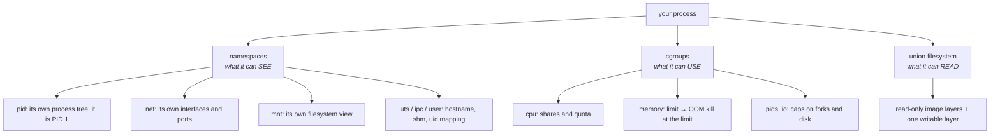

# Containers, properly

A container is not a small VM and not a magic box. It is an ordinary Linux
process with three kernel features applied to it. Knowing which three is the
difference between an answer that survives one follow-up and one that survives
five — and it is also what explains why your runtime sees 64 CPUs inside a pod
limited to one.

---

## In brief

- **A container is a process, isolated by namespaces and limited by cgroups,
  reading a filesystem assembled from image layers.** No kernel is booted,
  which is why it starts in milliseconds.
- **Namespaces control what the process can *see*; cgroups control what it can
  *use*.** Two different kernel subsystems, routinely conflated, and the
  distinction answers most container questions.
- **The container does not know it is in a container.** `/proc/cpuinfo` still
  reports the host's CPUs, so runtimes that size thread pools from "CPU count"
  over-allocate badly — the specific trap behind `GOMAXPROCS` and JVM heap
  sizing.
- **Layers are immutable and additive.** A later layer deleting a file does not
  remove it from the image, which is why a secret baked at build time is leaked
  forever even if "removed".
- **Layer order is build performance.** Dependencies before source, so a code
  change does not reinstall the world.
- **Multi-stage builds are the single biggest win** on both image size and
  attack surface: build with a full toolchain, ship only the artefact.
- **One concern per container, and let it be PID 1 properly** — exec-form
  entrypoint, signals handled, no process manager inside.

---

## What a container actually is


*Three independent kernel mechanisms, not one abstraction. Interview answers that say "containers are lightweight VMs" collapse all three into a metaphor that then cannot explain anything — like why a container sees the host's CPU count.*

**Namespaces** give a process a private view of a global resource. The PID
namespace is why your process is PID 1 and cannot see the host's processes. The
network namespace is why it has its own `eth0` and can bind port 3000 without
colliding with anything else. The mount namespace is why it sees the image's
filesystem rather than the host's.

**cgroups** (control groups) cap consumption. The memory cgroup is the one with
teeth: exceed it and the kernel's OOM killer runs *inside* the cgroup, which is
the `OOMKilled`/exit-137 story from
[Linux for operators](05-linux-for-operators.md). The CPU cgroup works
differently — it throttles, because CPU is a compressible resource and memory
is not. That asymmetry is the most reliably asked container question there is.

**The union filesystem** stacks the image's read-only layers and adds one thin
writable layer on top. Writes go to the writable layer only (copy-on-write), it
is discarded when the container is removed, and writing heavily to it is slower
than writing to a volume — which is why databases in containers need volumes,
not just for persistence but for performance.

### Containers are not VMs, concretely

| | Container | VM |
| --- | --- | --- |
| Kernel | **Shares the host's** | Boots its own |
| Start time | Milliseconds | Tens of seconds |
| Isolation boundary | Kernel namespaces — a kernel vulnerability crosses it | Hypervisor — a much stronger boundary |
| Overhead | A process | A full OS image and its memory |
| Density | Hundreds per host | Tens |

The row that matters for a security question is the third. Containers are an
*isolation* mechanism, not a *security* boundary of the same strength as a VM:
a kernel escape affects every container on the host. That is precisely why
untrusted multi-tenant workloads get firecracker-style microVMs or separate
node pools rather than being packed onto shared nodes.

---

## The trap: a container does not know its own limits

The namespaces hide other processes, but **`/proc/cpuinfo` and `/proc/meminfo`
are the host's**. A process in a container limited to 1 CPU on a 64-core
machine still reads 64.

Anything that sizes itself from "number of CPUs" therefore gets it wrong:

- **Go** sets `GOMAXPROCS` from the host count, creating 64 OS threads that
  fight over one CPU's worth of quota. Set it from the limit, or use
  `automaxprocs`.
- **Node** sizes its libuv thread pool and any `os.cpus()`-based cluster count
  the same way; `os.cpus().length` workers inside a 1-CPU container is a
  self-inflicted outage. See
  [the Node runtime](../11-backend-nodejs/02-runtime-and-event-loop.md).
- **JVMs** before container-awareness sized the heap from host memory and got
  OOMKilled reliably; modern ones read the cgroup, but only with the right
  flags.
- **Thread pools, worker counts and connection pools** in any language,
  wherever someone wrote `cpus * 2`.

The honest numbers live in the cgroup filesystem, which is where a
container-aware runtime reads them:

```bash
# cgroup v2 (current)
cat /sys/fs/cgroup/memory.max          # "max" means unlimited
cat /sys/fs/cgroup/cpu.max             # "quota period", e.g. "100000 100000" = 1 CPU
cat /sys/fs/cgroup/memory.current      # what we are using now
```

Mentioning this unprompted is a strong signal in an interview, because it shows
you have debugged a container rather than only deployed one.

---

## Images, layers and build performance

Every instruction in a Dockerfile that changes the filesystem creates a layer.
Layers are content-addressed, cached, and **additive — a layer can mark a file
deleted, but the file's bytes remain in the earlier layer**.

Two consequences, both of them interview answers:

1. **A secret baked into a build is leaked permanently.** `COPY .env .` then
   `RUN rm .env` leaves the secret fully readable to anyone who can pull the
   image and run `docker history` or extract the layer. The same applies to
   build-time `ARG`s. Secrets are fetched at *runtime*, from a secrets manager,
   using an identity the workload already has.
2. **`RUN apt-get install … && rm -rf /var/lib/apt/lists/*` must be one
   instruction.** Split across two `RUN`s, the cleanup adds a layer and saves
   nothing.

### Layer order is the build-cache contract

```dockerfile
# ---- build stage: full toolchain, never shipped
FROM node:20.11-bookworm AS build
WORKDIR /app
COPY package.json package-lock.json ./   # 1. rarely changes
RUN npm ci                               # 2. slow — cached unless (1) changed
COPY . .                                 # 3. changes every commit
RUN npm run build                        # 4. fast

# ---- runtime stage: artefact only
FROM node:20.11-bookworm-slim
ENV NODE_ENV=production
WORKDIR /app
COPY --from=build /app/dist ./dist
COPY --from=build /app/node_modules ./node_modules
USER node                                # never root
EXPOSE 3000
ENTRYPOINT ["node", "dist/main.js"]      # exec form: PID 1 receives SIGTERM
```

The ordering rule is **slowest and most stable first, fastest and most volatile
last**. Copying source before installing dependencies inverts it and makes
every one-line change reinstall every package — a 4-second build becoming a
3-minute one, multiplied by every commit of every engineer.

**Pin the base image** to a version, never `latest`: `latest` makes your build
non-reproducible and silently changes the runtime under you. Digest pinning
(`node:20.11-slim@sha256:…`) goes further and is what supply-chain hardening
asks for — see [pipelines and GitOps](10-pipelines-and-gitops.md).

### Making the image small, in order of payoff

| Step | Typical effect |
| --- | --- |
| Multi-stage build | Usually the bulk of it — toolchain and source stop shipping |
| Smaller base (`-slim`, `alpine`, distroless) | Hundreds of MB |
| Production dependencies only (`npm ci --omit=dev`) | Large for Node |
| `.dockerignore` (`node_modules`, `.git`, test fixtures) | Shrinks the build *context*, speeding every build |
| Combining create-then-delete `RUN`s | Removes layers that cancel out |

**Alpine's catch**, worth knowing because it is a real production surprise: it
uses musl rather than glibc. Native modules may not have prebuilt binaries,
DNS resolution behaves subtly differently, and some runtimes have measurably
worse performance. **Distroless** is often the better small base — no shell, no
package manager, far less attack surface — with the trade-off that you cannot
`exec` into it to debug, which is why a debug variant exists and why
ephemeral debug containers exist in Kubernetes.

**A container's filesystem should be read-only** where possible
(`readOnlyRootFilesystem`), with a writable `emptyDir` for scratch space. It
turns a remote code execution into a much smaller problem.

---

## Running them: the parts people skip

**One concern per container.** Not dogma for its own sake: the orchestrator's
unit of restart, scaling and health is the container, so two processes in one
mean a dead process the orchestrator cannot see, and you have to invent your own
supervision. Which leads to the specific anti-pattern:

**Do not run a process manager inside a container.** A supervisor (PM2,
supervisord) inside a container restarts a broken process forever, so the
container never exits, so the orchestrator never notices anything is wrong, so
the pod stays in rotation serving errors. The orchestrator *is* the supervisor.
PM2's place is a long-lived VM, where it genuinely earns its keep.

**Signals and PID 1** — the full version is in
[Linux for operators](05-linux-for-operators.md), and the container-specific
rules are:

- **Exec form, always**: `ENTRYPOINT ["node", "dist/main.js"]`. Shell form
  (`CMD node dist/main.js`) makes `/bin/sh` PID 1, which does not forward
  `SIGTERM`, so your graceful shutdown never runs and every deploy hard-kills
  in-flight requests after the grace period.
- If you genuinely need a wrapper, use a real init (`tini`, or
  `docker run --init`) so signals are forwarded and orphans reaped.
- Handle `SIGTERM` in the application. That handler is the entire difference
  between a clean rollout and a burst of 502s on every deploy.

**Health, logs and config**, as conventions the platform expects:

- Log to **stdout/stderr as structured JSON**, and let the platform collect it.
  Writing log files inside a container means logs vanish with the container and
  fill the writable layer in the meantime.
- Configuration from the environment, validated at startup, failing fast — the
  same discipline as the "building the server" chapters in each language track.
- Expose `/healthz` and `/readyz`, because [Kubernetes'
  probes](08-kubernetes-operations.md) need both and they are not the same
  question.

---

## The proxy in front: Nginx and friends

A reverse proxy sits between clients and your application and does the work
your application should not:

- **TLS termination** — one place with the certificates and the cipher config.
- **Load balancing** across instances, with health checks.
- **Static files**, served from the filesystem far faster than through an
  application runtime.
- **Rate and connection limiting** at the edge, before a flood reaches code.
- **Buffering slow clients**, which is the one that matters most for
  single-threaded runtimes: Nginx absorbs a request from a bad mobile
  connection and hands it over complete, so your Node process is never sitting
  idle holding a connection open.
- **Compression, caching headers, request-size limits**, and a sane set of
  security headers in one place.

```nginx
upstream api {
  least_conn;                       # not round-robin: send to the least busy
  server api-1:3000 max_fails=3 fail_timeout=10s;
  server api-2:3000 max_fails=3 fail_timeout=10s;
  keepalive 32;                     # reuse upstream connections
}

server {
  listen 443 ssl;
  server_name api.example.com;

  client_max_body_size 2m;          # reject huge uploads at the edge
  proxy_read_timeout 30s;           # never unbounded
  proxy_connect_timeout 2s;

  location / {
    limit_req zone=api burst=20 nodelay;
    proxy_pass http://api;
    proxy_http_version 1.1;              # required for upstream keep-alive
    proxy_set_header Connection "";      # strip "close"
    proxy_set_header X-Request-Id $request_id;   # correlation id for tracing
    proxy_set_header X-Forwarded-For $proxy_add_x_forwarded_for;
  }
}
```

In a Kubernetes cluster this role is played by an **ingress controller** —
frequently Nginx itself, or Envoy — and the same concerns reappear as
annotations and `Ingress` objects. In a cloud account the role is played by an
ALB. The mechanism changes; the list of jobs above does not, and it is the list
worth being able to recite.

**L4 versus L7**, since it comes up here: a layer-4 proxy forwards TCP and
knows nothing about HTTP — fast, protocol-agnostic, and unable to route by path
or retry a request. A layer-7 proxy parses HTTP and can route, retry, rewrite
and terminate TLS, at the cost of being in the request's critical path. The
full treatment is in
[networking for backend engineers](../02-interview-core/44-networking.md).

---

## Building it

**A Dockerfile per language track**, each already correct on the three things
that matter — multi-stage, non-root, exec-form entrypoint. These build the same
links service as the language tracks' "building the server" chapters.

Go, where the payoff is largest because the artefact is one static binary:

```dockerfile
FROM golang:1.22-bookworm AS build
WORKDIR /src
COPY go.mod go.sum ./
RUN go mod download                      # cached unless go.mod/go.sum change
COPY . .
RUN CGO_ENABLED=0 go build -ldflags="-s -w" -o /out/api ./cmd/api

FROM gcr.io/distroless/static-nonroot    # no shell, no libc, ~2MB
COPY --from=build /out/api /api
USER nonroot:nonroot
ENTRYPOINT ["/api"]
```

Python, where the trap is reinstalling dependencies on every source change:

```dockerfile
FROM python:3.12-slim AS build
WORKDIR /app
RUN python -m venv /venv
ENV PATH=/venv/bin:$PATH
COPY requirements.txt .
RUN pip install --no-cache-dir -r requirements.txt   # cached layer

FROM python:3.12-slim
ENV PATH=/venv/bin:$PATH PYTHONUNBUFFERED=1 PYTHONDONTWRITEBYTECODE=1
COPY --from=build /venv /venv
WORKDIR /app
COPY ./app ./app
RUN useradd -u 10001 -m app && chown -R app /app
USER app
ENTRYPOINT ["uvicorn", "app.main:app", "--host", "0.0.0.0", "--port", "8000"]
```

`PYTHONUNBUFFERED=1` is not cosmetic: without it Python buffers stdout when it
is not a TTY, so your logs appear in blocks minutes late or not at all when the
container is killed — a genuinely common and maddening container bug.

**Teaching the runtime its real limits**

```ts
// Node: size workers and pools from the cgroup, not from the host.
import { readFileSync } from 'node:fs';
import os from 'node:os';

function cpuQuota(): number {
  try {
    // cgroup v2: "<quota> <period>", or "max <period>" when unlimited
    const [q, p] = readFileSync('/sys/fs/cgroup/cpu.max', 'utf8').trim().split(' ');
    if (q === 'max') return os.cpus().length;
    return Math.max(1, Math.floor(Number(q) / Number(p)));
  } catch {
    return os.cpus().length;   // not in a cgroup v2 container
  }
}

// Workers, libuv's thread pool and any "cpus * 2" pool size all read from here.
const workers = cpuQuota();
process.env.UV_THREADPOOL_SIZE ??= String(Math.max(4, workers));
```

In Go the equivalent is one import (`go.uber.org/automaxprocs`); in the JVM it
is `-XX:MaxRAMPercentage` with container support on. The principle is the same
in all three: **ask the cgroup, not the kernel**.

**Debugging a container you cannot get a shell in**

```bash
docker inspect --format '{{.State.ExitCode}} {{.State.OOMKilled}}' <id>
docker logs --tail 100 <id>
docker stats --no-stream                  # live CPU/mem against limits
docker run --rm -it --entrypoint sh <image>        # poke at the image itself
docker history --no-trunc <image> | head           # what each layer added
```

For a distroless image there is no shell to exec into, which is the intended
trade. The answers are: run the debug variant of the same image, or in
Kubernetes attach an ephemeral container that shares the pod's namespaces —
`kubectl debug -it <pod> --image=busybox --target=<container>` — which gives
you tooling in the same network and PID namespace without rebuilding anything.

---

## Interview Q&A

### Q: What is a container, at the kernel level?
**Level:** intermediate · **Tags:** containers, linux

<details><summary>Model answer</summary>

It is a normal Linux process with three things applied.

**Namespaces** give it a private view of global resources: its own process tree
so it is PID 1 and cannot see the host's processes, its own network interfaces
and port space, its own mount table, its own hostname and IPC. That is
*visibility*.

**cgroups** cap what it can consume — CPU quota, memory limit, pids, IO. That
is *usage*. And the two behave differently at the limit: memory is
incompressible, so exceeding the memory limit means the kernel kills the
process; CPU is compressible, so exceeding the CPU quota means throttling,
which shows up as latency rather than a crash.

**A union filesystem** gives it a root built from the image's read-only layers
plus one writable layer on top, discarded when the container is removed.

No kernel is booted, which is why it starts in milliseconds rather than the
tens of seconds a VM takes. The flip side is that the isolation boundary is the
kernel itself — so a kernel vulnerability crosses between containers on a host,
which is why genuinely untrusted workloads get microVMs or dedicated nodes
rather than shared ones.

</details>

**Follow-ups:**

1. Q: Your Go service in a pod limited to 1 CPU spawns dozens of OS threads and gets slower under load. Why?
   <details><summary>Answer</summary>

   Because namespaces hide processes but `/proc/cpuinfo` is still the host's.
   The Go runtime reads the host's CPU count and sets `GOMAXPROCS` to it — say
   64 — so it runs 64 OS threads that collectively have one CPU's worth of
   cgroup quota. They get throttled, and the context switching and scheduler
   contention make throughput worse than with one thread.

   The fix is to set `GOMAXPROCS` from the cgroup limit, usually with
   `go.uber.org/automaxprocs`, or explicitly from the deployment's own limit
   value. The same bug exists in Node (`os.cpus().length` workers), in the JVM
   (heap sized from host memory), and anywhere someone wrote `cpus * 2`.

   The general rule I would state: in a container, ask the cgroup
   (`/sys/fs/cgroup/cpu.max`, `memory.max`), not the kernel.

   </details>

2. Q: Is a container a security boundary?
   <details><summary>Answer</summary>

   It is an isolation boundary, and a weaker one than a VM. The enforcement is
   kernel namespaces and cgroups, and all containers on a host share that one
   kernel, so a kernel privilege-escalation bug gets you the host and therefore
   its other containers.

   So containers are fine for separating workloads you ultimately trust —
   your own services, your own teams. For running genuinely untrusted code,
   like a customer's build or a code-execution product, you want a stronger
   boundary: microVMs such as Firecracker, gVisor's syscall interception, or
   simply separate node pools or accounts.

   And within containers there is still a lot to do: run as non-root, drop
   capabilities, read-only root filesystem, no privileged mode, seccomp
   profile, and no host mounts. Most real container escapes exploit a
   misconfiguration like a mounted Docker socket rather than a kernel bug.

   </details>

### Q: How would you get a 1.2GB image down to something sensible?
**Level:** intermediate · **Tags:** containers, docker, build

<details><summary>Answer</summary>

Multi-stage build first, and it is usually most of the win: build in an image
with the full toolchain, then copy only the built artefact into a slim runtime
image. Compilers, dev dependencies and source code stop shipping.

Then a smaller base — the `-slim` variants, or distroless, which carries only
the runtime with no shell or package manager. That cuts size and attack surface
together.

Then the details: production dependencies only; a `.dockerignore` so
`node_modules`, `.git` and fixtures never enter the build context; and
combining `RUN` steps that create and then delete files, because each layer
keeps what it added even if a later layer removes it.

And I would reorder layers so the slow stable steps come first — lockfile and
install before copying source — which is about build *time* rather than size
but is usually the bigger daily annoyance.

The reason it matters beyond tidiness: image size is pull time, which is deploy
time and scale-out time. A node that has to pull 1.2GB before a pod starts is
slow precisely when you need it to be fast.

</details>

### Q: Why should secrets never be in an image, even if a later layer deletes them?
**Level:** intermediate · **Tags:** containers, security, secrets

<details><summary>Answer</summary>

Because layers are additive and immutable. Deleting a file in a later layer
records a deletion marker; the bytes stay in the earlier layer, and anyone who
can pull the image can extract them — `docker history` and unpacking the layer
tarballs are all it takes. Build-time `ARG`s are the same: they are visible in
the image metadata.

The right shape is a runtime fetch with an identity the workload already has:
the task or pod assumes a role, calls Secrets Manager or Vault, and gets a
short-lived credential. Nothing long-lived is distributed, and rotation is a
server-side change rather than a redeploy.

If it has to be injected by the platform, prefer a mounted file over an
environment variable, because environment variables leak more easily — into
crash dumps, into child processes, into logs from error handlers that dump
config.

And in Kubernetes specifically, a `Secret` object is base64, which is encoding,
not encryption. Without encryption at rest enabled it sits readable in etcd, so
RBAC on secrets and etcd encryption are both part of the answer.

</details>

### Q: Would you run PM2 or supervisord inside your container?
**Level:** senior · **Tags:** containers, operations

<details><summary>Answer</summary>

No, on an orchestrated platform. The orchestrator is already the supervisor:
it watches the container, restarts it, and decides whether it is healthy. A
supervisor inside means two supervisors, and the failure mode is bad — PM2
restarts a broken process in a loop, so the container never exits, so the
orchestrator sees a running container and keeps it in rotation while it serves
errors. You have hidden the failure from the system designed to react to it.

It also breaks the health model: the restart count that should be visible as
`CrashLoopBackOff` is now invisible, and the thing the platform measures is no
longer the thing that is failing.

Where PM2 genuinely belongs is a long-lived VM with no orchestrator — then it
is doing real work: supervision, cluster mode across cores, log rotation,
zero-downtime reload. Plenty of production Node runs exactly that way.

The one container-shaped exception is `pm2-runtime`, which runs in the
foreground and forwards signals properly, so it does not lie to the
orchestrator. Even then I would rather have one process per container and let
the platform scale replicas, because that keeps the unit of health and the unit
of scaling the same thing.

</details>

---

## What a weak answer sounds like

- **"Containers are lightweight VMs."** They share the host kernel; no kernel
  is booted. The metaphor then cannot explain CPU-count leakage or the security
  boundary.
- **Conflating namespaces and cgroups**, or not knowing which does which.
- **Not knowing that memory limits kill and CPU limits throttle** — the two
  failures look completely different in production.
- **Sizing pools from `os.cpus()` or `runtime.NumCPU()`** in a container, then
  being surprised by throttling.
- **Secrets baked at build time**, or "we delete them in a later layer".
- **`:latest` as the base image tag**, which makes builds non-reproducible.
- **Shell-form `CMD`**, so `SIGTERM` is never forwarded and every deploy drops
  requests.
- **A process manager inside the container**, hiding failures from the
  orchestrator.
- **Running as root**, with a writable root filesystem and no dropped
  capabilities.

---

## Quiz

### MCQ: Which kernel mechanism limits how much memory a container may use?
- [ ] Namespaces
- [x] cgroups — namespaces control what a process can *see*, cgroups control what it can *consume*
- [ ] The union filesystem
- [ ] seccomp
**Why:** The namespace/cgroup split is the core distinction. Namespaces give a private view of PIDs, network and mounts; cgroups cap CPU, memory, pids and IO — and the memory cgroup is the one whose enforcement is a kill.

### MCQ: A process inside a container limited to 1 CPU reads `/proc/cpuinfo` and sees 64 CPUs. Why?
- [ ] A bug in the container runtime
- [x] `/proc` is still the host's view — namespaces isolate processes, network and mounts, but do not virtualise the CPU and memory information files, so runtimes must read the cgroup instead
- [ ] The CPU limit had not yet been applied
- [ ] Because CPU limits are advisory, not enforced
**Why:** This is the mechanism behind `GOMAXPROCS`, libuv thread-pool and JVM heap misconfiguration in containers. The authoritative values are `/sys/fs/cgroup/cpu.max` and `memory.max`.

### MCQ: Exceeding a container's CPU limit versus its memory limit produces which outcomes?
- [ ] Both kill the container immediately
- [x] Memory is incompressible so the kernel kills the process (OOMKilled, exit 137); CPU is compressible so the process is throttled, appearing as latency rather than a crash
- [ ] Both only throttle; limits are never fatal
- [ ] CPU overuse kills the container and memory overuse throttles allocation
**Why:** You cannot give a process "slower memory", so the only enforcement is killing it. CPU throttling is the harder failure to diagnose precisely because nothing crashes — you just get mysterious tail latency.

### MCQ: A Dockerfile does `COPY .env .` then `RUN rm .env`. Is the secret safe?
- [ ] Yes — the file no longer exists in the final image
- [x] No — layers are additive and immutable, so the bytes remain in the earlier layer and anyone who can pull the image can extract them
- [ ] Yes, provided the registry is private
- [ ] Only unsafe if the image is built with BuildKit disabled
**Why:** A deletion in a later layer records a whiteout marker, not an erasure. The same applies to build `ARG`s, which appear in image metadata — which is why secrets are fetched at runtime by a workload identity instead.

### MCQ: Why copy `package.json` and run `npm ci` *before* copying the rest of the source?
- [ ] Docker requires dependency files to be copied first
- [x] Layers are cached in order, so putting the slow, rarely-changing install before the fast, always-changing source copy means a code edit does not reinstall every dependency
- [ ] It makes the final image smaller
- [ ] It is only necessary in multi-stage builds
**Why:** The build-cache rule is "slowest and most stable first". Inverting it turns every one-line change into a full dependency install, multiplied across every commit by every engineer.

### MCQ: What is the main trade-off of a distroless base image?
- [ ] It cannot run compiled binaries
- [x] There is no shell or package manager, which cuts attack surface and size but means you cannot `exec` in to debug — you need a debug variant or an ephemeral debug container
- [ ] It only works with Google Cloud
- [ ] It requires running as root
**Why:** Removing the shell removes most of what an attacker would use post-compromise, and most of what you would use to investigate. Kubernetes' `kubectl debug` with a shared namespace is the standard answer to the debugging half.

### MCQ: Why does `ENTRYPOINT ["node", "dist/main.js"]` behave differently from `CMD node dist/main.js` on shutdown?
- [ ] Exec form starts the process faster
- [x] Shell form makes `/bin/sh` PID 1, and it does not forward `SIGTERM` to the child, so the application's graceful-shutdown handler never runs and it is `SIGKILL`ed after the grace period
- [ ] Shell form cannot read environment variables
- [ ] They are identical; only the syntax differs
**Why:** Exec form makes your process PID 1 directly, so it receives the signal. This is the single most common cause of dropped requests on every deploy, and the reason `tini` or `--init` exists for cases that genuinely need a wrapper.

### MCQ: Why is writing application logs to a file inside the container discouraged?
- [ ] File IO is not permitted in containers
- [x] The writable layer is discarded with the container, so the logs vanish exactly when you need them, and in the meantime they fill a slow copy-on-write layer — stdout/stderr lets the platform collect them
- [ ] Log files cannot be rotated in containers
- [ ] It breaks the container's PID namespace
**Why:** The platform contract is: emit structured JSON on stdout and let the collector ship it. Anything written to the container's own filesystem is ephemeral and invisible to the logging pipeline.

### MCQ: Why does a Python container often appear to produce no logs until it exits?
- [ ] Python requires a logging framework to write to stdout
- [x] Python buffers stdout when it is not attached to a TTY, so without `PYTHONUNBUFFERED=1` output appears in delayed blocks — and is lost entirely if the container is killed
- [ ] The container runtime drops stdout from interpreted languages
- [ ] `uvicorn` writes only to stderr by default
**Why:** Block buffering plus a `SIGKILL` means the buffer is never flushed. Setting `PYTHONUNBUFFERED=1` (or `-u`) is standard in every Python container image for exactly this reason.

### MCQ: What does a reverse proxy's request buffering specifically protect a single-threaded runtime from?
- [ ] Oversized response payloads
- [x] Slow clients — the proxy absorbs a request arriving over a bad connection and hands it to the application complete, so the application is never idle holding a half-received request
- [ ] TLS handshake cost
- [ ] Malformed JSON bodies
**Why:** This is the slowloris shape: without buffering, concurrency is consumed by connections that are waiting on the network rather than doing work, which matters most where concurrency is a single event loop.

---

## Glossary

- **Namespace** — kernel isolation of *visibility*: PID, net, mount, UTS, IPC, user.
- **cgroup** — kernel limiting of *consumption*: CPU quota, memory limit, pids, IO.
- **Union filesystem** — read-only image layers plus one writable copy-on-write layer.
- **Layer** — one filesystem delta from a Dockerfile instruction; immutable, cached, additive.
- **Whiteout** — the marker a layer uses to hide a file from a lower layer; the bytes remain.
- **Multi-stage build** — build in one image, copy only the artefact into a slim final image.
- **Distroless** — a base image with no shell or package manager; smallest attack surface.
- **musl vs glibc** — Alpine's libc versus the mainstream one; the source of native-module and DNS surprises.
- **Exec form** — `ENTRYPOINT ["cmd","arg"]`; makes your process PID 1 so it receives signals.
- **`tini`** — a minimal init that forwards signals and reaps orphans.
- **`PYTHONUNBUFFERED`** — makes Python flush stdout immediately, so container logs appear.
- **`readOnlyRootFilesystem`** — running with an immutable root plus a scratch volume.
- **Reverse proxy** — TLS termination, load balancing, static files, rate limiting, buffering.
- **L4 vs L7** — TCP forwarding with no HTTP awareness, versus parsing HTTP to route, retry and rewrite.
- **Ephemeral debug container** — a temporary container sharing a pod's namespaces, for debugging images with no shell.
