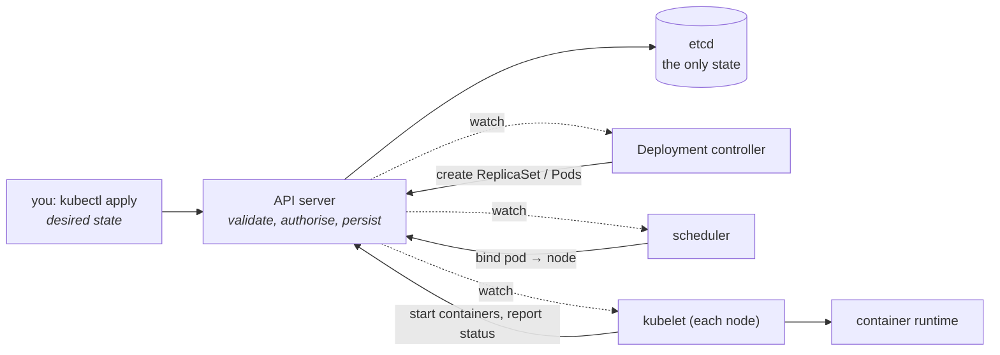
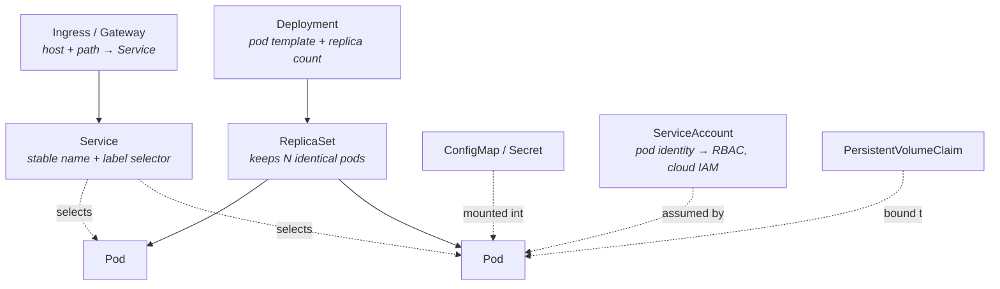

# Kubernetes: the object model

Most candidates can list the objects. Far fewer can explain the one idea that
makes Kubernetes comprehensible: **everything is a declared desired state, and
a controller loops forever trying to make reality match it.** Once you have
that, the object list stops being vocabulary and starts being derivable — and
the honest first answer to "would you use it" becomes possible.

---

## In brief

- **Kubernetes is a reconciliation engine, not a deployment tool.** You write
  desired state to the API server; controllers watch it and drive reality
  toward it, forever. Every behaviour that surprises people follows from this.
- **You probably do not need it.** One service on a managed runtime, or
  ECS/Fargate, is the right answer below a certain size. What justifies the
  cost is many services, many teams, one deployment model — and saying so is a
  stronger answer than reciting objects.
- **etcd is the only stateful thing.** The API server is a validating,
  authorising front door to it; the scheduler and controllers are stateless
  loops that could be killed and restarted without data loss.
- **The scheduler places pods on *requests*, not usage**, so a cluster can be
  full while every node looks idle.
- **Deployments are for interchangeable pods; StatefulSets are for pods with
  identity** — stable names, stable storage, ordered rollout. Databases need
  the second.
- **A Service is not a proxy you can see.** It is a label selector plus
  rules programmed into every node, which is why a Service with the wrong
  selector fails silently with zero endpoints.
- **A Secret is base64, not encryption.** Without encryption at rest it sits
  readable in etcd, so RBAC on Secrets is the real control.

---

## The one idea: declare, then reconcile


*Nothing in the cluster talks to anything except the API server. Each controller watches the state it cares about and writes back what it did — which is why a cluster self-heals, and why a bad desired state is applied patiently and repeatedly rather than failing once.*

Read that loop carefully, because four common questions fall straight out of it:

- **Why did my manual change get reverted?** A controller owns that object and
  reconciled it back. `kubectl edit` on a Deployment-owned pod is futile; this
  is also the entire basis of [GitOps](10-pipelines-and-gitops.md).
- **Why is my pod `Pending` forever?** Nothing failed. The scheduler simply has
  no node satisfying the pod's requirements and will keep trying.
- **Why does `kubectl apply` return success when the deploy is broken?** You
  only recorded intent. Success means etcd accepted it, not that it works —
  which is why `kubectl rollout status` exists.
- **Why can I kill the control plane and keep serving traffic?** Running pods
  are managed by the kubelet on each node. You lose the ability to *change*
  things, not the ability to serve.

### The control plane, by job

| Component | Job | If it dies |
| --- | --- | --- |
| **API server** | The only way in: authenticate, authorise, validate, persist to etcd, serve watches | No changes possible; existing pods keep running |
| **etcd** | The single source of truth, replicated by Raft | The cluster's memory is gone. This is the thing you back up |
| **scheduler** | Decide which node each pending pod binds to | New pods stay `Pending`; existing ones are untouched |
| **controller manager** | The built-in reconciliation loops (Deployment, ReplicaSet, node, endpoints…) | Nothing self-heals; drift accumulates |
| **kubelet** (per node) | Start and watch containers, report status, run probes | That node's pods go unmanaged and the node turns `NotReady` |
| **kube-proxy / CNI** (per node) | Program Service routing and pod networking | Networking breaks on that node |

**etcd is worth a paragraph of its own** because it is where interviewers probe
for depth. It is a Raft-replicated key-value store, so it needs an odd number
of members (3 or 5) to tolerate 1 or 2 failures, every write goes through
consensus, and it is latency-sensitive to disk `fsync` — etcd on slow storage
is the classic cause of a sluggish API server and flapping leader elections.
The consensus mechanics are in
[consensus and coordination](../02-interview-core/25-consensus-coordination.md).

---

## The objects, derived rather than listed


*Each arrow is an indirection that buys something: a Deployment can roll between ReplicaSets, a Service can front a changing set of pods, an Ingress can route to many Services. The label selector is the loose coupling throughout — and the thing that silently matches nothing when you get it wrong.*

**The workload objects**, and when each is the right one:

| Object | Use it for | The reason |
| --- | --- | --- |
| **Pod** | Almost never directly | One or more containers sharing a network namespace, IP and lifecycle. The schedulable unit. Nothing recreates a bare pod if its node dies |
| **ReplicaSet** | Never directly | Keeps N identical pods. Owned by a Deployment |
| **Deployment** | Stateless services | Owns the rollout and rollback between ReplicaSets. Pods are interchangeable and get random names |
| **StatefulSet** | Databases, brokers, anything with identity | Stable ordinal names (`db-0`, `db-1`), stable per-pod storage that survives rescheduling, ordered startup and shutdown |
| **DaemonSet** | Node agents | One pod per node: log shippers, metrics exporters, CNI. Scales with nodes, not with load |
| **Job / CronJob** | Batch and scheduled work | Run to completion with retries / on a schedule. A `CronJob` can overlap or miss runs, so idempotency matters |

**StatefulSet versus Deployment** is a real interview discriminator. Three
differences, all needed by stateful systems: **identity** (`db-0` is always
`db-0`, with a stable DNS name through a headless Service), **storage** (each
pod gets its own PVC that follows it when rescheduled, rather than sharing one),
and **ordering** (pods start 0, 1, 2 and terminate in reverse, so a cluster can
bootstrap and drain safely). A Postgres replica set in a Deployment would have
pods swapping names and volumes under it — which is the answer to "why not just
use a Deployment for the database".

**Services**, and the thing people get wrong:

| Type | What it does |
| --- | --- |
| **ClusterIP** | A virtual IP and DNS name inside the cluster. The default |
| **NodePort** | Opens the same port on every node. Mostly a building block |
| **LoadBalancer** | Asks the cloud for an external load balancer. One per Service gets expensive |
| **Headless** (`clusterIP: None`) | No virtual IP; DNS returns the pod IPs directly. What StatefulSets use for per-pod addressing |
| **ExternalName** | A DNS CNAME to something outside the cluster |

A Service is **not a running proxy pod**. It is a selector whose matching pod
IPs are collected into an `EndpointSlice`, and those endpoints are programmed
into every node's dataplane (iptables or eBPF via kube-proxy). Hence the
single most common "my service is broken" cause: the selector does not match the
pod labels — note that it matches **pod labels, not the Deployment's name** —
and `kubectl get endpointslices` shows zero addresses while everything else
looks healthy.

**Ingress** routes external HTTP by host and path to Services, and needs an
**ingress controller** actually running in the cluster (Nginx, Envoy, a cloud
one) — the `Ingress` object alone does nothing, which catches people out. Its
successor, the **Gateway API**, exists because Ingress ran out of expressiveness
and everyone encoded the rest in vendor-specific annotations; it splits the
concern into `Gateway` (infrastructure, owned by platform) and `HTTPRoute`
(routing, owned by app teams), which is a better fit for multi-team clusters.

**Config and identity:**

- **ConfigMap** — non-secret config as env vars or files. Mounted files update
  in place (eventually); env vars do **not** — they are fixed at container
  start, so a ConfigMap change needs a restart unless you mount it.
- **Secret** — the same, base64-encoded. **Encoding, not encryption.** Enable
  encryption at rest in etcd, restrict it with RBAC, and prefer an external
  store (Secrets Manager, Vault) fetched via workload identity. See
  [containers](06-containers.md).
- **ServiceAccount** — the pod's identity. It is what RBAC rules bind to, and
  what federates to cloud IAM (IRSA on EKS, Workload Identity on GKE) so a pod
  can reach a cloud API with no static credentials anywhere.
- **Namespace** — a scope for names, quotas (`ResourceQuota`) and access
  control. The usual multi-team boundary, though not a strong security one on
  its own: network policy and RBAC are what make it real.

---

## Scheduling: where a pod lands and why it does not

The scheduler runs two phases per pending pod: **filter** nodes that cannot run
it, then **score** the survivors and bind to the best.

What filters a node out:

- **Insufficient allocatable resources** against the pod's **requests** — and
  this is the one to say out loud: *scheduling is based on requests, not on
  actual usage*. A cluster whose pods request 4 CPUs each and use 0.1 is full
  while every dashboard shows idle nodes.
- **Taints** the pod does not tolerate. A taint on a node says "keep off unless
  you explicitly opt in" — used for GPU nodes, dedicated pools, and by the
  system to mark a node `NotReady`.
- **Node affinity** that does not match (`nodeSelector` is the simple form),
  and **pod (anti-)affinity** that is unsatisfiable.
- No volume available in the node's zone for its PVC.

Two controls worth knowing by name because they encode availability
requirements:

- **`podAntiAffinity` with `topologyKey: kubernetes.io/hostname`** spreads
  replicas across nodes, so one node failure does not take all three replicas.
  Using `topology.kubernetes.io/zone` spreads them across availability zones.
  Without it, the scheduler is free to put all your replicas on one node and
  frequently does.
- **`topologySpreadConstraints`** is the newer, more precise version: "keep the
  skew between zones at most 1", with a choice of whether to schedule anyway or
  stay `Pending` when it cannot be satisfied.

**Priority and preemption**: a pod with a higher `PriorityClass` can evict a
lower-priority pod to make room. Useful for guaranteeing a tier-0 service
capacity; dangerous if everything is declared critical, which is what always
happens unless someone owns the classes.

---

## Requests, limits, and the three QoS classes

This is the highest-yield detail in the whole chapter, because it explains most
real cluster pain.

- **Requests** are what the scheduler reserves and what the node guarantees.
  Too high wastes the cluster; too low lands your pod on a node with nothing
  left to give.
- **Limits** are the enforced ceiling. Over the **memory** limit the kernel
  kills the container (`OOMKilled`, exit 137). Over the **CPU** limit it is
  **throttled**, visible as latency, not a crash.

From the relationship between the two, the kubelet derives a **QoS class**, and
the class decides who dies when a *node* runs out of memory:

| Class | Condition | Eviction order |
| --- | --- | --- |
| **Guaranteed** | requests == limits, for every container and resource | Evicted last |
| **Burstable** | requests set, limits higher or absent | Evicted in the middle, worst-offender-first |
| **BestEffort** | no requests or limits at all | **Evicted first** |

So "we do not bother with requests and limits" is not neutral — it puts every
workload in `BestEffort`, first in line to be killed under node pressure, and
leaves the scheduler with nothing to reserve against so it overpacks nodes
until something dies.

The recommended shape, which is defensible and worth being able to justify:
**set memory request == memory limit** (memory is incompressible; you do not
want to be evicted for using what you asked for), and **set a CPU request with
no CPU limit, or a generous one** (CPU is compressible; a hard limit throttles
you during a burst you could have absorbed harmlessly). The counter-argument —
noisy neighbours and unpredictable capacity planning — is why many teams set
both anyway. Being able to argue either side is the senior answer.

Cluster-level guards: **`ResourceQuota`** caps a namespace's total requests and
limits, and **`LimitRange`** supplies defaults so a pod with no requests does
not silently become `BestEffort`.

---

## Building it

**A Deployment with the things that are usually missing** — anti-affinity,
honest requests and limits, a ServiceAccount, a locked-down security context,
and a `PodDisruptionBudget`:

```yaml
apiVersion: apps/v1
kind: Deployment
metadata:
  name: links-api
  labels: { app: links-api }
spec:
  replicas: 3
  revisionHistoryLimit: 5
  selector:
    matchLabels: { app: links-api }      # must match the pod labels below
  template:
    metadata:
      labels: { app: links-api }
    spec:
      serviceAccountName: links-api      # identity for RBAC and cloud IAM
      securityContext:
        runAsNonRoot: true
        runAsUser: 10001
        seccompProfile: { type: RuntimeDefault }
      topologySpreadConstraints:
        - maxSkew: 1                     # do not stack replicas in one zone
          topologyKey: topology.kubernetes.io/zone
          whenUnsatisfiable: ScheduleAnyway
          labelSelector:
            matchLabels: { app: links-api }
      containers:
        - name: api
          image: registry.example.com/links-api:1.4.2   # never :latest
          ports: [{ name: http, containerPort: 3000 }]
          env:
            - name: GOMAXPROCS           # the cgroup trap from 06-containers
              value: "1"
            - name: DATABASE_URL
              valueFrom: { secretKeyRef: { name: links-db, key: url } }
          envFrom:
            - configMapRef: { name: links-config }
          resources:
            requests: { cpu: 100m, memory: 256Mi }
            limits:   { memory: 256Mi }  # memory req==limit; no CPU limit on purpose
          securityContext:
            allowPrivilegeEscalation: false
            readOnlyRootFilesystem: true
            capabilities: { drop: ["ALL"] }
          volumeMounts:
            - { name: tmp, mountPath: /tmp }
      volumes:
        - name: tmp
          emptyDir: {}                   # scratch, since the root is read-only
---
apiVersion: v1
kind: Service
metadata: { name: links-api }
spec:
  selector: { app: links-api }           # pod labels, NOT the Deployment name
  ports: [{ port: 80, targetPort: http }]
---
apiVersion: policy/v1
kind: PodDisruptionBudget
metadata: { name: links-api }
spec:
  minAvailable: 2                        # node drains must respect this
  selector:
    matchLabels: { app: links-api }
```

The `PodDisruptionBudget` is the object most teams discover too late: without
it, a node drain or cluster upgrade is allowed to evict all three replicas at
once, and a routine maintenance operation becomes an outage.

**A StatefulSet, to see what changes**

```yaml
apiVersion: v1
kind: Service
metadata: { name: pg }
spec:
  clusterIP: None                        # headless: DNS returns pod IPs
  selector: { app: pg }
  ports: [{ port: 5432 }]
---
apiVersion: apps/v1
kind: StatefulSet
metadata: { name: pg }
spec:
  serviceName: pg                        # gives pods pg-0.pg, pg-1.pg DNS names
  replicas: 3
  podManagementPolicy: OrderedReady      # 0 ready before 1 starts
  selector: { matchLabels: { app: pg } }
  template:
    metadata: { labels: { app: pg } }
    spec:
      terminationGracePeriodSeconds: 60  # a database needs time to shut down
      containers:
        - name: pg
          image: postgres:16.2
          volumeMounts: [{ name: data, mountPath: /var/lib/postgresql/data }]
  volumeClaimTemplates:                  # one PVC per pod, follows the pod
    - metadata: { name: data }
      spec:
        accessModes: [ReadWriteOnce]
        resources: { requests: { storage: 100Gi } }
```

Three things to notice: the headless Service is what makes `pg-0.pg` resolvable;
`volumeClaimTemplates` creates a *separate* volume per pod rather than sharing
one; and those PVCs **are not deleted** when the StatefulSet is, which is
deliberate (your data outliving a `kubectl delete` is a feature) and a
footgun for whoever expected a clean teardown.

**Reading identity and RBAC**, since "how does a pod get AWS credentials" is a
standard question:

```yaml
apiVersion: v1
kind: ServiceAccount
metadata:
  name: links-api
  annotations:
    # EKS: federate this ServiceAccount to an IAM role. No static keys anywhere.
    eks.amazonaws.com/role-arn: arn:aws:iam::111122223333:role/links-api
---
apiVersion: rbac.authorization.k8s.io/v1
kind: Role                               # namespace-scoped; ClusterRole is global
metadata: { name: links-api-read-config, namespace: links }
rules:
  - apiGroups: [""]
    resources: ["configmaps"]
    verbs: ["get", "list", "watch"]      # least privilege: no secrets, no write
---
apiVersion: rbac.authorization.k8s.io/v1
kind: RoleBinding
metadata: { name: links-api-read-config, namespace: links }
subjects: [{ kind: ServiceAccount, name: links-api, namespace: links }]
roleRef: { kind: Role, name: links-api-read-config, apiGroup: rbac.authorization.k8s.io }
```

That annotation is the mechanism (IRSA on EKS, Workload Identity on GKE) that
replaces long-lived cloud keys in environment variables with a short-lived
token the pod exchanges for role credentials — the same "short-lived identity
rather than distributed secret" principle as everywhere else in this book.

---

## Interview Q&A

### Q: Would you run Kubernetes for a new service?
**Level:** senior · **Tags:** kubernetes, design

<details><summary>Model answer</summary>

Probably not, and the reasoning matters more than the answer.

Kubernetes buys one deployment model across many services and teams,
bin-packing across a fleet, and an ecosystem for autoscaling, policy, service
mesh and the rest. It costs a control plane to run or pay for, a real learning
curve for everyone who deploys, and a long tail of operational detail —
upgrades, CNI, resource tuning, admission controllers — that somebody has to
own as a job, not a side project.

For one or a few services I would take ECS on Fargate or an equivalent managed
container runtime: no nodes to patch, no scheduler to reason about, and the
deploy is a task-definition revision. The point where I change my mind is when
teams start independently reinventing the same deployment, service-discovery and
config machinery — that duplication is exactly what Kubernetes removes, and
then the platform cost is amortised across everyone.

If it is already there, use it. The cost is paid, and running something else
beside it is worse than either choice alone.

The thing I would resist is adopting it for the CV or because it is assumed.
A team of four running three services on Kubernetes spends more time on the
platform than the product.

</details>

**Follow-ups:**

1. Q: What breaks first when a team adopts it without experience?
   <details><summary>Answer</summary>

   Resource requests and limits. Nobody sets them, so every pod is `BestEffort`
   — first to be evicted under node pressure — and the scheduler has nothing to
   reserve against, so it overpacks nodes until something is OOMKilled. Or
   somebody sets limits far too low and gets CPU throttling that reads as slow
   code and gets debugged in the application for a week.

   Second: probes. A liveness probe pointed at the database, so a brief
   database wobble restarts the entire fleet during an incident it could have
   ridden out.

   Third: no `PodDisruptionBudget`, so the first cluster upgrade or node drain
   evicts every replica of something at once and a planned maintenance becomes
   an outage.

   All three are configuration, not code, which is why they are invisible until
   production.

   </details>

2. Q: What is actually in the control plane, and what happens if you lose it?
   <details><summary>Answer</summary>

   etcd holds all state, Raft-replicated. The API server is the only way in and
   out — authentication, authorisation, validation, persistence and watches.
   The scheduler binds pending pods to nodes. The controller manager runs the
   built-in reconciliation loops. On each node, the kubelet starts and watches
   containers and runs probes, and kube-proxy or a CNI programs networking.

   If you lose the control plane, running pods keep serving: the kubelet on
   each node already knows what should be running there. What you lose is
   *change* — no deploys, no scaling, no rescheduling of pods whose node dies,
   and no `kubectl`. So it is not an immediate outage, it is a frozen cluster
   that degrades as nodes fail.

   The thing I would actually protect is etcd: odd member count, fast disks
   because every write is an fsync through Raft, and tested backups. Losing
   etcd without a backup means the cluster's entire memory is gone.

   </details>

### Q: When do you need a StatefulSet instead of a Deployment?
**Level:** senior · **Tags:** kubernetes, state

<details><summary>Answer</summary>

When the pods are not interchangeable — when identity, storage or ordering
matters.

A Deployment treats its pods as identical cattle: random names, any pod can
serve any request, and a replacement is as good as the original. That is right
for a stateless API.

A StatefulSet gives three things a stateful system needs. **Stable identity**:
pods are `db-0`, `db-1`, and with a headless Service each has its own DNS name,
so peers can find each other and a replica knows who the primary is. **Stable
storage**: `volumeClaimTemplates` gives each pod its own PVC, which follows it
when rescheduled — rather than all replicas sharing one volume, which is
corruption. **Ordering**: pods start 0, 1, 2 and terminate in reverse, so a
quorum-based system can bootstrap and drain without losing quorum mid-way.

So: databases, Kafka, ZooKeeper, Elasticsearch, anything with cluster
membership.

Two caveats I would add. The PVCs survive deleting the StatefulSet, on purpose,
which surprises people during teardown. And a StatefulSet does not make
software distributed — it only provides the primitives. Running Postgres
yourself on Kubernetes means you own failover, backups and upgrades, and for
most teams a managed database is the better answer. The StatefulSet question is
really "do we want to operate this?"

</details>

### Q: A Service exists, the pods are Running, and nothing can reach it. Where do you look?
**Level:** intermediate · **Tags:** kubernetes, networking, debugging

<details><summary>Answer</summary>

`kubectl get endpointslices -l kubernetes.io/service-name=<svc>` first. If
there are no addresses, the Service is selecting nothing and everything else is
a red herring.

The usual cause is the selector. A Service selects **pod labels**, not the
Deployment's name, so a Service with `selector: {app: links}` and pods labelled
`app: links-api` matches nothing and fails completely silently — no error
anywhere, because an empty selection is legal.

If endpoints do exist, the next candidates in order: the port, since
`targetPort` must match the container's actual port, and a named port must
exist in the pod spec; readiness, because a pod failing readiness is
deliberately removed from endpoints, so `Running` but not `Ready` looks exactly
like this; then NetworkPolicy, because a default-deny policy in the namespace
drops the traffic with no log; then DNS, testing with
`kubectl run -it --rm dbg --image=busybox -- nslookup links-api.links.svc`.

I would confirm from inside the cluster before suspecting anything external:
`kubectl port-forward svc/links-api 8080:80` bypasses ingress entirely and tells
me whether the problem is the Service or everything in front of it.

</details>

### Q: How does a pod get credentials to call a cloud API?
**Level:** senior · **Tags:** kubernetes, security, identity

<details><summary>Answer</summary>

Through its ServiceAccount, federated to a cloud role — IRSA on EKS, Workload
Identity on GKE, equivalents elsewhere. The pod gets a projected, short-lived
OIDC token mounted as a file; the cloud SDK exchanges it for temporary role
credentials. No static key exists anywhere: not in an image, not in a Secret,
not in an environment variable, and nothing to rotate or leak.

The alternative people reach for is an access key in a Kubernetes Secret, which
I would push back on: it is a long-lived credential, it is base64 rather than
encrypted unless etcd encryption at rest is on, anyone with `get secrets` in
that namespace can read it, and rotating it is a redeploy.

Two related points I would raise unprompted. Node instance roles are the other
anti-pattern — if credentials live on the node, every pod on that node inherits
them, so permissions are as broad as the most privileged workload scheduled
there. And the ServiceAccount is also the RBAC subject, so the same object
carries the pod's in-cluster permissions; both should be least privilege, and
`automountServiceAccountToken: false` is worth setting for workloads that need
no API access at all.

</details>

---

## What a weak answer sounds like

- **Reciting objects without the reconciliation loop.** Everything surprising
  about Kubernetes follows from "controllers drive reality toward declared
  state", and nothing is explicable without it.
- **Reaching for Kubernetes** without being able to say what it buys over a
  managed container runtime for *this* system.
- **"We don't set requests and limits."** That is `BestEffort` QoS, first to be
  evicted, plus an overpacked scheduler.
- **Not knowing a memory limit kills and a CPU limit throttles.**
- **Believing a Secret is encrypted.** It is base64 in etcd.
- **A Service selecting the Deployment's name** rather than the pod labels, then
  debugging the network.
- **Thinking an `Ingress` object routes traffic** without a controller running.
- **A database in a Deployment**, with replicas sharing one volume.
- **No `PodDisruptionBudget`**, so a routine node drain takes out every replica.
- **Static cloud keys in a Secret** instead of a federated ServiceAccount.

---

## Quiz

### MCQ: What single idea explains why a manual `kubectl edit` to a Deployment-managed pod gets reverted?
- [ ] The API server rejects manual edits to pods
- [x] Kubernetes is a reconciliation engine — controllers continuously drive reality toward the declared desired state, so an out-of-band change is simply undone on the next loop
- [ ] Pods are immutable once scheduled
- [ ] Only the kubelet may modify a running pod
**Why:** Declare-then-reconcile is the core model, and it is also exactly why GitOps works: if the cluster always converges to declared state, then the git repository can be that declaration.

### MCQ: Which component holds all cluster state?
- [ ] The API server
- [x] etcd — the API server is a stateless, validating, authorising front door to it, and the scheduler and controllers are stateless loops
- [ ] The controller manager
- [ ] The kubelet on each node
**Why:** This is why etcd is the thing you back up and the thing whose disk latency determines control-plane health: every write goes through Raft consensus and an fsync.

### MCQ: You lose the entire control plane. What happens to traffic?
- [ ] All pods stop immediately
- [x] Running pods keep serving, because each node's kubelet already knows what should run there — what is lost is the ability to change anything: deploys, scaling, rescheduling
- [ ] Traffic fails over to another cluster automatically
- [ ] Pods continue but all Services stop routing
**Why:** The control plane is the change-management layer, not the dataplane. The cluster is frozen rather than dead, and degrades only as nodes subsequently fail with nothing to reschedule them.

### MCQ: A cluster reports no capacity for new pods, but node CPU dashboards show 5% usage. Why?
- [ ] The metrics server is broken
- [x] The scheduler reserves based on pods' resource *requests*, not actual usage — oversized requests fill the cluster while real consumption stays low
- [ ] The nodes are cordoned
- [ ] CPU limits are preventing new pods from being created
**Why:** Requests are a reservation. The gap between requested and used capacity is the main source of cluster waste, and closing it is what right-sizing and VPA are for.

### MCQ: A pod has no resource requests or limits set. Which QoS class does it get, and what does that mean?
- [ ] Guaranteed — nothing is competing for its resources
- [x] BestEffort — it is the first thing evicted when a node comes under memory pressure
- [ ] Burstable — it may use whatever is spare
- [ ] It is rejected by the API server
**Why:** QoS is derived from the requests/limits relationship: equal is Guaranteed, requests-below-limits is Burstable, nothing set is BestEffort. "We don't bother with requests" silently opts every workload into the first-to-die tier.

### MCQ: Why does the chapter recommend setting a memory request equal to the memory limit, but being wary of a hard CPU limit?
- [ ] Memory limits are advisory while CPU limits are enforced
- [x] Memory is incompressible — exceeding it means being killed, so you want the amount you asked for guaranteed; CPU is compressible, so a hard ceiling throttles a burst the node could have absorbed harmlessly
- [ ] CPU limits are not supported on all container runtimes
- [ ] It makes the pod Guaranteed QoS, which disables eviction entirely
**Why:** The compressible/incompressible distinction drives the whole policy. The counter-argument — noisy neighbours and predictable capacity — is legitimate, and being able to argue both sides is the senior answer.

### MCQ: A Service is defined, pods are `Running`, and nothing can reach it. What is the first thing to check?
- [ ] The Ingress controller's logs
- [x] Whether the Service has any endpoints — a selector that does not match the *pod labels* selects nothing and fails silently
- [ ] Whether the cluster DNS pods are healthy
- [ ] The node's iptables rules
**Why:** An empty selection is legal, so there is no error to find. The related traps are a `targetPort` that does not match the container port, and pods that are `Running` but not `Ready`, which are deliberately excluded from endpoints.

### MCQ: What does a StatefulSet provide that a Deployment does not?
- [ ] Automatic database backups
- [x] Stable per-pod identity and DNS, a dedicated PersistentVolumeClaim per pod that follows it when rescheduled, and ordered startup and shutdown
- [ ] Higher scheduling priority
- [ ] Replication of data between pods
**Why:** It supplies the primitives a clustered stateful system needs; it does not make the software distributed. Data replication and failover remain the application's job, which is the real argument for a managed database.

### MCQ: What is the practical security status of a Kubernetes `Secret`?
- [ ] Encrypted at rest by default with a per-cluster key
- [x] Base64-encoded, which is encoding and not encryption — without etcd encryption at rest it is readable in etcd, so RBAC and an external secrets store are the real controls
- [ ] Encrypted only when mounted as a file rather than an env var
- [ ] Stored outside etcd in a dedicated vault component
**Why:** Base64 is a transport encoding. The defences that actually matter are encryption at rest, tight RBAC on `get secrets`, and preferring a federated workload identity so there is no long-lived secret to store.

### MCQ: Why does a `PodDisruptionBudget` matter during a cluster upgrade?
- [ ] It prevents the cluster from being upgraded while pods are running
- [x] Without it, voluntary disruptions like a node drain may evict every replica of a workload at once, turning planned maintenance into an outage
- [ ] It guarantees pods are rescheduled to the same zone
- [ ] It raises the workload's scheduling priority during the upgrade
**Why:** A PDB constrains *voluntary* disruption only — it bounds how many pods a drain may remove simultaneously. It cannot protect against a node simply failing, which is what anti-affinity and topology spread are for.

---

## Glossary

- **Reconciliation loop** — a controller watching declared state and continuously driving reality toward it.
- **API server** — the only entry point: authenticates, authorises, validates, persists, serves watches.
- **etcd** — the Raft-replicated key-value store holding all cluster state; the thing to back up.
- **kubelet** — the per-node agent that starts containers, runs probes and reports status.
- **Pod** — the schedulable unit: containers sharing a network namespace, IP and lifecycle.
- **Deployment** — pod template plus replica count; owns rollout and rollback between ReplicaSets.
- **StatefulSet** — stable pod identity, per-pod storage, ordered lifecycle; for stateful systems.
- **DaemonSet** — one pod per node, for agents.
- **Service** — a stable name and virtual IP in front of pods matched by label selector.
- **EndpointSlice** — the resolved list of pod addresses behind a Service; empty means a selector mismatch.
- **Headless Service** — `clusterIP: None`; DNS returns pod IPs, giving StatefulSet pods addressable names.
- **Ingress / Gateway API** — HTTP routing from outside the cluster; needs a controller to do anything.
- **ConfigMap / Secret** — config and credentials; env vars are fixed at start, mounted files update.
- **ServiceAccount** — the pod's identity for RBAC and for federating to cloud IAM (IRSA, Workload Identity).
- **Requests vs limits** — what the scheduler reserves versus the enforced ceiling.
- **QoS class** — Guaranteed / Burstable / BestEffort, derived from requests vs limits; sets eviction order.
- **Taint and toleration** — "keep off this node unless you opt in".
- **Pod anti-affinity / topology spread** — keeping replicas on different nodes or zones.
- **PodDisruptionBudget** — the minimum availability a voluntary disruption such as a drain must respect.
- **ResourceQuota / LimitRange** — namespace-level caps, and defaults so pods are not accidentally BestEffort.
