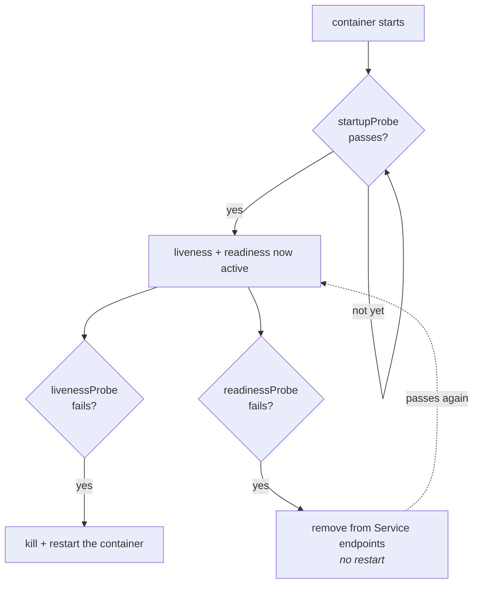
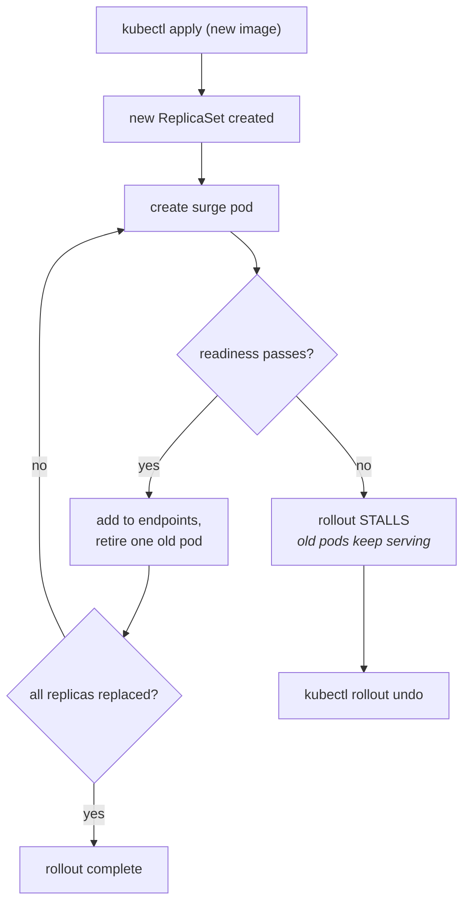
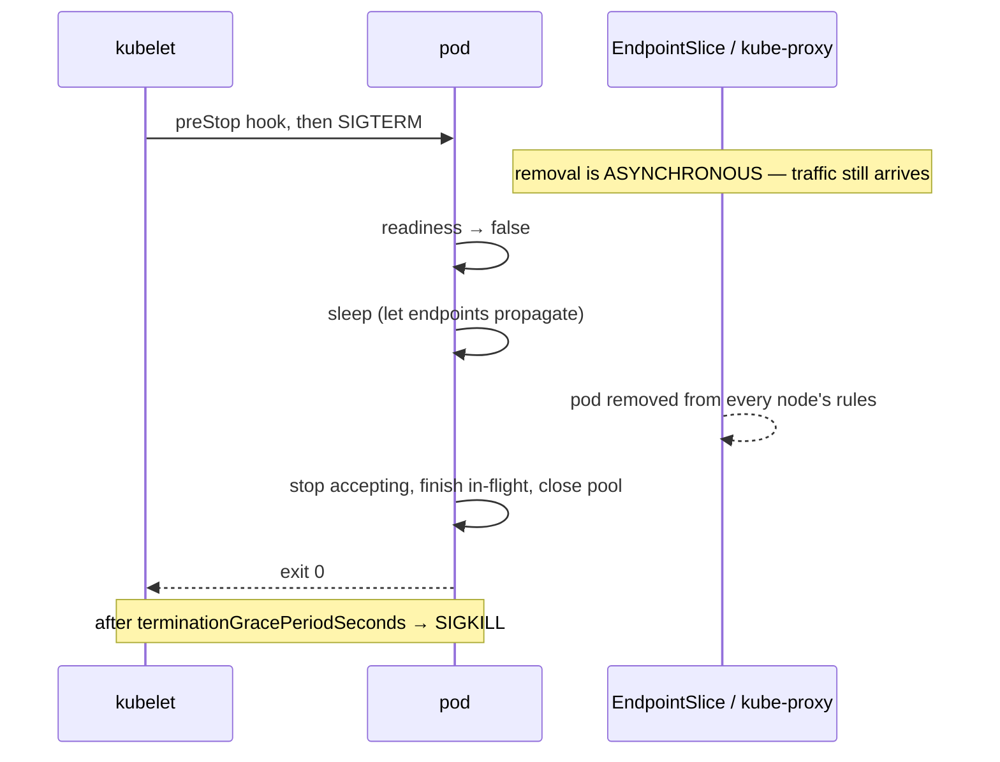

# Kubernetes: operating it

The object model is the easy half. This is the half interviews actually test,
because it is where the outages come from: probes that restart a healthy fleet,
rollouts that never finish, autoscalers that make the bottleneck worse, and the
five minutes of `kubectl` that separate a diagnosis from a guess.

---

## In brief

- **Liveness is shallow, readiness may be deep.** A liveness probe that checks
  the database restarts every pod when the database wobbles, turning a
  recoverable blip into a fleet-wide outage.
- **A rollout is gated by readiness, which is the feature.** A bad image never
  takes traffic because the rollout stalls instead of replacing healthy pods —
  which is also why a missing readiness probe turns a deploy into an outage.
- **Graceful shutdown is not automatic.** Endpoint removal is eventually
  consistent, so a pod that exits the instant it gets `SIGTERM` still receives
  traffic for a moment: fail readiness first, sleep, *then* drain.
- **Scale on the signal that is actually saturating.** Scaling on CPU when the
  constraint is a connection pool adds pods that make the bottleneck worse.
- **HPA without the cluster autoscaler just creates `Pending` pods**, and the
  cluster autoscaler cannot evict what a PodDisruptionBudget protects.
- **`kubectl describe` before `kubectl logs`.** The events at the bottom
  distinguish `ImagePullBackOff`, a failed mount and `OOMKilled`, which look
  identical from the outside.
- **`--previous` or you are reading the wrong container.** In a crash loop the
  running container is the new attempt; the error is in the one that died.

---

## Probes: the three questions


*Two different failures with two different blast radii. Readiness failing removes one instance from rotation and is cheap; liveness failing restarts the container and, if the cause is shared, restarts every container at once.*

| Probe | Question | Failure means |
| --- | --- | --- |
| **startupProbe** | Has it finished booting? | Hold the other two off. Nothing is killed while it is still failing (up to `failureThreshold`) |
| **livenessProbe** | Is this process wedged? | Kill and restart the container |
| **readinessProbe** | Can it serve traffic right now? | Remove it from the Service's endpoints. **No restart** |

**The classic outage, stated precisely:** a liveness probe that queries the
database. The database has a two-second hiccup, every pod's liveness probe
fails, the kubelet on every node restarts every container simultaneously, and
now you have a cold fleet with empty caches and a thundering herd of
reconnections hitting a database that was about to recover on its own. A
readiness probe doing the same check would have removed pods from rotation and
put them back, with no restarts and no cold start.

So: **liveness checks only this process** — can it answer at all — and should
be close to trivial. **Readiness may check dependencies**, because failing it
is reversible and local.

The timing fields are where subtler bugs live:

- **`initialDelaySeconds` is a guess, and `startupProbe` is the correct tool.**
  A delay that is too short restarts the pod during a slow boot (and the
  restart makes the boot slower, so it loops); too long means a genuinely
  wedged process is left serving errors for minutes. A startup probe with a
  generous `failureThreshold` replaces the guess with a measurement.
- **`periodSeconds × failureThreshold` is your actual detection time.** Default
  10s × 3 means a wedged pod serves errors for 30 seconds. Make it tighter for
  readiness than for liveness: you want to be pulled from rotation quickly and
  restarted reluctantly.
- **`timeoutSeconds` defaults to 1.** A probe endpoint that occasionally takes
  1.1 seconds under load produces mystery restarts that correlate with traffic,
  which is a genuinely nasty thing to debug.

---

## Rollouts, and how they stall

A Deployment update creates a new ReplicaSet and shifts replicas across,
governed by two numbers:

- **`maxSurge`** — how many extra pods above the replica count may exist during
  the rollout. Costs capacity, buys speed.
- **`maxUnavailable`** — how many of the desired replicas may be missing.
  Setting this to 0 means you never dip below full capacity; it requires
  `maxSurge > 0` and room in the cluster to schedule the extra pods.


*The readiness gate is the safety mechanism: a broken image never displaces a working pod. The failure mode it creates is a rollout that hangs forever rather than failing loudly, which is why `progressDeadlineSeconds` and watching `rollout status` in the pipeline matter.*

**A stalled rollout is the normal failure**, and the reasons, in order of
frequency: the new pods never pass readiness (bad config, missing secret, a
dependency they cannot reach); they cannot be scheduled at all (`Pending` — no
node has the requested resources, or anti-affinity cannot be satisfied with
`maxSurge` extra pods); or the image cannot be pulled. `progressDeadlineSeconds`
(default 600) marks the Deployment as failed after that long, which is what
turns a silent hang into something a pipeline can detect.

`kubectl rollout undo deploy/<d>` returns to the previous ReplicaSet —
and only works if `revisionHistoryLimit` kept it, which is why setting that to
0 to tidy up is a trap.

**The limits of a rollout as a safety mechanism.** A rolling update protects
you from a pod that fails to *start*. It does nothing about code that starts
fine and is subtly wrong — a 5% error-rate increase, a permission check
inverted, a query that is 10× slower. For those you need a canary with
automatic comparison against the previous version, and a feature flag so
behaviour can be switched off without a redeploy. Both are in
[pipelines and GitOps](10-pipelines-and-gitops.md), and the distinction between
*deploying code* and *releasing behaviour* is the senior framing.

---

## Graceful shutdown, in the order that actually works

This is the most commonly broken thing in a real cluster, and it produces a
small burst of 502s on every single deploy that teams learn to ignore.


*The pod's removal from the load-balancing rules on every node happens in parallel with its shutdown, not before it. A process that exits immediately on SIGTERM is still a routing target for a moment — which is exactly the window where requests are dropped.*

The correct sequence, which is worth being able to state in order:

1. **Fail readiness immediately** so the endpoint controller starts removing
   you.
2. **Wait** — a few seconds, via a `preStop` sleep or in the handler — for that
   removal to propagate to every node's dataplane.
3. **Stop accepting** new connections.
4. **Finish in-flight requests**, with a bound.
5. **Close** the database pool, flush logs and metrics, exit 0.

And `terminationGracePeriodSeconds` must exceed steps 2–4 combined, or the
kubelet `SIGKILL`s you mid-request. The default is 30 seconds; a service with
slow requests, or a database, needs more.

```yaml
lifecycle:
  preStop:
    exec:
      # Buy time for endpoint removal to propagate before the app starts
      # draining. Crude, and the standard answer.
      command: ["sh", "-c", "sleep 5"]
terminationGracePeriodSeconds: 45
```

---

## Autoscaling: three different things

| Scaler | Changes | Watch out for |
| --- | --- | --- |
| **HPA** (horizontal) | Replica count, from a metric | Scaling on the wrong metric; thrash without stabilisation windows |
| **VPA** (vertical) | Requests and limits of a pod | Usually restarts the pod to apply; conflicts with HPA on the same metric |
| **Cluster autoscaler** / Karpenter | Node count | Cannot help if pods fit but are `Pending` for affinity reasons; cannot remove nodes whose pods a PDB protects |

**HPA and the cluster autoscaler are a pair.** HPA creates pods; if no node has
room they sit `Pending`; the cluster autoscaler notices unschedulable pods and
adds a node. Deploy one without the other and you get an autoscaler that
"doesn't work" — pods pending forever, or nodes that never scale down.

**Scale on the metric that is actually saturating.** CPU is the default and is
frequently wrong:

- A **worker** should scale on **queue depth or message age**, not CPU. Age is
  better than depth: it directly expresses "how far behind are we", which is
  what the SLO is about.
- A service bounded by a **connection pool** or an upstream rate limit should
  not scale on CPU at all — more pods means more pool connections to the same
  database, so you scale the bottleneck's load while CPU stays flat. This is
  the most instructive autoscaling mistake there is.
- **Requests in flight** or p99 latency are often the honest signals, available
  through custom or external metrics adapters.

Two tuning details that come up: the HPA's **stabilisation window** prevents
flapping (scale up fast, scale down slow — the asymmetry is deliberate,
because scaling up wrongly costs money and scaling down wrongly costs an
outage), and HPA cannot scale below 1, so "scale to zero" needs something else
(KEDA, Knative).

**Over-provisioning on purpose** is the under-discussed answer: scaling up takes
time — HPA evaluation, pod scheduling, image pull, application boot, warm-up —
which can be minutes end to end. If your traffic arrives in seconds, no
autoscaler saves you, and the answer is headroom plus
[load shedding](../02-interview-core/29-resilience-rate-limiting.md), not a
faster autoscaler.

---

## Building it

**The probe endpoints, with the shutdown sequence wired in**

```ts
// Liveness: deliberately dumb. If this process can answer, it is not wedged.
// Checking a dependency here is the classic outage: one slow database and
// the kubelet restarts every pod in the fleet at once.
app.get('/healthz', (_req, res) => res.sendStatus(200));

// Readiness: may be deep, because failing it only removes THIS instance from
// the Service's endpoints. It must also go false on shutdown, before we stop
// accepting, so endpoint removal can propagate while we are still serving.
let ready = false;
app.get('/readyz', async (_req, res) => {
  if (!ready) return res.sendStatus(503);
  try { await db.ping(); res.sendStatus(200); } catch { res.sendStatus(503); }
});

const server = app.listen(3000, () => { ready = true; });

process.on('SIGTERM', async () => {
  ready = false;                       // 1. fail readiness first
  await sleep(5_000);                  // 2. let endpoint removal propagate
  server.close(async () => {           // 3. stop accepting, drain in-flight
    await db.end();                    // 4. close the pool
    process.exit(0);
  });
  // 5. a hard bound, below terminationGracePeriodSeconds
  setTimeout(() => process.exit(1), 25_000).unref();
});
```

The equivalent exists in every runtime — Go uses `srv.Shutdown(ctx)`, Python a
lifespan handler — and the ordering is identical in all of them.

**The probe spec that goes with it**

```yaml
startupProbe:                 # replaces guessing initialDelaySeconds
  httpGet: { path: /healthz, port: 3000 }
  periodSeconds: 2
  failureThreshold: 45        # tolerate a 90s boot, then give up
livenessProbe:
  httpGet: { path: /healthz, port: 3000 }
  periodSeconds: 10
  timeoutSeconds: 3           # NOT the 1s default: a slow probe = mystery restarts
  failureThreshold: 3         # 30s to restart: reluctant, on purpose
readinessProbe:
  httpGet: { path: /readyz, port: 3000 }
  periodSeconds: 5
  timeoutSeconds: 3
  failureThreshold: 2         # 10s to leave rotation: eager, on purpose
```

**An HPA on the right signal**

```yaml
apiVersion: autoscaling/v2
kind: HorizontalPodAutoscaler
metadata: { name: links-worker }
spec:
  scaleTargetRef: { apiVersion: apps/v1, kind: Deployment, name: links-worker }
  minReplicas: 2
  maxReplicas: 30
  metrics:
    - type: External                  # queue age, not CPU: "how far behind are we"
      external:
        metric: { name: sqs_oldest_message_age_seconds }
        target: { type: AverageValue, averageValue: "30" }
  behavior:
    scaleUp:
      stabilizationWindowSeconds: 0   # react immediately to a backlog
    scaleDown:
      stabilizationWindowSeconds: 300 # retreat slowly: a wrong scale-down is an outage
```

**The triage commands, in the order you actually run them**

| Need | Command |
| --- | --- |
| What is broken | `kubectl get pods -o wide` — look at STATUS and RESTARTS |
| **Why** it is broken | `kubectl describe pod <p>` — **read the events at the bottom first** |
| What it said before it died | `kubectl logs <p> --previous` |
| What it is saying now | `kubectl logs -f deploy/<d> --all-containers` |
| Get inside | `kubectl exec -it <p> -- sh` |
| Get inside a distroless image | `kubectl debug -it <p> --image=busybox --target=<c>` |
| Bypass ingress entirely | `kubectl port-forward svc/<s> 8080:80` |
| Is the rollout done | `kubectl rollout status deploy/<d> --timeout=5m` |
| Undo it | `kubectl rollout undo deploy/<d>` |
| Why is nothing scheduling | `kubectl describe node <n>`, `kubectl top nodes` |
| Does the Service select anything | `kubectl get endpointslices -l kubernetes.io/service-name=<s>` |
| What changed recently | `kubectl get events --sort-by=.lastTimestamp \| tail -30` |
| Who am I allowed to be | `kubectl auth can-i --list --as=system:serviceaccount:ns:sa` |

**The decision tree for a pod that is not serving** — this is the thing worth
rehearsing out loud, because the live-debugging round is exactly this:

```
STATUS?
├── Pending ................ nothing has gone wrong; it cannot be placed.
│     describe pod → events. Insufficient cpu/memory (requests too high, or
│     cluster full), unsatisfiable affinity/topology, an untolerated taint,
│     or a PVC with no volume in the right zone.
├── ImagePullBackOff ....... wrong tag/registry, or missing imagePullSecret.
├── CrashLoopBackOff ....... it starts and dies. logs --previous is the answer.
│     Empty logs → dying before it can log: bad command, missing env var,
│     permission denied on a read-only root filesystem.
│     describe shows OOMKilled/137 → memory limit, not a code bug.
├── Running, 0/1 Ready ..... readiness is failing. Hit the endpoint yourself
│     via exec or port-forward. Usually a dependency, a bad path, or a
│     timeoutSeconds that is too tight under load.
├── Running, Ready, errors . the app's own problem, OR
│     CPU throttling (check throttling metrics — latency with no crash), OR
│     the Service selects the wrong labels (zero endpoints).
└── Terminating forever .... a finalizer, or a process ignoring SIGTERM.
```

---

## Interview Q&A

### Q: A pod is in CrashLoopBackOff. Walk me through it.
**Level:** intermediate · **Tags:** kubernetes, debugging

<details><summary>Answer</summary>

`kubectl describe pod` first, and I read the events at the bottom before
anything else, because they separate cases that look identical from outside:
`ImagePullBackOff` is a wrong tag or missing registry credential; a failed
mount is a ConfigMap or Secret that does not exist; and `OOMKilled` with exit
code 137 is the memory limit, which is a configuration problem rather than a
code problem.

Then `kubectl logs <pod> --previous`, because the container currently running
is the *new* attempt and the error is in the one that died. Reading the live
logs instead is the most common wasted five minutes here.

If the logs are empty, the process is dying before it can log, which points at
the command itself, a missing environment variable, or a filesystem permission
— a read-only root filesystem with no writable `/tmp` does exactly this. I'd
confirm by running the same image with a sleep command and poking around, or
with `kubectl debug` if it is distroless.

Two non-crash causes worth ruling out while I am there. A liveness probe
failing because the application's boot takes longer than the probe allows —
that needs a `startupProbe`, not a code change, and it loops because each
restart makes the boot slower. And a readiness probe that never passes, which
leaves the pod `Running` but out of the Service, so it looks broken without
restarting.

</details>

**Follow-ups:**

1. Q: The events say OOMKilled. Is the fix to raise the limit?
   <details><summary>Answer</summary>

   Maybe, but I'd want to know whether it is a sizing problem or a leak first,
   because raising the limit on a leak just moves the outage later and makes it
   bigger.

   The distinguishing evidence is the memory trend across the pod's lifetime:
   rising to a plateau is sizing, rising monotonically through quiet periods is
   a leak. Container memory working-set graphs show it, and so does the
   restart cadence — a leak OOMKills on a regular rhythm proportional to
   traffic.

   I'd also check whether the request equals the limit. If the request is much
   lower, the pod was scheduled onto a node that could not actually give it
   what it uses, and it is also Burstable QoS, so it can be evicted under node
   pressure in addition to being OOMKilled at its own limit.

   And one language-specific thing: if the runtime sized its heap or its
   thread pools from the *host's* memory and CPU rather than the cgroup, the
   process is trying to use far more than the limit by design. That is the
   container-awareness trap, and no limit increase fixes it properly.

   </details>

2. Q: The pod is `Pending`. What is wrong?
   <details><summary>Answer</summary>

   Nothing has failed — the scheduler simply has no node that satisfies it, and
   it will keep trying forever. `kubectl describe pod` and read the scheduler's
   event, which states the reason per node.

   The usual causes: insufficient CPU or memory against the pod's *requests*
   — note requests, not usage, so the cluster can be full while the nodes look
   idle; an affinity or topology-spread constraint that cannot be satisfied,
   which is common during a rollout because `maxSurge` needs an extra pod
   somewhere; a taint the pod does not tolerate; or a PVC that must bind to a
   volume in a zone where no eligible node exists.

   If the reason is capacity, the question is whether the cluster autoscaler is
   running and whether it is able to add a node — it will not if the pod's
   requests exceed any possible node size, which is a silent and confusing
   version of this.

   </details>

### Q: Why is a liveness probe that queries the database dangerous?
**Level:** senior · **Tags:** kubernetes, reliability

<details><summary>Answer</summary>

Because liveness failure means *restart*, and the cause is shared.

The database has a two-second hiccup. Every pod's liveness probe fails at
roughly the same moment. The kubelet on every node kills and restarts every
container simultaneously. Now the fleet is cold — empty caches, fresh
connection pools — and all of it reconnects at once to a database that was
about to recover on its own. A two-second blip has become a multi-minute
outage, and the orchestrator caused it.

Readiness is the right place for dependency checks, because failing it is
local and reversible: the pod leaves the Service's endpoints, stops receiving
traffic, and rejoins when the check passes. Nothing restarts, nothing goes
cold.

So the rule is: liveness answers "is this process wedged" and should be close
to trivial — if it can respond at all, it is alive. Readiness answers "should I
be in rotation right now" and may be deep.

There is a nuance worth adding: if *every* pod fails readiness, you have taken
the whole service out of rotation, which is also an outage. Some teams
deliberately make readiness shallow for exactly that reason and handle
dependency failure in the application with circuit breakers and degraded
responses instead — which is often the better engineering answer, because
serving a degraded response beats serving nothing.

</details>

### Q: Your rollout is stuck at 2 of 5 updated and nothing is changing. What is happening?
**Level:** senior · **Tags:** kubernetes, deployment, debugging

<details><summary>Answer</summary>

A rolling update only replaces an old pod once the new one passes readiness, so
a stall means the new pods are not becoming ready — and the good news is that
the old pods are still serving, which is the gate doing its job.

I'd look at the new ReplicaSet's pods specifically.
`kubectl get pods -l app=x --sort-by=.metadata.creationTimestamp` to find them,
then describe them. Three shapes: they are `Pending`, so this is a scheduling
problem — frequently because `maxSurge` requires an extra pod and
anti-affinity or cluster capacity cannot accommodate it; they are
`CrashLoopBackOff`, so it is a bad image or missing config; or they are
`Running` but not `Ready`, which is readiness failing — a dependency the new
version needs and does not have, a renamed health path, or a new secret that
was not created.

`progressDeadlineSeconds` is what should have surfaced this automatically: after
it elapses the Deployment is marked failed, which is what a pipeline watching
`kubectl rollout status` reacts to. If nobody set it, a stalled rollout can sit
unnoticed for hours, with half the fleet on each version.

Then `kubectl rollout undo` to get back to one version while I work out why,
rather than debugging in a split state — assuming `revisionHistoryLimit` kept
the old ReplicaSet, which is a reason not to set it to 0.

</details>

### Q: How do you make deploys not drop requests?
**Level:** senior · **Tags:** kubernetes, reliability, deployment

<details><summary>Answer</summary>

The key fact is that a pod's removal from the Service endpoints happens
*concurrently* with its shutdown, not before it. kube-proxy or the CNI on every
node has to be told, and that propagation takes a moment — so a process that
exits immediately on `SIGTERM` is still a routing target when it stops
listening. That window is the dropped requests, and it is why the burst of 502s
on every deploy that teams learn to ignore exists.

The sequence that fixes it: fail readiness first; wait a few seconds for
endpoint removal to propagate, either in the handler or with a `preStop` sleep;
then stop accepting; then finish in-flight requests with a bound; then close
the pool and exit. And `terminationGracePeriodSeconds` has to be larger than
all of that, or the kubelet `SIGKILL`s you in the middle.

Two prerequisites that are easy to miss. The application must actually receive
`SIGTERM`, which means an exec-form entrypoint — shell form makes `/bin/sh`
PID 1 and it never forwards the signal. And clients need retries on idempotent
requests, because no amount of draining handles a connection that was already
in flight on a pod whose node vanished.

On the other side of the deploy: `maxUnavailable: 0` so capacity never dips,
and a `PodDisruptionBudget` so node drains and cluster upgrades respect the
same guarantees the rollout does.

</details>

### Q: You put an HPA on a worker and it made things worse. Why?
**Level:** senior · **Tags:** kubernetes, autoscaling

<details><summary>Answer</summary>

Almost certainly scaling on CPU when CPU is not the constraint.

The specific shape I have seen most: the workers are bounded by the database
connection pool or an upstream rate limit, not by CPU. The queue backs up, CPU
stays flat because the workers are mostly waiting, so either the HPA does not
react at all, or it reacts to a partial CPU signal by adding pods — and each
new pod opens its own pool connections to the same database. You have scaled
the load on the bottleneck, so throughput falls and latency rises. More
capacity made it slower.

For a worker the right signal is queue depth or, better, **oldest message
age**, because that is literally "how far behind are we" and maps onto the SLO.
For a request service it is often in-flight requests or p99 latency rather than
CPU.

Two other ways an HPA makes things worse. Without the cluster autoscaler it
creates pods that sit `Pending`, so it looks broken and does nothing. And
without stabilisation windows it thrashes — scaling up on a spike, down on the
trough, with every scale-up paying a cold-start cost. The asymmetric default is
right: up quickly, down slowly.

The broader point I would make is that autoscaling is not a latency fix. The
loop from metric to serving pod is evaluation plus scheduling plus image pull
plus boot plus warm-up, which can be minutes. If traffic arrives in seconds,
the answer is headroom and load shedding, not a more aggressive autoscaler.

</details>

---

## What a weak answer sounds like

- **A liveness probe that checks a dependency.** One wobble restarts the fleet.
- **Not knowing the difference in blast radius** between liveness and readiness
  failing.
- **Guessing `initialDelaySeconds`** instead of using a `startupProbe`.
- **Exiting immediately on `SIGTERM`**, then calling the resulting 502s on
  every deploy "normal".
- **`terminationGracePeriodSeconds` shorter than the drain**, so the kubelet
  kills mid-request.
- **`kubectl logs` without `--previous`** on a crash loop, reading the wrong
  container.
- **Jumping to logs before `describe`**, and so missing `OOMKilled`,
  `ImagePullBackOff` or a failed mount in the events.
- **Scaling on CPU by reflex**, especially for a worker or a pool-bound
  service.
- **An HPA with no cluster autoscaler**, then "autoscaling doesn't work".
- **Treating a rolling update as a safety net** for logic bugs — it only
  catches pods that fail to start.

---

## Quiz

### MCQ: What is the difference in consequence between a failing liveness probe and a failing readiness probe?
- [ ] Both restart the container; readiness just does it faster
- [x] Liveness failure kills and restarts the container; readiness failure only removes the pod from the Service's endpoints, with no restart
- [ ] Liveness removes the pod from endpoints; readiness restarts it
- [ ] Readiness failure evicts the pod to another node
**Why:** The asymmetry in blast radius is the whole reason to keep liveness shallow: a restart is expensive and, when the cause is a shared dependency, happens to every pod simultaneously.

### MCQ: Why is `startupProbe` preferable to a long `initialDelaySeconds`?
- [ ] `initialDelaySeconds` is deprecated
- [x] It measures rather than guesses — it holds liveness and readiness off until boot genuinely completes, so a slow boot is not restarted and a wedged process is still detected promptly afterwards
- [ ] It allows the probe to check dependencies safely
- [ ] It reduces the number of probe requests overall
**Why:** A too-short delay restarts during boot, and each restart makes the boot slower, so it loops. A too-long delay leaves a wedged process serving errors. The startup probe removes the trade-off.

### MCQ: A pod exits immediately on `SIGTERM` and users see a burst of 502s on every deploy. Why?
- [ ] The readiness probe is misconfigured
- [x] Removal from the Service's endpoints propagates asynchronously to every node, so the pod is still a routing target for a moment after it stops listening
- [ ] `SIGTERM` is sent after the pod is already deleted from the API
- [ ] The load balancer caches DNS for the pod IP
**Why:** The fix is ordering: fail readiness, wait for propagation, then stop accepting and drain — with `terminationGracePeriodSeconds` long enough to cover it.

### MCQ: A rolling update is stuck with 2 of 5 pods updated and nothing changing. What is the most likely situation?
- [ ] The cluster has lost its connection to etcd
- [x] The new pods are not passing readiness (or cannot be scheduled), so the rollout correctly refuses to retire more healthy old pods
- [ ] `kubectl apply` failed silently and must be re-run
- [ ] The old ReplicaSet is blocking the new one
**Why:** The readiness gate means a broken version never displaces working pods — the price is a silent hang, which is what `progressDeadlineSeconds` and watching `rollout status` in the pipeline exist to surface.

### MCQ: In a `CrashLoopBackOff`, why must you use `kubectl logs --previous`?
- [ ] It includes stderr, which the default omits
- [x] The container currently running is the newest restart attempt; the error that caused the crash is in the container instance that already terminated
- [ ] The default command only shows the last 10 lines
- [ ] `--previous` is required whenever a pod has multiple containers
**Why:** Without it you read a container that has just started and may not have failed yet, which is the most common wasted time in this exact debugging session.

### MCQ: A pod has been `Pending` for ten minutes. What does that tell you?
- [ ] The container image is corrupt
- [x] Nothing failed — the scheduler has found no node satisfying the pod's requests, affinity, tolerations or volume zone, and will keep retrying indefinitely
- [ ] The kubelet on the assigned node is down
- [ ] The readiness probe has not yet passed
**Why:** `Pending` is a scheduling state, before any node is involved. `describe pod` carries the scheduler's per-reason explanation, and "insufficient cpu" there refers to *requests*, not to measured usage.

### MCQ: Why should a queue worker usually scale on oldest-message age rather than CPU?
- [ ] CPU metrics are not available for workers
- [x] Age directly expresses how far behind the system is, which is what the SLO is about; a worker that is mostly waiting on IO shows flat CPU while the backlog grows
- [ ] Age-based scaling is cheaper to compute
- [ ] CPU-based scaling cannot exceed 10 replicas
**Why:** Scaling on a metric that does not saturate means the autoscaler never reacts — or worse, reacts by adding pods that increase pressure on the real bottleneck, such as a shared connection pool.

### MCQ: What happens if you deploy an HPA with no cluster autoscaler in a cluster with no spare capacity?
- [ ] The HPA raises limits on existing pods instead
- [x] The HPA creates new pods that cannot be scheduled and sit `Pending`, so scaling appears to do nothing
- [ ] The HPA refuses to scale and logs an error
- [ ] Existing pods are evicted to make room
**Why:** HPA changes replica counts; only the cluster autoscaler (or Karpenter) adds nodes. They are a pair, and deploying one without the other is why "autoscaling doesn't work" is such a common complaint.

### MCQ: Why does the chapter warn that a rolling update is not a safety mechanism for logic bugs?
- [ ] Because rollouts cannot be rolled back
- [x] The readiness gate only catches pods that fail to start or become ready; code that starts fine but is subtly wrong rolls out completely — that needs a canary with metric comparison and a feature flag
- [ ] Because rolling updates skip readiness probes under load
- [ ] Because logic bugs always cause `CrashLoopBackOff`
**Why:** This is the deploy-versus-release distinction: the rollout mechanism protects against startup failure, while behavioural risk needs traffic-level comparison and a kill switch that is not a redeploy.

### MCQ: Why can the cluster autoscaler sometimes fail to remove an underused node?
- [ ] Nodes can only be removed during a maintenance window
- [x] It must evict that node's pods, and a `PodDisruptionBudget` (or a pod with no controller, or local storage) can forbid the eviction
- [ ] Underused nodes are retained for a fixed 24 hours
- [ ] It cannot remove nodes that run DaemonSet pods, which is every node
**Why:** Scale-down is an eviction, so it is governed by the same voluntary-disruption rules as a drain. PDBs that are too strict are a common reason a cluster never shrinks and costs more than expected.

---

## Glossary

- **startupProbe** — holds liveness and readiness off until boot completes.
- **livenessProbe** — "is this process wedged"; failure restarts the container. Keep it shallow.
- **readinessProbe** — "can it serve now"; failure removes it from endpoints, with no restart.
- **`periodSeconds` × `failureThreshold`** — the real detection time for a probe.
- **`maxSurge` / `maxUnavailable`** — extra pods allowed during a rollout / replicas allowed to be missing.
- **`progressDeadlineSeconds`** — how long a stalled rollout waits before being marked failed.
- **`revisionHistoryLimit`** — how many old ReplicaSets are kept, and therefore whether `rollout undo` works.
- **`preStop` hook** — runs before `SIGTERM`; commonly a sleep to let endpoint removal propagate.
- **`terminationGracePeriodSeconds`** — time from `SIGTERM` to `SIGKILL`; must exceed the drain.
- **Endpoint propagation** — the asynchronous removal of a terminating pod from every node's routing rules.
- **HPA** — scales replica count from a metric; cannot scale below 1.
- **VPA** — adjusts a pod's requests and limits, usually by restarting it.
- **Cluster autoscaler / Karpenter** — adds and removes nodes in response to unschedulable pods.
- **Stabilisation window** — the anti-flapping delay; short for scale-up, long for scale-down.
- **CPU throttling** — the CPU-limit enforcement: latency with no crash, and easy to misread as slow code.
- **`kubectl debug`** — attaches an ephemeral container sharing a pod's namespaces, for images with no shell.
