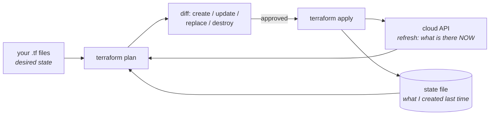

# Infrastructure as code

The point is not automation. The point is **review** — infrastructure in a
repository gets the same diff, approval and history as application code, and an
environment can be rebuilt rather than remembered. Terraform's state file is
where most of the real questions live, so that is where this chapter spends its
time.

---

## In brief

- **State is the whole ballgame.** Terraform's state maps configuration to real
  resources. Lose it and Terraform no longer knows what it owns; share it
  without a lock and two applies corrupt it.
- **The plan is the review artefact.** "This will destroy and recreate the
  database" is a line a plan catches and a mental model does not.
- **Never `apply` from a laptop** in an environment that matters: no shared
  state discipline, no audit trail, and whoever ran it is the only record.
- **Secrets end up in state in plain text.** A password passed as a variable is
  readable by anyone with the state file, so reference a secrets store instead
  and treat state as a secret itself.
- **Drift is a process problem, not a tidiness one.** A console fix makes the
  next plan want to undo it, which is how an unrelated deploy reverts an
  incident mitigation.
- **Modules are the reuse unit, and the hard part is the interface** — too many
  variables and it is a worse version of the provider; too few and nobody can
  use it.
- **Separate state per environment, and blast radius is a design decision.**
  One state file for everything means one lock, one plan, and one mistake that
  can reach production.

---

## The model: desired state, plus a memory of reality


*Three inputs, not two. Terraform compares your code against its own memory of what it created, reconciled against what the cloud actually reports. Every confusing Terraform behaviour comes from one of those three being out of sync with the others.*

Read that triangle and the common failures become predictable:

- **State lost** → Terraform's memory is empty, so everything in your code
  looks like it needs creating. Apply and you get duplicate resources, or
  errors because the names already exist.
- **Resource deleted outside Terraform** → refresh finds it missing, so the
  plan recreates it. Usually what you want.
- **Resource *changed* outside Terraform** → refresh finds a difference from
  state, and the plan proposes undoing it. This is **drift**, and it is the
  mechanism by which a later unrelated apply reverts somebody's emergency fix.
- **Two people apply at once** → both read state, both write it, one overwrites
  the other's record, and Terraform now has a memory that does not match
  reality. Hence locking.

### Why state cannot just be "ask the cloud"

A reasonable question, and worth being able to answer: why does Terraform need
a file at all, when it could read the cloud?

Because state carries three things the cloud does not tell you. **Ownership** —
which of the 400 security groups in this account are *mine* to manage, as
opposed to another team's. **Identity mapping** — that
`aws_instance.web["a"]` in your code is instance `i-0abc…`, a link that exists
nowhere in the provider. And **metadata** Terraform needs for dependency
ordering and for values that are only known after creation.

CloudFormation sidesteps the question by keeping state server-side, in the
stack. That is a genuine advantage — nothing to lose, nothing to lock — and the
trade is being AWS-only and slower to support new services.

---

## State, operationally

**Remote and locked, always.** The standard shape on AWS is an S3 bucket with
versioning and encryption, plus a DynamoDB table for the lock (newer Terraform
versions can use S3's own conditional writes for locking instead):

```hcl
terraform {
  required_version = "~> 1.7"
  backend "s3" {
    bucket         = "acme-tfstate"
    key            = "prod/links-api/terraform.tfstate"
    region         = "eu-west-1"
    dynamodb_table = "acme-tfstate-locks"   # one apply at a time
    encrypt        = true
  }
  required_providers {
    aws = { source = "hashicorp/aws", version = "~> 5.40" }   # pin, don't drift
  }
}
```

Versioning on the bucket is the recovery path: a corrupted or truncated state
file is restorable to the previous version, which is the difference between an
inconvenience and a reconstruction project.

**Treat state as a secret.** It contains every resource attribute Terraform
read back, in plain text — RDS passwords, generated keys, connection strings.
Encrypt the bucket, restrict who can read it as tightly as you restrict
production credentials, and never commit it. "We keep state in the repo" is a
credential leak and a corruption source in one.

**Split it, deliberately.** One state file per environment at minimum, and
usually per environment *and* per logical stack (networking, data, each
service). The reasons are blast radius and speed: a shared state file means one
lock for everybody, a plan that refreshes hundreds of resources every run, and
a typo in a networking module that can propose destroying production
databases. A small state file does less damage and plans in seconds.

The seam between stacks is a data source or a remote state read, not a shared
module instance:

```hcl
# The service stack reads the network stack's outputs; it does not own them.
data "terraform_remote_state" "network" {
  backend = "s3"
  config = {
    bucket = "acme-tfstate"
    key    = "prod/network/terraform.tfstate"
    region = "eu-west-1"
  }
}

resource "aws_db_subnet_group" "db" {
  subnet_ids = data.terraform_remote_state.network.outputs.private_subnet_ids
}
```

**The state surgery commands**, which exist because reality intrudes:

| Command | When |
| --- | --- |
| `terraform import` | A resource exists and should be managed. Adopt it into state rather than recreating it |
| `terraform state rm` | Stop managing something without destroying it — e.g. handing a resource to another team's stack |
| `terraform state mv` | You renamed a resource or moved it into a module; without this, Terraform sees a destroy plus a create |
| `moved` blocks | The declarative, reviewable version of `state mv`. Prefer it |
| `-target` | Narrowing an apply during an incident. A smell in normal use, because it applies a partial, inconsistent plan |
| `terraform force-unlock` | A lock left behind by a crashed apply. Verify nothing is actually running first |

`state mv` and `moved` blocks deserve emphasis, because the failure they
prevent is severe: renaming `aws_db_instance.main` to `aws_db_instance.primary`
is a pure refactor in your head and a **destroy-and-create of your production
database** in the plan. Terraform identifies resources by address, so a rename
is a different resource.

---

## Plan, apply, and why not from a laptop

**The plan is the artefact that gets reviewed**, and that only works if the
plan a human approved is the plan that runs:

```bash
terraform plan -out=tfplan        # the exact plan, saved
terraform show -json tfplan | jq '.resource_changes[]
  | select(.change.actions[] | . == "delete")'   # what will be destroyed?
terraform apply tfplan            # apply exactly what was reviewed
```

Without `-out`, `apply` re-plans, and what runs may differ from what was
approved because the world moved in between. In a pipeline, the saved plan
becomes the artefact that passes from the review step to the apply step — the
same "build once, promote the artefact" discipline as
[pipelines and GitOps](10-pipelines-and-gitops.md).

**What to read in a plan**, in priority order: anything being **destroyed**;
anything **replaced** (shown as destroy-then-create, and the `# forces
replacement` comment names the attribute responsible); then changes to
security groups, IAM and network ACLs, since those are the ones that turn into
incidents. A plan with 200 changes nobody reads is worse than no review at all,
which is itself an argument for small state files.

**Why not from a laptop:**

- The credentials are a human's, usually broad, and the audit log says a person
  did something rather than which pipeline applied which commit.
- Nothing guarantees the code applied matches the code merged — local edits,
  uncommitted files, a stale branch.
- No lock discipline across people who are all doing the same thing.
- Provider and Terraform versions differ per machine, and a provider upgrade can
  itself change a plan.

The pipeline shape: **plan on pull request, posting the plan as a comment;
apply on merge, from a role assumed by the CI system with no human
credentials**. The apply role is the only thing with write access to
production, and the only way to invoke it is a merge — which is what makes the
git history the audit log.

---

## Modules, and the interface problem

A module is a directory of Terraform with inputs, outputs and no backend of its
own. The reuse unit, called per environment with different variables:

```hcl
module "links_api" {
  source = "git::https://github.com/acme/tf-modules.git//service?ref=v2.3.1"

  name        = "links-api"
  environment = "prod"
  image       = "registry.example.com/links-api:1.4.2"
  cpu         = 512
  memory      = 1024
  min_count   = 3            # prod differs from staging only in variables
  subnet_ids  = data.terraform_remote_state.network.outputs.private_subnet_ids
}
```

Note `?ref=v2.3.1`: modules are **versioned and pinned**, exactly like
application dependencies. An unpinned module source means somebody else's
commit changes your plan, which is the infrastructure version of an unpinned
`latest` tag.

**The hard part is the interface, not the implementation.** Two failure modes:

- **The pass-through module** exposes a variable for every provider attribute.
  It adds indirection without abstraction — now there are two places to read
  and the module is strictly worse than using the resource directly.
- **The over-opinionated module** exposes three variables and hard-codes the
  rest, so the first team with a legitimately different requirement forks it,
  and now there are two modules drifting apart.

A good module encodes **a decision your organisation has made**: "a service
here means an ECS service, with these log settings, this alarm set, these tags,
behind the shared load balancer." The variables are the things that genuinely
differ between services; everything else is the standard, and that is the value
being delivered.

Keep `count` and `for_each` straight, because it bites: `count` indexes by
*position*, so removing the first element of a list re-indexes everything after
it and Terraform proposes destroying and recreating resources that did not
change. `for_each` keys by a stable string instead. **Use `for_each` for
anything that might change in the middle**, and reserve `count` for genuine
on/off conditionals.

---

## Drift, policy, and the other tools

**Drift detection** is a scheduled `terraform plan` that alerts when it is not
empty. Worth running nightly, because the alternative is discovering drift
during an unrelated deploy, when the plan that was supposed to change one tag
also proposes undoing a security-group fix somebody made by hand at 3am.

The organisational half matters more than the tooling: console write access in
production should be rare and ideally break-glass only, with the expectation
that anything done by hand during an incident is backfilled into code
immediately afterwards. Otherwise the code is fiction, and the thing everybody
believed was reproducible is not.

**Policy as code** is the control that scales. `terraform plan -json` is
machine-readable, so a check in the pipeline can refuse a plan that violates a
rule — a public S3 bucket, an unencrypted volume, a security group open to
`0.0.0.0/0` on port 22, a missing cost-allocation tag. OPA/Conftest and Sentinel
are the usual tools, and the Rego language is the same one covered in
[OPA and Rego](../01-auth-identity/09-opa-rego.md). The adjacent static
scanners — tfsec, Checkov, Terrascan — catch a large fraction of
misconfiguration without any custom rules at all.

| Tool | Where it fits |
| --- | --- |
| **Terraform** | The default: multi-cloud, enormous provider ecosystem, HCL, client-side state |
| **OpenTofu** | The fork after Terraform's licence change; a live consideration for new projects |
| **CloudFormation** | AWS-only, server-side state so nothing to lose or lock, built-in drift detection, slower to support new services |
| **CDK** | TypeScript or Python that synthesises CloudFormation — real loops, types and IDE support, IAM beside the app code. The trade: a bug is now a program |
| **Pulumi** | Like CDK but multi-cloud, with its own state service |
| **Crossplane** | Infrastructure as Kubernetes CRDs, so the cluster's reconciliation loop manages cloud resources. Attractive if you already live in Kubernetes |
| **Ansible** | Configuration *management*, not provisioning: it makes an existing machine's state correct. Largely displaced by immutable images for new work |

**Immutable infrastructure** is worth naming as the pattern: rather than
mutating servers in place, build a new image (Packer, or a container image),
roll it out, and destroy the old ones. It removes configuration drift at its
source — there is no long-lived server to diverge — and it is why Ansible's
original job has shrunk to image building and the long tail of boxes that
cannot be replaced.

---

## Building it

**The repository layout that scales to several teams**

```
infra/
  modules/                       # versioned, reusable decisions
    service/                     # "a service here means..."
    network/
    database/
  stacks/
    prod/
      network/     { main.tf backend.tf }   # one state file each
      data/        { main.tf backend.tf }
      links-api/   { main.tf backend.tf }
    staging/
      ...                        # same modules, different variables
```

Environments are directories with their own state and their own variables, not
Terraform workspaces. Workspaces share one backend key prefix and one set of
code, which makes "staging is slightly different" awkward and makes a wrong
`terraform workspace select` a production incident. Directories make the
environment explicit in the path and in the pipeline.

**A module with an interface worth reviewing**

```hcl
# modules/service/variables.tf — what genuinely differs between services
variable "name"        { type = string }
variable "environment" { type = string }
variable "image"       { type = string }
variable "cpu"         { type = number, default = 256 }
variable "memory"      { type = number, default = 512 }
variable "min_count"   { type = number, default = 2 }

variable "database_secret_arn" {
  type        = string
  description = "Secrets Manager ARN. The VALUE is never a Terraform variable: it would land in state in plain text."
}

# modules/service/main.tf — and what does not differ: the standard, applied once
locals {
  tags = {
    service     = var.name
    environment = var.environment
    managed_by  = "terraform"
    cost_centre = var.environment == "prod" ? "platform-prod" : "platform-dev"
  }
}
```

That comment on `database_secret_arn` is the whole secrets story in one line:
**pass the reference, never the value.** The task or pod reads the secret at
runtime using its own IAM role, so the credential never passes through
Terraform, never lands in state, and rotating it is not a deploy. The same
principle as workload identity in
[Kubernetes: the object model](07-kubernetes-objects.md).

**The pipeline, which is where the discipline actually lives**

```yaml
# .github/workflows/terraform.yml
permissions:
  contents: read
  id-token: write          # OIDC: assume a role, no long-lived AWS keys in CI
  pull-requests: write

jobs:
  plan:
    runs-on: ubuntu-latest
    steps:
      - uses: actions/checkout@v4
      - uses: aws-actions/configure-aws-credentials@v4
        with:
          role-to-assume: arn:aws:iam::111122223333:role/tf-plan   # READ-ONLY
          aws-region: eu-west-1
      - uses: hashicorp/setup-terraform@v3
        with: { terraform_version: 1.7.5 }      # pinned: version changes plans
      - run: terraform init
      - run: terraform fmt -check && terraform validate
      - run: terraform plan -out=tfplan -lock-timeout=5m
      - run: terraform show -json tfplan > plan.json
      - run: conftest test --policy ./policy plan.json   # refuse bad plans
      - run: |
          # Surface destructive changes loudly in the review, not in a scroll.
          jq -r '.resource_changes[]
                 | select(.change.actions | index("delete"))
                 | "DESTROY: \(.address)"' plan.json | tee destroy.txt
      - uses: actions/upload-artifact@v4
        with: { name: tfplan, path: tfplan }    # the reviewed plan, promoted

  apply:                    # only on merge to main, with the reviewed artefact
    needs: plan
    if: github.ref == 'refs/heads/main'
    environment: production                     # a human approval gate
    runs-on: ubuntu-latest
    steps:
      - uses: actions/checkout@v4
      - uses: actions/download-artifact@v4
        with: { name: tfplan }
      - uses: aws-actions/configure-aws-credentials@v4
        with:
          role-to-assume: arn:aws:iam::111122223333:role/tf-apply  # the only writer
          aws-region: eu-west-1
      - run: terraform init
      - run: terraform apply tfplan             # exactly what was reviewed
```

Four things in there are the actual answer to "how do you run Terraform
properly": **OIDC** so CI has no stored cloud keys, a **read-only plan role**
distinct from the **apply role**, a **pinned Terraform version** because a
version bump can change a plan, and **applying the saved plan artefact** so
what ran is what was approved.

**Adopting existing resources** — the first real task on most jobs, since the
infrastructure predates the code:

```bash
# 1. Write the resource block to match what exists, then adopt it.
terraform import aws_s3_bucket.assets acme-prod-assets

# 2. The plan after an import should be EMPTY. If it is not, your code does
#    not describe reality yet — fix the code, never "apply to make it match".
terraform plan

# 3. Newer Terraform can generate the configuration for you:
#    an import block in code, then
terraform plan -generate-config-out=generated.tf
```

Step 2 is the discipline. An import followed by a non-empty plan that someone
applies is how an adoption exercise modifies production by accident.

---

## Interview Q&A

### Q: Why does Terraform need a state file, and what do you do about it operationally?
**Level:** senior · **Tags:** iac, terraform

<details><summary>Model answer</summary>

State is Terraform's record of what it created. It carries three things the
cloud cannot tell you: ownership — which of these resources are mine to manage
rather than another team's; the mapping from a code address like
`aws_instance.web` to a real id like `i-0abc`; and metadata for dependency
ordering and computed values.

Operationally, four rules. **Remote and locked** — S3 with versioning plus a
lock table, so two applies cannot interleave and a corrupted file is
recoverable. **Treated as a secret**, because every resource attribute is in
there in plain text, including generated passwords, so it is as sensitive as
production credentials. **Split per environment and per stack**, because one
shared state file means one lock for everyone, a slow refresh of hundreds of
resources, and a blast radius that reaches production from a networking typo.
And **never in the repository**.

The failure I would call out is losing it. Without state, Terraform does not
know it owns anything, so a plan proposes creating everything again — either
duplicating infrastructure or failing on name conflicts, and recovering means
importing resources one at a time. Bucket versioning is what turns that from a
project into an undo.

CloudFormation avoids the whole category by keeping state server-side, which is
a real advantage. The trade is AWS-only and slower support for new services.

</details>

**Follow-ups:**

1. Q: Someone renamed a resource in the code and the plan wants to destroy the production database. What happened, and how do you fix it?
   <details><summary>Answer</summary>

   Terraform identifies resources by their address in code, so renaming
   `aws_db_instance.main` to `aws_db_instance.primary` is not a refactor to
   Terraform — the old address disappears and a new one appears, which is a
   destroy and a create.

   The fix is to tell state about the rename rather than applying: a `moved`
   block in the code, which is reviewable and goes through the normal pipeline,
   or `terraform state mv` for the imperative version. After either, the plan
   should be empty.

   What I would want institutionally is that this is impossible to apply by
   accident: the plan is the review artefact, destroys are surfaced
   explicitly — a jq filter over `plan -json` that lists every delete — and
   production applies need an approval. A plan with a database destroy in it
   should be hard to miss and hard to approve, because somebody will eventually
   do this at 6pm on a Friday.

   Deletion protection on the database and a tested restore are the backstops,
   because the review will eventually fail.

   </details>

2. Q: How do you handle secrets in Terraform?
   <details><summary>Answer</summary>

   By not putting values through Terraform at all. State holds every attribute
   in plain text, so a password passed as a variable is in the state file, and
   it is also in the plan output, probably in CI logs, and possibly in a plan
   artefact.

   So Terraform creates and references secrets without knowing them: it creates
   the Secrets Manager or Vault entry and grants the workload's role
   permission to read it, and the application fetches the value at runtime with
   its own identity. The module takes the secret's ARN, never its value.

   For something Terraform must generate, like an initial database password, the
   least-bad shapes are letting the provider generate it and never reading it
   back, or generating it out of band and having the resource reference the
   secret. Either way, state is encrypted, access to it is as restricted as
   production credentials, and it is rotated afterwards out of band.

   The rule I would state is: Terraform manages *references* and *permissions*,
   not *values*. It is also why workload identity — IRSA, instance roles, OIDC
   federation in CI — is strictly better than any secret-distribution scheme:
   there is no value to leak.

   </details>

### Q: How should Terraform be run in an organisation — who applies, and from where?
**Level:** senior · **Tags:** iac, process, security

<details><summary>Answer</summary>

Not from laptops. The shape I would argue for is plan on pull request, apply on
merge, both from CI with no human holding production write credentials.

Concretely: the PR pipeline assumes a **read-only** role, runs `fmt`,
`validate` and `plan -out=tfplan`, posts the plan on the PR, and runs policy
checks over `plan -json` — refusing public buckets, unencrypted storage, open
security groups, missing tags. On merge, a second job with an **apply** role
applies **that saved plan artefact**, behind an environment approval for
production.

Four details make it work. The saved plan, so what runs is what was reviewed
rather than a fresh plan against a world that has moved. OIDC federation, so CI
assumes a role instead of storing cloud keys. A pinned Terraform and provider
version, because a version bump can change a plan on its own. And separate
plan and apply roles, so the thing that can write to production is only
reachable by a merge.

What this buys beyond safety is that git becomes the audit log: every
infrastructure change has a commit, an author, a reviewer and a plan. That is
usually also what satisfies an auditor, which matters more than it sounds.

The exception is break-glass. There has to be a path to act in an incident
without a PR, and it should be a separate, loudly-audited role with an alert on
use — plus the expectation that whatever was done by hand is backfilled into
code the same week, or the code is fiction.

</details>

### Q: What is drift, and why is it more than a tidiness problem?
**Level:** intermediate · **Tags:** iac, operations

<details><summary>Answer</summary>

Drift is real infrastructure diverging from the code that declares it, usually
because someone changed something in the console.

The reason it is dangerous rather than untidy is what happens next. Terraform's
plan compares code against state against reality, so a hand-made change shows
up as something to *undo*. The next person to apply — for a completely
unrelated one-line change — gets a plan that also reverts that fix, and if they
do not read the whole plan carefully, the mitigation somebody made at 3am
silently disappears during a routine tag change.

It also destroys the property that makes IaC valuable: that you can rebuild an
environment from code. If the code does not describe reality, the disaster
recovery plan does not work and nobody finds out until the disaster.

So I would do two things. Technically, scheduled drift detection — a nightly
`plan` that alerts when it is not empty — so drift is discovered on a quiet
Tuesday rather than during a deploy. Organisationally, production console write
access that is break-glass only and audited, with the explicit expectation that
anything done by hand is backfilled into code immediately. The second matters
more; detection without a process just produces an alert everybody mutes.

</details>

### Q: When is a Terraform module worth writing?
**Level:** senior · **Tags:** iac, design

<details><summary>Answer</summary>

When it encodes a decision, not when it wraps a resource.

The anti-pattern is the pass-through module: one resource, a variable for every
attribute, and now a reader has to open two files to understand one security
group. It adds indirection without abstraction, and it is strictly worse than
using the resource directly.

A module earns its place when it captures "what a service means here" — this is
an ECS service with our log configuration, our alarm set, our tags, registered
with the shared load balancer, with the IAM role shaped the way we always shape
it. The variables are the handful of things that genuinely differ per service;
everything else is the organisational standard, applied consistently, and that
consistency is the product.

The other failure is over-opinionation: too few variables, so the first team
with a legitimate difference forks the module and now there are two drifting
copies. The fix is usually an escape hatch — an extra-tags map, an optional
override block — rather than refusing the requirement.

Practically I would also insist on versioned module sources pinned by tag, so
somebody else's commit cannot change my plan, and on `for_each` rather than
`count` for collections, because `count` indexes by position and removing a
middle element re-indexes and recreates resources that did not change.

</details>

---

## What a weak answer sounds like

- **State in the repository**, or applied from a laptop with no locking.
- **Not knowing state holds secrets in plain text**, and passing passwords as
  variables.
- **One state file for everything**, so one lock, one slow plan, and one blast
  radius.
- **`apply` without a saved plan**, so what ran is not what was reviewed.
- **"We'll just import it later"** without checking the plan is empty after an
  import.
- **Renaming resources freely**, without `moved` blocks or `state mv`.
- **Unpinned modules and providers**, so someone else's commit changes your
  plan.
- **Pass-through modules** that wrap one resource and add nothing.
- **`count` for collections**, then surprise re-creation when the list changes.
- **Treating drift as untidiness** rather than as a mechanism that reverts
  incident fixes.
- **`-target` as routine practice**, applying partial, inconsistent plans.

---

## Quiz

### MCQ: Why does Terraform need a state file rather than reading current infrastructure from the cloud API?
- [ ] Cloud APIs are too slow to query on every plan
- [x] State records ownership (which resources Terraform manages), the mapping from code addresses to real resource ids, and metadata for ordering — none of which the provider can tell it
- [ ] It caches credentials between runs
- [ ] It stores the plan for later approval
**Why:** Refresh does read reality, but reality cannot say which of the account's resources are yours or that `aws_instance.web` means `i-0abc`. CloudFormation avoids the problem by keeping equivalent state server-side.

### MCQ: What is the most important reason to treat the Terraform state file as a secret?
- [ ] It contains your cloud credentials
- [x] It stores every managed resource's attributes in plain text, including generated passwords and connection strings
- [ ] It can be used to impersonate the CI pipeline
- [ ] It contains the full git history of the infrastructure repo
**Why:** This is also why secrets should be passed as references (a Secrets Manager ARN) rather than values: anything Terraform knows, the state file records in clear text.

### MCQ: A developer renames `aws_db_instance.main` to `aws_db_instance.primary`. What does the plan show?
- [ ] No changes — it is only a label
- [x] A destroy and a create, because Terraform identifies resources by their address in code; a `moved` block or `terraform state mv` is needed to record the rename
- [ ] An in-place update of the instance identifier
- [ ] An error refusing to proceed
**Why:** This is the single most dangerous ordinary refactor in Terraform, and the reason destructive changes should be extracted from `plan -json` and surfaced loudly in review rather than buried in scrollback.

### MCQ: Why run `terraform plan -out=tfplan` and then `terraform apply tfplan`, rather than just `terraform apply`?
- [ ] It is faster because the plan is cached
- [x] It applies exactly the plan that was reviewed; a bare `apply` re-plans against a world that may have changed since the approval
- [ ] It is the only way to use a remote backend
- [ ] It bypasses the state lock
**Why:** It is the same "build the artefact once and promote it" discipline as a deployment pipeline: the reviewed plan is the artefact that passes from the review stage to the apply stage.

### MCQ: Why is `for_each` preferred over `count` for a collection of similar resources?
- [ ] `count` is deprecated
- [x] `count` indexes by position, so removing a middle element re-indexes the rest and Terraform proposes destroying and recreating resources that did not change; `for_each` keys by a stable string
- [ ] `for_each` is faster to plan
- [ ] `count` cannot be used with modules
**Why:** Positional identity is the problem. `count` remains appropriate for genuine on/off conditionals, where there is no collection to re-index.

### MCQ: What makes configuration drift dangerous rather than merely untidy?
- [ ] It increases cloud costs
- [x] The next plan proposes undoing the manual change, so an unrelated apply can silently revert an emergency fix — and the code no longer describes reality, which breaks rebuild-from-code
- [ ] It causes the state file to grow without bound
- [ ] It prevents Terraform from acquiring the state lock
**Why:** Drift turns every future apply into a trap, and it quietly invalidates disaster recovery, which is one of the main reasons for having infrastructure as code at all.

### MCQ: Why should CI use OIDC federation to assume a role rather than storing cloud access keys?
- [ ] OIDC is required by Terraform 1.7 and later
- [x] There is no long-lived credential to leak, rotate or find in a log — the pipeline exchanges a short-lived identity token for temporary role credentials
- [ ] It allows the pipeline to skip the plan stage
- [ ] It makes applies faster by avoiding credential lookups
**Why:** This is the same principle as workload identity for pods: a short-lived, verifiable identity beats a distributed secret. It also means a compromised CI config cannot be replayed from elsewhere.

### MCQ: Why split Terraform state per environment and per logical stack?
- [ ] Terraform imposes a hard limit on resources per state file
- [x] Blast radius and speed — a shared state file means one lock for everyone, a slow refresh of every resource on every plan, and a networking typo whose plan can reach production databases
- [ ] It is required in order to use modules
- [ ] Separate state files are automatically versioned
**Why:** Small state files fail small and plan fast. Stacks then read each other's outputs through remote state or data sources rather than owning each other's resources.

### MCQ: After `terraform import`, the plan is not empty. What should you do?
- [ ] Apply it — that is how the resource is brought under management
- [x] Fix the configuration until the plan is empty, because a non-empty plan means your code does not yet describe the real resource and applying it would modify production
- [ ] Run `terraform state rm` and import again
- [ ] Add `-target` to narrow the apply to the imported resource
**Why:** An import only adopts the resource into state; the code must independently match what exists. "Apply to make it match" is how an adoption exercise accidentally changes live infrastructure.

### MCQ: What does policy as code over `terraform plan -json` add that a human review does not?
- [ ] It replaces the need for a state lock
- [x] Mechanical, unmissable enforcement of rules like "no public buckets, no unencrypted volumes, no 0.0.0.0/0 on SSH, tags required" on every plan, regardless of how long the diff is
- [ ] It generates the Terraform configuration automatically
- [ ] It removes the need for separate plan and apply roles
**Why:** Reviews degrade as diffs grow, and the rules that matter most are exactly the ones easiest to skim past. Conftest/OPA or Sentinel over the machine-readable plan makes them a gate rather than a hope.

---

## Glossary

- **State** — Terraform's record of the resources it manages and their real ids; remote, locked, encrypted, secret.
- **Lock** — the mutual exclusion (DynamoDB table or S3 conditional write) preventing concurrent applies.
- **Refresh** — reading current reality from the provider before diffing.
- **Plan** — the proposed diff; the review artefact, and savable with `-out`.
- **Replacement** — a destroy-then-create forced by changing an immutable attribute.
- **Drift** — reality diverging from code, usually via a console change.
- **`moved` block** — the declarative way to tell state a resource was renamed or relocated.
- **`import`** — adopting an existing resource into state; the plan afterwards must be empty.
- **`-target`** — narrowing an apply; an incident tool, not a practice.
- **Module** — a reusable directory with inputs and outputs; should encode a decision, not wrap a resource.
- **`count` vs `for_each`** — positional indexing versus stable string keys.
- **Remote state data source** — how one stack reads another's outputs without owning its resources.
- **OIDC federation** — CI assuming a cloud role via a short-lived token, with no stored keys.
- **Policy as code** — automated rules (OPA/Conftest, Sentinel) refusing a non-compliant plan.
- **Immutable infrastructure** — replacing servers with new images rather than mutating them in place.
