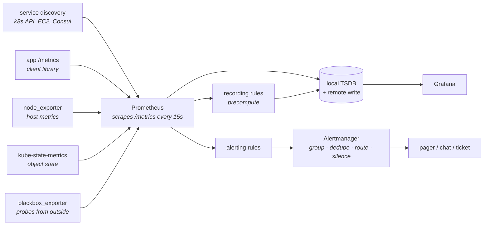

# The monitoring stack

[Observability, SLOs and operations](../02-interview-core/30-observability-slos-and-operations.md)
covers what to measure and what to page on. This chapter is the machinery:
how Prometheus actually collects data, the PromQL you will be asked to write,
why cardinality is the cost and reliability problem that bites everyone, and
how logs, metrics and traces fit together without being three disconnected
tools.

---

## In brief

- **Prometheus pulls.** It scrapes HTTP endpoints on a schedule, which makes
  service discovery the hard part and makes short-lived jobs a special case
  needing a push gateway.
- **Four metric types, and picking wrong is unfixable later.** Counters only
  go up and are queried with `rate()`; gauges go both ways; histograms
  pre-bucket so percentiles can be aggregated; summaries compute percentiles
  at the source and therefore **cannot** be averaged across instances.
- **`rate()` before `sum()`, always.** Summing counters across instances then
  rating produces nonsense when a pod restarts, because the counter resets.
- **Cardinality is the whole cost model.** A time series exists per unique
  label combination, so one label with a user id in it can multiply your
  series count by a million and take the monitoring system down.
- **Percentiles cannot be averaged.** The mean of two instances' p99s is not
  the fleet p99 — which is exactly why histograms exist.
- **Alert on symptoms, and on burning the error budget**, not on a raw
  threshold crossing. A threshold alert fires on a blip; a burn-rate alert
  fires when the month's reliability is actually at risk.
- **One correlation id across all three pillars** is what makes them a system
  rather than three tools: metric spike → exemplar trace → that request's logs.

---

## How Prometheus collects


*Pull-based collection with service discovery, local storage, and alert evaluation inside Prometheus — Alertmanager only receives already-fired alerts and decides who hears about them. The split matters: grouping, inhibition and silences are Alertmanager's job, not the rule's.*

**Pull, not push**, and the consequences are worth knowing because they are the
standard follow-up:

- **Service discovery becomes central.** Prometheus asks the Kubernetes API (or
  EC2, or Consul) what exists, and scrapes what it finds. Targets appearing and
  disappearing is normal rather than exceptional.
- **A target being down is itself a signal** — the synthetic `up` metric is 0,
  which is information a push model loses (a dead pusher is indistinguishable
  from a quiet one).
- **Short-lived jobs do not fit.** A cron job that finishes in 10 seconds is
  never scraped, hence the **Pushgateway** — and the honest answer is that it
  is a workaround with real caveats (stale values persist until deleted), so
  for batch work a "last success timestamp" gauge pushed to a gateway, alerted
  on age, is the usable pattern.
- **Prometheus is not a long-term store or globally aggregated.** Local
  retention is typically weeks, and a single server does not see other clusters.
  **Remote write** to Thanos, Mimir or Cortex is how you get long retention and
  a global query view — a standard interview follow-up once you mention scale.

**The exporters worth naming**, since "where do metrics come from" has four
different answers: your application's own instrumentation via a client library;
`node_exporter` for host-level CPU, memory, disk and network; `kube-state-metrics`
for the *state of Kubernetes objects* (how many replicas desired versus ready,
pod restarts, PVC status — not resource usage, which is cAdvisor's job); and
`blackbox_exporter` for probing endpoints from outside, which is the only one
that tells you whether users can actually reach you.

---

## The four metric types, and why the choice is permanent

| Type | Use for | Query with |
| --- | --- | --- |
| **Counter** | Things that only accumulate: requests, errors, bytes | `rate()` / `increase()` — never the raw value |
| **Gauge** | Things that go up and down: queue depth, connections, temperature | Directly, or `avg_over_time()` |
| **Histogram** | Distributions: latency, payload size | `histogram_quantile()` over the buckets |
| **Summary** | Distributions where you need exact quantiles per instance | Read the quantile directly — **and never aggregate it** |

**Counters are queried as rates, never read raw.** The raw value is "requests
since this process started", which is meaningless across restarts. `rate()`
handles the reset for you by detecting the drop and treating it correctly.
That also drives the single most common PromQL mistake, below.

**Histogram versus summary** is the question that separates people who have
operated a monitoring system from people who have configured one:

- A **histogram** ships pre-defined buckets as counters (`le="0.1"`,
  `le="0.5"`, …). Buckets from different instances can be **added**, so you can
  compute a true fleet-wide p99 — and slice it by endpoint or tenant at query
  time. The cost is choosing buckets up front: a p99 of 300ms is invisible if
  your buckets jump from 100ms to 1s.
- A **summary** computes quantiles inside the process and exports them. Cheap
  to query, exact for that instance, and **mathematically impossible to
  aggregate**: the average of ten instances' p99s is not the fleet p99. If one
  instance is broken, averaging hides it precisely when you need to see it.

So: **histograms for anything you will aggregate or slice**, which in practice
means almost all service latency. This is also why OpenTelemetry's and
Prometheus's newer native histograms matter — they remove the bucket-choice
problem by using exponential buckets.

**Naming conventions** are not pedantry; they are what makes a dashboard
readable by someone who did not build it: `http_requests_total` (counter,
`_total` suffix), `http_request_duration_seconds` (histogram, base unit
seconds, never milliseconds), `queue_depth` (gauge). Base units and a unit
suffix, always.

---

## PromQL, the parts you will be asked to write

Five queries cover most of what an interview or an incident needs.

**Request rate**, per second, over the last five minutes:

```promql
sum(rate(http_requests_total{service="links-api"}[5m]))
```

**Error ratio** — the SLI for availability. Note the structure: rate first, sum
second, and the denominator is *all* requests:

```promql
sum(rate(http_requests_total{service="links-api",status=~"5.."}[5m]))
/
sum(rate(http_requests_total{service="links-api"}[5m]))
```

**p99 latency** from a histogram, correctly aggregated across instances —
`sum by (le)` is the load-bearing part:

```promql
histogram_quantile(
  0.99,
  sum by (le) (rate(http_request_duration_seconds_bucket{service="links-api"}[5m]))
)
```

**Saturation**, as a fraction of the limit — the pattern for any "how close are
we" question:

```promql
sum(rate(container_cpu_usage_seconds_total{pod=~"links-api-.*"}[5m]))
/
sum(kube_pod_container_resource_limits{pod=~"links-api-.*",resource="cpu"})
```

**Is anything restarting**, which catches crash loops before users do:

```promql
increase(kube_pod_container_status_restarts_total{namespace="links"}[15m]) > 0
```

### The mistakes

**`rate()` goes inside `sum()`.** This is the one to get right:

```promql
sum(rate(http_requests_total[5m]))     # correct
rate(sum(http_requests_total)[5m:])    # WRONG
```

The wrong version sums counters across instances first. When a pod restarts,
its counter resets to zero, so the *sum* drops — and a rate over a dropping
series produces either a huge negative-corrected spike or silently wrong data.
`rate()` applied per series understands resets; applied to an aggregate it
cannot.

**The range must exceed the scrape interval, comfortably.** `rate(x[1m])` with
a 30-second scrape has two points, so one missed scrape leaves one and the
result is empty. The rule of thumb is a range of at least 4× the scrape
interval — `[2m]` or `[5m]` with a 15s scrape.

**`avg()` of a percentile is wrong**, as above. If you find yourself averaging a
`_p99` metric, you needed a histogram.

**`irate()` is for graphs, `rate()` for alerts.** `irate` uses only the last two
points, so it is spiky and can miss a sustained problem between evaluations.

---

## Cardinality: the cost and reliability problem

**One time series exists per unique combination of metric name and label
values.** That sentence is the entire cost model, and getting it wrong is how
teams take down their own monitoring.

```
http_requests_total{method, status, endpoint, pod}
  5 methods × 8 statuses × 40 endpoints × 30 pods = 48,000 series.  Fine.

add label user_id (1,000,000 users)
  → 48,000,000,000 series.  The monitoring system is now the outage.
```

Every series costs memory in the ingester, disk, and query time. The failure
mode is not gradual: Prometheus OOMs, or queries time out, and you lose
visibility exactly when an incident is underway.

**Never put these in a label:** user id, request id, trace id, email,
session id, full URL path with ids in it, raw error message, timestamp. Any
unbounded set.

**Do put these in a label:** service, endpoint *template* (`/links/:id`, not
`/links/abc123`), method, status **class**, region, tenant *tier*, version.
Bounded, small, and the dimensions you actually slice by.

The rule is: **metrics are for bounded dimensions; logs and traces are for
high-cardinality detail.** "Which user" is a log query or a trace attribute,
never a metric label. That is the division of labour between the pillars, and
it is the answer to "why not just put everything in metrics".

Finding it when it has already happened:

```promql
topk(10, count by (__name__)({__name__=~".+"}))       # worst metrics
topk(10, count by (job)({__name__=~".+"}))            # worst jobs
```

And defending against it structurally: `metric_relabel_configs` to drop
offending labels at scrape time, a per-target `sample_limit` so one bad deploy
cannot ingest a billion series, and a review habit of asking "what is the
maximum number of values this label can take" at the moment a label is added.

**Recording rules** are the other half of query cost: precompute an expensive
aggregation every 30 seconds and store the result, so dashboards and alerts
read a cheap series rather than recomputing over millions of samples.

```yaml
groups:
  - name: links-api-slis
    interval: 30s
    rules:
      - record: service:request_error_ratio:rate5m       # level:metric:operation
        expr: |
          sum by (service) (rate(http_requests_total{status=~"5.."}[5m]))
          /
          sum by (service) (rate(http_requests_total[5m]))
```

---

## Alerting that people do not learn to ignore

The *what* is in
[observability, SLOs and operations](../02-interview-core/30-observability-slos-and-operations.md):
symptoms not causes, percentiles not averages, every alert actionable. The
mechanics worth knowing here:

**`for:` is not optional.** An alert without a `for` duration fires on a single
evaluation, which means every transient blip pages someone. `for: 5m` requires
the condition to hold.

**Burn-rate alerting is the mature form.** Instead of "error rate above 1%",
alert on *how fast the error budget is being consumed*, at two speeds:

```yaml
groups:
  - name: links-api-slo
    rules:
      # Fast burn: at this rate the 30-day budget is gone in ~2 days. Page.
      - alert: LinksApiErrorBudgetFastBurn
        expr: service:request_error_ratio:rate5m{service="links-api"} > (14.4 * 0.001)
        for: 2m
        labels: { severity: page }
        annotations:
          summary: "links-api is burning its error budget 14x too fast"
          runbook: "https://runbooks.acme.dev/links-api/error-budget"

      # Slow burn: a small, persistent problem that will exhaust the budget.
      # Not a page — a ticket, because it needs attention this week, not now.
      - alert: LinksApiErrorBudgetSlowBurn
        expr: service:request_error_ratio:rate6h{service="links-api"} > (6 * 0.001)
        for: 30m
        labels: { severity: ticket }
```

The two windows catch two genuinely different failures: a sudden outage, and a
slow bleed that a threshold alert tuned for the outage would never notice.
`14.4` and `6` are the standard multipliers for a 99.9% objective — the fast
one means "this consumes 2% of a 30-day budget in an hour".

**Alertmanager does the human part**, and these four features are what make an
on-call rotation survivable: **grouping** (one notification for 40 pods failing,
not 40), **inhibition** (if the cluster is down, suppress every service alert
it causes), **silences** (a planned maintenance window), and **routing** by
severity and team. An alert annotation should carry a **runbook link** — the
single highest-value field, because it turns a page at 3am into a procedure
rather than an investigation.

---

## Logs, traces, and making the three pillars one system

| Pillar | Good at | Bad at | Cost driver |
| --- | --- | --- | --- |
| **Metrics** | Aggregate health, alerting, trends, cheap at any volume | Anything about one specific request | Cardinality |
| **Logs** | Detail about what happened, arbitrary queries after the fact | Aggregation at scale; expensive | Volume × retention |
| **Traces** | Where the time went across services, causality | Aggregate rates; usually sampled | Sampling rate |

**Structured logs or it does not count.** JSON with consistent field names, so
the question is a filter rather than a `grep`. Every line carries the
correlation/trace id, the tenant, the service and the version. And log *levels*
should mean something operational: `error` is "a human needs to look", not
"something unexpected happened", or the error rate is noise.

**Sampling is unavoidable for traces** at volume, and head-based sampling (keep
1%) has the obvious flaw: it throws away 99% of errors too. **Tail-based
sampling** decides after the trace completes, so you can keep every error and
every slow request plus a small sample of normal ones — which is what you
actually want and the better answer in an interview.

**The correlation id is the join key** between all three. The flow that makes
them one system: a metric alert fires → an **exemplar** on the histogram
bucket links to a trace id that landed in that bucket → the trace shows which
span was slow → that span's id filters the logs to the specific request. If
your tooling supports exemplars, that path is two clicks; if not, it is a
manual lookup by trace id, which is still far better than three disconnected
tools.

**OpenTelemetry** is the vendor-neutral answer to instrumenting once:
auto-instrumentation for HTTP clients and servers, database drivers and
messaging; context propagation via the W3C `traceparent` header so the trace
survives service hops; and an exporter you can repoint from one backend to
another without touching application code. The collector sits between your
services and your vendor, which is also where you do tail sampling, attribute
scrubbing (PII), and batching.

---

## Building it

**Instrumenting a service with the right metric types**

```ts
import { Counter, Histogram, Registry, collectDefaultMetrics } from 'prom-client';

export const registry = new Registry();
collectDefaultMetrics({ register: registry });   // event loop lag, heap, GC

// Counter: only goes up. Labels are BOUNDED — route template, not the raw path,
// and a status class, not the exact code, keeps cardinality small.
const requests = new Counter({
  name: 'http_requests_total',
  help: 'HTTP requests',
  labelNames: ['method', 'route', 'status'] as const,
  registers: [registry],
});

// Histogram, not summary: buckets from different pods can be summed, so a true
// fleet-wide p99 is computable and sliceable. Buckets must bracket the SLO.
const duration = new Histogram({
  name: 'http_request_duration_seconds',     // base unit seconds, _seconds suffix
  help: 'Request duration',
  labelNames: ['method', 'route', 'status'] as const,
  buckets: [0.005, 0.01, 0.025, 0.05, 0.1, 0.25, 0.5, 1, 2.5, 5],
  registers: [registry],
});

app.use((req, res, next) => {
  const done = duration.startTimer();
  res.on('finish', () => {
    // req.route?.path is the TEMPLATE ("/links/:id"). Using req.path here is
    // the classic cardinality bomb: one series per distinct url.
    const labels = {
      method: req.method,
      route: req.route?.path ?? 'unmatched',
      status: `${Math.floor(res.statusCode / 100)}xx`,
    };
    requests.inc(labels);
    done(labels);
  });
  next();
});

app.get('/metrics', async (_req, res) => {
  res.set('Content-Type', registry.contentType);
  res.end(await registry.metrics());
});
```

Two decisions in there are the whole chapter: **the route template rather than
the path**, and **a status class rather than the exact code**. Each one is the
difference between forty series and forty thousand.

**Structured logging that joins to traces**

```ts
import pino from 'pino';
import { trace } from '@opentelemetry/api';

export const log = pino({
  level: process.env.LOG_LEVEL ?? 'info',
  // Fixed fields on every line: this is what makes a filter possible.
  base: { service: 'links-api', version: process.env.GIT_SHA },
  formatters: { level: (label) => ({ level: label }) },   // "info", not 30
  redact: ['req.headers.authorization', 'req.body.password', '*.token'],
  mixin() {
    // The join key. Every log line from a request carries its trace id, so a
    // slow span in the trace UI leads straight to that request's logs.
    const span = trace.getActiveSpan()?.spanContext();
    return span ? { trace_id: span.traceId, span_id: span.spanId } : {};
  },
});

// Log levels mean operational things, not emotional ones:
log.warn({ tenant, retries }, 'upstream retry budget exhausted'); // degraded, no page
log.error({ err, tenant }, 'failed to persist link');              // a human must look
```

**A scrape config with cardinality guards**

```yaml
scrape_configs:
  - job_name: kubernetes-pods
    kubernetes_sd_configs: [{ role: pod }]
    sample_limit: 20000              # one bad deploy cannot ingest a billion series
    relabel_configs:
      - source_labels: [__meta_kubernetes_pod_annotation_prometheus_io_scrape]
        action: keep                 # opt in per pod, not scrape everything
        regex: "true"
      - source_labels: [__meta_kubernetes_namespace]
        target_label: namespace
      - source_labels: [__meta_kubernetes_pod_label_app]
        target_label: service
    metric_relabel_configs:
      - source_labels: [__name__]    # drop a known-noisy metric family entirely
        regex: 'go_memstats_.*_bytes_total'
        action: drop
      - regex: '(user_id|request_id|email|session_id)'
        action: labeldrop            # defence in depth against a bad label
```

**Grafana dashboards that are usable at 3am.** The conventions worth stating,
because "we have dashboards" is not an answer: one dashboard per service, with
the four golden signals — latency, traffic, errors, saturation — above the
fold and nothing else; template variables for service, tenant and version so
one dashboard serves everything; deploy annotations overlaid on the graphs, so
"did this start at a deploy" is answered by looking rather than by asking; and
every alert's annotation linking to the specific panel plus a runbook. A
dashboard with forty panels is a dashboard nobody reads under pressure.

---

## Interview Q&A

### Q: Walk me through how Prometheus works and what you would add at scale.
**Level:** senior · **Tags:** monitoring, prometheus

<details><summary>Model answer</summary>

It is pull-based. Prometheus uses service discovery — the Kubernetes API, EC2,
Consul — to find targets, scrapes an HTTP `/metrics` endpoint on each every 15
seconds or so, and stores the samples in a local time-series database. Rules
run inside Prometheus: recording rules precompute expensive aggregations,
alerting rules evaluate expressions and fire alerts at Alertmanager, which
handles grouping, deduplication, inhibition, silences and routing.

Pull has consequences worth naming. Service discovery does the heavy lifting,
so targets coming and going is routine. A target being unreachable is itself a
signal, through the synthetic `up` metric — a push model cannot distinguish a
dead pusher from a quiet one. And short-lived jobs do not fit at all, because
they finish before anything scrapes them, which is what the Pushgateway is for;
I would treat that as a workaround and prefer a "last success timestamp" gauge
alerted on age.

At scale, two things break. A single Prometheus has local retention measured in
weeks and sees only its own targets, so you want **remote write** to Thanos,
Mimir or Cortex for long retention and a global query view. And cardinality
becomes the binding constraint long before CPU does, so you need per-target
sample limits, metric relabelling to drop bad labels at scrape time, and a
habit of asking "how many values can this label take" in review.

The pieces around it: node_exporter for hosts, kube-state-metrics for the state
of Kubernetes objects, cAdvisor for container resource usage, and
blackbox_exporter for probing from outside — which is the only one that tells
you whether users can actually reach you, so I would not skip it.

</details>

**Follow-ups:**

1. Q: What is the difference between a histogram and a summary, and which do you choose?
   <details><summary>Answer</summary>

   A histogram exports pre-defined buckets as counters — how many observations
   fell under 10ms, under 50ms, and so on. A summary computes quantiles inside
   the process and exports the quantile values directly.

   The decisive difference is aggregation. Buckets from different instances can
   be added, so `histogram_quantile` over `sum by (le) (rate(...))` gives a
   true fleet-wide p99, and I can slice it by endpoint or tenant at query time.
   A summary's quantiles cannot be combined at all — averaging ten instances'
   p99s does not produce the fleet p99, and worse, it hides the one broken
   instance precisely when I need to see it.

   So: histograms for anything aggregated or sliced, which is essentially all
   service latency. Summaries only when I need an exact per-instance quantile
   and will never aggregate it.

   The histogram's cost is choosing buckets up front. If my SLO is 300ms and my
   buckets jump from 100ms to 1s, I cannot see the thing I care about. Buckets
   have to bracket the SLO threshold, which is why native exponential
   histograms are a genuine improvement.

   </details>

2. Q: Why can't you just put the user id in a metric label? It would be so useful.
   <details><summary>Answer</summary>

   Because a time series exists per unique combination of metric name and label
   values, so a label with a million possible values multiplies your series
   count by a million. Each series costs ingester memory, disk and query time,
   and the failure is not gradual — Prometheus OOMs or queries time out, and you
   lose observability exactly during the incident that made you want the data.

   The division of labour is: metrics carry bounded dimensions — service,
   endpoint *template*, status class, region, version. High-cardinality detail
   belongs in logs and traces, which are built for it: "which user was
   affected" is a log filter or a trace attribute.

   In practice I would enforce it structurally rather than by discipline: a
   `sample_limit` per target so one bad deploy cannot ingest a billion series, a
   `labeldrop` on known-dangerous label names at scrape time, and
   `topk(10, count by (__name__)(...))` as the query for finding it after the
   fact. The highest-yield single rule is to label with the route *template*,
   never the raw path — `/links/:id`, not `/links/abc123`.

   </details>

### Q: Write me a query for the p99 latency of a service across all its pods.
**Level:** intermediate · **Tags:** promql, monitoring

<details><summary>Answer</summary>

```promql
histogram_quantile(
  0.99,
  sum by (le) (rate(http_request_duration_seconds_bucket{service="links-api"}[5m]))
)
```

Three parts, each load-bearing. `rate(..._bucket[5m])` per series, because the
buckets are counters and rating them per series handles pod restarts correctly.
`sum by (le)` to combine the per-pod buckets into fleet-wide buckets, keeping
only the bucket-boundary label — that aggregation is what makes a true fleet p99
possible and is the step people miss. Then `histogram_quantile(0.99, …)` to
interpolate the quantile from those buckets.

The accuracy depends entirely on bucket boundaries: the result is interpolated
within the bucket the 99th percentile falls into, so if my buckets are 100ms
and 1s, a p99 of 300ms is a guess.

What I would not write is `avg(http_request_duration_p99)`. Percentiles cannot
be averaged, and that is exactly why histograms exist.

And if this query appears on a dashboard or in an alert, I would make it a
recording rule so it is precomputed every 30 seconds rather than scanning
millions of samples each time it is evaluated.

</details>

### Q: Why alert on error-budget burn rate rather than on an error-rate threshold?
**Level:** senior · **Tags:** monitoring, slo, alerting

<details><summary>Answer</summary>

Because a threshold answers the wrong question. "Error rate above 1%" tells me
a condition is true right now; it does not tell me whether my reliability
objective is actually at risk, which is the thing worth waking someone for.

Burn rate normalises against the budget. With a 99.9% objective, the month's
budget is 0.1% of requests. A burn rate of 14.4× means I am consuming that
budget fourteen times faster than sustainable — roughly 2% of the month's
allowance in an hour — and that is genuinely urgent. A burn rate of 1× means I
am exactly on target, even if the raw number looks alarming.

The practical shape is two windows at two speeds. A short window with a high
multiplier catches a sudden outage and pages. A long window with a lower
multiplier catches a slow bleed — a persistent 0.5% error rate that a threshold
tuned for the outage never fires on, but which will exhaust the month — and that
one becomes a ticket rather than a page, because it needs attention this week,
not at 3am.

It also fixes two chronic alerting problems. It de-noises: a blip that does not
materially consume budget does not page. And it makes severity meaningful,
because the multiplier *is* the urgency, rather than someone guessing a
threshold.

The prerequisite is an SLO everyone agrees on, which is often the harder
conversation — but without it, every alert threshold is a number somebody made
up.

</details>

### Q: How do metrics, logs and traces fit together during an incident?
**Level:** senior · **Tags:** observability, tracing

<details><summary>Answer</summary>

They are three views joined by a correlation id, and the value is in the path
between them rather than in any one of them.

The flow: a **metric** alert fires — error-budget burn on a service. Metrics
are cheap and aggregate, so they are what I alert and trend on, but they cannot
tell me about one request. An **exemplar** attached to the histogram bucket
links to a specific trace id that landed in that bucket. The **trace** shows me
the request's path across services as a waterfall, so I can see which span
consumed the time or threw — that is the only tool that answers "where did the
time go" in a distributed system. Then that span's id filters the **logs** down
to the exact request, with the detail: the parameters, the error, the tenant.

So: metrics for "is something wrong and how wrong", traces for "where", logs for
"what exactly". The join key is what makes it a system; without a trace id on
every log line you have three disconnected tools and you are back to
correlating by timestamp.

Two practical requirements. Logs must be structured JSON with consistent fields
— service, version, tenant, trace id — because at volume the difference between
filtering and grepping is minutes versus hours. And trace sampling should be
tail-based rather than head-based: keeping a flat 1% throws away 99% of your
errors, whereas deciding after the trace completes lets me keep every error and
every slow request plus a small baseline sample.

I would use OpenTelemetry for all of it, so instrumentation is done once and
the backend is a configuration choice — and so the collector gives me one place
to do sampling and to scrub PII before it leaves the cluster.

</details>

---

## What a weak answer sounds like

- **Not knowing Prometheus pulls**, and therefore not seeing why service
  discovery and short-lived jobs are the interesting problems.
- **Using a summary for service latency**, then averaging percentiles across
  instances.
- **`rate(sum(...))`** instead of `sum(rate(...))`.
- **A rate window shorter than a few scrape intervals**, producing empty
  results.
- **Putting user id, request id or a raw URL in a label.**
- **Histogram buckets that do not bracket the SLO**, so the number you care
  about is interpolated out of existence.
- **Alerting on a raw threshold** with no `for:` duration and no relation to a
  budget.
- **No runbook link in the alert**, so a page is an investigation.
- **Unstructured logs**, and `error` level used for anything unexpected.
- **Head-based trace sampling**, discarding the errors you most need.
- **A forty-panel dashboard** that nobody can read under pressure.

---

## Quiz

### MCQ: Prometheus is pull-based. What is the most important consequence?
- [ ] Applications need no instrumentation library
- [x] Service discovery becomes central, a target being unreachable is itself a signal via `up`, and short-lived jobs are a special case needing a push gateway
- [ ] Metrics are delivered with lower latency than in a push model
- [ ] It cannot monitor anything outside Kubernetes
**Why:** Pull makes the collector responsible for knowing what exists, which is a strength in a dynamic cluster. It also means anything that finishes before a scrape is invisible, which is the one genuine gap in the model.

### MCQ: Why should service latency be a histogram rather than a summary?
- [ ] Histograms use less memory in the client
- [x] Histogram buckets from different instances can be summed, so a true fleet-wide percentile can be computed and sliced; a summary's per-instance quantiles cannot be aggregated at all
- [ ] Summaries cannot measure durations
- [ ] Histograms do not require choosing bucket boundaries
**Why:** Averaging percentiles is mathematically wrong and operationally dangerous — it hides the single broken instance. The histogram's real cost is having to choose buckets that bracket your SLO in advance.

### MCQ: Which is correct, and why?
- [ ] `rate(sum(http_requests_total)[5m:])` — aggregate first to reduce series
- [x] `sum(rate(http_requests_total[5m]))` — rate per series handles counter resets on restart; summing first makes a pod restart look like a drop in the aggregate
- [ ] Both are equivalent
- [ ] Neither; counters should be read as raw values
**Why:** `rate()` detects and corrects a counter reset within a single series. Applied to a sum across instances, a restart appears as a decrease in the aggregate and the result is silently wrong.

### MCQ: Adding a `user_id` label to a request counter in a system with a million users does what?
- [ ] Increases storage linearly by one series
- [x] Creates a series per unique label combination — multiplying series count by a million, which OOMs the ingester or times out queries, so you lose observability during the incident
- [ ] Is fine as long as retention is short
- [ ] Is automatically aggregated away by Prometheus
**Why:** Cardinality is the cost model. Metrics are for bounded dimensions; high-cardinality identifiers belong in logs and traces, which are designed for them.

### MCQ: Why label a request metric with the route *template* (`/links/:id`) rather than the actual path?
- [ ] Templates are shorter and save storage
- [x] The raw path contains ids, so every distinct URL becomes its own time series — it is the most common accidental cardinality explosion
- [ ] Prometheus rejects labels containing slashes
- [ ] It is required by the OpenMetrics specification
**Why:** This single choice is often the difference between tens of series and tens of thousands. The same reasoning drives using a status *class* (`5xx`) rather than every distinct code.

### MCQ: What does an error-budget burn-rate alert tell you that an error-rate threshold does not?
- [ ] The exact number of affected users
- [x] Whether the reliability objective is actually at risk and how urgently — a 14.4× burn consumes a month's budget in days, while a scary-looking blip may consume almost none
- [ ] Which service dependency caused the errors
- [ ] Whether the errors are retryable
**Why:** Burn rate normalises against the SLO, which both de-noises alerting and makes severity meaningful. The two-window pattern then separates a sudden outage (page) from a slow bleed (ticket).

### MCQ: Why does an alerting rule need a `for:` duration?
- [ ] To give Alertmanager time to group notifications
- [x] Without it the alert fires on a single evaluation, so every transient blip pages someone — `for:` requires the condition to persist
- [ ] To define how long the alert stays firing after recovery
- [ ] Because recording rules cannot be evaluated instantly
**Why:** `for:` is the primary de-bouncing mechanism and the cheapest defence against alert fatigue. Grouping and inhibition, which are Alertmanager's job, handle a different problem: too many *distinct* alerts from one cause.

### MCQ: What problem does tail-based trace sampling solve compared with head-based sampling?
- [ ] It reduces the instrumentation overhead in the application
- [x] Head-based sampling at 1% discards 99% of errors too; deciding after the trace completes lets you keep every error and slow request plus a baseline sample of normal traffic
- [ ] It removes the need for context propagation between services
- [ ] It allows traces to be stored indefinitely
**Why:** The traces you want are exactly the unusual ones, and a decision made at the start of the request cannot know whether it will be unusual. The trade is that the collector must buffer spans until the trace finishes.

### MCQ: What is `kube-state-metrics` for, as distinct from cAdvisor or node_exporter?
- [ ] Host CPU, memory and disk metrics
- [x] The state of Kubernetes objects — replicas desired versus ready, pod restarts, PVC status — rather than resource usage
- [ ] Probing endpoints from outside the cluster
- [ ] Long-term storage of Prometheus data
**Why:** The three answer different questions: node_exporter for the host, cAdvisor for container resource usage, kube-state-metrics for what the control plane believes. Alerts like "a deployment has had unavailable replicas for ten minutes" come from the third.

### MCQ: Why are recording rules worth defining for SLI queries?
- [ ] They make alerts fire faster than their evaluation interval
- [x] They precompute an expensive aggregation on a schedule, so dashboards and alerts read a cheap stored series instead of scanning millions of samples on every evaluation
- [ ] They reduce metric cardinality at the source
- [ ] They are required for `histogram_quantile` to work
**Why:** Query cost is the other half of monitoring scalability, alongside cardinality. Precomputation also gives SLI definitions a single canonical name so dashboards and alerts cannot drift apart.

---

## Glossary

- **Pull model** — Prometheus scrapes targets it finds via service discovery; `up` is a free liveness signal.
- **Exporter** — a process exposing someone else's data as metrics: node_exporter, kube-state-metrics, blackbox_exporter.
- **cAdvisor** — container resource usage, as distinct from kube-state-metrics' view of object state.
- **Pushgateway** — a holding area so short-lived jobs can be scraped; a workaround with stale-value caveats.
- **Remote write** — shipping samples to Thanos/Mimir/Cortex for long retention and a global query view.
- **Counter / gauge / histogram / summary** — accumulating / bidirectional / pre-bucketed distribution / per-instance quantiles.
- **`rate()` vs `irate()`** — averaged over the window (for alerts) versus the last two points (for graphs).
- **`histogram_quantile` with `sum by (le)`** — the correct way to get a fleet-wide percentile.
- **Cardinality** — the number of unique label combinations; the cost and reliability model of metrics.
- **`sample_limit` / `metric_relabel_configs`** — per-target ingestion cap and label surgery at scrape time.
- **Recording rule** — a precomputed aggregation stored as its own series.
- **Burn rate** — how fast the error budget is being consumed, relative to sustainable.
- **`for:`** — how long an alert condition must hold before firing.
- **Alertmanager grouping / inhibition / silence** — one notification per cause / suppressing downstream alerts / planned mute.
- **Runbook link** — the alert annotation that turns a 3am page into a procedure.
- **Exemplar** — a trace id attached to a histogram bucket, the jump from a metric to a specific request.
- **Head vs tail sampling** — deciding at the start of a trace versus after it completes.
- **OpenTelemetry** — vendor-neutral instrumentation, W3C `traceparent` propagation, and a collector for sampling and scrubbing.
