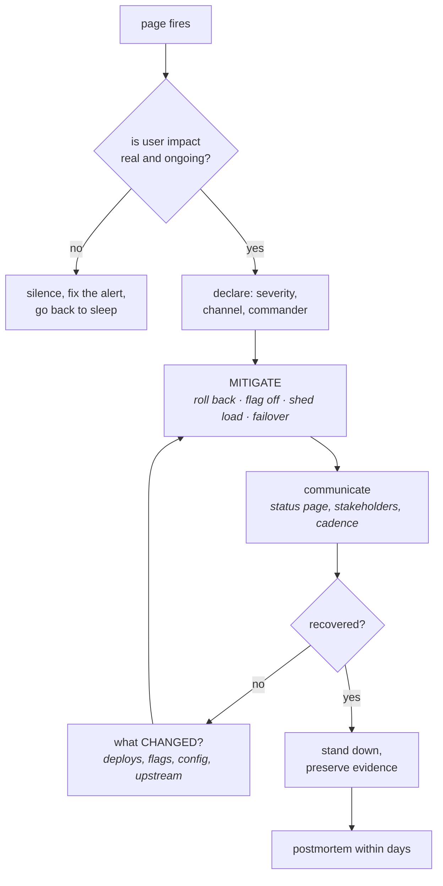

# Running it on call

[Observability, SLOs and operations](../02-interview-core/30-observability-slos-and-operations.md)
covers what to measure and why seniors are graded on "can you run it". This
chapter is the human system around it: what you do in the first ten minutes of
an incident, how a postmortem produces change rather than a document, what a
disaster recovery plan is worth before it has been tested, and the cost
conversation that every platform team eventually owns.

---

## In brief

- **Mitigate first, diagnose second.** Restoring service and finding the cause
  are different jobs, and conflating them is why incidents run long.
- **Roles beat heroics.** One incident commander who does not debug, one
  communicator, and responders who investigate — because the failure mode of a
  big incident is five people fixing the same thing and nobody talking to
  anyone.
- **"What changed" answers most incidents.** Deploys, flags, config, and
  somebody else's deploy. Check it before theorising.
- **Blameless means focused on the system, not soft.** The question is never
  "who ran it", it is "what made that the easy thing to do, and why did
  nothing catch it".
- **An action item without an owner and a date is a wish.** The output of a
  postmortem is a small number of changes that actually ship, not a complete
  list of everything imaginable.
- **An untested backup is not a backup.** RPO and RTO are claims until a
  restore has been performed and timed, and the first real restore is always
  slower than anyone guessed.
- **On-call load is a design signal.** Pages per shift is a metric about the
  system, and sustained high load is a reliability problem being paid for in
  human sleep.

---

## The first ten minutes


*Mitigation comes before diagnosis, and the loop back is through "what changed" rather than through theorising. The decision at the top is the one most teams skip: a page with no user impact is an alerting bug, and treating it as an incident is how alert fatigue becomes normal.*

**Mitigate before you understand.** This is the single highest-value habit, and
it is counterintuitive for engineers, because understanding feels like
progress. The mitigations that are nearly always available:

- **Roll back the deploy.** The most likely cause is the most recent change,
  and a rollback is a known-good state. You can diagnose the bad version at
  leisure.
- **Turn the flag off.** Faster than a rollback and more precise — seconds
  rather than minutes, with no rebuild. This is the payoff for separating
  deploy from release in
  [pipelines and GitOps](10-pipelines-and-gitops.md).
- **Shed load.** Reject the lowest-value traffic to keep the rest working:
  disable an expensive endpoint, degrade to cached data, turn off a
  non-essential feature. Serving 80% of traffic correctly beats serving 100%
  badly. See
  [resilience and rate limiting](../02-interview-core/29-resilience-rate-limiting.md).
- **Fail over** — to another region, a replica, a secondary provider — if you
  have tested it, which is the condition that disqualifies most teams.
- **Scale out**, bluntly, if the constraint is capacity. Expensive and usually
  temporary, and a reasonable trade at 3am.

**Then "what changed", before any theory.** In rough order of likelihood: our
deploy, our feature flag, our config or infrastructure change, a dependency's
deploy, a certificate expiry, a cron or batch job, a traffic change (a
customer's launch, a bot), and a provider incident. A deploy-annotation overlay
on the dashboards answers the first one by looking rather than asking, which is
why that annotation is worth setting up before you need it.

**Roles**, for anything beyond a one-person fix:

| Role | Does | Explicitly does not |
| --- | --- | --- |
| **Incident commander** | Owns the incident: decides, delegates, tracks, declares severity and stand-down | Debug. The moment the commander is head-down in a terminal, nobody is coordinating |
| **Communications** | Status page, stakeholder updates on a fixed cadence, keeps the channel readable | Investigate |
| **Responders** | Investigate and mitigate, report findings up | Decide unilaterally, or go quiet |
| **Scribe** | Timeline in the channel as it happens | Reconstruct it afterwards from memory |

The commander-does-not-debug rule is the one people resist and the one that
matters most. The characteristic failure of a serious incident is not a lack of
technical skill; it is five capable engineers independently investigating the
same hypothesis while the status page goes stale and nobody has decided whether
to roll back.

**Communicate on a cadence, even with nothing new.** "Still investigating, next
update in 20 minutes" is information: it tells everyone they do not need to
ask. Silence generates a second incident made of people asking what is
happening.

**Preserve evidence before restarting anything.** A restart fixes the symptom
and destroys the cause — grab logs, a heap or goroutine dump, the pod
description, the connection-state histogram from
[Linux for operators](05-linux-for-operators.md). Thirty seconds of capture
saves the next three occurrences.

---

## Postmortems that produce change

A postmortem is worth writing for one reason: the system changes afterwards. A
document that is written, circulated and filed is a cost with no benefit, and
most organisations produce those.

**Blameless is a precise idea, not a nicety.** It does not mean nobody is
responsible or that mistakes are fine. It means the investigation targets the
system, because that is where the leverage is: the question is not "who ran the
command" but "what made that command the easy thing to do, why did nothing
prevent it, and why did it take 40 minutes to notice". People behave sensibly
given their context; if the outcome was bad, the context produced it. And the
practical argument is self-interested — blame produces hiding, hiding produces
worse incidents, and the second-order cost is far higher than any individual
mistake.

**The structure that works:**

1. **Impact, in user terms and numbers.** "Checkout failed for 23% of users for
   47 minutes; 1,900 failed orders; error budget 60% consumed." Not "the service
   was degraded".
2. **Timeline**, with the gaps that matter visible: when it started, when we
   *detected* it, when we mitigated, when we resolved. Detection latency is
   usually the most actionable number in the whole document.
3. **What happened**, mechanically. The sequence, not the narrative.
4. **Why it happened**, several layers deep. Not one root cause — real
   incidents are a chain, and "the proximate cause was a bad config" stops one
   step too early.
5. **What went well.** Partly morale, mostly because the things that worked are
   the things to invest more in.
6. **Where we got lucky.** The most underrated section: "this only affected one
   region because the rollout had not finished" is a near-miss that will not be
   lucky next time.
7. **Action items**, each with an **owner**, a **date** and a **priority** —
   and few enough to actually happen.

**On action items**, which is where postmortems usually fail: a list of
nineteen is a list of zero. Three that ship beat nineteen that are filed. And
they should be ordered by the stage they improve — *prevent* it (a guardrail, a
test, a type), *detect* it faster (the alert that should have fired), *mitigate*
it faster (a flag, a runbook, a tested failover). Teams over-index on
prevention, but the detection and mitigation items usually generalise to
incidents you have not had yet, which makes them better value.

**Beware single root causes.** "Human error" is never a root cause; it is the
place the investigation stopped. Neither is "the database fell over" if the
real question is why one slow query could take the whole service down. The
useful stopping point is where you find something you can change that would
have broken the chain.

---

## Disaster recovery, and the honesty test

**RPO and RTO** are the two numbers, and they are business decisions rather
than technical ones:

- **RPO** (recovery point objective) — how much *data* you can afford to lose,
  which is the age of the oldest unrecoverable write. Driven by backup
  frequency and replication lag.
- **RTO** (recovery time objective) — how long you can afford to be *down*.
  Driven by how fast you can actually restore and cut over.

The honesty test is simple and most teams fail it: **has a restore been
performed, end to end, and timed?** Until then both numbers are aspirations.
What the first real drill always reveals: the restore takes far longer than
anyone estimated (a multi-terabyte database restore is hours, not minutes);
something essential was not being backed up at all — a secret, a config store,
a DNS zone, the Terraform state; the runbook references a person who left; and
the credentials needed to perform the recovery live in the system that is down.

**The backup rules worth stating**, because they are what distinguishes a plan
from a hope:

- **Test restores on a schedule**, not just backup completion. A backup job
  that reports success and produces unrestorable output is a well-understood
  failure.
- **Keep them off the primary account and immutably.** A backup an attacker (or
  a mistaken script) with production credentials can delete is not protection
  against the two scenarios that most need it — ransomware and a bad automation.
- **Back up the things that are not data**: infrastructure state, secrets,
  DNS, CI configuration, the container registry. "We can rebuild from code" is
  only true if the code and its state are also recoverable.
- **Know your retention and your legal requirements**, and that
  point-in-time recovery and a nightly snapshot are different RPOs.

**Game days** are how a plan becomes a capability: deliberately break something
in a controlled window and let the on-call rotation respond. Start small and
announced — kill a pod, fail a dependency, revoke a credential — and work up to
unannounced regional failover if the business genuinely needs that confidence.
The value is rarely the technical finding; it is discovering that the runbook is
stale, the alert never fired, and nobody knew who could approve a failover.
This is the disciplined end of chaos engineering, and it is the only way to
know whether the multi-region design in
[multi-region and geo-distribution](../02-interview-core/46-multi-region.md)
works.

---

## On-call as a system to design

**On-call load is a metric about the system**, not about the people. Pages per
shift, pages outside business hours, and the fraction that were actionable are
all reliability signals, and a rotation that is being woken three times a night
is telling you about the architecture, not about stamina.

The thresholds worth knowing: an on-call shift should be survivable, which in
practice means a handful of pages per week, not per night. Above that, the
correct response is to spend engineering time on reliability, not to rotate
faster. This is exactly what the **error budget** is for — it converts
"reliability versus features" from an argument into a number, and the policy
that makes it real is: budget remaining, ship; budget exhausted, reliability
work takes priority. A budget that is only reported is a budget nobody obeys.

**What makes a rotation humane**, and these are reasonable things to ask about
in an interview — they tell you a great deal about an engineering culture:

- **A real handover**, with what is ongoing and what is fragile this week.
- **Runbooks linked from the alerts themselves**, so a page is a procedure. The
  runbook link is the highest-value field in an alert annotation.
- **Permission to mitigate**, including rolling back someone else's change
  without finding them first. Needing approval at 3am is a design flaw.
- **Follow-the-sun or compensated nights**, and time off after a bad night.
  Unpaid, unacknowledged night work is how teams lose their best operators.
- **Alerts owned by the team that is paged.** Being woken by something you
  cannot fix and cannot change is the fastest route to learned helplessness.
- **An alert-tuning loop**, where every non-actionable page is a bug with a
  fix: delete it, raise the threshold, add a `for:` duration, or make the
  underlying thing self-healing.

**Toil** is the other half: manual, repetitive, automatable work that scales
with the system and produces no lasting value. Capping it — the usual
convention is around half of a team's time at most — is what stops a platform
team becoming a ticket queue. The question to ask of any repeated task is
whether it should be automated, eliminated by a design change, or handed to
the people who own the thing.

---

## Cost, because someone has to own it

Cloud cost is an engineering concern, and increasingly a question in senior
interviews, because the people who can change it are the ones making
architectural decisions.

**Make it visible first.** Untagged spend is unmanageable, so tagging by
service, team and environment — enforced by
[policy as code](09-infrastructure-as-code.md) in the pipeline rather than by
reminders — is the prerequisite for every other step. A per-service cost
dashboard changes behaviour on its own.

**Where the money usually is**, in rough order of how often it surprises
people:

| Source | The usual finding |
| --- | --- |
| **Over-provisioned requests** | Pods requesting 4× what they use; the gap is pure waste, and right-sizing is the single biggest win in most clusters |
| **Idle non-production** | Staging running 24/7 for a team that works 8 hours in one timezone |
| **Data transfer** | Cross-AZ and cross-region traffic, often from a topology nobody drew — chatty services split across zones |
| **Storage that only grows** | Old snapshots, orphaned volumes, logs with no retention policy, multi-region replication of data nobody reads |
| **Observability itself** | High-cardinality metrics and verbose logs are frequently a top-five line item. See [the monitoring stack](11-the-monitoring-stack.md) |
| **Managed service tiers** | Provisioned capacity sized for a peak that happens twice a year |

**The levers**, and the point to make in an interview is that they are ordered:
first eliminate (delete what nobody uses), then right-size (requests and
instance types to measured usage), then commit (savings plans and reserved
capacity for the stable baseline, which is a finance decision about a
predictable floor), then arbitrage (spot or preemptible for interruptible work
— batch, CI, stateless replicas behind a PDB). Committing before right-sizing
locks in the waste for a year, which is the common and expensive mistake.

**And the trade-off worth naming out loud:** cost optimisation competes with
reliability and with engineering time. Spot instances are cheaper and can
vanish; multi-AZ costs transfer and doubles some capacity; a reserved commitment
is a bet on next year's architecture. The senior answer is not "reduce cost",
it is being able to say what each saving costs in risk — and that an engineer's
week spent saving $200 a month was a bad trade.

---

## Building it

**A runbook that is usable at 3am** — the format matters more than the content,
because it is read by a tired person under pressure:

```markdown
# Runbook: links-api error-budget fast burn

## Is this real?           ← always first: is there user impact?
- Dashboard: https://grafana.acme.dev/d/links-api  (check the 5xx panel)
- Synthetic check: https://status.acme.dev/links-api
- If 5xx is flat and only one pod is unhealthy → NOT an incident. Silence 1h,
  open a ticket, go back to sleep.

## Mitigate (do this before diagnosing)
1. Was there a deploy in the last 30 min?  `argocd app history links-api`
   → Yes: `argocd app rollback links-api <prev>`   (~90s, safe, always first)
2. Is a flag newly on?  https://flags.acme.dev/links-api
   → Turn it off. Seconds, no deploy.
3. Still failing? Shed load: scale the ingest worker to 0 to protect reads.
   `kubectl -n links scale deploy/links-ingest --replicas=0`
4. Database unreachable? See runbook: links-db-failover.md  (needs @db-oncall)

## Diagnose
- Dependency health:  https://grafana.acme.dev/d/deps
- Recent config:      `git log -5 --oneline` in acme/config envs/prod/links-api
- Pod-level:          `kubectl -n links get pods` → CrashLoop? OOMKilled?
  Then: 08-kubernetes-operations.md decision tree.

## Escalate
- 20 min with no mitigation, or data loss suspected → page @platform-lead
- Customer-visible > 15 min → @comms updates the status page

## Known false alarms
- Nightly backfill 02:00–02:30 UTC raises p99; not an incident unless 5xx rises.
```

The ordering is the content: **is it real** before **mitigate** before
**diagnose**, with escalation criteria that are specific enough to act on
without a judgement call, and the known false alarms written down so a tired
person does not rediscover them.

**A postmortem template with the sections teams skip**

```markdown
# Postmortem: links-api outage 2026-03-14

**Impact:** 23% of link creations failed for 47 min (14:12–14:59 UTC).
1,900 failed requests, 340 affected tenants. 60% of the monthly error budget.

## Timeline (UTC)
| Time | Event |
| --- | --- |
| 13:58 | Deploy of links-api 2.14.0 (PR #4411) completes |
| 14:12 | Error rate crosses 5%. **No alert fires** (threshold was 10%) |
| 14:31 | A customer reports it in support. ← detection was a human, 19 min late |
| 14:34 | Incident declared, @rk commander |
| 14:41 | Rollback started |
| 14:59 | Error rate normal |

**Detection latency: 19 minutes, and it was a customer.** ← the real finding

## What happened
2.14.0 added a NOT NULL column read-path assumption while the backfill from
2.13.0 was still running. Rows not yet backfilled threw on read.

## Why (the chain, not one cause)
1. The migration's backfill was still in progress when the read-new deploy shipped.
2. Nothing enforced the ordering — the pipeline has no gate on backfill completion.
3. Staging had a fully-backfilled dataset, so tests passed.
4. The alert threshold (10%) was above the impact level (5%), so nothing fired.
5. The canary analysis window (2 min) was shorter than the time to hit
   un-backfilled rows, so the canary passed.

## What went well
- Rollback took 4 minutes and worked exactly as rehearsed.

## Where we got lucky
- The backfill was 80% done. At 20% this would have been a near-total outage.

## Action items
| # | Action | Stage | Owner | Due |
| --- | --- | --- | --- | --- |
| 1 | Alert on error-budget burn rate, not a 10% threshold | detect | @sa | 03-21 |
| 2 | Pipeline gate: read-new deploy blocked until backfill job reports complete | prevent | @rk | 03-28 |
| 3 | Seed a staging dataset with un-backfilled rows | prevent | @mn | 04-04 |
| 4 | Lengthen canary analysis to 10 min for schema-touching releases | detect | @sa | 03-21 |
```

Notice what the timeline does: it makes **detection latency** the headline
finding rather than the bad deploy, and two of the four action items improve
detection rather than prevention — which is what generalises to the next
incident.

**A game day you can actually run**

```bash
# Announced, business hours, one hypothesis, a stated abort condition.
# Hypothesis: losing one AZ's pods causes <1 min of elevated errors and
# no failed requests, because PDBs and anti-affinity hold.
# Abort if: error rate > 2% for 60s.

# 1. Record the baseline so "did it work" is measurable, not a feeling.
kubectl -n links get pods -o wide | awk '{print $7}' | sort | uniq -c

# 2. Inject: drain every node in one zone.
for n in $(kubectl get nodes -l topology.kubernetes.io/zone=eu-west-1a -o name); do
  kubectl drain "$n" --ignore-daemonsets --delete-emptydir-data --disable-eviction=false &
done; wait
#    --disable-eviction=false is deliberate: we WANT PDBs to be respected,
#    because whether they hold is the thing under test.

# 3. Observe for 10 minutes: error rate, p99, pod distribution, pending pods.
# 4. Restore.
kubectl uncordon -l topology.kubernetes.io/zone=eu-west-1a

# 5. Write down what surprised you. That is the entire output of the exercise.
```

The findings from a drill like this are almost never the one you designed for.
They are: a PDB that was too strict so the drain hung, a service with all
replicas in one zone because nobody set topology spread, an alert that did not
fire, and a runbook step that referenced a tool that no longer exists.

---

## Interview Q&A

### Q: You are on call. The page fires: error rate above threshold on a tier-0 service. Walk me through it.
**Level:** senior · **Tags:** operations, incidents

<details><summary>Model answer</summary>

First, confirm it is real and ongoing. I look at the dashboard and a synthetic
check for actual user impact, because a page with no user impact is an alerting
bug and I should silence it, open a ticket and go back to sleep rather than
start an incident. That decision takes a minute and teams skip it, which is how
alert fatigue becomes normal.

If it is real, declare it: a severity, a channel, and myself as commander until
someone takes it. Declaring early is cheap and escalating late is not.

Then **mitigate before diagnosing**. The instinct is to understand first, and
it is wrong, because understanding is slow and restoring service is often fast.
In order: was there a deploy in the last half hour — roll it back, since the
most recent change is the most likely cause and a rollback is a known-good
state. Is a flag newly on — turn it off, which is seconds rather than minutes.
If neither, can I shed load to protect the core path: disable an expensive
endpoint, degrade to cached data, turn off the ingest worker to protect reads.
Serving 80% of traffic correctly beats serving everything badly.

Alongside that, communicate on a cadence — a status page update and a next
update time, even with nothing new, because silence creates a second incident
made of people asking what is happening.

Only then diagnose, and I start with **what changed** rather than with a
theory: our deploys, our flags, our config, a dependency's deploy, a
certificate, a cron job, a traffic change. Deploy annotations on the dashboard
answer most of that by looking.

Two things I would be deliberate about. If I am commanding anything bigger than
a one-person fix, I do not debug — the characteristic failure of a serious
incident is five people investigating the same hypothesis while nobody decides
whether to roll back. And before restarting anything I capture evidence: logs,
a dump, the pod description. A restart fixes the symptom and destroys the cause,
and then it recurs next week with nothing learned.

</details>

**Follow-ups:**

1. Q: You rolled back and it did not help. Now what?
   <details><summary>Answer</summary>

   Then my assumption was wrong, and I widen rather than dig. The rollback
   ruling out our own code is useful information.

   The next candidates: something that is not our deploy but changed anyway —
   a config or infrastructure change, a feature flag, a certificate expiring, a
   cron or batch job that started, an upstream dependency's own deploy. Then a
   traffic change: a customer launch, a bot, a retry storm amplifying a small
   problem into a large one. Then the provider's status page, which is worth
   checking early precisely because it is free.

   I would also question whether the rollback actually took effect, which is an
   embarrassing and common finding — image pinned to a mutable tag, a stalled
   rollout with both versions live, or a cached config that did not reload.

   And I would re-examine the shape of the failure rather than its cause: is it
   all requests or one endpoint, all tenants or one, all regions or one, reads
   or writes. Those four questions narrow the search space faster than any
   hypothesis, because each answer eliminates whole categories.

   If 20 minutes have passed with no mitigation, I escalate — not because I am
   stuck, but because that is the threshold at which another pair of eyes is
   cheaper than my persistence.

   </details>

2. Q: When do you declare the incident over?
   <details><summary>Answer</summary>

   When user impact has ended and is verifiably staying ended — not when the
   graph touches normal once. I want the metric healthy for a sustained period,
   and I want to know *why* it recovered, because a recovery nobody can explain
   is a recurrence waiting for the next traffic peak.

   Stand-down is also when I do the work that only exists while things are
   fresh: capture the timeline from the channel, note what we have not yet
   explained, and write down the temporary mitigations that must be reverted —
   a scaled-up replica count, a disabled feature, a silenced alert. Those are
   exactly what gets forgotten and causes the next surprise, so they become
   tracked items with owners before anyone sleeps.

   Then schedule the postmortem within a few days, while memory is intact.

   One thing I would not do is treat "mitigated" as "resolved" in
   communications. If we are serving traffic by having turned a feature off,
   customers using that feature are still affected, and saying so is more
   useful than declaring victory.

   </details>

### Q: What makes a postmortem useful rather than a document nobody reads?
**Level:** senior · **Tags:** operations, process, culture

<details><summary>Answer</summary>

That the system is different afterwards. That is the only test, and most
postmortems fail it.

Concretely, four things. **Impact in user terms and numbers** — "checkout
failed for 23% of users for 47 minutes, 1,900 orders, 60% of the error budget"
rather than "degraded performance", because that is what makes prioritisation
possible. **A timeline that exposes the gaps**, especially detection latency:
when it started versus when we knew. That number is usually more actionable
than the cause, and if the answer is "a customer told us", that is the finding.
**A chain of causes rather than one root cause**, because real incidents are a
sequence of five things each of which could have broken it, and stopping at the
proximate cause discards the leverage. **A small number of action items with
owners and dates** — three that ship beat nineteen that are filed, and a list
of nineteen is a list of zero.

Two sections people skip and I would insist on. **Where we got lucky**: "this
only hit one region because the rollout had not finished" is a near-miss and it
will not be lucky next time. And **what went well**, because the things that
worked are the things to invest more in.

On blamelessness: it is a precise idea, not a soft one. The investigation
targets the system because that is where the leverage is — not "who ran it" but
"what made that the easy thing to do, and why did nothing catch it". The
self-interested argument is the strongest one: blame produces hiding, and
hiding produces worse incidents than any individual mistake.

Last, I would categorise action items by stage — prevent, detect faster,
mitigate faster. Teams over-invest in prevention for the specific bug that
happened, and the detection and mitigation items are what generalise to the
incidents you have not had yet.

</details>

### Q: How do you know your disaster recovery plan works?
**Level:** senior · **Tags:** operations, dr, backups

<details><summary>Answer</summary>

Because a restore has been performed end to end and timed. Until then RPO and
RTO are aspirations, and I would say so plainly — the gap between a documented
DR plan and a tested one is the gap between a hope and a capability.

The two numbers are business decisions: RPO is how much data we can lose, which
is set by backup frequency and replication lag; RTO is how long we can be down,
which is set by how fast we can actually restore and cut over. Both need an
owner outside engineering, because "zero" is not a budget.

What the first real drill always finds: the restore takes far longer than
estimated — a multi-terabyte database is hours, not minutes; something
essential was never being backed up, usually a secret store, a DNS zone or the
Terraform state; the runbook names someone who left; and the credentials needed
to perform the recovery live inside the system that is down, which is the
circular dependency that turns a four-hour recovery into a day.

So the practices: scheduled test restores, measuring completion rather than
backup success, because a backup job that reports success and produces
unrestorable output is a well-known failure. Backups held in a separate account
and immutably, because a backup that production credentials can delete does not
protect against the two scenarios that most need it — ransomware and a bad
script. Backing up the things that are not data: infrastructure state, secrets,
DNS, CI config, the registry.

And game days to turn it into a capability: announced, business hours, one
hypothesis and an abort condition, starting small. The value is almost never
the technical finding — it is discovering that the runbook is stale, the alert
never fired, and nobody knew who could approve a failover.

</details>

### Q: Your team is getting paged three times a night. What do you do?
**Level:** senior · **Tags:** operations, culture, reliability

<details><summary>Answer</summary>

Treat it as a reliability problem rather than a staffing problem. Pages per
shift is a metric about the system, and the wrong response is to rotate faster
or add people to the rotation, because that hides the signal while the cost
keeps being paid in sleep.

First, triage the pages for a week and sort them into three piles: not
actionable, actionable but automatable, and genuinely needing a human. In my
experience the first pile is the largest, and every page in it is a bug with a
specific fix — delete the alert, raise the threshold, add a `for:` duration, or
alert on error-budget burn rather than a raw threshold so a blip does not wake
anyone. That alone usually halves the volume and costs a day of work.

The second pile is toil: known cause, known fix, done by hand at 3am. Those
should be automated or designed out — a pod that needs restarting weekly is a
leak to fix or a liveness probe to configure, not a recurring page.

What is left is the real reliability work, and this is where the **error
budget** does its job: it converts "reliability versus features" from an
argument into a number, and the policy — budget exhausted means reliability work
takes priority over features — is what makes it real rather than reported.
Three pages a night is an exhausted budget by definition, so that conversation
is already won if the policy exists.

Alongside that, I would make sure the rotation is humane while we fix it:
compensated or follow-the-sun nights, time off after a bad one, alerts owned by
the team that is paged, and explicit permission to mitigate — including rolling
back someone else's change without finding them first. Needing approval at 3am
is a design flaw, and being woken by something you cannot fix is the fastest
route to people leaving.

</details>

---

## What a weak answer sounds like

- **Diagnosing before mitigating.** Understanding is slower than rolling back.
- **Restarting first**, destroying the evidence, then being surprised when it
  recurs.
- **No incident commander**, or a commander who is head-down debugging.
- **Silence during an incident**, which generates a second incident of people
  asking what is happening.
- **Theorising before checking what changed.**
- **"Human error" as a root cause** — the place the investigation stopped.
- **A single root cause** for an incident that was obviously a chain.
- **Nineteen action items**, with no owners and no dates.
- **An untested backup**, and RPO/RTO numbers nobody has measured.
- **Backups in the same account** that production credentials can delete.
- **Treating on-call load as a staffing problem** rather than a system signal.
- **Reporting an error budget without a policy** that changes what gets built.
- **Committing to reserved capacity before right-sizing**, locking in the waste.

---

## Quiz

### MCQ: A page fires. What is the correct first action?
- [ ] Find the root cause so the fix is correct
- [x] Confirm there is real, ongoing user impact — a page without it is an alerting bug to silence and ticket, not an incident
- [ ] Restart the affected service
- [ ] Notify every stakeholder immediately
**Why:** Skipping this check is how alert fatigue becomes normal, and it costs a minute. Once impact is confirmed, mitigation — not diagnosis — comes next.

### MCQ: Why does mitigation come before diagnosis?
- [ ] Because diagnosis is usually impossible during an incident
- [x] Restoring service and understanding the cause are different jobs; a rollback or a flag flip returns a known-good state in minutes, and the bad version can be diagnosed at leisure
- [ ] Because postmortems cover the diagnosis later
- [ ] Because mitigation always fixes the underlying cause
**Why:** Conflating the two is the main reason incidents run long. The counterpart discipline is capturing evidence before mitigating, so the cause survives the fix.

### MCQ: Why should an incident commander not debug?
- [ ] Commanders usually lack the technical context
- [x] The characteristic failure of a large incident is several engineers investigating the same hypothesis while nobody coordinates, decides or communicates — coordination is a full-time role
- [ ] Debugging would make the commander liable for the outcome
- [ ] It violates blameless postmortem principles
**Why:** The scarce resource in a serious incident is decision-making and communication, not technical skill. The moment the commander is in a terminal, the status page goes stale and the rollback decision has no owner.

### MCQ: In a postmortem timeline, which gap is usually the most actionable finding?
- [ ] The time between the deploy and the first error
- [x] Detection latency — the gap between when impact started and when anyone knew, especially if the answer is "a customer told us"
- [ ] The time spent writing the postmortem
- [ ] The number of engineers involved
**Why:** Detection improvements generalise to incidents you have not had yet, whereas preventing one specific bug does not. It is also why alerting action items often outperform code fixes.

### MCQ: What does "blameless" actually mean in a postmortem?
- [ ] That nobody is accountable for action items
- [x] That the investigation targets the system — what made the mistake easy and why nothing caught it — because that is where the leverage is, and because blame produces hiding, which produces worse incidents
- [ ] That mistakes have no consequences
- [ ] That the postmortem is not shared outside the team
**Why:** It is a precise engineering stance, not a soft one. "Human error" as a root cause is simply where the investigation stopped one step too early.

### MCQ: Why is "where we got lucky" a valuable postmortem section?
- [ ] It improves team morale after a difficult incident
- [x] It surfaces near-misses — "this only hit one region because the rollout had not finished" — which are failures that will not be lucky next time
- [ ] It is required for compliance reporting
- [ ] It identifies who deserves credit for the recovery
**Why:** Near-misses carry the same information as incidents at none of the cost, and they are the only cheap way to learn about failures that have not fully happened yet.

### MCQ: What makes an RPO/RTO claim credible?
- [ ] Documented backup schedules and replication configuration
- [x] A restore that has been performed end to end and timed, because the first real restore is always slower than estimated and usually reveals something that was never being backed up
- [ ] A backup job reporting success for 90 consecutive days
- [ ] Multi-AZ replication of the primary database
**Why:** Backup success and restorability are different properties. The classic drill findings are an un-backed-up secret store or Terraform state, and recovery credentials living inside the system that is down.

### MCQ: Why should backups live in a separate account with immutability?
- [ ] To reduce storage costs through lifecycle policies
- [x] A backup that production credentials can delete does not protect against the two scenarios that most need it — ransomware and a destructive automation
- [ ] Cross-account access makes restores faster
- [ ] It is the only way to achieve point-in-time recovery
**Why:** The threat model for backups includes a compromised or mistaken actor inside production. Same-account, mutable backups are exactly as compromised as the thing they are meant to recover.

### MCQ: A team is paged three times a night. What is the correct framing?
- [ ] A staffing problem — expand the rotation to spread the load
- [x] A reliability problem, and a signal about the system: triage the pages into non-actionable (fix the alert), automatable (fix the toil), and real, then spend engineering time accordingly
- [ ] An expected cost of operating a tier-0 service
- [ ] A monitoring problem — reduce alert sensitivity across the board
**Why:** Rotating faster hides the signal while the cost is still paid in sleep. This is precisely the argument the error budget exists to settle, provided the policy actually redirects work when the budget is exhausted.

### MCQ: Why should right-sizing come before buying reserved capacity or savings plans?
- [ ] Reserved capacity cannot be applied to right-sized instances
- [x] Committing first locks in the existing waste for the commitment term, so you pay a discounted rate for resources you did not need
- [ ] Right-sizing is reversible and commitments are not
- [ ] Savings plans require a minimum utilisation level to activate
**Why:** The lever order is eliminate, right-size, commit, arbitrage. Committing before measuring is both common and expensive, because the discount is applied to an inflated baseline.

---

## Glossary

- **Mitigate vs diagnose** — restore service now; find the cause after.
- **Incident commander** — owns decisions, delegation and stand-down; does not debug.
- **Severity** — the declared impact level that drives response and communication cadence.
- **Shed load** — deliberately rejecting lower-value traffic to protect the core path.
- **"What changed"** — deploys, flags, config, dependencies, certificates, cron, traffic; checked before theorising.
- **Deploy annotation** — the marker on a dashboard that answers "did this start at a deploy" by looking.
- **Blameless postmortem** — an investigation aimed at the system rather than the person.
- **Detection latency** — time from impact starting to anyone knowing; usually the most actionable number.
- **Chain of causes** — the sequence of contributing factors, as opposed to a single root cause.
- **Near-miss** — a failure that did not fully happen; the content of "where we got lucky".
- **Action item stages** — prevent / detect faster / mitigate faster.
- **RPO / RTO** — tolerable data loss / tolerable downtime; business decisions, credible only once tested.
- **Test restore** — measuring restorability and duration, as distinct from backup success.
- **Immutable, off-account backups** — protection against a compromised or mistaken production actor.
- **Game day** — a controlled, hypothesis-driven failure drill; the disciplined end of chaos engineering.
- **Error budget policy** — the rule that redirects work when the budget is exhausted; without it the budget is only a report.
- **Toil** — manual, repetitive, automatable work that scales with the system and leaves nothing behind.
- **Right-size then commit** — measure and shrink before buying reserved capacity, or the waste is locked in.
