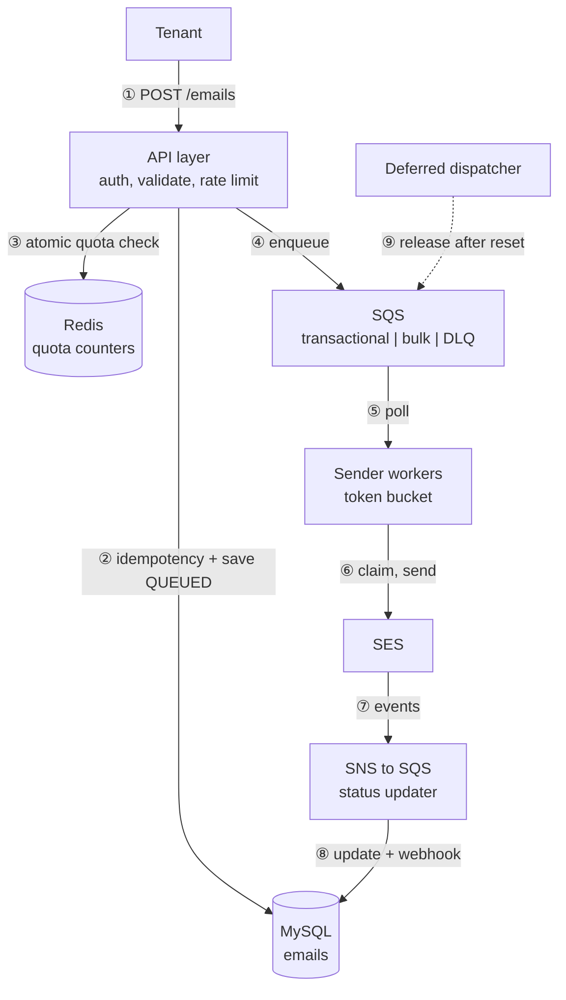
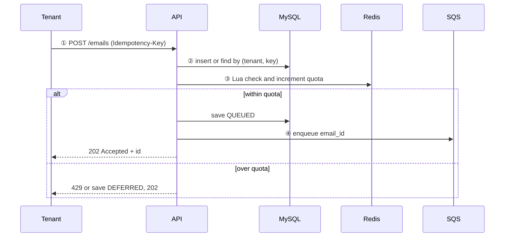
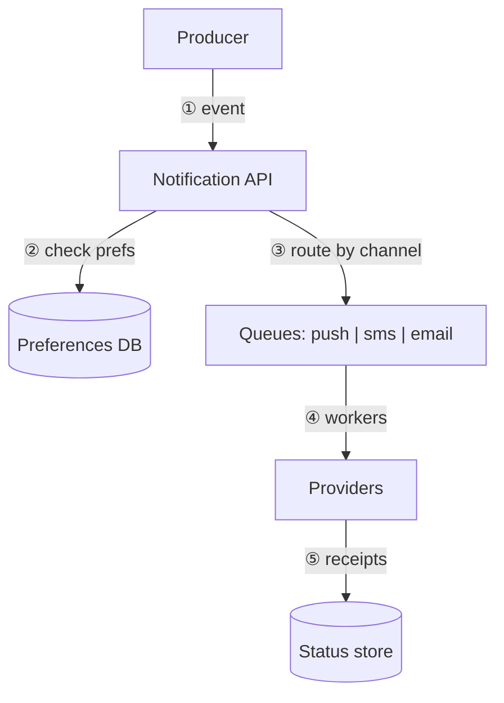

# Design: a multi-tenant email service with daily quotas

This is the question behind the panel rejection. The prompt is one vague line, and the candidate named SQS, Lambda, MySQL, Step Functions and cron without clarifying anything. This chapter shows the order of work that passes: ask, size, simple design, find what breaks, justify, walk the edge cases.

---

## In brief

- **The quota is the hard part, not the sending.** Counting per tenant across many servers without races, and deciding what happens at the limit, drives the whole design.
- **Accept fast, send later.** The API validates, dedupes, reserves quota, stores the email and enqueues it, then returns `202 Accepted`. A queue plus workers does the slow, failure-prone part.
- **The daily reset needs no cron.** The quota counter key contains the date (`quota:{tenant}:{yyyy-mm-dd}`), so tomorrow starts at zero by itself.
- **Over-quota is a per-tenant policy:** reject (429), defer until the next reset, or bypass for critical mail. Ask which one before drawing anything.
- **Duplicates are controlled in two places:** a unique idempotency key at the API, and a conditional status claim in the worker. Delivery is at-least-once and you say so.
- **Every component earns its place with a named problem.** That includes explicitly saying why you did not use cron or Step Functions.

## The prompt

> "Design an email-sending service for multiple tenants. Each tenant has a daily quota. Walk me through it."

It is vague on purpose. The first thing the interviewer scores is what you do next.

## Step 1: Ask before you draw

Spend five to seven minutes here. Write the answers where the interviewer can see them.

| Question | Why it matters | Assumed answer |
| --- | --- | --- |
| Who calls it, and what kind of mail? | Decides priority lanes | Services of tenant companies; transactional (OTP, receipts) and bulk (newsletters) |
| What is the quota unit and window? | Decides the counter design | Emails per tenant per day, UTC |
| What happens when the quota is exceeded: queued, delayed or rejected? | Decides whether a backlog store exists (the panel's exact point) | Configurable per tenant: reject or defer |
| Do any emails bypass the quota? | Decides priority and reserve logic | Critical (OTP, security) may bypass |
| Delivery guarantee? | Decides idempotency design | At-least-once; never lose; avoid duplicates |
| Scale? | Decides sizing | 1,000 tenants, 50M emails per day, peak 2,000 per second |
| Delivery latency target? | Decides queue and worker capacity | Transactional under 30 s at p95 |
| Which provider, and its limits? | The provider is the real bottleneck | SES with a send-rate limit |
| Do tenants need status? | Adds an event path | Status API and webhooks |

### Requirements

**Functional**

1. A tenant sends an email through an API (to, subject, body or template, priority, idempotency key).
2. The system enforces a per-tenant daily quota.
3. When the quota is exceeded, the tenant's policy applies: reject or defer to the next window.
4. A tenant can query an email's status and receive webhooks on delivery, bounce and failure.
5. Failed sends are retried; permanently failed ones are marked and reported.

**Non-functional**

1. API accepts a request in under 100 ms at p99; availability 99.9%.
2. No accepted email is lost. Duplicates are rare and tolerated; loss is not.
3. One tenant cannot slow or starve another (isolation).
4. Survives provider throttling or outage without data loss.
5. Quota counting is correct under concurrency (no overselling the quota).

**Out of scope for v1:** campaign builder, A/B templates, billing, multi-region active-active, analytics dashboards.

## Step 2: The numbers

| Quantity | Calculation | Result |
| --- | --- | --- |
| Average rate | 50M / 86,400 | about 580 per second |
| Peak rate | x 3 to 4 | about 2,000 per second |
| Row size | ~1 KB metadata, bodies in S3 if large | |
| Storage per day | 50M x 1 KB | 50 GB |
| 90-day retention | 50 GB x 90 | about 4.5 TB |
| Quota check rate | one atomic op per accepted email | 2,000 per second on Redis, trivial |
| Workers | 2,000/s x ~100 ms per send / concurrency 1 | about 200 concurrent sends at peak |

Conclusions to say aloud: 4.5 TB means partition by date and archive; 2,000 per second is easy for Redis and a single queue family but too much to check against MySQL on every request; the provider's send rate is the real limit, so workers need a token bucket.

## Step 3: Start simple, then find what breaks

Naive version: client calls API, API calls SES, API responds.

| What breaks | Component added |
| --- | --- |
| SES is slow, so the API hangs and requests time out | Queue and workers; API returns 202 |
| SES is down, so mail is lost | Persist the email first, retry from the queue |
| A client retries a timeout and sends twice | Idempotency key with a unique constraint |
| Nothing limits tenants | Redis atomic quota counter |
| A big blast delays OTPs | Separate transactional and bulk queues |
| Workers exceed SES rate limit | Token bucket in workers |
| Over-quota mail must go out tomorrow | Deferred table plus dispatcher |
| Poison messages retry forever | Dead letter queue and alerting |

### The final architecture


*Numbered request path: accept (1 to 4), send (5 to 6), status feedback (7 to 8), and the over-quota deferred release (9).*

| # | What happens | Why |
| --- | --- | --- |
| ① | Tenant calls `POST /emails` with an idempotency key | Retries are safe |
| ② | API checks the unique `(tenant_id, idempotency_key)`; a repeat returns the original response; otherwise saves the row as `QUEUED` | DB is the source of truth |
| ③ | Atomic Lua script in Redis checks and increments `quota:{tenant}:{date}` | No race at the limit |
| ④ | Message `{email_id}` goes to the transactional or bulk queue; API returns `202` with the id | Fast accept, durable work |
| ⑤ | Workers poll the queue with capped concurrency | Protects the DB and SES |
| ⑥ | Worker claims `QUEUED to SENDING` conditionally, takes a token, calls SES, records `SENT` | Dedupe under redelivery; respects provider rate |
| ⑦ | SES publishes delivery, bounce and complaint events | Real outcome, not just accepted |
| ⑧ | Status updater changes the row and calls the tenant webhook (signed, retried) | Tenant visibility |
| ⑨ | When a deferred email's `release_at` arrives, the dispatcher re-checks quota and enqueues it | Over-quota backlog drains after the reset |

When the quota is exceeded at step ③, the tenant's policy decides: REJECT returns `429` with the reset time; DEFER saves the row as `DEFERRED` with `release_at` set to the next reset; BYPASS (critical mail) skips the check or uses a reserved allowance.

### The accept flow in sequence


*Quota is reserved before enqueue so an over-limit tenant never reaches the queue; the policy decides between 429 and deferral.*

## Step 4: The data model

### MySQL

**`tenants`**

| Column | Type | Notes |
| --- | --- | --- |
| id | BIGINT PK | |
| name | VARCHAR | |
| plan | VARCHAR | drives quota default |
| daily_quota | INT | |
| over_quota_policy | ENUM(REJECT, DEFER) | |
| timezone | VARCHAR | for reset date key if tenant-local |
| status | ENUM | active, suspended |

**`emails`** (partitioned by `created_at` date)

| Column | Type | Notes |
| --- | --- | --- |
| id | BIGINT or UUID PK | |
| tenant_id | BIGINT | |
| idempotency_key | VARCHAR(128) | |
| to_addr | VARCHAR | |
| subject | VARCHAR | |
| body_ref | VARCHAR | S3 key for large bodies |
| priority | ENUM(TRANSACTIONAL, BULK) | |
| status | ENUM(QUEUED, SENDING, SENT, FAILED, DEFERRED, BOUNCED) | state machine |
| attempts | INT | |
| release_at | DATETIME NULL | deferred emails only |
| provider_msg_id | VARCHAR NULL | |
| created_at, updated_at | DATETIME | |

**`email_events`**: `id, email_id, type (SENT, DELIVERED, BOUNCED, COMPLAINED, FAILED), detail, created_at`. Append-only history.

**`suppressions`**: `tenant_id, address, reason, created_at`. Never send to hard-bounced or complaining addresses.

**`webhook_endpoints`**: `tenant_id, url, secret, enabled`.

### Redis

| Key | Value | TTL |
| --- | --- | --- |
| `quota:{tenant}:{yyyy-mm-dd}` | integer count | 48 hours |
| `ratelimit:{tenant}` | token bucket state for API rate limiting | short |

### Indexes and the access pattern each serves

| Index | Serves |
| --- | --- |
| UNIQUE `(tenant_id, idempotency_key)` | Dedupe at accept |
| `(status, release_at)` | Dispatcher finds due deferred emails |
| `(tenant_id, created_at)` | Tenant status listing, usage reports |
| PK `id` | Worker claim and status updates |
| `(tenant_id, address)` on `suppressions` | Pre-send suppression check |

## Step 5: The decisions that matter

### 1. Counting quota correctly

| Option | Verdict |
| --- | --- |
| `COUNT(*)` in MySQL per request | Too slow at 2,000 per second and hot-row contention |
| Redis `GET` then `INCR` | Race: two requests both read 9,999 |
| Redis Lua script (check and increment atomically) | **Chosen** |

```lua
local cur = tonumber(redis.call('GET', KEYS[1]) or '0')
if cur + tonumber(ARGV[1]) > tonumber(ARGV[2]) then return 0 end
redis.call('INCRBY', KEYS[1], ARGV[1])
redis.call('EXPIRE', KEYS[1], 172800)
return 1
```

Trade-off: Redis can lose data. The DB is the source of truth, and a reconciliation job rebuilds counters from `emails`. If a send fails permanently, decrement to release the reservation.

### 2. The daily reset: why not cron

A cron job that zeroes counters is stateless, can miss or double-fire, runs per tenant timezone awkwardly, and is unneeded: the date is part of the key, so a new day is a new key. The old key expires on its own. If tenants need local-time days, compute the date key from the tenant's timezone.

### 3. Backlog and "send tomorrow": why not Step Functions

| Option | Verdict |
| --- | --- |
| Step Functions wait state per email | One execution per deferred email at millions per day is costly and heavy for "send later". Right tool for multi-step workflows with human steps or long waits at low volume |
| SQS delay | Capped at 15 minutes, cannot hold an email overnight |
| Per-tenant cron | Many jobs, drift, missed runs |
| **Indexed table plus one dispatcher** | **Chosen**: query `status='DEFERRED' AND release_at <= now()` in batches, re-check quota per tenant, enqueue what fits |

Guard against the reset-time thundering herd: drain in batches with per-tenant limits.

### 4. Queue choice and priority

SQS standard: at-least-once, near-unlimited throughput, built-in DLQ and visibility timeout. Ordering is not a requirement, so FIFO's throughput limits are not worth it. Two queues, transactional and bulk, so a newsletter blast cannot delay an OTP. Very large tenants can get their own queue or a concurrency slice (bulkhead).

### 5. Duplicate prevention

| Layer | Mechanism |
| --- | --- |
| API | Unique `(tenant_id, idempotency_key)` |
| Worker | `UPDATE ... SET status='SENDING' WHERE id=? AND status='QUEUED'`; zero rows means another worker owns it |
| Remaining gap | Worker crashes after SES accepts but before writing `SENT`. State it: at-least-once, rare duplicate acceptable, loss is not |

### 6. Retries and failures

| Error | Action |
| --- | --- |
| Throttled, timeout, 5xx | Exponential backoff with jitter, up to N attempts |
| Invalid address, hard bounce | Mark `FAILED`, add suppression, no retry |
| Provider down | Circuit breaker pauses consumption; the queue buffers; alert |
| Exhausted retries | DLQ, alert, replay tool |

### 7. Why MySQL

Constraints (unique idempotency), transactions and queries by tenant and status are all needed. 50 GB a day is manageable with date partitioning and archiving. If write volume outgrows it, shard by tenant or move email state to DynamoDB; say it, but do not start there.

### 8. Tenant isolation

API rate limit per tenant, per-tenant quota, priority queues, bulkheaded concurrency for large tenants, per-tenant dashboards, and automatic suspension of tenants whose bounce or complaint rate threatens the shared SES reputation.

## Alternatives we did not choose, and why

Say these out loud when you pick a component. For each: what it is good at, and the specific reason it loses here.

| Decision | Alternative | Good when | Why not here |
| --- | --- | --- | --- |
| Queue | **Kafka** or Kinesis | You need ordering per key, replay, or very high sustained throughput | No ordering requirement, and we do not need replay; SQS gives visibility timeout, retries and a DLQ with no brokers to run |
| Queue | **RabbitMQ** (or Amazon MQ) | Native priority queues, complex routing | Self-managed or pricier; two SQS queues give priority lanes more simply |
| Queue | **SQS FIFO** for exactly-once | Strict ordering or dedupe needed | Dedupe window is only five minutes and throughput is lower; our dedupe must last as long as the idempotency key |
| Queue | **No queue** (call SES synchronously) | Tiny volume, internal tool | Slow provider hangs the API, outage loses mail, spikes hit SES directly |
| Quota counter | **Counter row in MySQL** | Low volume, one datastore only | Hot-row contention for large tenants at 2,000 per second and a DB round trip on every accept |
| Quota counter | **DynamoDB atomic counter** with a conditional update | You want a durable, fully managed counter with no Redis to operate | Higher cost per write at this rate, a hot partition for the biggest tenant, and Redis is faster; a valid choice if the team already avoids Redis |
| Quota counter | `GET` then `INCR` in Redis | Never | Races at the limit; Lua makes check and increment atomic |
| Quota window | **Sliding window** or token bucket per tenant | The limit is "N per rolling 24 h" or a burst rate | The requirement is a calendar-day quota; a date-keyed counter is simpler and cheaper |
| Daily reset | **Cron or EventBridge schedule** zeroing counters | Maintenance jobs | Stateless, can miss or double-fire, awkward per timezone, and unnecessary because the date is in the key |
| Deferred send | **Step Functions** wait state per email | Few, long, multi-step workflows | Millions of executions a day; cost and operational weight for a plain "send later" |
| Deferred send | **EventBridge Scheduler** one-time schedule per email | Low volume of deferred mail | Per-schedule quotas and cost at scale; a table with `release_at` and one dispatcher is cheaper and observable |
| Deferred send | **SQS delay** or visibility tricks | Delays under 15 minutes | Maximum delay is 15 minutes, cannot hold mail overnight |
| Deferred send | **DynamoDB TTL** as a scheduler | Expiring data | TTL deletion is lazy and not a precise timer |
| Storage | **DynamoDB** for emails | Write volume outgrows MySQL, simple key access | We need unique constraints, queries by tenant and status, and joins for reports; revisit at much larger scale |
| Storage | **PostgreSQL** | Same needs as MySQL | Equally valid; choose whichever the team runs. The design does not depend on it |
| Workers | **Containers** (ECS or Fargate) | Steady throughput, shared token bucket in Redis | Also valid; Lambda scales to zero and fast, but needs reserved concurrency so it cannot exceed the SES rate |
| Duplicates | **Redis `SETNX`** idempotency only | Short-lived dedupe | Not durable; a restart forgets keys. The DB unique constraint is the guarantee |
| Provider | **Self-hosted SMTP** (Postfix) | Special compliance needs | IP reputation, bounce handling and deliverability become your job; SES or SendGrid is cheaper than the team time |
| Provider | **SendGrid or Mailgun** | Richer templates, analytics, multi-provider failover | Fine behind an adapter; start with SES for AWS integration and add a second provider for failover later |
| Status | **Polling only** or **webhooks only** | Simple tenants / push-only tenants | Offer both: webhooks for speed, a status API as the fallback when a webhook endpoint is down |

## Edge cases and failure modes

| Scenario | What breaks | Mitigation |
| --- | --- | --- |
| Two requests at quota minus one | Both pass a naive check | Atomic Lua script |
| Client retries a timeout | Duplicate email | Idempotency key |
| Worker crashes mid-send | Message reappears | Visibility timeout, conditional claim, accept rare duplicate |
| Redis down | Quota unknown | Fall back to a DB count; for bulk fail closed, for transactional fail open (state your choice) |
| SES throttles or is down | Failures pile up | Token bucket, backoff, circuit breaker, queue buffers |
| One tenant floods | Others delayed | API rate limit, separate queues, quota |
| Poison message | Infinite retries | Max attempts then DLQ and alert |
| Reset-time surge | Deferred backlog spikes load | Batched, rate-limited dispatcher |
| Permanent failure after reservation | Quota consumed for nothing | Release reservation |
| Tenant in another timezone | Wrong day boundary | Date key from tenant timezone |
| Huge body or attachment | Exceeds SQS 256 KB | Store in S3, queue only the reference |
| Webhook endpoint down | Lost notifications | Signed payload, retries with backoff, DLQ |
| Spam from one tenant | Shared reputation damaged | Bounce and complaint thresholds, auto-suspend |

## Step 6: Scaling and evolution

- **10x volume:** shard `emails` by tenant, increase queue count by tenant tier, add read replicas for status queries.
- **Provider risk:** add a second provider (for example SendGrid) with failover and per-provider token buckets.
- **Large tenants:** dedicated IP pools and dedicated queues.
- **Deliberately not built in v1:** scheduled sends, template A/B, analytics. They bolt on later without redesign.
- **Observability:** queue depth and oldest-message age, send success rate, DLQ size, per-tenant quota usage, bounce and complaint rates, API p50, p95 and p99.

## How to drive the conversation

| Minutes | Do |
| --- | --- |
| 0 to 7 | Ask the questions above; write requirements and out of scope |
| 7 to 10 | State assumptions and the sizing math |
| 10 to 15 | Naive design, say what breaks, add the queue |
| 15 to 30 | Deep dive quota, idempotency, workers, over-quota policy |
| 30 to 40 | Walk edge cases yourself, then retries, observability |
| 40 to 45 | Trade-offs, what you left out, 10x scale |

Sentences to use: "Before I design, I'd like to clarify the requirements." "The simplest version is X; it breaks when Y, so I add Z." "I considered A and B and chose B because ..., at the cost of ..." "I'd deliberately not build X in v1."

## Follow-ups to expect

| Follow-up | Where to go |
| --- | --- |
| "What if Redis loses its data?" | DB is the source of truth; reconcile; fail policy |
| "Why not exactly-once?" | Needs distributed transactions with the provider; idempotency plus at-least-once is the practical answer |
| "How do you guarantee an OTP arrives fast during a newsletter blast?" | Separate queues, priority workers, bypass quota |
| "How would you support per-tenant timezones?" | Date key from tenant timezone; dispatcher uses `release_at` in UTC |
| "How do you handle a 10x tenant?" | Dedicated queue, concurrency slice, token bucket share |

## Reference stack

| Need | Choice | Why |
| --- | --- | --- |
| API | Node.js (NestJS or Fastify) | Stateless, scales horizontally |
| Queue | SQS standard + DLQ | Spikes, retries, no ordering needed |
| Workers | Lambda with reserved concurrency, or containers | Capped parallelism protects SES |
| Quota counter | Redis with Lua | Atomic, sub-millisecond |
| Source of truth | MySQL, date partitioned | Constraints, queries, transactions |
| Large bodies and archive | S3 | Cheap, durable |
| Provider | SES | Events via SNS |
| Rate limiting | Token bucket | Matches provider send rate |

## Interview Q&A

### Q: Walk me through how you would design a multi-tenant email service with daily quotas.
**Level:** senior · **Tags:** system-design, quotas, queues

<details><summary>Model answer</summary>

I'd start by asking requirements: transactional versus bulk, quota unit and window, what happens when the quota is exceeded, delivery guarantee, scale and the provider's limits. Then state assumptions with numbers (50M per day, about 2,000 per second peak, UTC reset, at-least-once). The simple design is API to provider; it breaks on provider slowness, outage and retries, so I accept fast, persist, enqueue and send from workers. Quota is an atomic Redis counter keyed by tenant and date, so the reset needs no cron. Over-quota follows a per-tenant policy: reject or defer into a table drained by a small dispatcher. Idempotency keys and conditional claims prevent duplicates. Retries use backoff with jitter, a DLQ catches poison messages, and a token bucket respects the provider rate. Then I walk the edge cases and trade-offs.

**Follow-ups:**

1. Q: Why did you not use Step Functions or cron?
<details><summary>Answer</summary>

Step Functions per email means millions of executions a day for a plain "send later". Cron is stateless, can miss or double-fire, and the daily reset is derived from the date in the key anyway. The only scheduled work is draining deferred mail, which one dispatcher over an indexed table does. I'd use Step Functions for a low-volume multi-step workflow with long waits or human approval.
</details>

2. Q: What happens if two requests arrive at the same instant with one email of quota left?
<details><summary>Answer</summary>

The check and increment are one atomic Lua script in Redis, so exactly one succeeds and the other is rejected or deferred by policy.
</details>

</details>

### Q: How do you prevent duplicate emails?
**Level:** intermediate · **Tags:** idempotency, queues

<details><summary>Model answer</summary>

Two layers. At the API a client-supplied idempotency key with a unique constraint on `(tenant_id, idempotency_key)` makes retried requests return the original result. In the worker, a conditional update from `QUEUED` to `SENDING` means only one worker proceeds when SQS redelivers. The residual gap is a crash after the provider accepts but before `SENT` is recorded. I accept at-least-once there because losing an email is worse than a rare duplicate, and OTP-style mail is harmless to repeat.

**Follow-ups:**

1. Q: Could you make it exactly-once?
<details><summary>Answer</summary>

Not without the provider participating in your transaction. The practical answer is idempotent operations plus at-least-once delivery, with provider message ids recorded for reconciliation.
</details>

</details>

### Q: What should happen when a tenant exceeds their daily quota?
**Level:** senior · **Tags:** quotas, product-thinking

<details><summary>Model answer</summary>

It is a policy, and I'd ask the interviewer which they want. Reject with `429` and the reset time is simplest and right for free tiers. Defer stores the email as `DEFERRED` with `release_at` at the next reset and a dispatcher drains it, right for paid tenants who cannot lose mail. Critical mail like OTP can bypass or use a reserved allowance so a marketing blast cannot block logins.
</details>

### Q: One tenant sends 5 million newsletters. How do you protect everyone else?
**Level:** senior · **Tags:** isolation, bulkhead

<details><summary>Model answer</summary>

Per-tenant API rate limit and daily quota stop the intake. Bulk and transactional use separate queues, so OTPs never sit behind newsletters. A very large tenant gets its own queue or a concurrency slice so its drain rate cannot starve others, and the token bucket caps total sending to the provider rate. I'd also watch its bounce and complaint rates, since one bad tenant can damage the shared sender reputation.
</details>

## What a weak answer sounds like

> "I'd put an API Gateway in front, Lambda behind it, SQS for the queue, Step Functions to orchestrate, a cron job to reset quotas, and MySQL."

No questions, no numbers, no failure handling, and two components (Step Functions, cron) that were exactly the ones the panel called inappropriate. A strong answer states requirements first, justifies each box by the problem it solves, and says what it cost.

## Design variants to practise

### Design: Design a notification service that sends push, SMS and email with per-user preferences.
**Level:** senior · **Time:** 45 min  
**What a strong answer covers:**

- Clarifies channels, volume, priorities, user preferences and quiet hours
- Per-channel queues and workers (bulkheads), so an SMS outage does not stall email
- Preference and consent check before send; suppression lists
- Idempotency key per notification, retries with backoff, DLQ
- Provider abstraction with failover per channel
- Rate limits per provider and per user (no notification storms)
- Status tracking and observability


*One intake, a preference check, per-channel queues so channels fail independently, and receipts flowing back to a status store.*

<details><summary>Worked solution</summary>

Ask: channels, scale, which messages are critical, whether users can opt out per category, and whether ordering matters. Intake validates and dedupes with an idempotency key, then checks preferences and consent (a stale preference is a compliance bug). Route to per-channel queues so a failing SMS gateway cannot block email. Workers apply per-provider token buckets and retry with backoff, then DLQ. Add per-user rate limiting and digesting so a burst does not spam one user. Keep provider adapters behind an interface for failover. Store status from receipts for the dashboard and webhooks. Defer analytics and campaign tooling.
</details>

### Design: Design a webhook delivery system for customers' endpoints.
**Level:** senior · **Time:** 45 min  
**What a strong answer covers:**

- Events persisted before delivery (outbox) so none are lost
- Per-endpoint queues or concurrency, so a slow customer cannot block others
- Signed payloads (HMAC) with timestamp for replay protection
- Retries with exponential backoff and jitter, a maximum window, then disable and notify
- At-least-once with an event id the customer can dedupe on
- Replay tooling and delivery logs

<details><summary>Worked solution</summary>

Write the event and its delivery rows in one transaction (outbox). A dispatcher fans out to per-endpoint work, with concurrency capped per endpoint so a slow receiver cannot consume all workers. Sign each body with a per-endpoint secret and include a timestamp. Retry 5xx and timeouts with backoff and jitter for, say, 24 hours, then mark the endpoint failing and alert the owner. Deliver at-least-once with a stable event id and tell customers to dedupe. Keep delivery attempts for a replay UI and debugging.
</details>

## Quiz

### MCQ: How does the daily quota reset without a cron job?
- [ ] A Lambda zeroes all counters at midnight
- [x] The date is part of the counter key, so a new day uses a new key and the old one expires
- [ ] Step Functions resets it
- [ ] The database trigger resets rows
**Why:** Deriving the reset from the key removes a moving part that can fail.

### MCQ: Why use an atomic Lua script for the quota check?
- [ ] It is faster than GET
- [x] Check and increment happen as one step, so concurrent requests cannot both pass at the limit
- [ ] It persists data to disk
- [ ] It replaces the database
**Why:** GET then INCR races under concurrency.

### MCQ: A newsletter blast delays password-reset emails. What fixes it?
- [ ] A larger single queue
- [x] Separate transactional and bulk queues with their own workers
- [ ] A cron job that pauses bulk mail
- [ ] More Redis memory
**Why:** Priority lanes isolate latency-sensitive mail.

### MCQ: Why is SQS delay not enough to hold a deferred email until tomorrow?
- [ ] SQS does not support delay
- [x] Maximum delay is 15 minutes
- [ ] It deletes messages after a day
- [ ] It requires FIFO
**Why:** Long deferrals live in a table with `release_at` and a dispatcher.

### MCQ: What best prevents two workers sending the same email after a redelivery?
- [ ] A larger visibility timeout
- [x] A conditional update from QUEUED to SENDING, where only one worker changes a row
- [ ] Deleting the queue
- [ ] Using Lambda
**Why:** The conditional claim makes redelivered messages harmless.

### MCQ: Which error should NOT be retried?
- [ ] SES throttling
- [ ] Network timeout
- [x] Hard bounce for an invalid address
- [ ] A 503 from the provider
**Why:** Permanent failures will never succeed; mark failed and suppress.

### MCQ: Redis loses all quota counters. What is the recovery?
- [ ] Reset every tenant to zero
- [x] Rebuild the counters from the emails table, which is the source of truth
- [ ] Stop the service for the day
- [ ] Ask tenants for their usage
**Why:** Redis is a fast cache, the DB holds the durable record.

## Glossary

| Term | Meaning |
| --- | --- |
| Tenant | A customer company sharing the platform |
| Quota | A per-tenant usage limit per window |
| Idempotency key | A client-supplied id that makes retries safe |
| DLQ | Dead letter queue holding messages that exhausted retries |
| Token bucket | Rate limiter that allows bursts up to a bucket size at a steady refill rate |
| Circuit breaker | Stops calling a failing dependency until it recovers |
| Bulkhead | Separate resources so one failure or tenant cannot starve others |
| Visibility timeout | SQS period during which a received message is hidden from other consumers |
