# Design: an e-commerce platform

An e-commerce platform is not one system. It is a set of services that each have their own hard problem: search, inventory, payments. The interview skill is **decomposition**: cut the prompt into services, say what each owns, trace one purchase through all of them, and go deep where the interviewer points. This chapter is the whole case in one place: the platform map first, then one deep dive per service, then scale, questions and quiz.

---

## In brief

- **Decompose by ownership of data.** Catalog, search, cart, inventory, orders, payments, fulfillment and notifications each own their data and expose an API or events.
- **Reads dominate.** Browsing and search outnumber purchases by 100 to 1 or more, so the read path (CDN, cache, search index) is built differently from the write path (checkout).
- **Checkout is the critical path.** It touches pricing, inventory, orders and payments, so it needs idempotency, a clear state machine and compensation when a step fails (a saga).
- **Never oversell and never double-charge.** Those two rules drive the inventory and payment designs.
- **Use events between services.** Order placed, payment captured and stock reserved are published as events, so services stay decoupled and notifications are cheap to add.
- **Start with a modular monolith or a few services if the team is small.** Say it. Splitting everything on day one is a cost, not a virtue.

## The prompt

> "Design an e-commerce platform like Amazon or Flipkart. Walk me through it."

It is enormous on purpose. The strongest move is to scope it with questions, then pick the order of the deep dives.

## Step 1: Ask before you draw

| Question | Why it matters | Assumed answer |
| --- | --- | --- |
| First-party store or marketplace with many sellers? | Sellers add onboarding, payouts and per-seller inventory | Start first-party; mention marketplace as an extension |
| Which flows are in scope? | Bounds the design | Browse, search, cart, checkout, pay, track |
| Scale: users, orders, catalog size? | Sizing | 50M MAU, 1M orders a day, 10M products |
| Peak events (sales)? | Flash sales change inventory design | Yes, 10x spikes |
| Payment methods and gateway? | Payment integration shape | Cards and UPI via an external gateway |
| Consistency needs? | Inventory and payments must be exact | Strong for stock and money; eventual for search |
| Latency targets? | Where users wait | Page and search under 200 ms; checkout under 2 s |
| Out of scope? | Keeps v1 focused | Recommendations, ads, returns portal, seller payouts |

### Requirements

**Functional**

1. Browse and search products with filters and sorting.
2. View product detail with price and availability.
3. Add to cart, change quantities, apply a coupon.
4. Checkout with address and payment; receive an order confirmation.
5. Track order status through fulfillment.
6. Cancel or refund an order.


**Non-functional**

1. Browse and search p99 under 200 ms; checkout accepts an order in under 2 seconds.
2. Availability 99.95% on browse; checkout 99.9%.
3. **Never oversell** stock; **never double-charge** a customer.
4. Handle 10x traffic spikes on sale days.
5. Orders and payments are durable and auditable.
6. Search may lag the catalog by a few seconds (eventual consistency is fine).


**Out of scope for v1:** recommendations, ads, marketplace payouts, returns portal, multi-currency.

## Step 2: The numbers

| Quantity | Calculation | Result |
| --- | --- | --- |
| Orders per day | given | 1M |
| Order rate | 1M / 86,400 | about 12 per second average; peak 10x, about 120 per second |
| Page views | 100 per order x 1M | 100M per day, about 1,200 per second average; peak about 12,000 |
| Search queries | ~30% of views | about 400 per second average |
| Catalog | 10M products x 5 KB | 50 GB (fits one search cluster and a DB) |
| Orders storage | 1M x 3 KB x 365 | about 1 TB a year |

Conclusions: writes are small (120 orders per second at peak), reads are large, so cache and CDN carry the platform. A relational DB handles orders and payments easily; search needs a dedicated index; hot inventory rows during a flash sale are the real contention problem.

## Step 3: Architecture

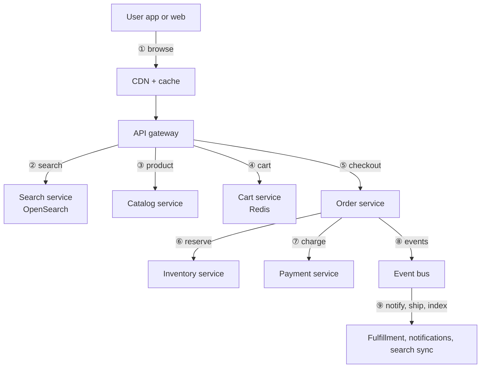
*Reads go through CDN, cache and search (1 to 3); the purchase path runs cart, order, inventory and payment (4 to 7); events fan out to the rest (8 to 9).*

| # | Step | Detail |
| --- | --- | --- |
| ① | Browse | Static and popular pages served from the CDN and cache |
| ② | Search | Query hits the search index, not the primary DB |
| ③ | Product page | Catalog service reads from its DB with a cache in front |
| ④ | Cart | Cart kept in Redis with persistence to the DB for logged-in users |
| ⑤ | Checkout | Order service creates the order with an idempotency key |
| ⑥ | Reserve stock | Inventory reserves quantities atomically with a TTL |
| ⑦ | Pay | Payment service calls the gateway; confirmation by webhook |
| ⑧ | Publish | Order service writes events through an outbox |
| ⑨ | React | Fulfillment, notifications (the email service case) and the search indexer consume the events |

### The purchase flow in sequence

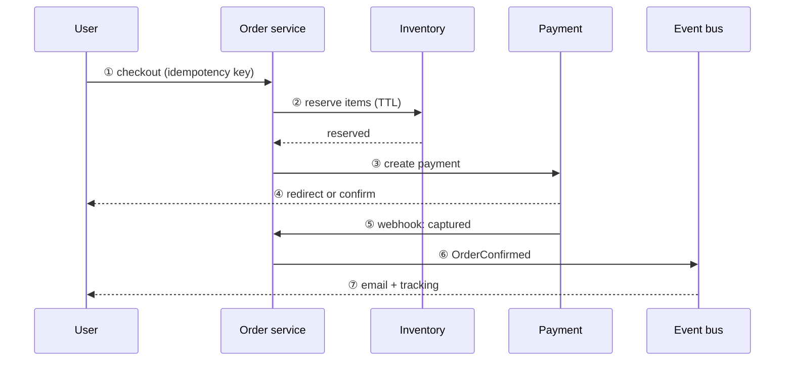
*A saga: reserve, pay, confirm; if payment fails or times out the reservation is released and the order is cancelled.*

## Step 4: Service ownership and data stores

| Service | Owns | Store | Why |
| --- | --- | --- | --- |
| Catalog | Products, categories, attributes, prices | PostgreSQL or MySQL, cached | Relational, read-heavy |
| Search | Searchable view of products | OpenSearch | Full-text, facets, ranking |
| Cart | Per-user cart | Redis, persisted for logged-in users | Fast, short-lived |
| Inventory | Stock per SKU and warehouse, reservations | Relational DB with row-level atomic updates | Strong consistency |
| Order | Orders, items, state, addresses | Relational DB | Transactions, audit |
| Payment | Payment attempts, refunds, gateway ids | Relational DB | Money requires ACID |
| Fulfillment | Shipments, tracking | Relational DB | Workflow state |
| Notification | Messages sent | Reuses the email service | Decoupled via events |

Rule to say aloud: **each service owns its data; others read through its API or events, never its tables.**

## Step 5: Platform-level decisions

| Decision | Choice | Why and trade-off |
| --- | --- | --- |
| Monolith or services | Modular monolith first, split along these seams when teams or load demand | Fewer moving parts early; cost is later extraction work |
| Sync or async between services | Sync for the checkout path that needs an answer; events for everything after | Latency where it matters, decoupling elsewhere |
| Consistency | Strong for inventory and payments; eventual for search, recommendations, notifications | Money and stock cannot be stale; search can lag |
| Transactions across services | Saga with compensation, not 2PC | 2PC does not scale across services and a gateway |
| Events | Transactional outbox | A DB write and its event publish stay atomic |
| Caching | CDN for pages, Redis for hot product data and carts | Reads are 100x writes; invalidate on catalog change |

## Platform-level alternatives and why not

| Decision | Alternative | Good when | Why not here |
| --- | --- | --- | --- |
| Architecture | **Microservices from day one** | Many teams, independent scaling and release needs | Network failure modes and ops cost before there is a reason; start modular and extract along these seams |
| Architecture | **Pure monolith, no seams** | A very small team and product | Cheapest at first, but the seams (search, payments) are expensive to carve out later; keep module boundaries |
| Data | **One shared database** for all services | Early stage, simplicity | Services couple through tables and cannot scale or change independently; each service owns its data |
| Data | **One NoSQL store** (DynamoDB or MongoDB) for everything | Massive simple key access | Orders, stock and payments need transactions, constraints and ad hoc queries; search needs a search engine |
| Consistency | **Two-phase commit (XA)** across services | Single database or tightly coupled systems | Blocks on the slowest participant, and a payment gateway cannot join it; use a saga with compensation |
| Consistency | **Event sourcing and full CQRS** for everything | Strong audit and replay needs | High complexity and a steep learning curve; use an append-only ledger only where needed (stock, money) |
| Integration | **Synchronous calls everywhere** | Simple request and response flows | One slow or down service takes checkout with it; use events after the critical path |
| Integration | **Publish events directly, no outbox** | Loss is acceptable | A crash between commit and publish loses or invents events; the outbox makes both atomic |

## Platform-level edge cases

| Scenario | Mitigation |
| --- | --- |
| Two users buy the last item | Atomic stock decrement or conditional update; one loses cleanly |
| Payment succeeded, order service crashed | Webhook plus reconciliation job closes the gap |
| Payment fails or is abandoned | Reservation TTL expires and stock is released |
| User double-clicks pay | Idempotency key on order and on payment |
| Flash sale spike | Queue-based checkout, per-SKU rate limits, pre-warmed cache |
| Price changes during checkout | Price is snapshotted onto the order lines at creation |
| Search index stale | Eventually consistent; product page is the truth at purchase |
| Gateway outage | Circuit breaker, retry later, message the user; never mark paid without confirmation |

> **How to read the deep dives.** Each one below follows the same shape: requirements and numbers for that service, its architecture with numbered paths, schema, decisions, edge cases and scaling. In the interview, take the one the interviewer picks; if they say "your choice", pick inventory plus payments.

## Deep dive 1: Catalog and search

**In brief**

- **Two systems with different jobs.** The catalog database is the source of truth; the search index is a derived, query-optimized read model.
- **Keep them in sync with events, not dual writes.** Catalog changes go through an outbox to a stream; an indexer consumes it. Dual writing from the app loses data when one side fails.
- **Search is eventually consistent. The product page and checkout are not.** A stale search result is acceptable; a stale price at payment is not, so price and stock are rechecked at the source.
- **Cache aggressively.** Popular queries, product pages and images sit behind a CDN and Redis.
- **Plan a reindex path.** Mappings change, and you must rebuild the index without downtime (alias swap).

**The prompt.** "Design the product catalog and search for an e-commerce site with 10 million products."

### Requirements

| Question | Why it matters | Assumed answer |
| --- | --- | --- |
| Catalog size and change rate? | Indexing throughput | 10M products, ~50 changes per second |
| Query volume and latency? | Cluster sizing and caching | 400 per second average, 4,000 peak; p99 under 200 ms |
| Search features? | Index design | Keyword, filters (category, brand, price), sort, pagination |
| Typo tolerance, autocomplete? | Analyzer and extra indexes | Yes for autocomplete and basic typos |
| Freshness expected? | Sync design | A few seconds is fine |
| Price and stock in results? | Correctness boundary | Shown, but rechecked at checkout |
| Multi-language? | Analyzers | Out of scope for v1 |

**Functional:** search by keyword with filters and sort; browse by category; view product details; autocomplete; sellers or admins create and update products.

**Non-functional:** p99 under 200 ms; index lag under 10 seconds; 99.95% availability for reads; search results degrade gracefully if the index is unavailable.

**Out of scope:** personalization, ads, learning-to-rank.

### The numbers

| Quantity | Calculation | Result |
| --- | --- | --- |
| Catalog data | 10M x 5 KB | 50 GB in the DB |
| Search index | ~2x for analyzed fields and replicas | 100 to 150 GB, a small cluster with shards and replicas |
| Search QPS | 400 average, 4,000 peak | Cached and sharded cluster handles it |
| Index updates | 50 per second | Trivial for bulk indexing |
| Cache hit target | popular queries and pages | 80% or more absorbs most of the peak |

### Architecture

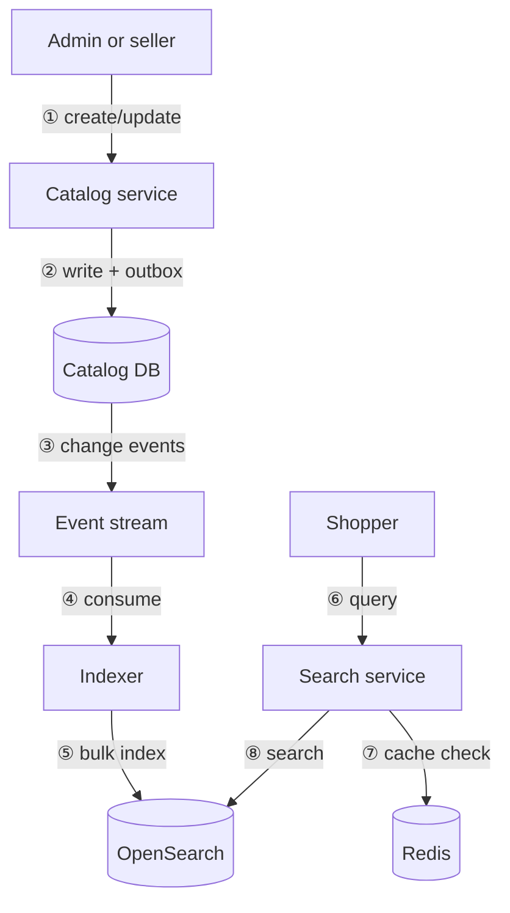
*Write path (1 to 5) turns a catalog change into an index update; read path (6 to 8) serves queries from cache or the index.*

| # | Step | Detail |
| --- | --- | --- |
| ① | Update | Product created or changed through the catalog service |
| ② | Persist | Row and an outbox event written in one transaction |
| ③ | Publish | Relay publishes the change event |
| ④ | Consume | Indexer reads events, builds the search document |
| ⑤ | Index | Bulk writes with the product version for ordering |
| ⑥ | Query | Shopper sends keywords and filters |
| ⑦ | Cache | Popular query results come from Redis |
| ⑧ | Search | Miss goes to OpenSearch; results are cached briefly |

### The data model

**Catalog DB**

| Table | Key columns | Notes |
| --- | --- | --- |
| `products` | id PK, title, description, brand_id, category_id, status, version, updated_at | `version` guards out-of-order events |
| `skus` | id PK, product_id, attributes JSON, price, currency | Variant-level price |
| `categories` | id PK, parent_id, name | Tree |
| `outbox` | id, aggregate_id, type, payload, created_at, published_at | Relay reads unpublished rows |

Indexes: `skus(product_id)`, `products(category_id, status)`, `outbox(published_at)`.

**Search document (one per product)**

| Field | Type | Purpose |
| --- | --- | --- |
| id, version | keyword, long | Idempotent upsert with external versioning |
| title, description | text (analyzed) | Keyword matching, boosted title |
| brand, category_path | keyword | Filters and facets |
| price | number | Range filter and sort |
| attributes | nested or flattened | Facets (color, size) |
| popularity, rating | number | Ranking signals |
| in_stock | boolean | Filter; advisory only |
| suggest | completion | Autocomplete |

### The decisions that matter

| Decision | Options | Choice and why |
| --- | --- | --- |
| Where to search | DB `LIKE`, DB full-text, dedicated engine | Dedicated engine: ranking, facets and scale |
| How to sync | Dual write from app; periodic batch; outbox plus stream | Outbox plus stream: no lost updates, near-real-time; dual write diverges on partial failure |
| Out-of-order events | Last write wins; versioned upsert | Versioned upsert: ignore events older than the stored `version` |
| Consistency | Strong or eventual | Eventual for search; recheck price and stock at the source on the product page and at checkout |
| Reindexing | Rebuild in place; build new index and swap | New index plus alias swap, zero downtime |
| Caching | None; per-query cache | CDN for pages, Redis for hot queries with short TTL |
| Sharding | By product id hash | Even spread; queries fan out and merge |
| Pagination | Offset; search-after cursor | Cursor for deep pages (offset gets slow) |

### Alternatives and why not

| Decision | Alternative | Good when | Why not here |
| --- | --- | --- | --- |
| Search | **Database full-text** (Postgres `tsvector`, MySQL `FULLTEXT`) | Small catalog, simple keyword search | Facets, ranking and typo tolerance at 4,000 QPS would compete with transactional load |
| Search | **Managed search** (Algolia, Typesense Cloud) | Fastest time to market, small team | Per-record or per-query cost at 10M products, less control over ranking and data residency; a fair buy-versus-build choice |
| Search | **Solr** | Existing Solr expertise | Comparable engine with a smaller ecosystem and tooling than Elasticsearch or OpenSearch |
| Sync | **Dual write** from the app | Never at scale | One write fails and the stores diverge, silently |
| Sync | **Nightly batch ETL** | Data that changes rarely | Search is hours stale; a price or stock change must show within seconds |
| Sync | **CDC (Debezium)** instead of an outbox | You do not want app code to write outbox rows | Equally good; it needs Kafka Connect to run. Outbox keeps events explicit and versioned |
| Reindex | **Rebuild in place** | Dev environments | Downtime and a half-built index; build new and swap the alias |
| Paging | **Offset paging** | Shallow pages | Cost grows with the offset on every shard; use `search_after` with a point in time |

### Edge cases and failure modes

| Scenario | What breaks | Mitigation |
| --- | --- | --- |
| Index lags the DB | Search shows old data | Alert on indexer lag; page and checkout read the source |
| Indexer crashes mid-batch | Missed updates | Offset-based consumption, idempotent versioned upserts |
| Out-of-order events | Old data overwrites new | External version check |
| Mapping change | Existing index unusable | Reindex into a new index, swap alias |
| Search cluster down | No search | Serve cached results, degrade to category browse from DB |
| Hot query during a sale | Cluster overloaded | Query cache, rate limiting, replicas |
| Deleted or hidden product | Still appears | Delete events are first-class; filter on `status` |
| Price changed after indexing | Stale price in results | Show price from index, recheck at add-to-cart and checkout |

### Scaling and evolution

- Add replicas for read volume; add shards when the index grows.
- Move ranking signals (popularity, conversion) into a feature pipeline later.
- Add personalization and learning-to-rank only after the basic relevance is measured.
- Observability: query latency percentiles, zero-result rate, indexer lag, cache hit rate.

## Deep dive 2: Cart and checkout

**In brief**

- **The cart is a convenience; the order is a commitment.** Store carts in a fast store (Redis, persisted for logged-in users) and accept loss as tolerable. Orders live in a transactional database.
- **Never trust the client's price.** Recompute prices, discounts and taxes on the server at checkout and snapshot them onto the order lines.
- **Checkout creates the order idempotently.** The client sends an idempotency key, so a double click or retry returns the same order.
- **Checkout is a saga:** validate, reserve stock, create payment, confirm. Each step has a compensation.
- **Guest carts merge into user carts at login.**

**The prompt.** "Design the cart and checkout flow for an e-commerce platform."

### Requirements

| Question | Why it matters | Assumed answer |
| --- | --- | --- |
| Guest carts supported? | Identity and merge logic | Yes, merged on login |
| Cart lifetime? | Storage and TTL | 30 days |
| Pricing rules: coupons, taxes, shipping? | Pricing service complexity | Coupons and tax in scope; shipping simple |
| Is stock reserved when added to cart or at checkout? | Inventory pressure | At checkout only |
| Payment: before or after order creation? | State machine | Order created pending, payment confirms it |
| Peak behavior? | Checkout capacity | 120 orders per second at peak |

**Functional:** add, update, remove items; apply a coupon; see totals; checkout with address and payment method; get an order id; retry safely.

**Non-functional:** cart operations under 100 ms; checkout accepted under 2 s; no duplicate orders; prices consistent between the confirmation screen and the charge; survive a crash mid-checkout.

**Out of scope:** gift cards, subscriptions, multi-address splits.

### The numbers

| Quantity | Result |
| --- | --- |
| Active carts | 5M at once; 5M x ~2 KB = 10 GB, fits Redis |
| Cart operations | About 10 per order, 1,200 per second at peak |
| Checkouts | 12 per second average, 120 at peak, trivial for a DB; the contention is in inventory, not orders |

### Architecture

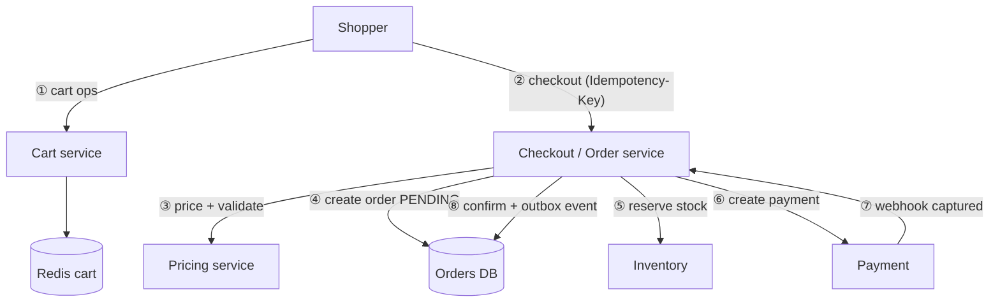
*Checkout recomputes the price server side, creates a pending order, reserves stock, takes payment, and only then confirms the order.*

| # | Step | Detail |
| --- | --- | --- |
| ① | Cart ops | Add, update and remove items; the cart stores sku ids and quantities, not trusted prices |
| ② | Checkout | Client sends the cart id, address, payment method and an idempotency key |
| ③ | Price | Pricing service recomputes line prices, coupons, tax and shipping from current data |
| ④ | Create order | Row with status `PENDING`, price snapshots on lines, unique on `(user_id, idempotency_key)` |
| ⑤ | Reserve | Inventory reserves quantities with a TTL; failure aborts and reports out-of-stock |
| ⑥ | Pay | Payment service creates a gateway payment tied to the order |
| ⑦ | Confirm payment | Gateway webhook marks the payment captured |
| ⑧ | Confirm order | Order becomes `CONFIRMED`; an outbox event triggers fulfillment and email |

#### Order state machine

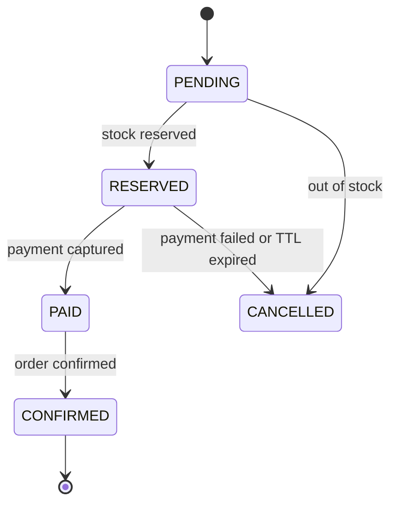
*Only forward transitions are allowed; failure paths cancel and run compensations (release stock, refund).*

### The data model

**Redis cart:** key `cart:{user_or_guest_id}`, value hash of `sku_id -> qty`, TTL 30 days. Logged-in carts are also persisted to the DB asynchronously.

**Orders DB**

| Table | Key columns | Notes |
| --- | --- | --- |
| `orders` | id PK, user_id, status, total, currency, address_json, idempotency_key, created_at | UNIQUE `(user_id, idempotency_key)` |
| `order_items` | id PK, order_id, sku_id, qty, unit_price, discount, tax | Price snapshot at purchase |
| `order_events` | id, order_id, type, payload, created_at | Audit trail |
| `outbox` | id, type, payload, published_at | Reliable event publishing |

Indexes: `orders(user_id, created_at)` for order history, `orders(status, created_at)` for ops queries, `order_items(order_id)`.

### The decisions that matter

| Decision | Options | Choice and why |
| --- | --- | --- |
| Cart store | DB only; Redis only; Redis plus DB | Redis for speed and TTL, persisted for logged-in users so a cache loss is not a cart loss |
| Price source | Client sends price; server recomputes | Recompute: the client is untrusted |
| Reserve at add-to-cart or checkout | Cart; checkout | Checkout: reserving at cart ties up stock for abandoned carts |
| Order before or after payment | After; before as PENDING | PENDING first: gives a stable id to tie the payment and webhook to |
| Duplicate prevention | None; unique key | Idempotency key unique per user, returning the existing order |
| Cross-service consistency | 2PC; saga | Saga with compensations and an outbox |
| Coupons | Client applies; server validates | Server validates eligibility, limits and stacking, and records the usage atomically |

### Alternatives and why not

| Decision | Alternative | Good when | Why not here |
| --- | --- | --- | --- |
| Cart store | **Database only** | Low traffic | Hot, short-lived writes at 1,200 per second for data that is cheap to lose |
| Cart store | **Client-side cart** (local storage or cookie) | Guest carts | Untrusted prices, not shared across devices; fine as a cache, not as the source |
| Cart store | **DynamoDB with TTL** | You want a durable managed cart without Redis | A strong alternative; Redis wins on latency and simple hash operations, DynamoDB wins on durability |
| Cart store | **Sticky sessions with in-memory carts** | Prototypes | Lost on deploy or instance failure and blocks horizontal scaling |
| Price | **Trust the client price** | Never | Tampering and stale prices; recompute on the server |
| Stock timing | **Reserve at add-to-cart** | Tickets, very scarce items | Abandoned carts lock real stock; reserve at checkout with a TTL |
| Order creation | **Charge first, create the order after** | Never | No order id to tie the payment and webhook to; a crash leaves money taken and no order |

### Edge cases and failure modes

| Scenario | Mitigation |
| --- | --- |
| Double click on Pay | Idempotency key returns the same order and payment |
| Price changed since the page loaded | Recompute at checkout; show the new total and require confirmation if it differs |
| Item sold out at checkout | Reserve fails; return a clear out-of-stock result per line |
| Crash after reserving, before payment | Reservation TTL expires and stock is released |
| Payment captured but order service down | Webhook is retried; a reconciliation job matches captured payments to orders |
| Coupon limit reached concurrently | Atomic counter on usage, same technique as quotas |
| Guest then login | Merge carts; on conflict, sum quantities or keep the larger, and say which |
| Cart lost from Redis | Rebuild from the persisted copy for logged-in users |
| Stale cart item no longer sold | Validate at checkout and remove with a message |

### Scaling and evolution

- Cart scales by sharding Redis on user id.
- Checkout scales horizontally; the shared hot spot is inventory on popular SKUs (next chapter).
- For flash sales, put a queue in front of checkout and process in order of arrival with per-SKU limits.
- Observability: checkout conversion funnel, failure rate per step, payment-to-order lag, reservation expiries.

## Deep dive 3: Inventory and flash-sale stock

**In brief**

- **Separate three numbers:** on-hand stock, reserved stock, and available (on-hand minus reserved). Orders reserve first; shipping later decrements on-hand.
- **Reserve with an atomic conditional update**, never read-then-write. `UPDATE ... SET reserved = reserved + n WHERE available >= n` either succeeds or does not.
- **Reservations expire.** A TTL releases stock from abandoned or failed checkouts.
- **Hot SKUs are the bottleneck.** A single row takes limited writes per second; use Redis counters, a queue in front, or stock splitting to survive a flash sale.
- **The database is the source of truth; Redis can front it** for speed with reconciliation.

**The prompt.** "Design the inventory system for an e-commerce platform, including flash sales."

### Requirements

| Question | Why it matters | Assumed answer |
| --- | --- | --- |
| Single or multiple warehouses? | Stock per location, allocation | Multiple; start with per-SKU totals plus per-warehouse |
| Reserve when? | Contention and abandonment | At checkout, with a TTL of 10 minutes |
| Is overselling ever acceptable? | Strong consistency need | No for limited items |
| Flash sale scale? | Contention design | 100k buyers for 1,000 units, a few seconds |
| Backorders and preorders? | Negative stock rules | Out of scope for v1 |
| Source of stock updates? | Ingest path | Warehouse system events and returns |

**Functional:** show availability; reserve on checkout; release on cancel or expiry; commit on shipment; receive stock updates.

**Non-functional:** exact counts (no oversell); reservation under 50 ms at p99; survive a 100x spike on a SKU; durable and auditable.

**Out of scope:** demand forecasting, backorders, warehouse routing optimization.

### The numbers

| Quantity | Result |
| --- | --- |
| Normal reservations | 120 per second at peak across all SKUs; trivial |
| Flash sale | 100,000 requests for one SKU within seconds, so thousands per second on one row |
| Single DB row | Roughly hundreds to low thousands of contended updates per second |
| Conclusion | Normal traffic is fine on a relational DB; the flash-sale hot SKU needs a different mechanism |

### Architecture

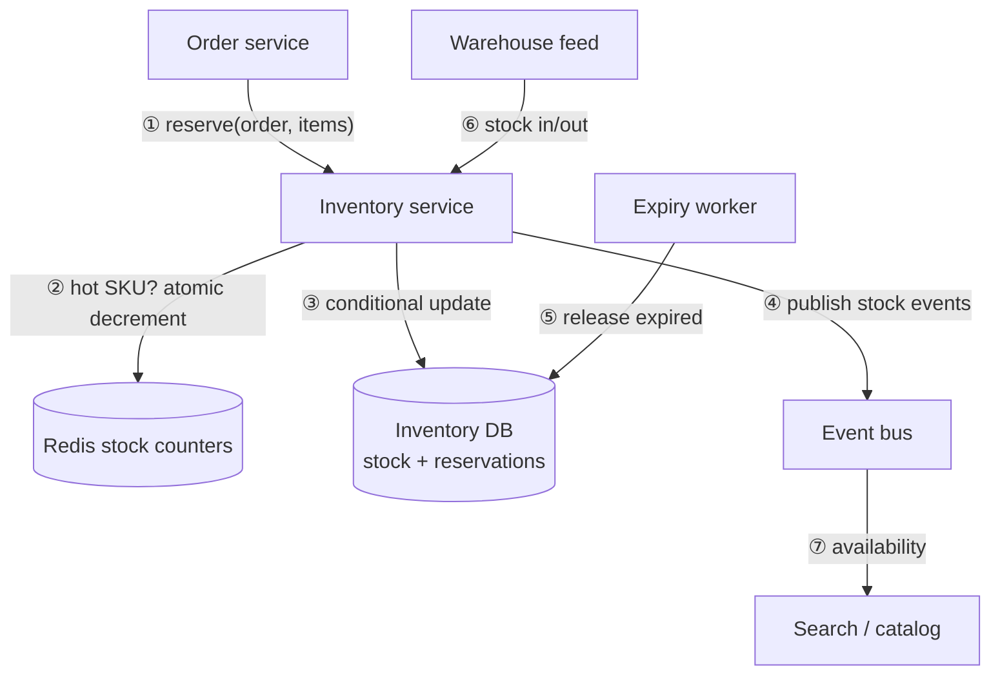
*Reserve through an atomic conditional update (with a Redis gate for hot SKUs), expire stale reservations, and publish availability changes for search.*

| # | Step | Detail |
| --- | --- | --- |
| ① | Reserve | Order service calls reserve with order id and lines; the call is idempotent per order id |
| ② | Hot gate | For flagged hot SKUs, an atomic Redis decrement rejects excess buyers before they touch the DB |
| ③ | Commit reservation | Conditional update plus a reservation row, in one transaction |
| ④ | Events | Availability changes published through an outbox |
| ⑤ | Expire | Worker releases reservations past `expires_at` and returns the stock |
| ⑥ | Receive | Warehouse systems add or remove on-hand stock |
| ⑦ | Display | Search and catalog show approximate availability, not authoritative |

### The data model

| Table | Key columns | Notes |
| --- | --- | --- |
| `stock` | sku_id, warehouse_id, on_hand, reserved, version | PK `(sku_id, warehouse_id)`; `available = on_hand - reserved`; CHECK `reserved <= on_hand` |
| `reservations` | id PK, order_id, sku_id, warehouse_id, qty, status (HELD, COMMITTED, RELEASED, EXPIRED), expires_at | UNIQUE `(order_id, sku_id)` for idempotency |
| `stock_movements` | id, sku_id, delta, reason, ref, created_at | Append-only ledger for audit and reconciliation |

Indexes: `reservations(status, expires_at)` for the expiry worker, `reservations(order_id)`.

Reserve statement:

```sql
UPDATE stock
SET reserved = reserved + :qty
WHERE sku_id = :sku AND warehouse_id = :wh
  AND on_hand - reserved >= :qty;
-- 1 row affected = success; 0 rows = out of stock
```

### The decisions that matter

| Decision | Options | Choice and why |
| --- | --- | --- |
| Check then update | Read available, then write | Never; races oversell. Use one conditional update |
| Locking | Pessimistic `SELECT FOR UPDATE`; optimistic version; atomic conditional | Atomic conditional update: no explicit lock round trip, correct under concurrency |
| Reserve vs decrement | Decrement on order; reserve then commit | Reserve then commit: payment may fail, and reservations can expire |
| Hot SKU | Let the DB take it; Redis gate; queue; split stock | Redis atomic decrement in front for flash items, DB as truth; queue checkout if still hot |
| Stock splitting | One row; N sub-rows | Split a hot SKU into buckets (for example 10 rows) to spread contention; sum for display |
| Multi-item orders | Reserve one by one | All-or-nothing in one transaction, ordered by sku id to avoid deadlocks |
| Display of availability | Exact; approximate | Approximate in search, exact at reserve |

### Alternatives and why not

| Decision | Alternative | Good when | Why not here |
| --- | --- | --- | --- |
| Concurrency | **`SELECT ... FOR UPDATE`** (pessimistic lock) | Moderate contention, simple logic | Serializes writers and holds locks across the transaction; one atomic conditional update does the same job faster |
| Concurrency | **Optimistic version check with retries** | Low contention | On a hot SKU, retries storm and most requests fail repeatedly |
| Concurrency | **Distributed lock** (Redlock) | Cross-resource mutual exclusion | Clock and fencing pitfalls and extra round trips; an atomic DB or Redis operation avoids needing one |
| Hot SKU | **Redis as the only source of truth** | Ephemeral counters | Failover can lose recent writes and oversell; keep the DB as truth with Redis as a gate |
| Hot SKU | **Single-consumer queue per SKU** | Extreme flash sales | Serializes cleanly, but adds latency and operational complexity; use after the Redis gate if still needed |
| Model | **Event-sourced stock ledger only** | Heavy audit needs | More complex reads; keep a `stock_movements` ledger for audit beside a simple counter |
| Policy | **Allow oversell, apologize later** | Backorderable or high-volume commodity items | Unacceptable for limited-stock drops and damages trust |

### Edge cases and failure modes

| Scenario | Mitigation |
| --- | --- |
| Two buyers, one unit | Atomic conditional update; one wins, one gets out-of-stock |
| Reserve call retried | UNIQUE `(order_id, sku_id)` makes it idempotent |
| Payment fails | Release the reservation immediately; TTL is the backstop |
| Worker crashes before release | Expiry worker releases stale holds |
| Redis counter drifts from DB | Reconciliation job rebuilds Redis from the DB; DB wins |
| Deadlock on multi-item orders | Lock and update SKUs in a consistent order |
| Bots hoarding stock in a sale | Per-user purchase limits, rate limits, bot protection, short TTL |
| Stock count wrong after warehouse sync | Ledger plus periodic cycle count reconciliation |
| Negative stock | CHECK constraint refuses it |

### Scaling and evolution

- Shard stock by SKU id; most SKUs are cold, so only hot ones need special handling.
- For true flash sales, use a virtual waiting room or queue in front of checkout so the system admits buyers at a rate it can handle, and tell the rest "sold out" quickly.
- Observability: oversell attempts (should be zero), reservation expiry rate, hot SKU latency, Redis/DB drift.

## Deep dive 4: Order management and the saga

**In brief**

- **The order is a state machine.** Define states and allowed transitions, and reject everything else. It is the single source of truth for "where is my order".
- **Use a saga, not two-phase commit.** Each service performs a local transaction; failures trigger compensating actions.
- **Orchestration or choreography?** Orchestration (the order service drives the steps) is easier to reason about and debug for checkout; choreography (services react to events) suits loosely coupled follow-ups like notifications.
- **Use a transactional outbox** so every state change reliably publishes its event.
- **Make every handler idempotent.** Events are delivered at least once.

**The prompt.** "Design the order management service. How do you keep inventory, payment and shipping consistent?"

### Requirements

| Question | Why it matters | Assumed answer |
| --- | --- | --- |
| Which steps must be atomic from the customer's view? | Saga shape | Reserve, pay, confirm |
| Can orders be cancelled, and until when? | Compensation paths | Until shipment |
| Partial fulfillment or split shipments? | Order versus shipment model | Split shipments supported |
| Refunds and returns in scope? | Extra states | Cancel and refund in scope |
| Event delivery guarantee? | Idempotency design | At-least-once |
| Who needs to know order changes? | Event consumers | Fulfillment, notifications, analytics |

**Functional:** create an order, move it through states, cancel, query status and history, emit events.

**Non-functional:** no lost or duplicated orders, an auditable history, state changes visible to customers within seconds, tolerant of any single service being down.

### The numbers

| Quantity | Result |
| --- | --- |
| Orders | 12 per second average, 120 at peak |
| State changes | About 6 per order, 700 per second at peak |
| Storage | 1M orders per day x 3 KB plus events, about 1 to 2 TB a year |
| Conclusion | A relational DB handles this; the design effort is in correctness and recovery |

### Architecture

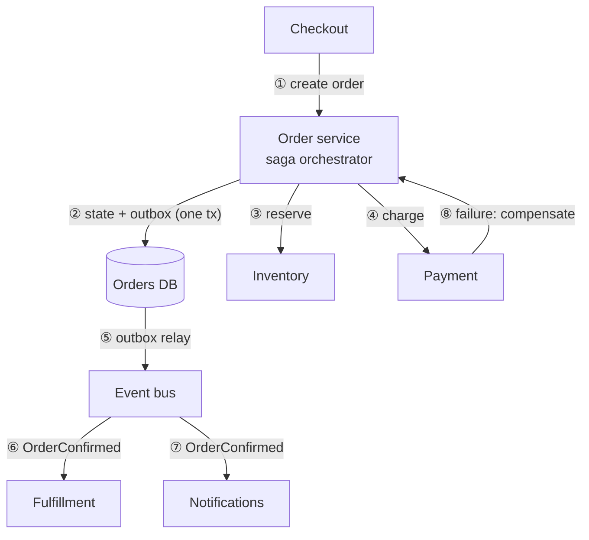
*The order service orchestrates reserve and pay, records each transition with an outbox event atomically, and runs compensations on failure.*

| # | Step | Detail |
| --- | --- | --- |
| ① | Create | Idempotent create in `PENDING` |
| ② | Persist | State change and outbox row in one transaction |
| ③ | Reserve | Call inventory; on failure cancel the order |
| ④ | Charge | Call payment; on failure release stock |
| ⑤ | Relay | Outbox rows published to the bus |
| ⑥ | Fulfill | Fulfillment starts picking and shipping |
| ⑦ | Notify | Confirmation email through the email service |
| ⑧ | Compensate | Release stock, cancel the order, refund if captured |

#### Saga with compensation

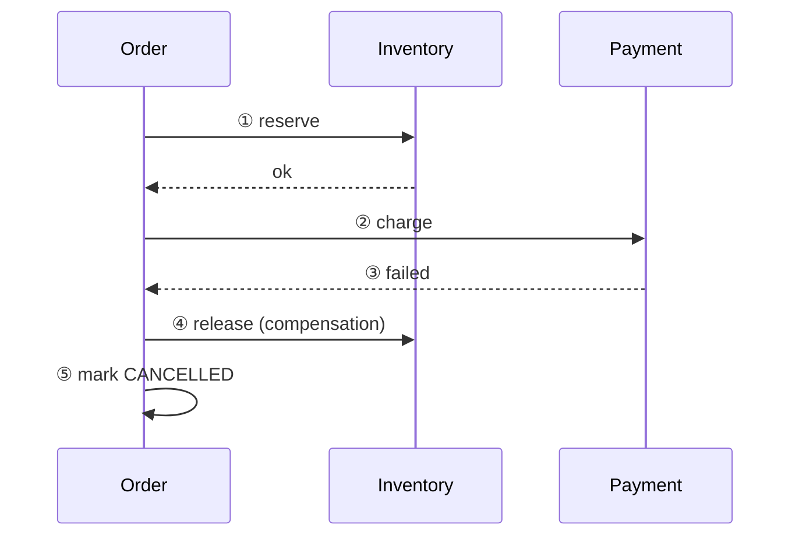
*A failed charge triggers the compensating release of stock and the order is cancelled, leaving no half-finished state.*

### The data model

| Table | Key columns | Notes |
| --- | --- | --- |
| `orders` | id PK, user_id, status, total, version, created_at, updated_at | `version` for optimistic locking on transitions |
| `order_items` | order_id, sku_id, qty, unit_price | Snapshots |
| `order_events` | id, order_id, from_status, to_status, reason, created_at | Immutable history |
| `saga_state` | order_id PK, step, attempts, next_retry_at, last_error | Lets recovery resume stuck orders |
| `outbox` | id, topic, payload, created_at, published_at | Reliable publishing |
| `inbox` (consumer side) | message_id PK, processed_at | Dedupes redelivered events |

Transition guard:

```sql
UPDATE orders SET status = 'PAID', version = version + 1
WHERE id = :id AND status = 'RESERVED' AND version = :v;
-- 0 rows = illegal or concurrent transition, do nothing
```

### The decisions that matter

| Decision | Options | Choice and why |
| --- | --- | --- |
| Cross-service consistency | 2PC; saga | Saga: 2PC blocks and the payment gateway cannot join it |
| Orchestration or choreography | Central coordinator; events only | Orchestrate checkout (clear failure handling); choreograph downstream consumers |
| Publishing events | Publish then write; write then publish; outbox | Outbox: state and event commit atomically |
| Consumer duplicates | Hope; inbox or idempotent handlers | Inbox table or natural idempotency |
| Stuck orders | Ignore; recovery job | A job scans `saga_state` for stale steps and resumes or compensates |
| Event schema | Ad hoc; versioned | Versioned events so consumers can evolve |

### Alternatives and why not

| Decision | Alternative | Good when | Why not here |
| --- | --- | --- | --- |
| Coordination | **Two-phase commit** | One database | Cannot span services or a payment gateway and blocks on failure |
| Coordination | **Pure choreography** for checkout | Loosely coupled reactions | The flow becomes invisible and compensation is scattered; orchestrate checkout, choreograph the rest |
| Coordination | **Temporal or Step Functions** orchestration | Long-running flows with timers and human steps | A new dependency and cost; an in-service saga with persisted state is enough until flows grow complex |
| Publishing | **Publish straight to the broker** | Loss is acceptable | A crash between commit and publish loses events; the outbox makes it atomic |
| Publishing | **Polling relay** versus CDC | Simplicity versus latency | Polling the outbox is simplest; move to CDC when relay lag or load matters |
| State | **Event-sourced orders** | Full history is the product | Heavier to query and evolve; an `order_events` table gives the audit trail |

### Edge cases and failure modes

| Scenario | Mitigation |
| --- | --- |
| Order service crashes mid-saga | `saga_state` persisted; recovery job resumes |
| Event published twice | Consumers dedupe by message id |
| Compensation itself fails | Retry with backoff; alert; manual queue after N attempts |
| Out-of-order events | Version numbers; ignore older events |
| Cancel during payment | State guard: only legal transitions apply; refund path if captured |
| Service call timeout | Treat as unknown; query the other service before compensating |
| Partial shipment | Model shipments separately; order status derived from them |
| Two concurrent updates | Optimistic locking with `version` |

### Scaling and evolution

- Partition the orders table by date or shard by user id; orders are mostly accessed by user and recent time.
- Move the saga to a workflow engine (Temporal) if flows grow complex, with the cost of a new dependency; say it as an option, not a day-one need.
- Observability: orders stuck per state, compensation rate, outbox lag, event consumer lag.

## Deep dive 5: Payments

**In brief**

- **Do not touch raw card data.** Use the gateway's hosted fields or tokenization so card numbers never reach your servers. This keeps your PCI scope small.
- **Every payment operation carries an idempotency key**, both in your DB and toward the gateway.
- **Confirmation is asynchronous.** Trust the gateway's signed webhook (or a server-side lookup), not the browser redirect.
- **A payment is a state machine:** created, authorized, captured, failed, refunded.
- **Reconcile.** A job compares your records with the gateway's settlement reports and fixes drift.
- **Timeouts mean unknown, not failed.** Query before retrying.

**The prompt.** "Design the payment service for an e-commerce platform."

### Requirements

| Question | Why it matters | Assumed answer |
| --- | --- | --- |
| Build a gateway or integrate one? | Scope | Integrate an external gateway (Stripe, Razorpay) |
| Payment methods? | Flows differ (card, UPI, wallet, COD) | Card and UPI; COD out of scope |
| Authorize then capture, or immediate capture? | State machine | Immediate capture for simplicity; mention auth-capture |
| Refunds and partial refunds? | Extra states | Both |
| Currency and region? | Complexity | Single currency v1 |
| Compliance? | Data handling | PCI scope minimized by tokenization |
| Scale? | Sizing | 120 payments per second at peak |

**Functional:** create a payment for an order, collect via the gateway, confirm via webhook, refund, query status, reconcile.

**Non-functional:** no double charge; no lost captured payment; payment API p99 under 1 s excluding the gateway; durable audit trail; secrets and tokens protected; availability 99.9%.

**Out of scope:** building a card network integration, fraud model, payouts to sellers.

### The numbers

| Quantity | Result |
| --- | --- |
| Payments | 12 per second average, 120 peak; a relational DB is plenty |
| Webhooks | A few per payment, about 400 per second at peak |
| Records | 1M per day x 2 KB, about 700 GB a year |
| Conclusion | Volume is small; correctness is the problem |

### Architecture

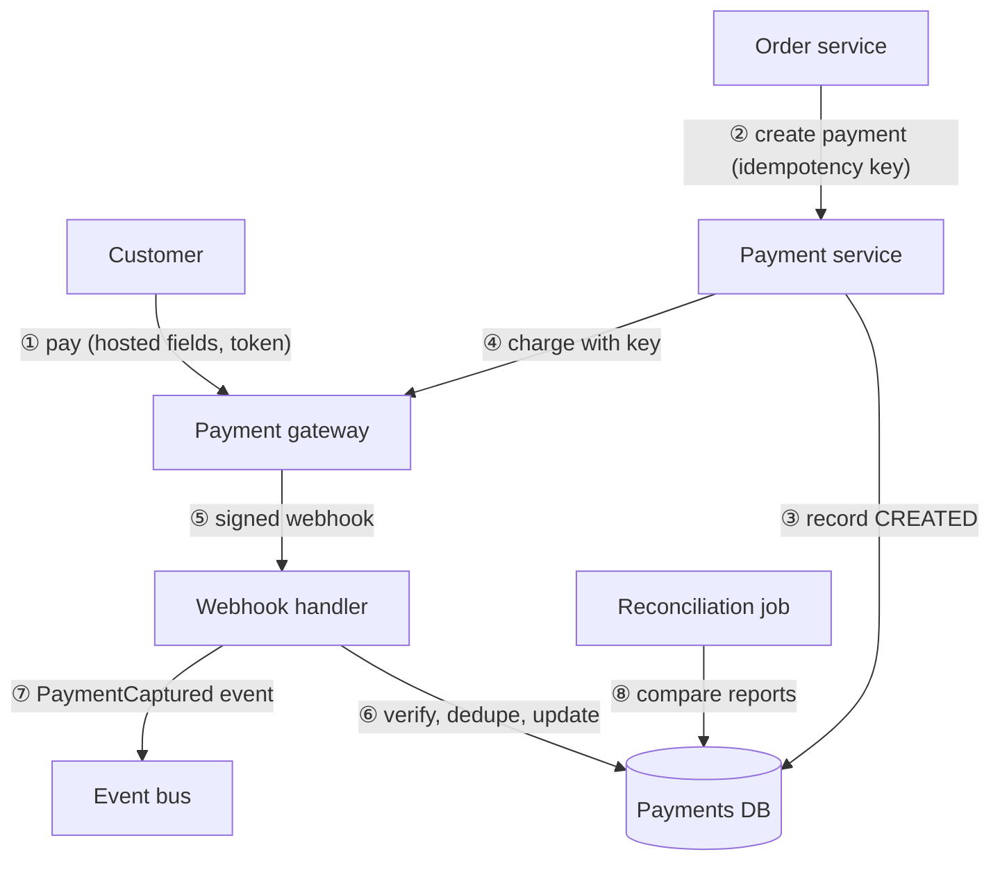
*The customer pays at the gateway with a token, your service records and charges idempotently, and the signed webhook (with reconciliation as a safety net) is what marks it captured.*

| # | Step | Detail |
| --- | --- | --- |
| ① | Collect | Card entered in the gateway's fields; your server only sees a token |
| ② | Create | Order service asks for a payment tied to the order id and idempotency key |
| ③ | Record | Payment row saved as `CREATED` before calling out |
| ④ | Charge | Gateway call includes the same idempotency key |
| ⑤ | Webhook | Gateway calls back with a signed event |
| ⑥ | Handle | Verify the signature, dedupe by event id, move state forward |
| ⑦ | Publish | Event goes out through the outbox; order service confirms the order |
| ⑧ | Reconcile | Daily comparison with settlement reports |

#### Payment state machine

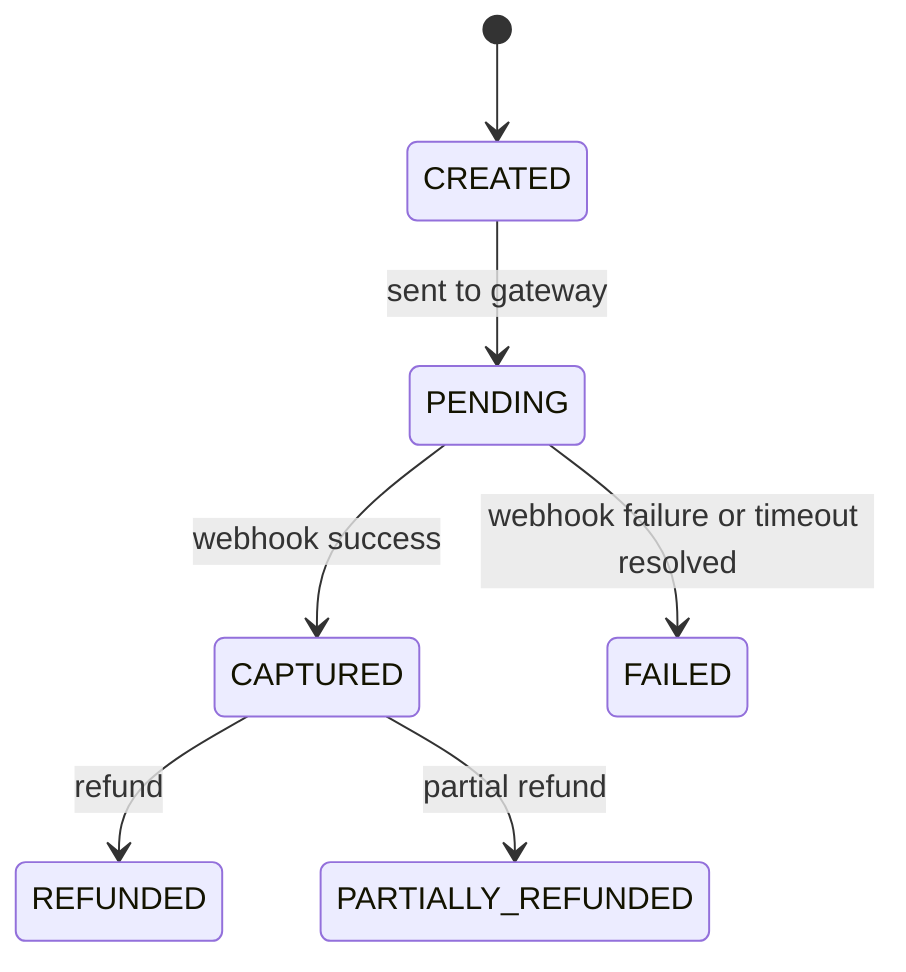
*Money moves only through allowed transitions, and CAPTURED is reached only from a verified gateway confirmation.*

### The data model

| Table | Key columns | Notes |
| --- | --- | --- |
| `payments` | id PK, order_id, amount, currency, status, gateway, gateway_payment_id, idempotency_key, created_at, updated_at | UNIQUE `(order_id, idempotency_key)`; amounts as integer minor units, never floats |
| `payment_attempts` | id, payment_id, request_hash, response_code, created_at | Every outbound call |
| `refunds` | id PK, payment_id, amount, status, idempotency_key, gateway_refund_id | Sum of refunds cannot exceed captured |
| `webhook_events` | event_id PK, payload_hash, received_at, processed_at | Dedupe and audit |
| `ledger_entries` | id, payment_id, account, debit, credit, created_at | Append-only double-entry record |

Indexes: `payments(order_id)`, `payments(gateway_payment_id)`, `payments(status, created_at)` for stuck payments.

### The decisions that matter

| Decision | Options | Choice and why |
| --- | --- | --- |
| Handling card data | Collect and store; tokenize at gateway | Tokenize: keeps card numbers out of your systems |
| Confirmation source | Browser redirect; webhook; both | Webhook (plus server lookup); redirect is untrusted |
| Retry on timeout | Retry blindly; query then retry with same key | Query by key, then retry idempotently; blind retry can double-charge |
| Money type | Float; decimal; integer minor units | Integer minor units: no rounding errors |
| Webhook security | Trust the call; verify | Verify signature and timestamp, dedupe by event id |
| Consistency with orders | Joint transaction; events | Events with outbox; order confirms on `PaymentCaptured` |
| Drift detection | None; reconciliation | Daily reconciliation against gateway reports |

### Alternatives and why not

| Decision | Alternative | Good when | Why not here |
| --- | --- | --- | --- |
| Card data | **Collect and store cards yourself** | Payment processors only | Brings you into full PCI scope and breach risk; use the gateway's hosted fields or tokens |
| Checkout UX | **Redirect to a hosted payment page** instead of embedded fields | Fastest compliance, minimal UI work | Slightly less control of the experience; a perfectly good choice, and the lower-risk one for a small team |
| Confirmation | **Trust the browser redirect** | Never as the only signal | It can be skipped, replayed or forged; use the signed webhook, with a server lookup as fallback |
| Retry | **Retry blindly on timeout** | Never | Can double-charge; query by idempotency key first |
| Money | **Floating point or decimals in app code** | Never | Rounding errors; store integer minor units |
| Flow | **Authorize now, capture at shipment** | Physical goods, split shipments | Valid and common; immediate capture is simpler for v1, and auth then capture can be added behind the same state machine |
| Gateway | **Single gateway hard-wired** | Early stage | Outage risk and lock-in; put an adapter in front so a second gateway can be added |

### Edge cases and failure modes

| Scenario | Mitigation |
| --- | --- |
| Charge call times out | State is unknown: query the gateway by key, do not assume failure |
| Customer clicks pay twice | Idempotency key at order and gateway |
| Webhook delivered twice | Dedupe by event id |
| Webhook never arrives | Poll pending payments, plus reconciliation |
| Webhook arrives before your DB write commits | Handler retries or looks up by gateway id; process idempotently |
| Forged webhook | Signature verification fails; reject |
| Money captured, order failed | Reconciliation detects it; auto-refund or confirm |
| Refund exceeds captured amount | CHECK on the sum of refunds |
| Gateway outage | Circuit breaker; return a clear failure; do not create orders as paid |
| Currency rounding | Integer minor units |

### Scaling and evolution

- Volume is modest; scale by partitioning payments by date and archiving.
- Add a second gateway behind an adapter with routing and failover.
- Add fraud scoring before capture, and 3-D Secure where required.
- Observability: payment success rate per gateway, pending age, webhook lag, reconciliation mismatches (alert on any).

## Deep dive 6: Fulfillment and notifications

**In brief**

- **Fulfillment is event-driven.** `OrderConfirmed` starts picking; shipping carrier events move the order forward; each change publishes an event.
- **Notifications reuse the email service.** Order events trigger templated emails and pushes through the multi-tenant email service from the earlier chapter, with idempotency per event.
- **Order status shown to customers is derived,** from shipment events, not hand-edited.
- **Scale by function:** CDN and cache for reads, per-service databases, queues for spikes, and special handling for hot SKUs.
- **Say what fails first at 10x** and how you would detect it.

**The prompt.** "After an order is confirmed, how does it get shipped and how does the customer stay informed? Then, how would you scale the whole platform for a sale day?"

### Requirements

| Question | Why it matters | Assumed answer |
| --- | --- | --- |
| Own warehouses or third-party logistics? | Integration shape | Mix; carriers integrated via adapters |
| One shipment or split shipments? | Data model | Split shipments supported |
| Tracking updates source? | Event ingest | Carrier webhooks and polling |
| Customer notifications? | Channels | Email and push; SMS optional |
| Returns? | Extra states | Out of scope for v1 |

**Functional:** create shipments from confirmed orders, assign warehouse, record carrier events, expose tracking, notify the customer at key steps.

**Non-functional:** no lost events; tracking visible within a minute of a carrier update; notifications at most once per event from the customer's perspective; works if the carrier API is down.

### The numbers

| Quantity | Result |
| --- | --- |
| Shipments | About 1.3M a day (some orders split) |
| Tracking events | ~5 per shipment, about 6.5M a day, 75 per second average |
| Notifications | ~4 per order, 4M a day, about 50 per second; trivial for the email service |

### Architecture

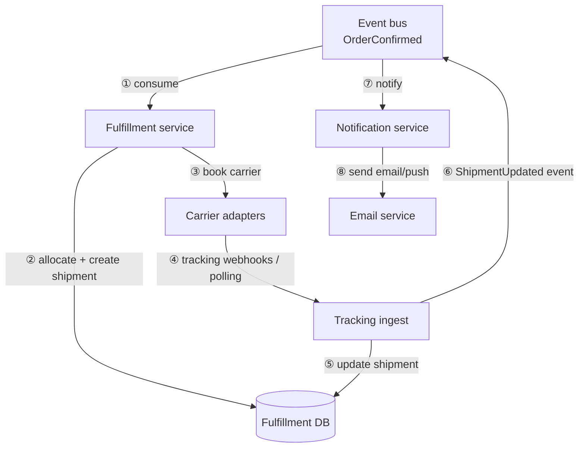
*A confirmed order becomes shipments, carrier events update them, and each update publishes an event that triggers customer notifications through the email service.*

| # | Step | Detail |
| --- | --- | --- |
| ① | Consume | Idempotent handler keyed by order id |
| ② | Allocate | Pick warehouse, create shipment rows |
| ③ | Book | Carrier adapter creates the shipment and returns a tracking number |
| ④ | Track | Webhooks or periodic polling bring carrier events |
| ⑤ | Update | Shipment status moves forward only |
| ⑥ | Publish | Outbox event per change |
| ⑦ | Notify | Notification service maps events to templates and preferences |
| ⑧ | Send | Call the email service with an idempotency key per order event |

### The data model

| Table | Key columns | Notes |
| --- | --- | --- |
| `shipments` | id PK, order_id, warehouse_id, carrier, tracking_no, status, created_at | UNIQUE `(order_id, warehouse_id)` for idempotent creation |
| `shipment_items` | shipment_id, sku_id, qty | |
| `tracking_events` | id, shipment_id, status, location, carrier_ts, received_at | Append-only; UNIQUE on carrier event id |
| `notifications` | id PK, user_id, order_id, type, channel, idempotency_key, status | UNIQUE `idempotency_key` such as `order:123:shipped` |

Indexes: `shipments(order_id)`, `shipments(tracking_no)`, `tracking_events(shipment_id, carrier_ts)`.

### The decisions that matter

| Decision | Options | Choice and why |
| --- | --- | --- |
| Start of fulfillment | Called synchronously; event-driven | Event-driven: checkout is not blocked by warehouse systems |
| Carrier integration | Directly everywhere; adapter per carrier | Adapters behind one interface; carriers fail independently |
| Tracking source | Webhooks only; polling only; both | Both: webhooks for speed, polling as a safety net |
| Order status | Edited by hand; derived | Derived from shipments |
| Notification duplicates | Hope; idempotency key per order event | Key like `order:123:shipped`, unique in the notifications table |
| Notification delivery | Inline; via email service | Via the email service: quotas, retries and provider limits already solved |

### Alternatives and why not

| Decision | Alternative | Good when | Why not here |
| --- | --- | --- | --- |
| Start | **Call the warehouse synchronously from checkout** | Same-process systems | A slow warehouse system blocks purchases; react to `OrderConfirmed` asynchronously |
| Carriers | **Integrate each carrier directly** | One carrier | Each has a different API and failures; use adapters, or buy an aggregator (Shiprocket, EasyPost) when carrier count grows |
| Tracking | **Polling only** | Carriers without webhooks | Slow and wasteful; use webhooks with polling as the safety net |
| Tracking | **Webhooks only** | Reliable carriers | Callbacks get lost; add polling for stuck shipments |
| Notifications | **Send emails inline** from the order service | Prototypes | Couples order latency to the mail provider; publish an event and let the email service handle quotas and retries |
| Order status | **Edit status by hand** | Never | Drifts from reality; derive it from shipment events |

### Edge cases and failure modes

| Scenario | Mitigation |
| --- | --- |
| Carrier API down | Retry with backoff; queue bookings; alert |
| Duplicate carrier webhook | Unique carrier event id |
| Out-of-order tracking events | Use carrier timestamp and a forward-only status rule |
| Order cancelled after fulfillment started | Cancel booking if possible; otherwise treat as return |
| Split shipment partially delivered | Order status derived: PARTIALLY_SHIPPED or similar |
| Email provider fails | The email service retries; notification status tracked |
| Customer opted out | Preference check in notification service |

## Taking the platform to scale

| Layer | At 10x (sale day) | How |
| --- | --- | --- |
| Edge | 10x reads | CDN, pre-warmed caches, static product pages |
| Search | 10x queries | Replicas, query cache, graceful degradation to category browse |
| Cart | 10x ops | Redis sharding by user |
| Checkout | 10x orders | Horizontal scale; queue in front for flash items |
| Inventory | Hot SKUs | Redis gate, stock splitting, waiting room |
| Payments | Gateway limits | Rate limiting, backoff, second gateway |
| Events | 10x volume | Partitioned topics, consumer scaling, lag alerts |
| Databases | Hot partitions | Per-service DBs, read replicas, sharding by user or order id |
| Regions | Latency, availability | Single region with multi-AZ first; multi-region read replicas and CDN; active-active only if required |

**What fails first, and how you would know:** inventory hot rows (lock waits, reservation latency), the payment gateway rate limit (rising pending age), the search cluster (p99 latency, rejected queries), and event consumer lag (notification delays). Each has an alert in the observability plan.

**Observability across the platform:** a request id carried through all services, a checkout funnel dashboard (view, cart, checkout, paid), per-service SLOs, oversell and double-charge counters that must stay at zero.

## How to drive the conversation

| Minutes | Do |
| --- | --- |
| 0 to 7 | Scope the platform; write requirements; state out of scope |
| 7 to 10 | Numbers: reads dominate, checkout is the critical path |
| 10 to 18 | Service map and the numbered purchase flow |
| 18 to 38 | Deep dive on what the interviewer picks; default inventory then payments |
| 38 to 43 | Failure modes and scaling: what fails first on a sale day |
| 43 to 45 | What you deferred and why |

If the interviewer says "your choice", pick **inventory plus payments**: that is where senior judgment shows (no overselling, no double charge, saga, idempotency).

## Reference stack

| Service | What you would name |
| --- | --- |
| Edge | CDN, API gateway |
| Catalog | PostgreSQL or MySQL, Redis cache |
| Search | OpenSearch or Elasticsearch, fed by an outbox or CDC (Debezium) with a Kafka or SNS and SQS stream; alias swap for reindexing |
| Cart | Redis hashes with TTL, persisted asynchronously for logged-in users |
| Inventory | PostgreSQL or MySQL conditional updates; Redis `DECRBY` or Lua gate for hot SKUs; expiry worker on `(status, expires_at)` |
| Orders | PostgreSQL or MySQL with a unique idempotency constraint; saga in the order service (Temporal for complex flows); inbox table for consumers |
| Payments | External gateway (Stripe, Razorpay, Adyen) with signed webhooks; ACID store; scheduled reconciliation against settlement reports |
| Fulfillment | Adapter per carrier, webhooks plus polling |
| Notifications | The email service case, plus a push provider |
| Observability | OpenTelemetry tracing, metrics, per-service SLOs |

## Interview Q&A

### Q: How would you break an e-commerce platform into services?

**Level:** senior · **Tags:** system-design, decomposition

<details><summary>Model answer</summary>

By data ownership and rate of change: catalog, search, cart, inventory, orders, payments, fulfillment, notifications. Each owns its store and talks through APIs and events. I'd note I would start as a modular monolith with these boundaries and extract services when load or team boundaries require it, because premature splitting adds network failure modes and operational cost.

**Follow-ups:**

1. Q: Which seam would you split first?
<details><summary>Answer</summary>

Search (different store and scaling profile, eventual consistency is fine) and notifications (already asynchronous). Inventory and payments stay close to orders until there is a reason, because they need strong consistency.
</details>

</details>

### Q: How do you keep a purchase consistent across services without a distributed transaction?

**Level:** senior · **Tags:** saga, outbox

<details><summary>Model answer</summary>

A saga: reserve stock, create the payment, confirm the order. Each step is a local transaction. If a later step fails, run compensations: release the reservation, cancel the order, refund if needed. State changes publish events through a transactional outbox so a database write and its event cannot diverge.
</details>

### Q: Reads outnumber writes 100 to 1. What does that change?

**Level:** intermediate · **Tags:** caching, scale

<details><summary>Model answer</summary>

The read path is built for volume: CDN for pages and images, Redis for hot catalog data, a search index instead of database queries for listing and filters. The write path (checkout) is built for correctness: transactions, idempotency and a state machine. They scale and fail independently.
</details>

### Q: How do you keep the search index in sync with the catalog database?

**Level:** senior · **Tags:** search, outbox, consistency

<details><summary>Model answer</summary>

Write the change and an outbox row in one DB transaction, relay the outbox to a stream, and have an indexer consume it and bulk-upsert into the search engine using the product's version number so older events cannot overwrite newer ones. Avoid dual writes, because if the index write fails after the DB commit the two diverge. Monitor indexer lag and provide a full reindex path.

**Follow-ups:**

1. Q: What if the indexer falls an hour behind?
<details><summary>Answer</summary>

Search shows stale data, which is acceptable for browsing, because the product page and checkout read the DB for price and stock. Alert on lag, scale consumers, and if needed catch up from the stream offset or rebuild.
</details>

</details>

### Q: How do you change the index mapping without downtime?

**Level:** senior · **Tags:** search, operations

<details><summary>Model answer</summary>

Create a new index with the new mapping, backfill it from the source and keep applying live events, then switch the read alias from the old index to the new one atomically. Keep the old index for rollback and delete it later.
</details>

### Q: Why not use the database for search?

**Level:** intermediate · **Tags:** search

<details><summary>Model answer</summary>

Relational databases handle exact lookups well, but ranked full-text, faceting and typo tolerance across millions of rows at high QPS are what search engines are built for. Running those queries on the primary database would compete with transactional load. The database stays the source of truth; the index is a read model.
</details>

### Q: How do you make checkout idempotent?

**Level:** senior · **Tags:** idempotency, checkout

<details><summary>Model answer</summary>

The client generates an idempotency key per checkout attempt. The order table has a unique constraint on `(user_id, idempotency_key)`. A second request with the same key finds the existing order and returns it instead of creating another. The same key is passed to the payment gateway so the charge is also idempotent.

**Follow-ups:**

1. Q: What if the same key arrives with a different cart?
<details><summary>Answer</summary>

Reject it as a conflict; a key identifies one logical operation. Store a hash of the request and compare.
</details>

</details>

### Q: Why recompute prices on the server?

**Level:** foundation · **Tags:** security, pricing

<details><summary>Model answer</summary>

The client is untrusted and could send any price; prices and promotions also change between page load and purchase. The server recomputes from the current catalog and rules, snapshots the result onto the order lines, and shows the customer any difference before charging.
</details>

### Q: Payment was captured but the order was never confirmed. How do you handle it?

**Level:** senior · **Tags:** reconciliation, saga

<details><summary>Model answer</summary>

Webhooks are retried by the gateway, and the handler is idempotent, so most cases heal themselves. A reconciliation job compares captured payments with order states and fixes mismatches, either confirming the order or refunding. I would alert on any payment older than a threshold without a confirmed order.
</details>

### Q: How do you prevent overselling the last item?

**Level:** senior · **Tags:** inventory, concurrency

<details><summary>Model answer</summary>

Make the check and the change one atomic operation: `UPDATE stock SET reserved = reserved + n WHERE available >= n`, and treat zero rows affected as out of stock. Reserve before payment with a TTL, and commit on shipment. Add a CHECK constraint so stock cannot go negative even if a bug appears.

**Follow-ups:**

1. Q: Why not `SELECT` then `UPDATE`?
<details><summary>Answer</summary>

Two buyers can read the same available count and both write, selling the same unit. The atomic conditional update moves the decision into the database where it is serialized.
</details>

</details>

### Q: A flash sale puts 100,000 requests on 1,000 units in seconds. What do you do?

**Level:** senior · **Tags:** flash-sale, scale

<details><summary>Model answer</summary>

The hot row cannot absorb that many contended writes. Put an atomic Redis counter in front for the hot SKU so excess requests are rejected without touching the DB, then reserve the admitted ones in the DB. If load is still too high, put a queue or waiting room before checkout and admit at a sustainable rate. Optionally split stock into buckets. Enforce per-user limits and bot protection. Reconcile Redis against the DB afterwards.
</details>

### Q: Why have reservations at all?

**Level:** intermediate · **Tags:** inventory, saga

<details><summary>Model answer</summary>

Payment takes time and can fail. Reserving holds the unit for that order without permanently removing it. If payment succeeds the reservation is committed; if it fails or times out the stock returns to available.
</details>

### Q: What is the outbox pattern and why use it?

**Level:** senior · **Tags:** outbox, events

<details><summary>Model answer</summary>

When state changes, write the change and an event row to an outbox table in the same database transaction. A separate relay publishes unpublished rows to the broker and marks them done. It avoids the failure where the database commits but the publish fails (or the reverse), keeping state and events consistent. The cost is at-least-once publishing, so consumers must be idempotent.

**Follow-ups:**

1. Q: How would you publish without polling the outbox?
<details><summary>Answer</summary>

Use change data capture on the outbox table (for example Debezium), streaming inserts to Kafka.
</details>

</details>

### Q: Orchestration or choreography for checkout?

**Level:** senior · **Tags:** saga

<details><summary>Model answer</summary>

Orchestration for the checkout path: one component knows the steps and the compensations, so behavior and failures are explicit and debuggable. Choreography for downstream reactions like emails and analytics, where services subscribe independently. Pure choreography across a long chain makes the flow hard to follow and failures hard to compensate.
</details>

### Q: A payment call times out. What state is the order in?

**Level:** senior · **Tags:** failure, saga

<details><summary>Model answer</summary>

Unknown. The charge may or may not have succeeded. Do not compensate blindly: query the payment service or gateway by the idempotency key, then proceed accordingly. Webhook confirmation and a reconciliation job cover the rest.
</details>

### Q: How do you avoid charging a customer twice?

**Level:** senior · **Tags:** payments, idempotency

<details><summary>Model answer</summary>

Generate an idempotency key per payment attempt and enforce uniqueness in your DB. Send the same key to the gateway, which returns the original result for repeats. On a timeout, query by key before retrying. Dedupe webhooks by event id. Disable the button on the client for convenience, but treat server-side idempotency as the guarantee.

**Follow-ups:**

1. Q: What if the gateway does not support idempotency keys?
<details><summary>Answer</summary>

Create your own payment record first, include your payment id as the merchant reference, and before any retry search the gateway by that reference. Single-flight per payment id so only one attempt runs at a time.
</details>

</details>

### Q: Why trust the webhook over the browser redirect?

**Level:** intermediate · **Tags:** payments, security

<details><summary>Model answer</summary>

The redirect passes through the user's browser and can be skipped, replayed or forged, or the tab can close. The webhook is a signed server-to-server message from the gateway. Verify its signature, dedupe it and use it as the trigger to mark the payment captured. A server-side lookup is the fallback.
</details>

### Q: How do you detect payments that are captured but not reflected in orders?

**Level:** senior · **Tags:** reconciliation

<details><summary>Model answer</summary>

A reconciliation job compares your payments with the gateway's settlement data and with order states, flagging captured payments without confirmed orders, orders marked paid without capture, and amount mismatches. Mismatches create alerts and either auto-correct (confirm or refund) or go to a manual queue.
</details>

### Q: Sale day brings 10x traffic. What breaks first and what do you do?

**Level:** senior · **Tags:** scale, e-commerce

<details><summary>Model answer</summary>

Contended inventory rows for hot SKUs break first, then external limits such as the payment gateway, then the search cluster. I'd gate hot SKUs with Redis and a waiting room, rate-limit and back off against the gateway, scale search replicas with cached queries and a degraded browse fallback, and scale stateless services horizontally. I'd watch lock waits, pending payment age, search p99 and consumer lag, and rehearse with load tests beforehand.

**Follow-ups:**

1. Q: How do you decide what to degrade first?
<details><summary>Answer</summary>

Protect the purchase path (checkout, inventory, payments) and degrade the rest: drop recommendations, serve stale search results, delay non-critical notifications.
</details>

</details>

### Q: How do you ensure a customer gets exactly one "shipped" email?

**Level:** intermediate · **Tags:** notifications, idempotency

<details><summary>Model answer</summary>

Give each notification an idempotency key derived from the business event, such as `order:123:shipped`, with a unique constraint. Redelivered events find the existing notification and do nothing, and the same key is passed to the email service. True exactly-once is impossible, so say at-most-one logical notification with a rare duplicate on a crash at the provider boundary.
</details>

### Q: How would you evolve this into a marketplace with many sellers?

**Level:** senior · **Tags:** extension

<details><summary>Model answer</summary>

Add seller onboarding and catalog ownership, per-seller inventory and fulfillment (seller-fulfilled or platform-fulfilled), split orders per seller, payment splitting and payouts with a ledger, and seller-facing dashboards and rate limits. The core services stay; ownership and money flows get more complex, so the ledger and reconciliation matter more.
</details>

## What a weak answer sounds like

> "I'll use microservices on Kubernetes with Kafka and MongoDB for everything."

It starts with technology, uses one store for every kind of data, gives no decomposition by ownership, ignores overselling and double charging, and never mentions the saga. A strong answer scopes first, separates read and write paths, and names the consistency level for each service.

## Design variants to practise

### Design: Design a flash-sale system that sells 10,000 units to 1 million users in one minute.

**Level:** senior · **Time:** 45 min  
**What a strong answer covers:**

- Clarifies fairness, per-user limits, whether queueing is acceptable, and the oversell rule
- Waiting room or queue to admit buyers at a sustainable rate
- Atomic Redis decrement as the stock gate, DB as truth with reconciliation
- Pre-warmed caches and static pages; checkout isolated from browse
- Idempotent orders, reservation TTL and payment timeouts
- Bot protection, rate limits and per-user quantity caps
- Failure modes and graceful degradation

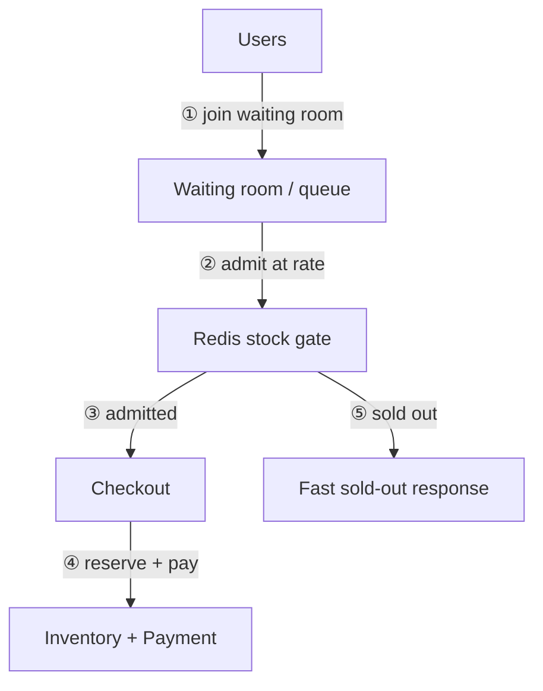
*A waiting room limits arrivals, an atomic gate allocates stock without touching the database, and only admitted buyers reach checkout.*

<details><summary>Worked solution</summary>

Ask whether it must be first come first served and whether a lottery is acceptable (a lottery removes the race entirely). Put a CDN-served static sale page and a waiting room in front so only a controlled rate reaches checkout. Use a Redis `DECR` on the sale counter as the gate: success admits the buyer to a short-lived reserved slot, failure returns sold out in milliseconds without touching the DB. Admitted buyers proceed through the normal idempotent checkout with a payment time limit; unpaid slots expire and are re-released. The database remains the truth, and a reconciliation step corrects Redis drift. Add per-user limits, bot detection and rate limiting. Tell the interviewer you would load test and have a kill switch.
</details>

### Design: Design a marketplace where many sellers list and fulfill products.

**Level:** senior · **Time:** 45 min  
**What a strong answer covers:**

- Seller onboarding, catalog ownership and moderation
- Order splitting per seller and per-seller fulfillment
- Payment splitting, escrow, a ledger and payouts with reconciliation
- Per-seller inventory and rate limits
- Disputes, returns and reputation

<details><summary>Worked solution</summary>

Keep the buyer experience as one cart and one payment, but split the order into seller sub-orders after payment. Each sub-order has its own inventory, fulfillment and state machine. Money is held and recorded in a double-entry ledger; payouts to sellers happen after delivery and a hold period, with commissions and refunds as ledger entries. Add seller dashboards, catalog moderation, per-seller API limits and a dispute workflow. Defer recommendations and ads.
</details>

## Quiz

### MCQ: Which data needs strong consistency in an e-commerce platform?

- [ ] Search results
- [x] Inventory counts and payments
- [ ] Product recommendations
- [ ] Page view counters
**Why:** Overselling and double charging are correctness failures; search and recommendations can lag.

### MCQ: Why use a saga instead of a distributed transaction for checkout?

- [ ] Sagas are faster to write
- [x] Two-phase commit does not scale or work across independent services and a payment gateway, so each step is local with compensations
- [ ] Sagas remove the need for idempotency
- [ ] Databases do not support transactions
**Why:** Compensation (release stock, refund) handles partial failure.

### MCQ: Why snapshot price onto order lines?

- [ ] To save database space
- [x] So later catalog price changes do not alter what the customer was charged
- [ ] Because the catalog is read-only
- [ ] To speed up search
**Why:** An order is a historical record of what was agreed.

### MCQ: Why serve search from an index instead of the primary DB?

- [ ] The DB cannot store text
- [x] Full-text, facets and ranking at high read volume suit a search engine, and eventual consistency is acceptable
- [ ] It removes the catalog service
- [ ] It guarantees real-time stock
**Why:** The DB stays the source of truth; the index is a derived read model.

### MCQ: What is the safest way to propagate catalog changes to the search index?

- [ ] The app writes to both the DB and the index
- [x] Write to the DB with an outbox row, publish events, and have an indexer upsert with versions
- [ ] A nightly full dump
- [ ] Query the DB from the search service
**Why:** Dual writes diverge on partial failure; the outbox makes the event atomic with the write.

### MCQ: A stale price appears in search results. Where must the correct price be enforced?

- [ ] Only in the index
- [x] On the product page and at checkout, read from the source of truth
- [ ] Nowhere, search is the truth
- [ ] In the CDN
**Why:** Search is eventually consistent; purchases need the authoritative value.

### MCQ: How do you reindex with zero downtime?

- [ ] Delete the index and rebuild
- [x] Build a new index, keep it updated, and swap the alias
- [ ] Stop writes during rebuild
- [ ] Reindex nightly only
**Why:** The alias swap is atomic for readers.

### MCQ: Why use a cursor (search-after) for deep pagination?

- [ ] It is easier to code
- [x] Offset pagination gets slower as the offset grows, while a cursor continues from the last sort values
- [ ] It improves ranking
- [ ] It removes the need for sorting
**Why:** Deep offsets force the engine to collect and discard many results.

### MCQ: Why create the order as PENDING before payment?

- [ ] To speed up the page
- [x] It gives a stable id to tie the payment, webhook and reservation to, and a place to record failure
- [ ] Because payment is optional
- [ ] To avoid using a database
**Why:** Without an order id, a webhook cannot be matched safely to a purchase.

### MCQ: What prevents duplicate orders when a user double-clicks Pay?

- [ ] Disabling the button only
- [x] An idempotency key with a unique constraint on the order
- [ ] A longer timeout
- [ ] Caching the page
**Why:** The client-side fix is cosmetic; the server needs a hard guarantee.

### MCQ: When should stock be reserved?

- [ ] On every add to cart
- [x] At checkout, with a TTL, so abandoned carts do not lock stock
- [ ] After shipping
- [ ] Never
**Why:** Reserving at cart time lets abandoned carts block real buyers.

### MCQ: A cart in Redis is lost. What is the impact for a logged-in user?

- [ ] Permanent loss
- [x] Minimal: the cart is rebuilt from its persisted copy
- [ ] Orders are lost
- [ ] Payments fail
**Why:** Carts are a convenience and persisted asynchronously; orders are in the transactional DB.

### MCQ: Which statement correctly reserves stock without a race?

- [ ] Read available, then update if enough
- [x] Single UPDATE with a WHERE condition that available is at least the quantity
- [ ] Update, then check afterwards
- [ ] Cache the count in the app
**Why:** The condition and change are evaluated atomically by the database.

### MCQ: What releases stock from abandoned checkouts?

- [ ] Manual review
- [x] A reservation TTL with an expiry worker
- [ ] A nightly rebuild
- [ ] Customer support
**Why:** Without expiry, abandoned holds block real buyers.

### MCQ: What is the best first defense for one extremely hot SKU?

- [ ] A bigger database
- [x] An atomic Redis gate in front, with the DB as source of truth, possibly with a queue or stock splitting
- [ ] Retrying in a loop
- [ ] Disabling the sale
**Why:** Contention on one row is the bottleneck, so reject excess early.

### MCQ: How do you avoid deadlocks when reserving multiple SKUs in one order?

- [ ] Use more retries
- [x] Process SKUs in a consistent order such as sorted by id
- [ ] Remove transactions
- [ ] Lock the whole table
**Why:** Consistent lock order prevents circular waits.

### MCQ: Why prefer a saga to two-phase commit across services?

- [ ] Sagas are simpler to implement in every case
- [x] 2PC blocks and does not span independent services or a payment gateway
- [ ] Sagas guarantee isolation
- [ ] 2PC is not defined
**Why:** Sagas accept eventual consistency and use compensations instead.

### MCQ: What does the outbox pattern guarantee?

- [ ] Exactly-once delivery to consumers
- [x] The state change and its event are committed atomically, so neither is lost
- [ ] No duplicate events
- [ ] Faster publishing
**Why:** Delivery is at least once, so consumers still dedupe.

### MCQ: A transition request arrives for an order already CANCELLED. What happens?

- [ ] It is applied
- [x] The guarded update affects zero rows and is rejected
- [ ] The order is deleted
- [ ] The database crashes
**Why:** Only legal transitions apply.

### MCQ: How do you handle a stuck order after a service crash?

- [ ] Wait for the customer to complain
- [x] A recovery job scans saga state for stale steps and resumes or compensates
- [ ] Delete the order
- [ ] Restart all services
**Why:** Persisted saga state makes recovery possible.

### MCQ: Why store money as integer minor units?

- [ ] Integers are shorter
- [x] To avoid floating point rounding errors
- [ ] The gateway requires it
- [ ] It improves indexing
**Why:** Floats cannot represent decimal currency exactly.

### MCQ: A gateway call times out. What should you do?

- [ ] Assume it failed and retry with a new key
- [x] Query the gateway by idempotency key, then act on the actual state
- [ ] Mark the order paid
- [ ] Cancel the order and ignore it
**Why:** A timeout is an unknown result; blind retries can double-charge.

### MCQ: What reduces your PCI scope most?

- [ ] Encrypting card numbers in your DB
- [x] Using the gateway's hosted fields or tokenization so card data never reaches your servers
- [ ] Hiding the checkout page
- [ ] Using a bigger server
**Why:** Data you never receive cannot be leaked from your systems.

### MCQ: A webhook arrives twice. What happens?

- [ ] The customer is charged twice
- [x] The handler dedupes by event id and processes it once
- [ ] The order is cancelled
- [ ] The second is processed in parallel
**Why:** Gateways deliver at least once.

### MCQ: What should be protected first when the platform is overloaded on a sale day?

- [ ] Recommendations
- [x] The purchase path: checkout, inventory and payments
- [ ] Analytics
- [ ] Search suggestions
**Why:** Degrade non-critical features to keep revenue-producing flows working.

### MCQ: How do you ensure one shipped notification per order event?

- [ ] Send it twice to be safe
- [x] A unique idempotency key derived from the business event
- [ ] A cron job
- [ ] Ignore duplicates
**Why:** Redelivered events then become no-ops.

### MCQ: Why use both webhooks and polling for carrier tracking?

- [ ] Webhooks are unreliable and polling is faster
- [x] Webhooks give speed and polling is a safety net for missed callbacks
- [ ] Carriers require it
- [ ] It halves the cost
**Why:** Callbacks can be lost; polling closes the gap.

### MCQ: What is a waiting room in a flash sale?

- [ ] A cache
- [x] A queue that admits users to checkout at a rate the system can handle
- [ ] A database table
- [ ] A load balancer setting
**Why:** It converts a spike into steady, safe load.

## Glossary

| Term | Meaning |
| --- | --- |
| SKU | A distinct sellable item variant |
| Saga | A multi-step process of local transactions with compensating actions |
| Outbox | A table written in the same transaction as state, relayed to publish events reliably |
| Reservation | Stock held for an order for a limited time |
| CDN | Network of edge caches serving static and cacheable content |
| Read model | A derived, query-optimized copy of data, such as a search index |
| Inverted index | Structure mapping terms to the documents containing them |
| Facet | A count of results grouped by an attribute, such as brand |
| CDC | Change data capture, streaming database changes as events |
| Alias | A name that points to an index so it can be swapped atomically |
| Shard | A partition of an index spread across nodes |
| Idempotency key | Client-supplied id making retries return the same result |
| Price snapshot | Copying the price onto the order line at purchase time |
| Compensation | An action that undoes an earlier saga step |
| Reconciliation | A periodic job comparing two systems and fixing mismatches |
| TTL | Time to live before an entry expires |
| On-hand | Physical units in the warehouse |
| Reserved | Units held for pending orders |
| Available | On-hand minus reserved |
| Oversell | Selling more units than exist |
| Hot key | A single row or key receiving disproportionate traffic |
| Waiting room | A queue that admits buyers at a controlled rate |
| Orchestrator | Component that drives saga steps |
| Choreography | Services coordinate by reacting to events |
| Outbox / inbox | Tables ensuring reliable event publish and consume |
| Optimistic locking | Version check on update to detect concurrent change |
| Authorization | Holding funds on a card without taking them |
| Capture | Taking the authorized funds |
| Webhook | A server-to-server callback from the gateway |
| Tokenization | Replacing card data with a non-sensitive token |
| PCI DSS | Security standard for handling card data |
| Fulfillment | Picking, packing and shipping an order |
| Carrier adapter | Component wrapping one shipping carrier's API |
| Graceful degradation | Turning off non-critical features to protect critical ones |
| Ledger | Append-only record of money movements |
