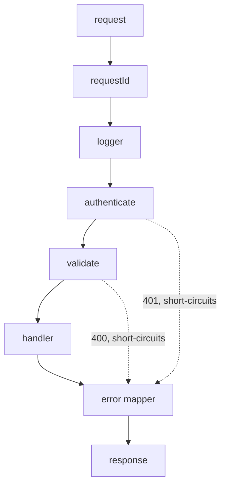
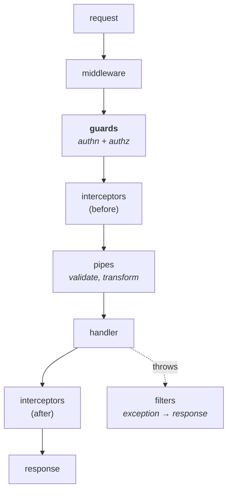

# Building the server

The chapter that turns a language into a service. We build the same small API
in all three language tracks — `POST /links`, `GET /links/:id`, `GET /healthz` —
so that when you read the Python and Go versions you are comparing mechanisms
rather than learning a new problem.

Twelve things, in the order you would actually add them. Start with no
framework at all, because the point of the first section is to see what a
framework is doing for you.

---

## In brief

- **A framework is a router, a middleware chain and a body parser.** Writing
  those three by hand once, in 40 lines, makes every framework afterwards
  obvious rather than magic.
- **Middleware is a chain of functions that wrap the handler**, and *order is
  the whole model*: request id before logging, logging before auth, auth before
  anything that reads the user, error handling last so it sees everything.
- **Validate at the edge and never again.** One parse of the body produces a
  typed value for the rest of the request; a handler that re-checks its inputs
  is a handler that was not given a contract.
- **Errors belong to one mapper.** Handlers throw meaningful error types; a
  single piece of middleware turns them into status codes, so no route invents
  its own error shape and no internal message escapes.
- **Config is validated at startup and the process exits if it is wrong.** A
  service that boots with a missing database URL and fails on the first request
  has converted a deploy-time error into an incident.
- **Graceful shutdown is not optional** once something orchestrates you: fail
  readiness, stop accepting, drain in-flight requests, close the pool — in that
  order, or every deploy drops requests.
- **Express 4 does not catch async errors**; a rejected promise in a handler
  hangs the request until a timeout. Express 5 fixes it, Fastify never had the
  problem, and knowing this is a real interview discriminator.

---

## 1. The server with no framework

```ts
// src/raw.ts — run: npx tsx src/raw.ts
import { createServer } from 'node:http';

const server = createServer(async (req, res) => {
  // This is the entire interface: a method, a URL string, headers, and a
  // readable stream of bytes. Everything a framework gives you is built here.
  if (req.method === 'GET' && req.url === '/healthz') {
    res.writeHead(200, { 'content-type': 'application/json' });
    return res.end(JSON.stringify({ ok: true }));
  }

  if (req.method === 'POST' && req.url === '/links') {
    // The body is a stream, not a string: it arrives in chunks and you must
    // decide how much you are willing to buffer. A framework's body parser is
    // doing exactly this, plus a size limit you did not have to think about.
    const chunks: Buffer[] = [];
    let size = 0;
    for await (const chunk of req) {
      size += chunk.length;
      if (size > 1_000_000) { res.writeHead(413); return res.end(); }  // or you have a DoS
      chunks.push(chunk);
    }
    const body = JSON.parse(Buffer.concat(chunks).toString('utf8'));
    res.writeHead(201, { 'content-type': 'application/json' });
    return res.end(JSON.stringify({ id: 'abc', url: body.url }));
  }

  res.writeHead(404);
  res.end();
});

server.listen(3000, () => console.log('listening on 3000'));
```

Four things this makes visible, which frameworks hide:

- **The body is a stream.** Nothing buffers it for you, and nothing bounds it —
  the size check above is the difference between a service and an outage.
- **Matching `req.url` by hand does not scale.** `/links/abc` needs a pattern,
  and now you want a router.
- **Every response repeats the content type and the JSON encoding.** You want a
  helper, and that helper becomes `res.json()`.
- **Nothing is wrapped.** An exception in that handler is an unhandled
  rejection, and the client waits forever.

---

## 2. Routing

A router maps (method, path pattern) to a handler and extracts parameters:

```ts
type Handler = (ctx: Ctx) => Promise<void> | void;
const routes: { method: string; pattern: RegExp; keys: string[]; handler: Handler }[] = [];

function route(method: string, path: string, handler: Handler) {
  // '/links/:id' -> /^\/links\/([^/]+)$/ with keys ['id']
  const keys: string[] = [];
  const pattern = new RegExp('^' + path.replace(/:(\w+)/g, (_, k) => { keys.push(k); return '([^/]+)'; }) + '$');
  routes.push({ method, pattern, keys, handler });
}

function match(method: string, pathname: string) {
  for (const r of routes) {
    if (r.method !== method) continue;
    const m = r.pattern.exec(pathname);
    if (m) return { handler: r.handler, params: Object.fromEntries(r.keys.map((k, i) => [k, m[i + 1]!])) };
  }
  return null;
}
```

That is the whole idea. Real routers use a radix tree rather than scanning a
list — which is a large part of why Fastify is faster than Express — but the
contract is identical.

---

## 3. Middleware: the chain, and why order is the model


*Each layer wraps the next, so the response travels back out through them. A layer can short-circuit — auth returning 401 means the handler never runs — which is why order is the design, not a detail.*

Express's signature is `(req, res, next)`: do work, then either respond or call
`next()` to continue. Written out by hand, the chain is a fold:

```ts
type Middleware = (ctx: Ctx, next: () => Promise<void>) => Promise<void>;

function chain(middlewares: Middleware[], handler: Handler) {
  return (ctx: Ctx) =>
    middlewares.reduceRight<() => Promise<void>>(
      (next, mw) => () => mw(ctx, next),      // each one wraps the rest
      async () => { await handler(ctx); },
    )();
}
```

The middleware every service wants, in registration order:

```ts
// 1. Request id — first, so everything after it can log the same id. Accept an
// inbound one so a trace survives across services.
const requestId: Middleware = async (ctx, next) => {
  ctx.id = ctx.req.headers['x-request-id'] as string ?? crypto.randomUUID();
  ctx.res.setHeader('x-request-id', ctx.id);
  await next();
};

// 2. Structured logging + timing — wraps everything below, so the duration it
// records is the real end-to-end time.
const logging: Middleware = async (ctx, next) => {
  const started = performance.now();
  ctx.log = log.child({ reqId: ctx.id });
  try {
    await next();
  } finally {
    ctx.log.info({ method: ctx.req.method, path: ctx.path, status: ctx.res.statusCode,
                   ms: Math.round(performance.now() - started) }, 'request');
  }
};

// 3. Recovery — catches anything thrown below and hands it to the error mapper
// rather than letting it become an unhandled rejection.
const recover: Middleware = async (ctx, next) => {
  try { await next(); } catch (err) { writeError(ctx, err); }
};
```

**The ordering rules worth saying out loud in an interview:**

| Put this | Before this | Because |
| --- | --- | --- |
| Request id | Everything | Nothing can log a correlation id it does not have |
| Logging / timing | Handlers | Timing must include the work being timed |
| Recovery | Handlers | It cannot catch what ran above it |
| Body size limit | Body parsing | Rejecting after buffering 2GB is not rejecting |
| Authentication | Authorization | You cannot check a role before you know the user |
| Rate limiting | Expensive work, after cheap identification | The limiter is there to stop the work happening |
| Error mapper | — | Last, so every layer's failure funnels through one place |

---

## 4. Validation

```ts
import { z } from 'zod';

const CreateLink = z.object({
  url: z.string().url().max(2048),
  note: z.string().max(280).optional(),
});

// One middleware, reused by every route that takes a body. The parsed, typed
// value replaces the raw one, so the handler can't accidentally use the
// unvalidated version — the most common way validation gets bypassed.
const validate = <S extends z.ZodTypeAny>(schema: S): Middleware => async (ctx, next) => {
  const parsed = schema.safeParse(ctx.body);
  if (!parsed.success) {
    throw new ValidationError(parsed.error.issues.map((i) => ({
      path: i.path.join('.'), message: i.message,     // field-level detail the client can act on
    })));
  }
  ctx.body = parsed.data;
  await next();
};
```

Validate the query string and path params the same way. A `:id` that the client
controls and you pass straight to a database is how injection and enumeration
bugs start.

---

## 5. Errors: one mapper, one shape

```ts
// Handlers throw meaning; this is the only place that knows about HTTP status.
function writeError(ctx: Ctx, err: unknown) {
  if (err instanceof ValidationError) {
    return json(ctx, 400, { error: 'validation_failed', code: 'validation_failed', details: err.issues });
  }
  if (err instanceof AppError) {
    return json(ctx, err.status, { error: err.message, code: err.code });
  }
  // Unknown: the client gets nothing useful, the logs get everything. Leaking
  // err.message here is how stack traces and SQL end up in a response body.
  ctx.log.error({ err }, 'unhandled');
  return json(ctx, 500, { error: 'internal error', code: 'internal', requestId: ctx.id });
}
```

Returning the request id on a 500 is a small thing that makes support possible:
the user quotes it, and it is the key to every log line for that request.

---

## 6. Authentication middleware

```ts
import { createRemoteJWKSet, jwtVerify } from 'jose';

// Fetched once and cached — the key set is how you verify without a shared
// secret, and it rotates without a deploy. See the JWT chapter for why
// verification is the whole security boundary.
const jwks = createRemoteJWKSet(new URL(`${config.issuer}/.well-known/jwks.json`));

const authenticate: Middleware = async (ctx, next) => {
  const header = ctx.req.headers.authorization ?? '';
  const token = header.startsWith('Bearer ') ? header.slice(7) : null;
  if (!token) throw new UnauthorizedError('missing bearer token');

  try {
    const { payload } = await jwtVerify(token, jwks, {
      issuer: config.issuer,      // never skip: a valid signature from the
      audience: config.audience,  // wrong issuer is still the wrong token
    });
    ctx.user = { id: payload.sub!, tenantId: payload.tenant as string, scopes: (payload.scope as string ?? '').split(' ') };
  } catch {
    throw new UnauthorizedError('invalid token');   // never echo the library's reason
  }
  await next();
};

// Authorization is a separate, later layer: authentication says who, this says
// whether. Only the owning service knows about ownership and tenancy.
const requireScope = (scope: string): Middleware => async (ctx, next) => {
  if (!ctx.user?.scopes.includes(scope)) throw new ForbiddenError(scope);
  await next();
};
```

The mechanics of JWTs — signing, claims, revocation — are in
[JWT](../01-auth-identity/06-jwt.md); this chapter only wires them in.

---

## 7. Config, validated at startup

```ts
// src/config.ts — imported for its side effect of failing fast.
import { z } from 'zod';

const Config = z.object({
  NODE_ENV: z.enum(['development', 'test', 'production']).default('development'),
  PORT: z.coerce.number().int().positive().default(3000),
  DATABASE_URL: z.string().url(),
  JWT_ISSUER: z.string().url(),
  LOG_LEVEL: z.enum(['debug', 'info', 'warn', 'error']).default('info'),
  SHUTDOWN_GRACE_MS: z.coerce.number().default(10_000),
});

const parsed = Config.safeParse(process.env);
if (!parsed.success) {
  // Crash at startup, not on the first request that needs the missing value.
  // In an orchestrator this means the bad version never becomes ready, and the
  // old pods keep serving — a deploy that fails safely.
  console.error('invalid configuration:', parsed.error.flatten().fieldErrors);
  process.exit(1);
}
export const config = parsed.data;
```

Secrets come from the environment, injected by the platform — never from a file
in the image, and never committed. The reasoning is in
[the AWS ecosystem](../06-cloud-devops/01-aws-ecosystem.md) §Secrets Manager.

---

## 8. Persistence and the pool

```ts
import { Pool } from 'pg';

export const pool = new Pool({
  connectionString: config.DATABASE_URL,
  max: 10,                        // per instance. 20 instances × 10 = 200 server-side
  idleTimeoutMillis: 30_000,      // connections aren't free on the server either
  connectionTimeoutMillis: 2_000, // fail fast when the pool is exhausted…
  statement_timeout: 5_000,       // …and never let one query hold a connection forever
});

export async function createLink(input: CreateLink, tenantId: string): Promise<Link> {
  const { rows } = await pool.query(
    // Parameterised, always. String interpolation here is SQL injection,
    // regardless of what validation ran earlier.
    'INSERT INTO links (id, url, tenant_id) VALUES ($1, $2, $3) RETURNING *',
    [nanoid(7), input.url, tenantId],
  );
  return rows[0];
}
```

**Pool sizing is a system property, not a local one.** The database has a
connection limit; your pool size multiplied by your instance count must stay
under it, which is why autoscaling a service can take the database down. The
networking chapter's [connection pooling section](../02-interview-core/44-networking.md)
is the general version of this.

---

## 9. Logging, metrics and tracing

```ts
import pino from 'pino';

export const log = pino({
  level: config.LOG_LEVEL,
  // Structured JSON so logs are queryable fields, not text to regex over.
  formatters: { level: (label) => ({ level: label }) },
  redact: ['req.headers.authorization', 'req.headers.cookie', '*.password'],
});
```

Three rules that survive contact with production: **log JSON, not sentences**;
**always include the request id** (that is what `log.child({ reqId })` above is
for); and **redact credentials at the logger**, not at each call site, because
one forgotten call site is a credential in a log aggregator forever. What to
measure, and the SLO argument for it, is in
[observability](../02-interview-core/30-observability-slos-and-operations.md).

---

## 10. Graceful shutdown

```ts
let ready = false;
const server = app.listen(config.PORT, () => { ready = true; });

// Readiness is what the load balancer reads; liveness is only "is the process
// wedged". Failing readiness first is what stops new traffic arriving.
app.get('/readyz', (_req, res) => (ready ? res.sendStatus(200) : res.sendStatus(503)));
app.get('/healthz', (_req, res) => res.sendStatus(200));   // deliberately dumb

process.on('SIGTERM', async () => {
  ready = false;                                   // 1. fail readiness
  await sleep(5_000);                              // 2. let the LB notice — removal is
                                                   //    eventually consistent, so exiting
                                                   //    immediately still drops requests
  server.close(async () => {                       // 3. finish in-flight, refuse new
    await pool.end();                              // 4. close the pool cleanly
    process.exit(0);
  });
  setTimeout(() => process.exit(1), config.SHUTDOWN_GRACE_MS).unref();  // don't hang forever
});
```

This is the same sequence as the Kubernetes section in
[containers, properly](../06-cloud-devops/06-containers.md),
and the five-second sleep is the part everyone omits and then wonders why every
deploy produces a burst of 502s.

---

## 11. Project layout

```
src/
  main.ts            # compose: config -> deps -> routes -> listen. No logic.
  config.ts          # validated environment, exits on failure
  http/
    server.ts        # framework setup, middleware order in one readable list
    middleware/      # requestId, logging, auth, validate, errors
    routes/
      links.ts       # routing + request/response shape only
  domain/
    links.ts         # the actual rules: what a link is, what may be created
  db/
    pool.ts
    links.repo.ts    # SQL lives here, and nowhere else
  lib/               # logger, ids, errors
test/
```

The rule that keeps this honest: **a handler does HTTP, a domain function does
rules, a repository does SQL.** A handler containing a query is a handler you
cannot test without a database; a domain function importing `req` is a rule you
cannot reuse from a worker or a CLI.

---

## 12. Tests

```ts
// Unit: the rule, with no HTTP and no database in sight.
test('rejects a url longer than the limit', () => {
  assert.throws(() => CreateLink.parse({ url: 'https://x.com/' + 'a'.repeat(3000) }));
});

// Handler level: the real middleware chain, a fake repository. This is where
// most of the value is — it covers routing, validation, auth and error mapping
// in one test, and runs in milliseconds.
test('POST /links returns 201 and the id', async () => {
  const app = buildApp({ repo: inMemoryRepo() });
  const res = await request(app).post('/links')
    .set('authorization', `Bearer ${testToken()}`)
    .send({ url: 'https://example.com' });
  assert.equal(res.status, 201);
  assert.match(res.body.id, /^[\w-]{7}$/);
});

// Integration: one test against a real database in a container, proving the
// SQL and the migrations are right. Few of these — they are slow.
test('createLink persists and is readable', async () => {
  const link = await createLink({ url: 'https://example.com' }, 'tenant-1');
  assert.equal((await getLink(link.id))?.url, 'https://example.com');
});
```

The shape to aim for: many unit tests, a solid layer of handler tests with
fakes, and a few integration tests. The depth argument, and the honest version
of defending a coverage number, is in
[testing and TDD](../05-testing/01-testing-and-coverage.md).

---

## Choosing a framework, once you know what one does

| | **Express** | **Fastify** | **NestJS** |
| --- | --- | --- | --- |
| Style | Minimal, unopinionated | Minimal, performance-focused | Opinionated, structured |
| Structure | You decide everything | You decide everything | Modules, DI, decorators |
| Speed | Baseline | ~2× Express | Runs on Express *or* Fastify |
| Async errors | **Not caught in v4**; fixed in v5 | Caught | Caught |
| Validation | Bring your own | Built in, JSON Schema, also speeds serialisation | Pipes, usually `class-validator` |
| Good for | Small services, full control | High-throughput APIs | Large apps, many teams |
| Cost | Every project looks different | Smaller ecosystem | Learning curve, more ceremony |

**NestJS is not a competitor to the other two** — it is a layer on top, and you
choose Express or Fastify as its HTTP adapter.

**The Express 4 async trap**, because it is a real interview question:

```js
app.get('/x', async (req, res) => { throw new Error('boom'); });
// Express 4: the rejection is unhandled, the error middleware never runs, and
// the request hangs until the client times out.

const wrap = (fn) => (req, res, next) => Promise.resolve(fn(req, res, next)).catch(next);
app.get('/x', wrap(async (req, res) => { /* … */ }));   // the fix in v4
```

Express identifies an error handler by its **four** parameters —
`(err, req, res, next)` — which is why a three-argument function never receives
errors no matter where it is registered.

## Fastify: speed and schemas

Faster mostly because of **schema-based serialisation**. You declare the shape
of your response, and Fastify compiles a fast serialiser for it instead of
using generic `JSON.stringify`.

```js
fastify.get('/user/:id', {
  schema: {
    params: { type: 'object', properties: { id: { type: 'string' } } },
    response: {
      200: { type: 'object', properties: { id: {type:'string'}, name: {type:'string'} } }
    }
  }
}, handler);
```

Two benefits beyond speed, and they're the ones worth mentioning:

- **Input validation is free** — the schema rejects bad requests before your
  handler runs.
- **Response serialisation only emits declared fields.** So a field you forgot
  to strip — a password hash, an internal flag — simply doesn't get sent. That's
  a genuine security benefit, not just a performance one.

Fastify uses **plugins with encapsulation**: something registered inside a
plugin is scoped to it, rather than Express's global middleware chain. Cleaner
for larger apps.

---
## NestJS: structure for teams

Angular-inspired: modules, dependency injection, decorators.

```ts
@Controller('entries')
export class EntriesController {
  constructor(private readonly entries: EntriesService) {}   // injected

  @Get(':id')
  @UseGuards(AuthGuard, PermissionGuard)                     // authz here
  findOne(@Param('id') id: string) {
    return this.entries.findOne(id);
  }
}
```

### The request pipeline — worth knowing in order


*Guards are where RBAC belongs: a permission declared next to the route and enforced centrally, rather than an if-statement someone can forget inside a handler.*

A request passes through **middleware → guards → interceptors (before) → pipes →
handler → interceptors (after) → response**, and a thrown exception is diverted
to **filters**, which turn it into a response.

- **Guards** — return true/false. This is where authentication and
  authorization live.
- **Interceptors** — wrap the handler; logging, timing, response shaping,
  caching.
- **Pipes** — validate and transform input (`ValidationPipe` with
  `class-validator`).
- **Filters** — catch exceptions and turn them into responses.

**Why this matters for you:** guards are the natural place for RBAC. A
`@RequirePermission('entry:publish')` decorator plus a guard that checks it
means authorization is declared next to the route and enforced centrally —
rather than an `if` statement someone can forget inside a handler. That's
exactly the "make correct auth the easy path" argument from your auth package
story.

### Dependency injection

You declare what you need in the constructor; Nest supplies it. The real
benefit is testing — swap a real service for a mock without touching the class
under test.

## Passport.js: authentication as middleware

The de-facto authentication middleware for Express, and it sits exactly where
the previous section leaves off — `authenticate` in that chain is usually
Passport.

The model is small and worth being able to state in one breath: **a strategy
verifies a credential and hands back a user; Passport puts it on `req.user`.**
Everything else is a strategy — `passport-local` for username/password,
`passport-jwt` for a bearer token, `passport-saml` for SAML SSO,
`openid-client` for OIDC, plus one per social provider.

```js
passport.use(new JwtStrategy(
  { jwtFromRequest: ExtractJwt.fromAuthHeaderAsBearerToken(), secretOrKeyProvider: jwks },
  // done(err, user) - the whole contract. Return false, not an error, for a
  // valid-but-unknown subject: it is a 401, not a 500.
  async (payload, done) => {
    const user = await users.findById(payload.sub);
    return user ? done(null, user) : done(null, false);
  },
));

app.get('/entries', passport.authenticate('jwt', { session: false }), handler);
```

**Sessions vs stateless is the decision people get wrong.** By default Passport
establishes a login session and needs `serializeUser`/`deserializeUser` to
decide what goes in the session store. For a token-authenticated API you want
`{ session: false }` on every call — otherwise you are minting a server-side
session per request, which quietly recreates the state you chose JWTs to avoid.

**What it does and doesn't give you.** It authenticates. It has no opinion at
all about authorization — no roles, no permissions, no policy. That is your
`authorize('entry:read')` middleware and, at your scale, OPA/Rego behind it.
Confusing the two is the single most common Passport mistake, and being clear
about the boundary is a good signal.

**Where teams outgrow it**, which is the interesting half of the answer:

- It is Express-shaped. On NestJS you use `@nestjs/passport`, which wraps it in
  guards; on Fastify the ecosystem prefers `@fastify/jwt` and plugins.
- Many strategies are thin, lightly maintained community packages. For anything
  load-bearing — SAML, OIDC — a maintained protocol library (`openid-client`,
  and see [SAML](../01-auth-identity/04-saml-sso.md) for why signature and
  audience validation is where the bugs live) beats a wrapper you have to audit
  yourself.
- Once you are the identity provider rather than a consumer of one, Passport
  covers only the front door. Token issuance, refresh rotation, introspection
  and session governance all sit outside it.

That last point is the honest framing for your own background: Passport is the
right tool for adding login to an application, and the wrong shape for building
the auth platform other applications log into.

---

---

## Interview Q&A

### Q: Walk me through building an HTTP service from nothing. What do you add, and in what order?
**Level:** intermediate · **Tags:** nodejs, http, middleware, design

<details><summary>Model answer</summary>

I'd start with the raw server so the shape is clear: a request is a method, a
URL, headers and a stream of bytes, and a response is a status, headers and
bytes. Everything a framework adds is built on exactly that.

Then, roughly in this order. A router, because matching URLs by hand stops
scaling at the first path parameter. A body parser with a size limit — the
limit matters, because buffering an unbounded request body is a denial of
service. Then the middleware chain, which is where most of the design lives.

The order of middleware is the design: request id first so everything after can
log a correlation id; structured logging and timing next, wrapping the work so
the duration is real; a recovery layer so nothing below becomes an unhandled
rejection; body limits before parsing; authentication before authorization,
because you cannot check a role before you know the user; and the error mapper
last, so every failure funnels through one place.

After that: validation at the edge with a schema, so the handler receives a
typed value and never re-checks; config validated at startup so the process
exits rather than failing on the first request; a bounded connection pool;
structured logging with redaction; and graceful shutdown, which is the one
people skip and then wonder why every deploy produces 502s.

The structural rule underneath all of it: handlers do HTTP, domain functions do
rules, repositories do SQL. That is what makes the thing testable.

</details>

**Follow-ups:**

1. Q: Why does authentication go before authorization, and why can't the gateway do both?
   <details><summary>Answer</summary>

   Authentication establishes who the caller is; authorization decides whether
   they may do this. The second needs the first's output, so the order is
   forced.

   A gateway can do coarse authorization — is the token valid, is the issuer
   and audience right, does it carry the required scope — because that is
   decidable from the token alone. It cannot decide whether *this* user owns
   *this* record, because that needs the data. So the owning service always
   checks too, and treating the gateway as the only check is how the internal
   network becomes an implicit trust zone.

   </details>

### Q: What happens when an async Express 4 handler throws?
**Level:** senior · **Tags:** nodejs, express, errors

<details><summary>Model answer</summary>

Nothing good: the returned promise rejects, Express 4 does not look at it, the
error middleware never runs, and the request hangs until the client or a proxy
times out. From the outside it looks like the service stopped responding to one
endpoint, which sends people hunting in the wrong place.

The fix in Express 4 is to wrap every async handler so a rejection is forwarded
to `next()`. Express 5 forwards rejected promises automatically, and Fastify
never had the problem because its lifecycle is promise-aware.

The related detail is how Express recognises an error handler at all: by
arity. A middleware function with four parameters — `(err, req, res, next)` —
is an error handler; three parameters is ordinary middleware. So a
three-argument error handler silently never receives errors, no matter where it
is registered, which is a genuinely confusing bug the first time you hit it.

</details>

### Q: A deploy causes a burst of 502s every time, even though the new version is healthy. Why?
**Level:** senior · **Tags:** nodejs, shutdown, operations

<details><summary>Model answer</summary>

The old instances are exiting before they stop receiving traffic. Removal from
a load balancer's or Service's endpoint list is eventually consistent, so for a
second or two after SIGTERM the process is still a target — and if it has
already closed its listener, those requests are refused.

The correct sequence is: on SIGTERM, fail the readiness probe first; wait a few
seconds so the routing layer actually notices; then stop accepting new
connections while letting in-flight requests finish; then close the database
pool and exit. With a hard timer as a backstop so a stuck request cannot hold
the process open forever.

The two mistakes I look for are exiting immediately on SIGTERM, and having no
readiness endpoint separate from liveness — because if they are the same
endpoint, failing it to drain traffic also tells the orchestrator the process
is wedged, and it kills it mid-drain.

</details>

### Q: Where does validation belong, and what happens if it's spread around?
**Level:** intermediate · **Tags:** nodejs, validation, design

<details><summary>Answer</summary>

At the edge, once, before the handler runs — and the parsed value should
*replace* the raw one so the handler cannot accidentally use the unvalidated
version. That is the subtle failure: validation that runs but leaves the
original body in place, and some code path later reads the original.

The cost of spreading it around is that every handler re-checks slightly
differently, the error responses stop agreeing, and a new endpoint quietly
forgets a check. Centralising also gives one error shape — field-level details
the client can act on, not a string — which matters because an API's error
format is part of its contract.

Deriving the TypeScript type from the schema is the part that keeps it honest:
one declaration produces both the runtime check and the static type, so they
cannot drift.

</details>

### Q: When would you choose NestJS over Express?
**Level:** intermediate · **Tags:** nestjs, express, architecture

<details><summary>Model answer</summary>

It's really a question about team size and application lifetime.

Express gives you nothing and asks nothing. That's ideal for a small service or
when you want full control — but on a large codebase with several people, every
module ends up structured differently, because there's no convention to follow.

NestJS gives you modules, dependency injection, and a defined request pipeline.
The value is consistency: any developer opening any module finds the same
shape. The DI also makes testing much easier, since you inject mocks instead of
monkey-patching.

The cost is real: more ceremony, a learning curve, and a lot of boilerplate for
a small service.

So: Express or Fastify for something small and focused; NestJS when the
codebase will be large, long-lived, and worked on by several people. For an
auth platform with many endpoints and consistent cross-cutting concerns, Nest's
guards and interceptors are worth the overhead on their own.

</details>

**Follow-ups:**

1. Q: What are guards, and why put authorization there?
   <details><summary>Answer</summary>

   A guard runs before the handler and returns true or false — proceed, or
   reject with a 403.

   Putting authorization there means it's **declarative and central**. You write
   `@UseGuards(PermissionGuard)` with a required permission next to the route,
   and one guard implementation enforces it everywhere. Compare that with an
   `if` check at the top of each handler, which someone will eventually forget
   on a new endpoint — and a missing authorization check fails silently, because
   nothing errors, it just permits.

   It also keeps handlers focused on business logic rather than access control,
   and it means changing how permissions are evaluated is one file rather than
   a hundred.

   That's the same argument as the shared auth package: make the correct thing
   the default path so it can't be skipped by accident.

   </details>

2. Q: Where does Fastify's speed actually come from?
   <details><summary>Answer</summary>

   Mostly serialisation. If you declare a response schema, Fastify compiles a
   purpose-built serialiser for that exact shape, which is substantially faster
   than generic `JSON.stringify` — and for a JSON API, serialisation is a large
   share of the per-request cost.

   It also has a faster router (radix tree), a lighter internal middleware
   model, and schema-based input validation that rejects bad requests before
   your code runs.

   The part I find more interesting than the speed is that response schemas
   **only emit declared fields**. A field you forgot to strip — a password
   hash, an internal flag — is simply not serialised. That turns "remember to
   sanitise output" into something the framework enforces.

   Honest caveat: for most applications the framework isn't the bottleneck. The
   database is. Choosing Fastify for raw throughput matters at high request
   rates; below that, the schema-driven validation is the better reason.

   </details>

### Q: How do you handle errors in an Express app?
**Level:** intermediate · **Tags:** express, errors

<details><summary>Model answer</summary>

Express recognises an error handler by its arity — four arguments,
`(err, req, res, next)` — and it should be registered last, after all routes.

The trap is async. In Express 4, a rejected promise inside an async handler is
**not** caught, so the request just hangs until the client times out and you
get no error at all. You either wrap every async handler in something that
catches and calls `next(err)`, or use a library that does it. Express 5 forwards
rejections automatically, which removes the footgun.

Beyond the mechanics, what I'd want in the handler: distinguish operational
errors (bad input, not found, unauthorised) from programmer errors, since the
first are expected and the second mean something is broken. Log with a
correlation id so one request can be traced across services. Never leak stack
traces or internal messages to the client. And return a consistent error shape,
because clients have to parse it.

For an auth service specifically, error messages need care: "user not found"
versus "wrong password" tells an attacker which usernames exist. The response
should be the same either way.

</details>

---

---

## What a weak answer sounds like

- **"I'd use Express"** as the whole answer, with no account of what a framework
  is doing or what you add on top of it.
- **No middleware ordering reasoning** — treating the chain as a bag of
  features rather than a sequence where position is the design.
- **Validation inside handlers**, differently in each one.
- **Error handling per route**, so the API's error shape is whatever the last
  person wrote.
- **Config read with `process.env.FOO` at point of use**, so a missing value
  fails on a request instead of at startup.
- **No graceful shutdown**, and no idea why deploys produce 502s.
- **An unbounded body parser**, or an unbounded pool.
- **SQL in the handler**, which makes the handler untestable without a database.

---

## Quiz

### MCQ: What is a web framework actually providing over `node:http`?
- [ ] A faster TCP implementation
- [x] A router, a middleware chain and a body parser with limits — plus response helpers; the transport underneath is the same
- [ ] Multi-threading for request handling
- [ ] Automatic input validation
**Why:** Writing those three by hand once makes every framework legible afterwards. It also makes visible what you must supply yourself — a body size limit, for instance, which is a denial-of-service hole when missing.

### MCQ: Why must the request-id middleware run before the logging middleware?
- [ ] Logging is synchronous and would block it
- [x] The logger can only attach a correlation id that already exists; registered after, every log line for that request is missing the one field that ties them together
- [ ] Express sorts middleware alphabetically
- [ ] It avoids a circular dependency
**Why:** Middleware order is the design rather than a detail. The same reasoning puts a body size limit before parsing, and authentication before authorization.

### MCQ: In Express 4, an async handler rejects and nothing else is configured. What does the client see?
- [ ] A 500 from the default error handler
- [x] Nothing — the rejection is unobserved, the error middleware never runs, and the request hangs until something times out
- [ ] A 404
- [ ] The process restarts immediately
**Why:** Express 4 does not inspect a handler's returned promise. The fix is wrapping handlers so rejections reach `next()`; Express 5 does it automatically and Fastify never had the problem.

### MCQ: Why does validation middleware replace `ctx.body` with the parsed value instead of just checking it?
- [ ] Parsing is faster than validating in place
- [x] So a handler cannot accidentally read the unvalidated original — validation that leaves the raw body in place is silently bypassable by any later code path
- [ ] To reduce memory usage
- [ ] Because schemas cannot validate without consuming the value
**Why:** It also carries the type forward: with the type derived from the schema, the handler receives a value the compiler knows is valid, so no re-checking is needed or tempting.

### MCQ: Which SIGTERM sequence avoids dropping requests during a deploy?
- [ ] Close the server immediately, then exit
- [x] Fail readiness, wait a few seconds for the routing layer to notice, stop accepting new connections while in-flight requests finish, close the pool, exit — with a hard timer as a backstop
- [ ] Ignore SIGTERM and wait for SIGKILL
- [ ] Close the database pool first, then stop the server
**Why:** Endpoint removal is eventually consistent, so a process that exits the instant it is signalled is still receiving traffic. Closing the pool first is actively wrong: in-flight requests then fail with database errors.

### MCQ: Your pool is `max: 10` and you scale from 5 to 40 instances. What breaks?
- [ ] Nothing; pools are per-process and independent
- [x] The database — 40 × 10 = 400 server-side connections, which likely exceeds its limit, so connections start being refused across the whole system
- [ ] The load balancer runs out of file descriptors
- [ ] Requests queue in the router
**Why:** Pool size is a system-wide property: instances multiply it. This is why autoscaling a stateless service can take down a database, and why a proxy such as PgBouncer or RDS Proxy exists.

### MCQ: What is NestJS's relationship to Express and Fastify?
- [ ] It's a completely independent HTTP server implementation
- [x] It's a structural layer built on top of one of them — you pick Express or Fastify as its underlying HTTP adapter
- [ ] It replaces the need for either one
- [ ] It's only compatible with Fastify, not Express
**Why:** "NestJS vs Express" is a category error — NestJS adds modules, DI, and decorators on top of whichever adapter you choose underneath.

### MCQ: What happens when an async Express 4 route handler throws or rejects, with no explicit error handling added?
- [ ] Express automatically forwards it to the error-handling middleware
- [x] The rejection is not caught — the request simply hangs until it times out, with no error surfaced
- [ ] The server crashes immediately
- [ ] The response returns a generic 500 automatically
**Why:** This is the most common real bug in Express 4 apps — every async handler needs to be wrapped (or use a catching helper) to forward rejections to `next(err)`; Express 5 fixes this automatically.

### MCQ: How does Express identify a function as an error-handling middleware rather than a regular one?
- [ ] By its position at the very top of the middleware stack
- [x] By its arity — an error handler takes exactly four arguments: `(err, req, res, next)`
- [ ] By a special `isErrorHandler` property
- [ ] By its function name containing the word "error"
**Why:** Express inspects the function's parameter count to decide whether to treat it as an error handler — this is a common source of confusion since it's based on arity, not naming convention.

### MCQ: What does Passport.js actually provide, and what is it explicitly silent on?
- [ ] It provides both authentication and authorization out of the box
- [x] It authenticates (verifies a credential and attaches a user) but has no opinion at all on authorization — no roles, no permissions, no policy
- [ ] It only handles authorization, not authentication
- [ ] It provides neither and is purely a session management library
**Why:** Confusing the two is described as the single most common Passport mistake — authorization is a separate concern the application must implement (e.g. via a guard or middleware) on top of Passport's authentication.

### MCQ: Why does `{ session: false }` matter for a Passport strategy used in a token-authenticated API?
- [ ] It disables the strategy entirely
- [x] Without it, Passport establishes a server-side login session by default, quietly recreating the stateful storage that JWTs were chosen specifically to avoid
- [ ] It's only relevant for OAuth strategies, not JWT
- [ ] It improves the performance of credential verification
**Why:** Passport's default behavior assumes session-based login; a stateless, token-authenticated API needs to explicitly opt out of session creation on every authenticated call.

### MCQ: What is the primary source of Fastify's performance advantage over a framework using generic JSON serialization?
- [ ] Fastify uses a different, faster JavaScript engine
- [x] Schema-based serialization — declaring a response schema lets Fastify compile a purpose-built serializer for that exact shape, instead of using generic `JSON.stringify`
- [ ] Fastify doesn't support middleware
- [ ] Fastify caches all responses by default
**Why:** For a JSON API, serialization is a significant share of per-request cost — a compiled, shape-specific serializer is substantially faster than generic stringification.

### MCQ: Beyond raw speed, what security benefit does Fastify's response schema provide?
- [ ] It automatically encrypts sensitive response fields
- [x] Response serialization only emits fields declared in the schema — a forgotten field like a password hash or internal flag is simply never sent, even if present on the object
- [ ] It validates that all responses use HTTPS
- [ ] It prevents SQL injection in query parameters
**Why:** This turns "remember to strip sensitive fields before responding" from a manual discipline into something the framework enforces structurally.

### MCQ: In NestJS's request pipeline, in what order does a request pass through guards, pipes, and interceptors (before the handler)?
- [ ] Pipes → Guards → Interceptors
- [x] Guards → Interceptors (before) → Pipes
- [ ] Interceptors → Pipes → Guards
- [ ] All three run simultaneously
**Why:** This ordering matters — guards (authn/authz) run first so unauthorized requests never reach validation or business logic, and interceptors wrap around pipes and the handler.

### MCQ: Why is a NestJS guard described as the natural place for authorization logic, rather than an `if` check inside the handler?
- [ ] Guards execute faster than in-handler checks
- [x] A guard declared via a decorator (e.g. `@UseGuards(PermissionGuard)`) is enforced centrally and can't be silently omitted on a new endpoint the way an in-handler `if` check can be forgotten
- [ ] Handlers in NestJS cannot access the request's user object
- [ ] Guards are required by the NestJS framework and can't be bypassed
**Why:** A missing authorization check fails silently — nothing errors, it just permits — which is exactly the failure mode centralizing the check in a guard, declared next to the route, is designed to prevent.

### MCQ: For most typical applications, is choosing Fastify over Express primarily justified by raw request-handling speed?
- [ ] Yes, framework overhead is always the dominant cost
- [x] Usually not — for most applications the database is the bottleneck, not the framework; Fastify's schema-driven validation and serialization benefits often matter more than raw throughput
- [ ] No, Fastify and Express have identical performance characteristics
- [ ] Yes, but only for applications with fewer than 100 users
**Why:** The honest caveat is that framework choice rarely dominates real-world latency — the schema-enforced validation and output-shaping benefits are often the stronger practical argument than throughput alone.

---

---

## Glossary

- **Middleware** — a function wrapping the handler, able to act before and after it, or to short-circuit the chain.
- **Middleware order** — the sequence of registration; the actual design of the request pipeline.
- **Router** — the map from method and path pattern to handler, extracting parameters.
- **Body parser** — buffers and decodes the request stream; must be bounded or it is a DoS.
- **Edge validation** — parsing input once, at the boundary, and replacing the raw value with the typed one.
- **Error mapper** — the single place translating thrown error types into status codes and a consistent body.
- **Fail fast config** — validating the environment at startup and exiting, so a misconfigured version never becomes ready.
- **Readiness vs liveness** — can it serve right now, versus is the process wedged; the distinction graceful shutdown depends on.
- **Graceful shutdown** — fail readiness, wait, drain, close resources, exit.
- **Repository** — the layer where SQL lives, so handlers and domain logic stay testable.
