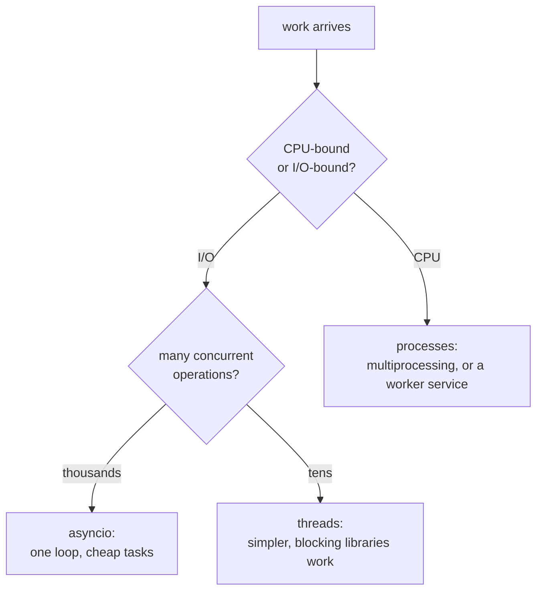

# The Python runtime

The chapter that decides whether you can defend Python in a backend interview.
The questions are always the same: what is the GIL, why is threading not what
you think, and when do you reach for async, threads or processes.

Get this right and Python's concurrency story is clear and defensible. Get it
wrong and you will say "Python is slow" without being able to say at what.

---

## In brief

- **The GIL means one thread executes Python bytecode at a time** in a process.
  Threads do not give you CPU parallelism; they give you concurrency for
  waiting.
- **The GIL is released during I/O** — a socket read, a disk read, a database
  call — so threads *are* effective for I/O-bound work, which is most of what a
  web service does.
- **CPU-bound work needs processes**, not threads: `multiprocessing` or a
  separate worker service, each with its own interpreter and its own GIL.
- **Async is single-threaded cooperative concurrency**: one event loop, tasks
  that yield at `await`. One blocking call anywhere in it stalls every request
  the process is serving — the most common async Python bug by a wide margin.
- **Never mix blocking calls into async code.** A synchronous database driver
  in an async handler converts a concurrent server into a serial one.
  `asyncio.to_thread` is the escape hatch.
- **Python 3.11+ is meaningfully faster**, and 3.13's free-threaded build is the
  beginning of the GIL's end — but it is not the default and not yet the
  answer in an interview.
- **Scale a service with processes**: multiple workers behind Gunicorn or
  Uvicorn, one per core, each handling many concurrent requests.

---

## The GIL

The Global Interpreter Lock is a mutex inside CPython that protects interpreter
state — primarily reference counts, which every object mutates constantly.
Without it, every reference count change would need its own lock, and the
single-threaded case would get slower.

**What it means in practice:**

```python
import threading, time

def burn():                       # CPU-bound: pure bytecode
    x = 0
    for _ in range(10_000_000):
        x += 1

# Two threads, two cores, and no speedup — they take turns holding the GIL.
t0 = time.perf_counter()
ts = [threading.Thread(target=burn) for _ in range(2)]
[t.start() for t in ts]; [t.join() for t in ts]
print(f"threads: {time.perf_counter() - t0:.1f}s")      # ~ same as running twice in series

# Two processes, two interpreters, two GILs — actual parallelism.
from multiprocessing import Process
t0 = time.perf_counter()
ps = [Process(target=burn) for _ in range(2)]
[p.start() for p in ps]; [p.join() for p in ps]
print(f"processes: {time.perf_counter() - t0:.1f}s")    # ~ half
```

**And what it does not mean.** The GIL is released around blocking I/O: while a
thread waits on a socket, a file or a database response, another thread runs.
So for a web service — which is overwhelmingly waiting — threads work.


*The only decision tree that matters. Getting the first branch wrong is why people say "Python can't do concurrency" — threads for CPU work genuinely cannot.*

---

## Threads

```python
from concurrent.futures import ThreadPoolExecutor

# Good: I/O-bound fan-out. Each thread spends its time waiting on a socket,
# with the GIL released, so they really do overlap.
with ThreadPoolExecutor(max_workers=16) as pool:
    results = list(pool.map(fetch_url, urls))
```

Threads are the right answer when the work is I/O-bound, the library you must
use is blocking (many database drivers and SDKs are), and the concurrency is in
the tens rather than the thousands. Each thread costs a real OS thread and
roughly 8MB of stack address space, so thousands of them is not a plan.

The usual hazards apply — shared mutable state needs a `threading.Lock`, and
"the GIL makes it safe" is false: the GIL protects interpreter internals, not
your invariants. `x += 1` across threads can still lose updates, because it is
several bytecodes.

---

## Processes

```python
from concurrent.futures import ProcessPoolExecutor

# CPU-bound: each worker is a separate interpreter with its own GIL.
with ProcessPoolExecutor(max_workers=4) as pool:
    results = list(pool.map(hash_password, passwords))
```

The costs are real and worth naming: arguments and results are **pickled** and
copied between processes, so passing large objects is expensive; start-up is
slow; and anything unpicklable (a lambda, an open connection) cannot cross the
boundary.

For a web service the usual shape is not `multiprocessing` inside a request —
it is **several worker processes behind one port**, which is what Gunicorn and
Uvicorn do, plus a separate queue-driven worker service for genuinely heavy
work.

---

## Async

```python
import asyncio, httpx

async def fetch(client: httpx.AsyncClient, url: str) -> int:
    r = await client.get(url, timeout=2.0)     # yields the loop while waiting
    return len(r.content)

async def main() -> None:
    async with httpx.AsyncClient() as client:
        # TaskGroup (3.11+) is the modern way: structured concurrency, and if
        # one task fails the others are cancelled rather than orphaned.
        async with asyncio.TaskGroup() as tg:
            tasks = [tg.create_task(fetch(client, u)) for u in urls]
        print(sum(t.result() for t in tasks))

asyncio.run(main())
```

**The model:** one thread, one event loop, many tasks. A task runs until it hits
`await` on something not yet ready, then yields; the loop runs another. This is
exactly Node's model, and the same caveat applies — see
[the Node runtime](../11-backend-nodejs/02-runtime-and-event-loop.md).

### The one bug that matters

```python
import time, requests

@app.get("/bad")
async def bad():
    time.sleep(1)                         # blocks the LOOP: every request waits
    return requests.get("https://x.com")  # blocking HTTP client: same problem

@app.get("/good")
async def good():
    await asyncio.sleep(1)                # yields
    async with httpx.AsyncClient() as c:  # async client
        return (await c.get("https://x.com", timeout=2.0)).text

@app.get("/unavoidable")
async def unavoidable():
    # Some library is blocking and has no async version. Push it to a thread so
    # the loop keeps serving everyone else.
    return await asyncio.to_thread(legacy_sdk.call, payload)
```

A single blocking call in an async handler does not slow that request — it
stalls **every** request the process is handling. A synchronous database driver
in an async endpoint is the most common performance bug in FastAPI services,
and it looks like "the framework is slow" rather than what it is.

### Async or threads?

| | Async | Threads |
| --- | --- | --- |
| Concurrency ceiling | Thousands of tasks, cheap | Tens to low hundreds |
| Library requirement | Must be async all the way down | Blocking libraries are fine |
| Failure mode | One blocking call stalls everything | Lock contention, races |
| Right for | Many concurrent I/O operations; websockets, fan-out | Moderate concurrency with blocking drivers |

The decisive question is usually the ecosystem: if the driver you must use is
blocking and has no async version, threads are the honest answer.

---

## Memory and performance

- **Reference counting plus a cycle collector.** Objects are freed as soon as
  their count hits zero, which makes memory use predictable, and a generational
  collector handles reference cycles.
- **Objects are expensive.** A Python int is an object with a header; a list of
  a million ints is far larger than a million machine words. `__slots__` or a
  `dataclass(slots=True)` removes the per-instance `__dict__` and is a real
  saving when there are many instances. `array` and NumPy exist for bulk
  numeric data.
- **The common speed-ups, in order of effect:** do less work (algorithmic), use
  the C-implemented standard library instead of hand-rolled loops, batch I/O,
  then move hot paths to a C-backed library. Micro-optimising Python loops is
  usually the least effective of these.
- **Python 3.11 was 10–60% faster** than 3.10 on real workloads and later
  versions continue. Upgrading the interpreter is the cheapest performance work
  available.

**Free-threaded Python.** 3.13 ships an optional build with the GIL removed.
It is not the default, has a single-threaded performance cost today, and the
ecosystem is still catching up — the right interview answer in 2026 is that it
exists, it is the long-term direction, and production systems still plan around
the GIL.

---

## How a Python service actually runs

```
                    ┌─ worker process 1 (uvicorn, its own event loop) ─┐
 load balancer ──▶ Gunicorn/Uvicorn master ─ worker 2 ─────────────────┤──▶ handlers
                    └─ worker 3, 4 … (one per core)                    ┘
```

```bash
# Development: one process, reload on change.
uvicorn app.main:app --reload

# Production: several worker processes, each an event loop.
gunicorn app.main:app -k uvicorn.workers.UvicornWorker -w 4 --timeout 30
```

**How many workers?** Start at the number of CPU cores (`2 × cores + 1` is the
traditional Gunicorn rule for blocking workers; for async workers, cores is a
better starting point since each handles many concurrent requests). Then
measure — the right number depends on whether your handlers wait or compute.

**Each worker is a separate process** with its own memory, so an in-process
cache is per worker, and anything that must be shared goes in Redis. In a
container, prefer **one worker per container** and scale with replicas, for the
reasons in
[containers, properly](../06-cloud-devops/06-containers.md).

---

## Building it

**Choosing, in one table**

| Workload | Use | Why |
| --- | --- | --- |
| HTTP handlers waiting on a database and other services | **async** (FastAPI) with async drivers | Thousands of concurrent waits on one loop |
| A blocking SDK with no async version | **threads** (`asyncio.to_thread`, or a sync framework) | Keeps the loop free |
| Hashing, image processing, parsing large files | **processes** or a queue worker | Real parallelism; the GIL is irrelevant across processes |
| Scheduled or long jobs | **A separate worker service** (Celery, RQ, or a queue consumer) | Never in the request path |

**Finding the blocking call that is stalling your loop**

```python
# asyncio's debug mode logs any callback that holds the loop too long — the
# fastest way to find the sync call hiding in an async handler.
import asyncio, logging
logging.basicConfig(level=logging.DEBUG)
asyncio.run(main(), debug=True)          # or PYTHONASYNCIODEBUG=1
# WARNING: Executing <Task ...> took 1.015 seconds
```

In production, the symptom is that **p99 latency rises across every endpoint at
once** while CPU is low — the same signature as event-loop lag in Node. Measure
loop lag directly: schedule a callback every 100ms and record how late it runs.

---

## Interview Q&A

### Q: What is the GIL, and what does it mean for a web service?
**Level:** senior · **Tags:** python, gil, concurrency

<details><summary>Model answer</summary>

It is a mutex in CPython that allows only one thread to execute Python bytecode
at a time in a process. It exists because reference counting is not atomic, and
fine-grained locking around every object would make the single-threaded case
slower.

The practical consequence is that threads give you no CPU parallelism: two
CPU-bound threads on two cores take about as long as running them one after the
other.

But — and this is the part people stop short of — the GIL is released during
blocking I/O. While a thread waits on a socket or a database, another thread
runs. A web service is overwhelmingly waiting, so threads are genuinely
effective for it, and so is asyncio, which does the same thing with cheaper
tasks on one thread.

So the rule I apply is: I/O-bound concurrency with async or threads, CPU-bound
work in separate processes — a process pool, or more usually a queue-driven
worker service — and scale the web tier by running several worker processes,
one per core, each with its own interpreter and its own GIL.

I would also mention that 3.13 has an optional free-threaded build without the
GIL. It is not the default, it costs single-threaded performance today, and the
ecosystem is catching up, so I would not plan a production system around it
yet.

</details>

**Follow-ups:**

1. Q: If the GIL makes only one thread run at a time, do you still need locks?
   <details><summary>Answer</summary>

   Yes. The GIL protects interpreter internals, not your invariants. It can be
   released between bytecodes, and `counter += 1` is several — load, add,
   store — so two threads can interleave and lose an update. Anything spanning
   more than one operation, or more than one object, needs a `Lock`.

   What the GIL does buy you is that you will not corrupt the interpreter's own
   structures, so a data race in Python produces a wrong number rather than a
   segfault.

   </details>

### Q: A FastAPI endpoint is slow under load, and every other endpoint gets slow at the same time. CPU is low. What is it?
**Level:** senior · **Tags:** python, asyncio, debugging

<details><summary>Model answer</summary>

Almost certainly a blocking call inside an async handler. One event loop per
worker process serves every concurrent request, so a synchronous call — a
blocking database driver, `requests` instead of `httpx`, `time.sleep`, a large
synchronous file read, a CPU-heavy loop — holds the loop and nothing else
progresses. The signature is exactly that: every endpoint degrades together
while CPU looks unremarkable, because the process is waiting, not computing.

How I would confirm it: run with `asyncio` debug mode, which logs callbacks
that take too long and names them; or measure event-loop lag directly by
scheduling a callback every 100ms and recording how late it fires.

The fixes, in order of preference. Use the async client for that dependency —
`httpx` rather than `requests`, `asyncpg` or SQLAlchemy's async engine rather
than a sync driver. If the library has no async version, wrap it in
`asyncio.to_thread` so it runs in a thread pool and the loop stays free. If the
work is genuinely CPU-bound, it does not belong in the request path at all —
push it to a process pool or a queue worker.

The trap to avoid is declaring the handler `def` instead of `async def` as a
"fix". FastAPI then runs it in a thread pool, which does unblock the loop, but
the pool is finite and it is a silent capacity limit rather than a decision.

</details>

### Q: When would you choose threads over asyncio in Python?
**Level:** intermediate · **Tags:** python, concurrency

<details><summary>Answer</summary>

When the libraries I have to use are blocking and have no async version, which
in practice is a lot of vendor SDKs and some database drivers. Async is
all-or-nothing down the call stack: one synchronous call in the middle of it
undoes the model, so if I cannot go async the whole way, threads are the honest
choice and a synchronous framework is simpler than fighting it.

I would also choose threads when the concurrency is modest — tens of
simultaneous operations rather than thousands — because a thread pool is easier
to reason about and debug than a loop, and stack traces are normal.

Asyncio wins when there are many concurrent waits: thousands of open
connections, websockets, large fan-outs. A task costs a few kilobytes where a
thread costs megabytes of stack, so the ceiling is completely different.

</details>

---

## What a weak answer sounds like

- **"Python can't do concurrency because of the GIL."** It cannot do CPU
  parallelism with threads; I/O concurrency is fine.
- **"Use threads to make it faster"** for CPU-bound work.
- **`requests` inside an async handler**, and no idea why throughput collapsed.
- **"The GIL makes my code thread-safe."** It protects the interpreter, not your
  invariants.
- **No answer for scaling** beyond one process.
- **Treating `def` vs `async def` in FastAPI as a style choice.**

---

## Quiz

### MCQ: Two CPU-bound threads on a two-core machine. What happens?
- [ ] They run in parallel and finish in about half the time
- [x] They take turns holding the GIL, so the total time is roughly the same as running them one after the other
- [ ] One thread is killed by the interpreter
- [ ] Performance improves only if they share no data
**Why:** Only one thread executes Python bytecode at a time. For actual CPU parallelism you need separate processes, each with its own interpreter and GIL.

### MCQ: Why are threads still useful in Python despite the GIL?
- [ ] The GIL only applies to the main thread
- [x] It is released during blocking I/O, so while one thread waits on a socket or database another runs — and a web service is mostly waiting
- [ ] Threads bypass the GIL when there are fewer than four of them
- [ ] It is released automatically every millisecond
**Why:** This is the distinction a weak answer misses: no CPU parallelism, but real I/O concurrency — which is what a service needs.

### MCQ: `time.sleep(1)` inside an `async def` FastAPI handler. What is the effect?
- [ ] Only that request waits one second
- [x] The entire event loop is blocked, so every concurrent request in that worker process waits — p99 rises across all endpoints while CPU stays low
- [ ] FastAPI detects it and moves the handler to a thread
- [ ] It raises a RuntimeError
**Why:** `await asyncio.sleep(1)` yields the loop; `time.sleep` does not. The same applies to any synchronous call — a blocking driver or HTTP client is the usual real-world version.

### MCQ: You must call a vendor SDK with no async version from an async handler. Best option?
- [ ] Call it directly; one call is not enough to matter
- [x] `await asyncio.to_thread(sdk.call, payload)` — it runs in a thread pool, the GIL is released during its I/O, and the loop keeps serving
- [ ] Rewrite the handler as a generator
- [ ] Spawn a new process per call
**Why:** A process per call is far too expensive for I/O; calling it directly stalls every concurrent request. Threads are exactly the escape hatch for a blocking library in an async service.

### MCQ: How do you scale a Python web service across CPU cores?
- [ ] Increase the thread pool size
- [x] Run multiple worker processes — Gunicorn or Uvicorn workers, roughly one per core — each with its own interpreter, GIL and event loop
- [ ] Enable the free-threaded build in production
- [ ] Use `multiprocessing` inside each request handler
**Why:** Processes are how Python gets parallelism. Each worker has separate memory, so in-process caches are per worker and shared state belongs in Redis.

### MCQ: What does `__slots__` (or `dataclass(slots=True)`) buy?
- [ ] Faster attribute type checking
- [x] It removes the per-instance `__dict__`, cutting memory per object and speeding attribute access — a real saving when there are many instances
- [ ] Thread safety for the instance
- [ ] Automatic serialisation
**Why:** Python objects carry meaningful overhead, so per-instance savings matter at scale. It is one of the few micro-optimisations with a reliable payoff.

---

## Glossary

- **GIL** — the lock allowing one thread to execute Python bytecode at a time; released during blocking I/O.
- **CPU-bound vs I/O-bound** — limited by computation versus by waiting; the first branch of every concurrency decision.
- **`asyncio` event loop** — single-threaded cooperative scheduler; tasks yield at `await`.
- **Blocking call** — one that does not yield the loop; in async code it stalls every concurrent request.
- **`asyncio.to_thread`** — runs a blocking function in a thread pool so the loop stays free.
- **`TaskGroup`** — structured concurrency (3.11+): children are cancelled if one fails.
- **`ProcessPoolExecutor` / `multiprocessing`** — real parallelism via separate interpreters; arguments are pickled.
- **Gunicorn / Uvicorn worker** — a worker process serving requests; the unit of CPU scaling for a Python service.
- **Reference counting + cycle collector** — Python's memory management; predictable frees, plus a collector for cycles.
- **`__slots__`** — removes the per-instance attribute dict, saving memory and time.
- **Free-threaded build** — the optional GIL-less CPython (3.13+); the direction, not yet the default.
