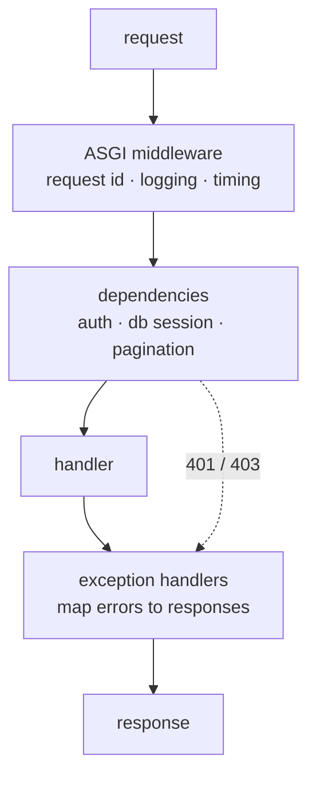

# Building the server

The same service as the Node track — `POST /links`, `GET /links/:id`,
`GET /healthz` — in Python. Same twelve steps, same order, so you can read the
two side by side and see what is a Python fact and what is a universal one.

FastAPI is the default choice here, and the chapter says why at the end rather
than at the start, because the point is to understand what a framework does
before picking one.

---

## In brief

- **WSGI is the synchronous Python server interface, ASGI the asynchronous
  one.** Every modern framework speaks ASGI, which is what makes websockets,
  streaming and async handlers possible at all.
- **A framework is a router, a middleware chain and a request/response wrapper**
  — the same three things as in any language. Writing them once with the
  standard library makes FastAPI legible rather than magic.
- **FastAPI's distinguishing feature is that validation comes from type
  hints.** One Pydantic model is the parser, the validator, the serialiser and
  the OpenAPI schema — which is why Python's "annotations do nothing at
  runtime" is only half true in a FastAPI service.
- **Middleware in ASGI wraps the whole request**; FastAPI *dependencies* are the
  finer-grained tool, and the one to use for authentication and per-route
  concerns.
- **Exception handlers are registered per exception type**, which gives you the
  single error mapper the Node chapter builds by hand.
- **`async def` and `def` handlers behave differently**: `def` runs in a thread
  pool. That is a capacity decision, not a style choice.
- **Graceful shutdown comes from the lifespan context manager** plus Uvicorn's
  signal handling — and it still needs the readiness-fails-first sequence.

---

## 1. The server with no framework

ASGI is an interface, not a library: an application is a callable taking three
arguments.

```python
# raw.py — run: uvicorn raw:app
import json

async def app(scope, receive, send):
    # `scope` is the request metadata: type, method, path, headers.
    # `receive` is an awaitable giving you body chunks.
    # `send` is an awaitable you push response events into.
    assert scope["type"] == "http"

    if scope["method"] == "GET" and scope["path"] == "/healthz":
        await send({"type": "http.response.start", "status": 200,
                    "headers": [(b"content-type", b"application/json")]})
        await send({"type": "http.response.body", "body": b'{"ok":true}'})
        return

    if scope["method"] == "POST" and scope["path"] == "/links":
        # The body arrives in chunks, and nothing bounds it for you — the size
        # check is the difference between a service and a denial of service.
        body, size = b"", 0
        while True:
            event = await receive()
            body += event.get("body", b"")
            size += len(event.get("body", b""))
            if size > 1_000_000:
                await send({"type": "http.response.start", "status": 413, "headers": []})
                await send({"type": "http.response.body", "body": b""})
                return
            if not event.get("more_body"):
                break
        payload = json.loads(body)
        await send({"type": "http.response.start", "status": 201,
                    "headers": [(b"content-type", b"application/json")]})
        await send({"type": "http.response.body",
                    "body": json.dumps({"id": "abc", "url": payload["url"]}).encode()})
        return

    await send({"type": "http.response.start", "status": 404, "headers": []})
    await send({"type": "http.response.body", "body": b""})
```

**WSGI vs ASGI**, because it is a real interview question: WSGI
(Flask, Django's classic path) is synchronous — one callable, one request, one
thread, no way to express a long-lived connection. ASGI adds async and an event
model, so websockets, server-sent events and streaming are expressible, and a
handler can await without occupying a thread. Everything modern is ASGI;
Django supports both.

---

## 2. Routing

```python
from fastapi import FastAPI, APIRouter

router = APIRouter(prefix="/links", tags=["links"])

@router.post("", status_code=201)
async def create_link(...): ...

@router.get("/{link_id}")
async def get_link(link_id: str): ...

app = FastAPI()
app.include_router(router)
```

Starlette (which FastAPI is built on) compiles each path into a regex with
named groups, exactly like the hand-rolled router in the Node chapter. Routers
exist so a feature's routes live in one module and are mounted with a prefix in
one place.

---

## 3. Middleware, and dependencies

Python gives you two tools where Node gives you one, and knowing which to reach
for is most of the design.


*Middleware wraps every request and knows nothing about routes; dependencies are per-route, typed, and can be overridden in tests. Authentication belongs in a dependency, request id in middleware.*

**Middleware** wraps the whole request/response cycle:

```python
import time, uuid, logging
from starlette.middleware.base import BaseHTTPMiddleware

class RequestContext(BaseHTTPMiddleware):
    async def dispatch(self, request, call_next):
        # First in the chain: everything after can log this id, and an inbound
        # one is honoured so a trace survives across services.
        rid = request.headers.get("x-request-id") or str(uuid.uuid4())
        request.state.request_id = rid
        started = time.perf_counter()
        try:
            response = await call_next(request)
        finally:
            logging.info("request", extra={
                "request_id": rid, "method": request.method,
                "path": request.url.path, "ms": round((time.perf_counter() - started) * 1000),
            })
        response.headers["x-request-id"] = rid
        return response

app.add_middleware(RequestContext)
```

**Order note, and it catches people:** `add_middleware` *prepends*, so the
middleware added last runs **first**. Write the list in one place with a
comment, or the ordering becomes accidental.

**Dependencies** are the per-route tool, and the better one for anything that
produces a value the handler needs:

```python
from fastapi import Depends, HTTPException, Header

async def current_user(authorization: str = Header(default="")) -> User:
    token = authorization.removeprefix("Bearer ").strip()
    if not token:
        raise UnauthorizedError("missing bearer token")
    claims = await verify_jwt(token)            # see step 6
    return User(id=claims["sub"], tenant_id=claims["tenant"], scopes=claims.get("scope", "").split())

def require_scope(scope: str):
    async def checker(user: User = Depends(current_user)) -> User:
        if scope not in user.scopes:
            raise ForbiddenError(scope)
        return user
    return checker

@router.post("", status_code=201)
async def create_link(body: CreateLink, user: User = Depends(require_scope("links:write"))):
    ...
```

Three things dependencies give you that middleware cannot: they are **typed**,
so the handler receives a `User` rather than fishing in `request.state`; they
**compose** (`require_scope` depends on `current_user`); and they can be
**overridden in tests** with `app.dependency_overrides`, which is the cleanest
injection story in any of the three languages here.

---

## 4. Validation

```python
from pydantic import BaseModel, HttpUrl, Field

class CreateLink(BaseModel):
    url: HttpUrl                                      # parsed and validated
    note: str | None = Field(default=None, max_length=280)

class LinkOut(BaseModel):
    id: str
    url: HttpUrl
    hits: int

@router.post("", status_code=201, response_model=LinkOut)
async def create_link(body: CreateLink, ...) -> LinkOut:
    # `body` is already validated. A 422 with field-level detail was returned
    # before this function ran — no `if` statements needed here.
    ...
```

This is FastAPI's whole argument. The annotation declares the contract, and
Pydantic turns it into a parser, a validator, an error response and an OpenAPI
schema. `response_model` also **filters the output**, so a field you did not
declare cannot leak — a password hash on the ORM object simply does not appear.

---

## 5. Errors: one mapper

```python
from fastapi import Request
from fastapi.responses import JSONResponse

class AppError(Exception):
    def __init__(self, message: str, status: int = 500, code: str = "internal"):
        super().__init__(message)
        self.message, self.status, self.code = message, status, code

class NotFoundError(AppError):
    def __init__(self, what: str): super().__init__(f"{what} not found", 404, "not_found")
class UnauthorizedError(AppError):
    def __init__(self, why: str): super().__init__(why, 401, "unauthorized")
class ForbiddenError(AppError):
    def __init__(self, scope: str): super().__init__(f"missing scope {scope}", 403, "forbidden")

@app.exception_handler(AppError)
async def app_error_handler(request: Request, exc: AppError):
    return JSONResponse(status_code=exc.status,
                        content={"error": exc.message, "code": exc.code})

@app.exception_handler(Exception)
async def unhandled(request: Request, exc: Exception):
    # The client gets nothing useful; the log gets everything, keyed by the id
    # the user can quote back to support.
    logging.exception("unhandled", extra={"request_id": request.state.request_id})
    return JSONResponse(status_code=500, content={
        "error": "internal error", "code": "internal",
        "request_id": request.state.request_id,
    })
```

Handlers raise meaning; exactly one place knows about HTTP status codes.

---

## 6. Authentication

```python
from jose import jwt                      # or: pyjwt
import httpx
from cachetools import TTLCache

_jwks = TTLCache(maxsize=1, ttl=3600)     # fetched once an hour, not per request

async def _get_jwks() -> dict:
    if "k" not in _jwks:
        async with httpx.AsyncClient(timeout=2.0) as c:
            _jwks["k"] = (await c.get(f"{settings.jwt_issuer}/.well-known/jwks.json")).json()
    return _jwks["k"]

async def verify_jwt(token: str) -> dict:
    try:
        return jwt.decode(
            token, await _get_jwks(),
            algorithms=["RS256"],         # pin it: never trust the token's own `alg`
            issuer=settings.jwt_issuer,   # a valid signature from the wrong
            audience=settings.jwt_audience,  # issuer is still the wrong token
        )
    except Exception:
        raise UnauthorizedError("invalid token")   # never echo the library's reason
```

Pinning the algorithm is not optional: accepting the token's own `alg` is the
`alg: none` and HS/RS confusion class of vulnerability, covered in
[JWT](../01-auth-identity/06-jwt.md).

---

## 7. Config, validated at startup

```python
from pydantic_settings import BaseSettings

class Settings(BaseSettings):
    environment: str = "development"
    port: int = 8000
    database_url: str                      # no default: required
    jwt_issuer: str
    jwt_audience: str
    log_level: str = "INFO"
    shutdown_grace_seconds: float = 10.0

    class Config:
        env_file = ".env"                  # development only; never in an image

settings = Settings()                      # raises at import, so the process
                                           # exits instead of failing on request 1
```

The same principle as every other track: a misconfigured version should never
become ready, so the old one keeps serving.

---

## 8. Persistence and the pool

```python
from sqlalchemy.ext.asyncio import create_async_engine, async_sessionmaker

# Async driver + async engine. A synchronous driver here would block the event
# loop on every query — the single most common FastAPI performance bug.
engine = create_async_engine(
    settings.database_url,          # postgresql+asyncpg://…
    pool_size=10,                   # per worker process…
    max_overflow=0,                 # …and no silent extra connections
    pool_timeout=2,                 # fail fast when exhausted
    pool_pre_ping=True,             # drop connections killed by a proxy or restart
)
Session = async_sessionmaker(engine, expire_on_commit=False)

# A dependency per request: one session, closed afterwards, overridable in tests.
async def db_session():
    async with Session() as session:
        yield session

@router.post("", status_code=201, response_model=LinkOut)
async def create_link(body: CreateLink, user: User = Depends(require_scope("links:write")),
                      session = Depends(db_session)) -> LinkOut:
    link = Link(id=make_id(), url=str(body.url), tenant_id=user.tenant_id)
    session.add(link)
    await session.commit()
    return link
```

**Pool size multiplies by worker count**: 4 Uvicorn workers × `pool_size=10` is
40 connections per container, times your replica count. The database's limit is
the budget (see
[the networking chapter](../02-interview-core/44-networking.md) §Connection
pooling).

---

## 9. Logging

```python
import logging, json, sys

class JsonFormatter(logging.Formatter):
    def format(self, record: logging.LogRecord) -> str:
        payload = {"level": record.levelname, "msg": record.getMessage(),
                   "logger": record.name, "time": self.formatTime(record)}
        for key in ("request_id", "method", "path", "ms", "status"):
            if hasattr(record, key):
                payload[key] = getattr(record, key)
        if record.exc_info:
            payload["exc"] = self.formatException(record.exc_info)
        return json.dumps(payload)

handler = logging.StreamHandler(sys.stdout)
handler.setFormatter(JsonFormatter())
logging.basicConfig(level=settings.log_level, handlers=[handler])
```

Log JSON to stdout and let the platform collect it. `structlog` does this with
less code if you prefer a library. Never log the authorization header, a token
or a password — redact at the formatter so one forgotten call site cannot leak
a credential.

---

## 10. Graceful shutdown

```python
from contextlib import asynccontextmanager

ready = False

@asynccontextmanager
async def lifespan(app: FastAPI):
    global ready
    await engine.connect()           # fail fast if the database is unreachable
    ready = True
    yield                            # ---- the app serves here ----
    ready = False                    # 1. fail readiness first
    await asyncio.sleep(5)           # 2. let the load balancer notice
    await engine.dispose()           # 3. close the pool after in-flight work

app = FastAPI(lifespan=lifespan)

@app.get("/healthz")                 # liveness: deliberately dumb
async def healthz(): return {"ok": True}

@app.get("/readyz")                  # readiness: may check dependencies
async def readyz():
    if not ready:
        raise HTTPException(status_code=503)
    return {"ok": True}
```

Uvicorn handles SIGTERM by stopping new connections and waiting for in-flight
requests (`--timeout-graceful-shutdown`), and the lifespan teardown runs after.
The five-second sleep is the part everyone omits — endpoint removal is
eventually consistent, so exiting immediately still drops requests.

---

## 11. Project layout

```
app/
  main.py              # create the app, include routers, lifespan. No logic.
  config.py            # Settings; raises at import if the env is wrong
  api/
    deps.py            # current_user, require_scope, db_session
    routes/links.py    # HTTP shape only
    middleware.py      # request id, logging — order in one list
    errors.py          # exception types + handlers
  domain/links.py      # the rules: no FastAPI import anywhere in here
  db/
    models.py          # SQLAlchemy models
    links_repo.py      # queries
  lib/logging.py
tests/
pyproject.toml
```

The rule that matters: **nothing in `domain/` imports FastAPI**. If it does,
the rules cannot be called from a Celery worker or a management command, and
they cannot be tested without constructing a request.

---

## 12. Tests

```python
import pytest
from httpx import AsyncClient, ASGITransport

@pytest.fixture
async def client():
    # dependency_overrides is FastAPI's killer testing feature: swap the real
    # database session and user for fakes, with no monkeypatching.
    app.dependency_overrides[db_session] = lambda: InMemorySession()
    app.dependency_overrides[current_user] = lambda: User(id="u1", tenant_id="t1", scopes=["links:write"])
    transport = ASGITransport(app=app)              # no network, no port
    async with AsyncClient(transport=transport, base_url="http://test") as c:
        yield c
    app.dependency_overrides.clear()

async def test_create_link_returns_201(client):
    r = await client.post("/links", json={"url": "https://example.com"})
    assert r.status_code == 201
    assert r.json()["url"].startswith("https://")

async def test_invalid_url_is_422_with_field_detail(client):
    r = await client.post("/links", json={"url": "nope"})
    assert r.status_code == 422
    assert r.json()["detail"][0]["loc"][-1] == "url"

async def test_missing_scope_is_403_and_does_not_touch_the_repo(client, repo):
    app.dependency_overrides[current_user] = lambda: User(id="u1", tenant_id="t1", scopes=[])
    r = await client.post("/links", json={"url": "https://example.com"})
    assert r.status_code == 403
    assert repo.saved == []            # the assertion that tests the ordering
```

---

## Choosing the framework

| | **FastAPI** | **Flask** | **Django** |
| --- | --- | --- | --- |
| Interface | ASGI (async-native) | WSGI (ASGI possible) | Both |
| Validation | Built in, from type hints | Bring your own | Forms / DRF serializers |
| Batteries | Deliberately few | Few | ORM, admin, auth, migrations |
| Docs | OpenAPI generated free | Add-on | DRF generates |
| Best for | JSON APIs, async I/O, typed teams | Small services, full control | Content-heavy apps, fast CRUD with an admin |

**Default to FastAPI for a JSON API.** Choose Django when you want the ORM,
migrations, auth and admin out of the box and the app is more than an API.
Choose Flask when the service is small and you want to decide everything —
the same argument as Express in the Node track.

---

## Interview Q&A

### Q: What is the difference between WSGI and ASGI, and why does it matter?
**Level:** intermediate · **Tags:** python, asgi, frameworks

<details><summary>Model answer</summary>

WSGI is the synchronous interface Python web frameworks standardised on: a
callable that takes an environment and returns a response, one request at a
time, occupying a thread for the duration. It has no vocabulary for anything
long-lived, so websockets and server-sent events cannot be expressed in it, and
a handler that waits on I/O holds its thread while waiting.

ASGI is the async successor. An application is a callable taking a scope, a
receive channel and a send channel, which makes the request an event stream
rather than a single call. That gives you three things: async handlers that
yield the loop while waiting rather than holding a thread, long-lived
connections like websockets, and streaming responses.

In practice: Flask is WSGI, FastAPI and Starlette are ASGI, and Django supports
both. If a service is I/O-bound and concurrent, ASGI lets one process handle
thousands of in-flight requests where WSGI would need a thread each.

</details>

### Q: Why does FastAPI care about type hints when Python ignores them at runtime?
**Level:** intermediate · **Tags:** python, fastapi, validation

<details><summary>Model answer</summary>

Because FastAPI reads them itself. The interpreter ignores annotations, but
FastAPI introspects the signature and uses it to decide what each parameter is —
a path parameter, a query parameter, the request body, a dependency — and hands
the body's annotation to Pydantic, which builds a validator from it.

So one model declaration produces four things: runtime parsing and validation,
a 422 with field-level errors before the handler runs, the static type the
handler receives, and the OpenAPI schema and documentation. They cannot drift,
because they all come from the same source.

`response_model` is the part worth calling out separately, because it is a
security control as well as a convenience: the response is filtered to the
declared fields, so an ORM object carrying a password hash or an internal flag
cannot leak just because someone returned it directly.

</details>

### Q: When do you use FastAPI middleware versus a dependency?
**Level:** senior · **Tags:** python, fastapi, design

<details><summary>Model answer</summary>

Middleware for things that apply to every request and are about the
request/response envelope: request id, structured access logging and timing,
CORS, compression, a global catch. It runs outside routing, so it has no idea
which endpoint was hit and cannot return a typed value.

Dependencies for anything that produces a value a handler needs, or that
applies to a subset of routes: authentication, authorization, a database
session, pagination parameters, feature flags. They are typed, so the handler
receives a `User` rather than reaching into `request.state` for an untyped
blob; they compose, so a scope check can depend on the authenticated user; and
they can be overridden in tests with `dependency_overrides`, which is the
cleanest injection mechanism of the three languages.

The ordering gotcha I would mention: `add_middleware` prepends, so the last one
added runs first. That surprises people, and the fix is to declare the list in
one place with a comment rather than scattering calls around.

</details>

### Q: What does declaring a FastAPI handler `def` instead of `async def` change?
**Level:** senior · **Tags:** python, fastapi, concurrency

<details><summary>Answer</summary>

FastAPI runs a `def` handler in a thread pool rather than on the event loop, so
blocking calls inside it do not stall other requests. That makes it the correct
choice when the handler must use a blocking library — a synchronous database
driver or a vendor SDK with no async version.

An `async def` handler runs directly on the loop, which is right when every
call inside it is awaitable. If it contains a blocking call, it holds the loop
and every concurrent request in that worker waits.

The reason it is a capacity decision rather than a style one: the thread pool
is finite — a few dozen threads — so `def` handlers have a concurrency ceiling
that async handlers do not. Make everything `def` and you have quietly capped
throughput; make a blocking handler `async def` and you have stalled the
server. The honest answer is to pick per handler based on what it calls, and to
prefer async libraries so the question rarely arises.

</details>

---

## What a weak answer sounds like

- **A synchronous database driver in an `async def` handler**, and surprise at
  the throughput.
- **Validation with `if` statements in the handler** when the framework does it
  from the annotation.
- **No `response_model`**, returning ORM objects straight out.
- **`except Exception` per route** instead of one exception handler.
- **Reading `os.environ` at point of use**, so a missing value fails at request
  time rather than startup.
- **Not knowing the difference between middleware and a dependency.**
- **No readiness endpoint**, or readiness and liveness being the same.

---

## Quiz

### MCQ: What does ASGI provide that WSGI cannot?
- [ ] Faster JSON serialisation
- [x] Async handlers that yield while waiting, plus long-lived connections like websockets and streaming — because the request is an event stream rather than a single synchronous call
- [ ] Automatic request validation
- [ ] Built-in dependency injection
**Why:** Under WSGI a waiting request occupies a thread and there is no vocabulary for a connection that outlives one request/response pair. That is why every modern Python framework is ASGI.

### MCQ: A `CreateLink` Pydantic model is the body annotation and a client posts `{"url": 42}`. What happens?
- [ ] The handler runs with `url` as the integer 42
- [x] FastAPI returns 422 with field-level detail before the handler runs — Pydantic built a validator from the annotation
- [ ] The value is coerced to `"42"` and the handler runs
- [ ] A 500 from an unhandled `TypeError`
**Why:** This is where "type hints do nothing at runtime" stops being the whole story: the interpreter ignores them, but FastAPI and Pydantic read them and generate real validation, error responses and the OpenAPI schema.

### MCQ: Where does authentication belong in a FastAPI service?
- [ ] In middleware, so it applies to every request automatically
- [x] In a dependency — it is typed, composable with an authorization check, scoped to the routes that need it, and overridable in tests
- [ ] In each handler's first few lines
- [ ] In the ASGI server configuration
**Why:** Middleware is right for the envelope — request id, access logs, CORS. A dependency produces a typed `User` the handler receives as a parameter, and `dependency_overrides` makes testing trivial.

### MCQ: `app.add_middleware(A)` then `app.add_middleware(B)`. Which runs first?
- [ ] A, because it was added first
- [x] B — `add_middleware` prepends, so the most recently added middleware is outermost and runs first
- [ ] They run concurrently
- [ ] Order is determined by class name
**Why:** It is the opposite of the intuition from Express, and it is why the middleware list belongs in one place with a comment rather than scattered across modules.

### MCQ: Why does `response_model` matter beyond documentation?
- [ ] It makes serialisation faster
- [x] It filters the response to the declared fields, so an internal field on an ORM object — a password hash, an internal flag — cannot leak just because a handler returned the object directly
- [ ] It validates the request body
- [ ] It enables async serialisation
**Why:** It is an output contract, which makes it a security control as much as a documentation one. The equivalent in other stacks has to be written by hand.

### MCQ: A FastAPI service uses a synchronous Postgres driver inside `async def` handlers. What is the symptom under load?
- [ ] Connection pool exhaustion only
- [x] Every endpoint slows together while CPU stays low — each query blocks the single event loop in that worker, so concurrency collapses to one request at a time
- [ ] Requests fail with 500s immediately
- [ ] Only the database-backed endpoints are affected
**Why:** The giveaway is that unrelated endpoints degrade too. Fix it with an async driver, or `asyncio.to_thread`, or by declaring the handler `def` so it runs in the thread pool.

---

## Glossary

- **WSGI / ASGI** — the synchronous and asynchronous Python web server interfaces.
- **Starlette** — the ASGI toolkit FastAPI is built on; routing, middleware, responses.
- **Uvicorn / Gunicorn** — the ASGI server, and the process manager usually running several of them.
- **Pydantic model** — a class whose annotations become a runtime validator, serialiser and schema.
- **`response_model`** — the declared output shape; filters the response and prevents field leakage.
- **Dependency (`Depends`)** — a typed, composable, per-route injected value; the place for auth and sessions.
- **`dependency_overrides`** — swapping dependencies for fakes in tests.
- **Exception handler** — a registered mapper from an exception type to a response; the single error boundary.
- **Lifespan** — the async context manager running startup and shutdown around the serving phase.
- **`pool_pre_ping`** — validating a pooled connection before use, so a connection killed by a proxy does not surface as a request error.
