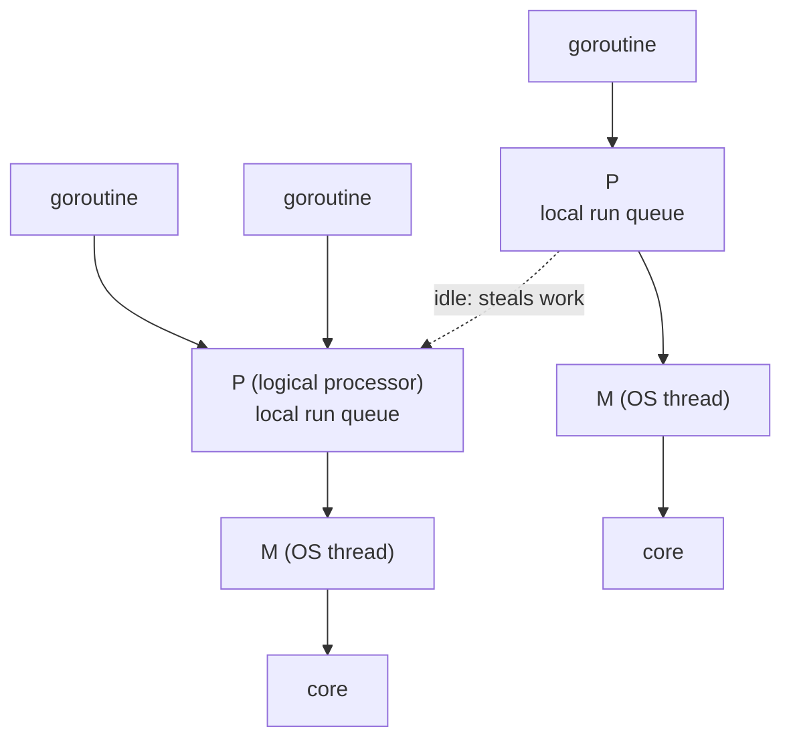

# The Go runtime

The part of Go that is actually different: goroutines, the scheduler that runs
them, channels and `select`, `context` for cancellation, and a garbage
collector tuned for latency rather than throughput.

This is where Go earns its place in a backend stack. The language from the
previous chapter is small and quickly learned; the runtime is what makes a Go
service handle a hundred thousand concurrent connections on a handful of
threads, and what you will be asked about.

> **A note on claiming Go.** Listing a language invites a question in it, and
> "I've used it a little" *after* listing it beside your main language reads
> worse than not listing it at all. Either prepare it properly — this chapter
> and the next two — or scope it honestly: *"I've used Go for X; my production
> depth is in Y, and I'd be productive in a Go codebase within a few weeks."*
> Confident scoping beats bluffing, which the first real follow-up finds.

---

## In brief

- **A goroutine is not a thread.** It starts at ~2KB of growable stack and is
  scheduled by Go's runtime, so hundreds of thousands are routine where OS
  threads would have died at a few thousand.
- **The scheduler is M:N** — many goroutines multiplexed onto few OS threads.
  When a goroutine blocks on I/O the thread picks up another, so threads are
  never idle waiting.
- **Go has real parallelism**, unlike Node and single-process Python: CPU-bound
  work runs on every core by default (`GOMAXPROCS`). That is the honest reason
  to reach for Go alongside a Node or Python stack.
- **Channels are for ownership transfer, not for every variable.** "Share
  memory by communicating" is the slogan, but a `sync.Mutex` around a map is
  often the simpler and faster answer, and idiomatic.
- **`context.Context` is the cancellation and deadline mechanism**, passed
  explicitly as the first parameter, and it is how a client disconnect
  propagates all the way down to a database query.
- **A goroutine leak is Go's memory leak**: one blocked forever on a channel
  nobody will write to, usually because a cancellation path was forgotten.
- **The GC is a concurrent mark-sweep tuned for short pauses** — sub-millisecond
  typically — and it is tuned by reducing allocation, not by fiddling with
  knobs.

## Goroutines and the scheduler

### Goroutines

A goroutine is a function running concurrently, managed by Go's runtime rather
than the OS. They start at ~2KB of stack and grow, so hundreds of thousands are
fine — OS threads would die long before.

```go
go doSomething()        // starts a goroutine, returns immediately
```

The runtime multiplexes many goroutines onto few OS threads (the M:N
scheduler). That's why Go handles concurrency well without callbacks or async
syntax.

**Compared to Node:** Node has one thread and an event loop, so concurrency is
cooperative and CPU work blocks everything. Go has real parallelism across
cores, so CPU-bound work is genuinely a different story — which is the honest
reason to reach for Go alongside Node.

Both handle high concurrency; only Go gets parallelism for free. That's why Go
is the usual answer for CPU-bound services and Node is fine for I/O-bound ones.

When a goroutine blocks on I/O the scheduler puts another one on that thread,
so the thread is never idle. That plus the tiny growable stack is why hundreds
of thousands of goroutines are fine where OS threads would die.

### Channels

Typed pipes for passing values between goroutines.

```go
ch := make(chan int)      // unbuffered — send blocks until someone receives
ch := make(chan int, 10)  // buffered — send blocks only when full

ch <- 42                  // send
v := <-ch                 // receive
```

The slogan: **"Don't communicate by sharing memory; share memory by
communicating."** Pass ownership of data through a channel instead of guarding
it with a mutex.

`select` waits on several channels at once — this is how timeouts and
cancellation are done:

```go
select {
case v := <-ch:
    use(v)
case <-time.After(time.Second):
    return errors.New("timeout")
}
```

### Context

`context.Context` carries cancellation, deadlines and request-scoped values
through a call chain. **It's the first parameter of essentially every
Go function that does I/O**, and using it correctly is a strong signal.

```go
func GetUser(ctx context.Context, id string) (*User, error)
```

When a request is cancelled, the context cancels, and every downstream call
using it stops. That's deadline propagation built into the language.

### The common bugs

**Goroutine leaks** — a goroutine blocked forever on a channel nobody will
write to. It never exits, and its memory is never freed. The usual cause is
forgetting a cancellation path.

**Data races** — two goroutines touching the same variable without
synchronisation. Go ships a race detector (`go test -race`); use it.

**The loop variable gotcha** — in Go before 1.22, `for i := range x { go f(i) }`
shared one variable across iterations, so goroutines often saw the last value.
Go 1.22 changed loop variables to be per-iteration, which fixed it. Knowing
both the bug and that it was fixed is a nice signal.

### The scheduler, concretely


*G-M-P: goroutines queue on logical processors, each bound to an OS thread on a core. An idle P steals from a busy one, which is why load spreads without you doing anything.*

- **G** is a goroutine, **M** is an OS thread, **P** is a logical processor
  holding a run queue. The number of `P`s is `GOMAXPROCS`, which defaults to
  the number of cores.
- **Work stealing**: an idle `P` takes goroutines from a busy one's queue, so
  uneven work distributes itself.
- **When a goroutine blocks on a syscall**, its `M` is handed off and the `P`
  picks up another thread, so a blocking file or network call does not idle a
  core.
- **Preemption is asynchronous** since Go 1.14: a goroutine in a tight loop
  with no function calls can still be interrupted, which fixed a class of
  "one goroutine starves the scheduler" bugs.

**`GOMAXPROCS` in a container is the trap.** The runtime reads the machine's
core count, not the cgroup CPU limit — so a pod limited to 500m CPU on a
64-core node still creates 64 `P`s, producing heavy context switching and
throttling. Set `GOMAXPROCS` from the limit, or use `automaxprocs`, which does
it for you. This is one of the highest-value Go production facts there is.

### Synchronisation, beyond channels

"Share memory by communicating" is the slogan, but the standard library's
primitives are idiomatic too, and often simpler:

```go
// A mutex around shared state is normal Go, not a failure to use channels.
type Counter struct {
    mu sync.Mutex
    n  map[string]int
}

func (c *Counter) Inc(key string) {
    c.mu.Lock()
    defer c.mu.Unlock()          // defer makes "always unlock" automatic
    c.n[key]++
}

// sync.RWMutex when reads vastly outnumber writes.
// sync.Once for one-time initialisation, which is the right way to build a
// lazily-created client without a race.
var once sync.Once
var client *http.Client
func Client() *http.Client {
    once.Do(func() { client = &http.Client{Timeout: 2 * time.Second} })
    return client
}

// errgroup: the usual way to fan out, collect the first error, and cancel the
// rest — structured concurrency without writing it yourself.
g, ctx := errgroup.WithContext(ctx)
for _, u := range urls {
    g.Go(func() error { return fetch(ctx, u) })
}
if err := g.Wait(); err != nil { return err }
```

**The rule of thumb**: a channel when you are transferring ownership of a value
or coordinating a pipeline; a mutex when you are protecting shared state. Using
a channel as a lock is a common beginner pattern and it is slower and harder to
read.

### The garbage collector

A concurrent mark-sweep collector tuned for **short pauses** rather than
maximum throughput: stop-the-world phases are typically under a millisecond,
and the marking work runs alongside your goroutines.

- **`GOGC`** (default 100) sets how much the heap may grow before the next
  cycle — 100 means collect when the heap doubles. Higher means fewer
  collections and more memory.
- **`GOMEMLIMIT`** (1.19+) is a soft memory ceiling, and it is the knob that
  matters in a container: set it a little under the pod's memory limit and the
  GC works harder as you approach it, instead of the kernel OOM-killing you.
- **The real tuning is allocating less.** Preallocate slices with `make([]T, 0,
  n)`, reuse buffers with `sync.Pool` on genuinely hot paths, avoid `interface{}`
  boxing in loops, and prefer value types where they do not escape.
- **Escape analysis** decides stack versus heap at compile time. `go build
  -gcflags='-m'` tells you why a variable escaped, which is how you find the
  accidental allocation in a hot loop.

## Building it

Consistent with "If you're scoping it honestly": don't reach for a library
list here you can't back up. The standard library covers most of what
gets asked (`net/http`, `context`, `sync`) — naming a third-party router
(`gin`, `chi`) only if the interviewer asks how you'd structure a larger
service, not unprompted.

**Pseudocode — a goroutine leak, and the fix from "The common bugs"**

```go
// leaks: nothing ever reads from ch if the caller stops waiting
func fetch() <-chan int {
    ch := make(chan int)
    go func() { ch <- expensiveCall() }()
    return ch
}

// fixed: buffered channel, or a context that cancels the goroutine
func fetch(ctx context.Context) <-chan int {
    ch := make(chan int, 1)
    go func() {
        select {
        case ch <- expensiveCall():
        case <-ctx.Done():
        }
    }()
    return ch
}
```

---

## Interview Q&A

### Q: What's the difference between a goroutine and a thread?
**Level:** intermediate · **Tags:** golang, concurrency

<details><summary>Model answer</summary>

A goroutine is managed by the Go runtime, not the operating system. It starts
with about 2KB of stack that grows as needed, where an OS thread reserves
megabytes. So you can run hundreds of thousands of goroutines, which you
absolutely could not do with threads.

The runtime multiplexes them onto a smaller number of OS threads — an M:N
scheduler. When a goroutine blocks on I/O, the scheduler moves another one onto
that thread rather than leaving it idle.

Switching between goroutines is also much cheaper, because it happens in user
space and doesn't need a kernel context switch.

The comparison I'd draw to what I know best: Node gives you concurrency on one
thread through an event loop, so CPU-bound work blocks everything. Go gives you
real parallelism across cores with cheap concurrency on top. That's the honest
reason to pick Go for CPU-heavy services even in a mostly-Node stack.

</details>

**Follow-ups:**

1. Q: What's a goroutine leak?
   <details><summary>Answer</summary>

   A goroutine that never finishes — usually blocked forever sending to or
   receiving from a channel that nothing will ever touch again.

   It's a leak because the goroutine and everything it references stay alive,
   so memory grows steadily. And unlike a crash it's silent: the service just
   gets slowly heavier until it's restarted or dies.

   The usual cause is a missing cancellation path — you start a goroutine to do
   some work, the caller returns early on an error, and nobody tells the
   goroutine to stop.

   The fix is `context`: pass a context in, and have the goroutine `select` on
   `ctx.Done()` alongside its real work, so cancellation always has a route
   out. Buffered channels also help where a send might otherwise block with no
   receiver.

   You can spot them by watching the goroutine count over time — if it only
   ever goes up, something isn't exiting.

   </details>

2. Q: When would you pick Go over Node?
   <details><summary>Answer</summary>

   CPU-bound work is the clearest case. Node runs your code on one thread, so
   heavy computation blocks everything; Go runs it in parallel across cores
   without any special handling.

   Also: services where predictable latency matters, since Go's GC pauses are
   short and tuned for that; single-binary deployment, which makes containers
   tiny and removes runtime dependencies; and long-lived connection handling at
   very high counts, where goroutines-per-connection is a genuinely simple
   model.

   Node stays better for I/O-heavy services where the ecosystem matters, for
   sharing code and types with a TypeScript frontend, and simply where the team
   is already fluent — team familiarity is a real engineering factor, not a
   cop-out.

   I'd be straightforward that my production depth is in Node; the auth
   platform work was all Node and NestJS. I can work in Go, and I'd want a bit
   of ramp-up time before claiming otherwise.

   </details>

### Q: What is `context` used for?
**Level:** intermediate · **Tags:** golang, context, cancellation

<details><summary>Model answer</summary>

It carries cancellation, deadlines and request-scoped values through a call
chain, and it's conventionally the first argument to any function that does
I/O.

The main use is cancellation. When an HTTP request is cancelled — the client
disconnected, or a deadline passed — the context cancels, and every downstream
call that received it can stop immediately. Without that, work carries on
producing a result nobody will read, which under load is a meaningful waste.

`context.WithTimeout` gives you deadline propagation for free: set a budget at
the top, and every layer below inherits the *remaining* time rather than
starting a fresh timer. That's exactly the deadline-propagation pattern you'd
otherwise have to build by hand.

It also carries request-scoped values like a trace id or the authenticated
user — though the convention is to use that sparingly, for things genuinely
scoped to the request, not as a general-purpose bag.

The rule people repeat: don't store a context in a struct, pass it explicitly.
That keeps the cancellation path visible.

</details>

---

### Q: Your Go service is in a container with a 500m CPU limit on a 64-core node, and it performs badly. Why?
**Level:** senior · **Tags:** golang, runtime, containers

<details><summary>Model answer</summary>

Almost certainly `GOMAXPROCS`. The runtime sets it from the machine's visible
core count, not from the cgroup CPU limit, so the process creates 64 logical
processors and happily schedules 64 goroutines in parallel — on a budget of
half a core. The result is constant context switching and CFS throttling: the
process is stopped for the rest of each scheduling period once it exhausts its
quota, which shows up as latency spikes with no obvious cause in the
application.

The fix is to set `GOMAXPROCS` from the limit, either explicitly in the
manifest or with `automaxprocs`, which reads the cgroup and sets it at startup.

The same class of problem applies to memory: the GC sizes its heap target
against `GOGC` with no knowledge of the container's memory limit, so it can
grow past the limit and get OOM-killed. `GOMEMLIMIT` set a little below the
pod's limit makes the collector work harder as it approaches, which turns a
hard kill into degraded throughput.

Both are about the same root cause — the runtime sees the machine, the
orchestrator enforces the cgroup — and they are the two things I would check
first on any Go service that behaves worse in Kubernetes than on a laptop.

</details>

### Q: When do you use a channel and when a mutex?
**Level:** intermediate · **Tags:** golang, concurrency

<details><summary>Answer</summary>

A channel when I am transferring ownership of a value or coordinating a
pipeline — a work queue feeding a pool of workers, results flowing back,
fan-out and fan-in. The value moves from one goroutine to another and only one
owns it at a time, which is what "share memory by communicating" actually
means.

A mutex when I am protecting shared state that several goroutines read and
write in place — a cache, a counter map, a connection registry. That is normal,
idiomatic Go, not a failure to use channels. `sync.RWMutex` when reads vastly
outnumber writes, and `sync.Once` for one-time initialisation.

Using a channel as a lock — a buffered channel of size one that goroutines
take a token from — is a pattern people reach for to be idiomatic, and it is
slower and harder to read than the mutex it replaces.

For fan-out with error handling I would reach for `errgroup`: it gives
structured concurrency, cancels the remaining work when one task fails, and
returns the first error, which is a lot of correctness for three lines.

</details>

---

## What a weak answer sounds like

- **"Goroutines are lightweight threads"** and nothing more. Say *why* —
  user-space scheduling, small growable stacks.
- **Not knowing about `context`.** It's in every real Go codebase.
- **Claiming Go depth you don't have.** The follow-up finds it, and it damages
  everything else you said.
- **Not knowing the loop variable gotcha**, or that Go 1.22 fixed it.

---

## Quiz

### MCQ: What's the main structural difference between a goroutine and an OS thread?
- [ ] Goroutines can only run on a single CPU core
- [x] A goroutine starts with a tiny (~2KB) growable stack managed by the Go runtime, versus megabytes reserved for an OS thread — enabling hundreds of thousands of goroutines
- [ ] Goroutines require explicit thread pool configuration
- [ ] OS threads are managed by the Go runtime as well
**Why:** This size difference plus user-space scheduling (no kernel context switch) is why goroutine-per-connection scales to numbers that would exhaust OS threads.

### MCQ: What does Go's M:N scheduler actually do?
- [ ] It limits the program to exactly N goroutines at a time
- [x] It multiplexes many goroutines (M) onto a smaller number of OS threads (N), moving another goroutine onto a thread whenever one blocks on I/O
- [ ] It creates one OS thread per goroutine
- [ ] It's a memory allocation strategy, unrelated to concurrency
**Why:** This is what lets Go handle massive goroutine counts efficiently — a blocked goroutine doesn't leave its OS thread idle, since the scheduler moves other work onto it.

### MCQ: What's the key difference between how Node and Go handle CPU-bound work?
- [ ] They handle it identically; both block on CPU work
- [x] Node's single thread means CPU-bound work blocks everything else; Go can run CPU-bound work genuinely in parallel across multiple cores
- [ ] Go is single-threaded like Node but with a faster JIT compiler
- [ ] Node handles CPU-bound work better than Go
**Why:** This is the honest, specific reason to reach for Go for CPU-heavy services alongside a Node stack — not a vague "faster," but genuine multi-core parallelism versus a single JS thread.

### MCQ: What is a "goroutine leak"?
- [ ] A goroutine that runs too many times
- [x] A goroutine blocked forever on a channel operation that will never complete, keeping it and everything it references alive indefinitely
- [ ] A memory allocation that exceeds the configured heap size
- [ ] A goroutine that panics without being recovered
**Why:** Unlike a crash, this is silent — the process just gets steadily heavier as leaked goroutines accumulate, usually because a cancellation path (via `context`) was never wired in.

### MCQ: How does `context.WithTimeout` give "deadline propagation" for free?
- [ ] It automatically retries failed operations with backoff
- [x] A budget set at the top of a call chain is inherited by every downstream call as the *remaining* time, rather than each layer starting a fresh independent timer
- [ ] It converts all errors into timeouts automatically
- [ ] It only affects the top-level function, not downstream calls
**Why:** This is exactly the deadline-propagation pattern that has to be built by hand in many other languages — passing a context through the call chain gives it automatically.

### MCQ: Why is passing `context.Context` explicitly as a function parameter preferred over storing it in a struct?
- [ ] Structs in Go cannot hold interface values
- [x] Explicit passing keeps the cancellation path visible at every call site, rather than hidden inside object state
- [ ] Storing context in a struct causes a compile error
- [ ] It's purely a stylistic preference with no functional difference
**Why:** The convention exists specifically so a reader can see, at each function signature, that cancellation and deadlines flow through — hiding it in a struct obscures that.

### MCQ: Before Go 1.22, what was the "loop variable gotcha" with code like `for i := range x { go f(i) }`?
- [ ] `f` would never actually be called
- [x] All goroutines shared the same loop variable, so they often ended up seeing its final value rather than the value at the time each goroutine was launched
- [ ] The loop would run infinitely
- [ ] This was never actually a bug — it's a common misconception
**Why:** Go 1.22 changed loop variables to be scoped per-iteration, fixing this — knowing both the historical bug and that it's fixed is a useful, specific signal of real Go experience.

### MCQ: What should trigger `panic` in idiomatic Go code, according to this chapter?
- [ ] Any error that a caller should handle
- [x] Only genuinely unrecoverable situations — not ordinary control flow, which should use returned error values instead
- [ ] Input validation failures
- [ ] Any function that might fail
**Why:** Using `panic` for expected failure conditions (bad input, not-found, etc.) misuses the mechanism — Go's idiom is that ordinary, expected errors are values returned and checked, not exceptions thrown.

---

### MCQ: A Go service in a pod limited to 500m CPU on a 64-core node has unexplained latency spikes. First thing to check?
- [ ] The garbage collector's `GOGC` value
- [x] `GOMAXPROCS` — the runtime reads the machine's core count, not the cgroup limit, so it creates 64 logical processors on half a core's budget and suffers context switching and CFS throttling
- [ ] The number of open file descriptors
- [ ] Whether channels are buffered
**Why:** Set it from the limit, or use `automaxprocs`. The memory equivalent is `GOMEMLIMIT`, which makes the GC work harder near the pod's limit instead of being OOM-killed.

### MCQ: You are protecting a shared map read and written by many goroutines. What is idiomatic?
- [ ] A channel used as a lock, since Go prefers communication
- [x] A `sync.Mutex` (or `RWMutex` if reads dominate) with `defer` to unlock — protecting shared state with a mutex is normal Go; channels are for transferring ownership
- [ ] A global variable with atomic reads only
- [ ] One goroutine per key
**Why:** "Share memory by communicating" applies to moving values between goroutines. Using a buffered channel as a mutex is slower and harder to read than the mutex it replaces.


---

## Glossary

- **Goroutine** — a runtime-scheduled concurrent function; ~2KB to start.
- **Channel** — a typed pipe between goroutines.
- **`select`** — wait on several channels; how timeouts are written.
- **`context.Context`** — cancellation, deadlines and request values.
- **M:N scheduler** — many goroutines onto few OS threads.
- **Race detector** — `go test -race`, finds unsynchronised access.
- **Goroutine leak** — one blocked forever; memory grows silently.
- **`%w`** — wraps an error, preserving the chain for `errors.Is`/`As`.
- **G-M-P** — goroutine, OS thread and logical processor; the scheduler's three objects.
- **`GOMAXPROCS`** — the number of logical processors; defaults to machine cores and must be set from the cgroup limit in a container.
- **Work stealing** — an idle processor taking goroutines from a busy one's queue.
- **`GOGC` / `GOMEMLIMIT`** — heap growth target, and the soft memory ceiling that keeps a container from being OOM-killed.
- **Escape analysis** — the compiler deciding stack versus heap; `-gcflags='-m'` explains its choices.
- **`errgroup`** — structured fan-out with cancellation and first-error propagation.
- **`sync.Once`** — guaranteed one-time initialisation without a race.
