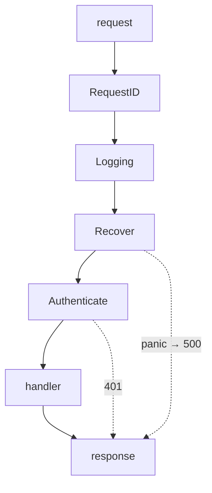

# Building the server

The same service once more — `POST /links`, `GET /links/:id`, `GET /healthz` —
in Go. The twelve steps are identical to the Node and Python tracks; what
changes is how much of it the standard library already does.

Go's distinguishing feature here: `net/http` in the standard library is a
production-grade server. You can ship with no framework at all, and many teams
do. The middleware pattern is a one-line type, which is why Go middleware
composes so cleanly.

---

## In brief

- **`net/http` is enough.** The standard library gives you a server, a router
  (improved substantially in Go 1.22 with method and wildcard patterns),
  TLS, timeouts and graceful shutdown. A framework is optional, unlike in Node
  or Python.
- **Middleware is `func(http.Handler) http.Handler`** — one type, composable by
  wrapping. Once you have seen it, every Go router's middleware is the same
  thing.
- **The zero-value `http.Server` has no timeouts**, and that is the most
  important production fact in this chapter: a default server can be held open
  forever by a slow client.
- **`context` carries the request's deadline and cancellation** all the way
  down to the database query, so a client disconnect stops the work rather than
  orphaning it.
- **There is no exception to catch**, so a panic in a handler kills the process
  unless middleware recovers it — recovery middleware is not optional.
- **Validation is explicit.** No decorator does it for you; a `Validate()`
  method or struct tags with `go-playground/validator` is the convention.
- **Graceful shutdown is built in**: `srv.Shutdown(ctx)` stops accepting and
  drains in-flight requests, and still needs readiness to fail first.

---

## 1. The server with no framework

```go
// main.go — run: go run .
package main

import (
    "encoding/json"
    "io"
    "log"
    "net/http"
)

func main() {
    mux := http.NewServeMux()

    mux.HandleFunc("GET /healthz", func(w http.ResponseWriter, r *http.Request) {
        w.Header().Set("Content-Type", "application/json")
        w.WriteHeader(http.StatusOK)
        json.NewEncoder(w).Encode(map[string]bool{"ok": true})
    })

    mux.HandleFunc("POST /links", func(w http.ResponseWriter, r *http.Request) {
        // MaxBytesReader is the bound. Without it, a client can stream
        // gigabytes into your process — the same hole as an unbounded body
        // parser in any other language.
        r.Body = http.MaxBytesReader(w, r.Body, 1<<20)     // 1MB

        var in struct{ URL string `json:"url"` }
        if err := json.NewDecoder(r.Body).Decode(&in); err != nil {
            http.Error(w, "bad request", http.StatusBadRequest)
            return
        }
        w.Header().Set("Content-Type", "application/json")
        w.WriteHeader(http.StatusCreated)
        json.NewEncoder(w).Encode(map[string]string{"id": "abc", "url": in.URL})
    })

    // The zero-value http.Server has NO timeouts. This is the single most
    // common production mistake in Go services: a slow client holds a
    // connection, and goroutines and file descriptors accumulate until the
    // process dies.
    srv := &http.Server{
        Addr:              ":8080",
        Handler:           mux,
        ReadHeaderTimeout: 5 * time.Second,   // slowloris protection
        ReadTimeout:       15 * time.Second,
        WriteTimeout:      15 * time.Second,
        IdleTimeout:       60 * time.Second,
    }
    log.Fatal(srv.ListenAndServe())
}
```

Compare this with the Node and Python versions: the body is still a stream and
still needs a bound, but routing, JSON encoding and the server itself are
already here.

---

## 2. Routing

**Go 1.22 improved `ServeMux` substantially**: patterns now carry a method and
wildcards.

```go
mux.HandleFunc("GET /links/{id}", getLink)      // method + wildcard
mux.HandleFunc("POST /links", createLink)
mux.HandleFunc("GET /links/{id}/stats", stats)

func getLink(w http.ResponseWriter, r *http.Request) {
    id := r.PathValue("id")                      // extracted by the mux
    ...
}
```

That covers most services. A third-party router — **chi** is the usual choice
because it keeps the standard `http.Handler` interface — adds route groups,
per-group middleware and a few conveniences:

```go
r := chi.NewRouter()
r.Use(RequestID, Logging, Recover)              // global middleware
r.Route("/links", func(r chi.Router) {
    r.Use(Authenticate)                         // group middleware
    r.With(RequireScope("links:write")).Post("/", createLink)
    r.Get("/{id}", getLink)
})
```

**Gin** is the other common answer; it is faster on benchmarks and uses its own
context type, which means your handlers are no longer plain `http.Handler`.
That is the trade: ecosystem compatibility against convenience.

---

## 3. Middleware


*Each middleware returns a handler wrapping the next one, so the request travels inwards and the response back out. `Recover` must be outside the handler to catch its panic, and inside `Logging` so the 500 is still logged.*

The entire pattern is one type:

```go
type Middleware func(http.Handler) http.Handler

// Request id first: everything after it can log the same correlation id.
func RequestID(next http.Handler) http.Handler {
    return http.HandlerFunc(func(w http.ResponseWriter, r *http.Request) {
        id := r.Header.Get("X-Request-Id")
        if id == "" {
            id = uuid.NewString()
        }
        w.Header().Set("X-Request-Id", id)
        // Values travel on the context, which is how they reach the handler
        // and every function it calls.
        ctx := context.WithValue(r.Context(), ctxKeyRequestID, id)
        next.ServeHTTP(w, r.WithContext(ctx))
    })
}

// Logging wraps the work, so the duration it records is the real one. It needs
// a wrapped ResponseWriter because the status code is otherwise write-only.
func Logging(logger *slog.Logger) Middleware {
    return func(next http.Handler) http.Handler {
        return http.HandlerFunc(func(w http.ResponseWriter, r *http.Request) {
            started := time.Now()
            rec := &statusRecorder{ResponseWriter: w, status: http.StatusOK}
            next.ServeHTTP(rec, r)
            logger.Info("request",
                "request_id", RequestIDFrom(r.Context()),
                "method", r.Method, "path", r.URL.Path,
                "status", rec.status, "ms", time.Since(started).Milliseconds())
        })
    }
}

type statusRecorder struct {
    http.ResponseWriter
    status int
}
func (r *statusRecorder) WriteHeader(code int) {
    r.status = code
    r.ResponseWriter.WriteHeader(code)
}

// Recover is NOT optional: Go has no exceptions, so an unrecovered panic in a
// handler terminates the whole process — every other in-flight request dies
// with it.
func Recover(logger *slog.Logger) Middleware {
    return func(next http.Handler) http.Handler {
        return http.HandlerFunc(func(w http.ResponseWriter, r *http.Request) {
            defer func() {
                if rec := recover(); rec != nil {
                    logger.Error("panic", "err", rec, "stack", string(debug.Stack()))
                    writeError(w, r, errInternal)
                }
            }()
            next.ServeHTTP(w, r)
        })
    }
}

// Composition: Chain(h, A, B, C) runs A, then B, then C, then h.
func Chain(h http.Handler, mw ...Middleware) http.Handler {
    for i := len(mw) - 1; i >= 0; i-- {
        h = mw[i](h)
    }
    return h
}
```

The ordering rules are the same as every other track — request id, logging,
recovery, body limits, authentication, authorization, handler — and for the
same reasons.

---

## 4. Validation

Go has no decorator doing this for you. Two conventions:

```go
// Explicit: a Validate method on the request type. No dependency, no magic,
// and the error messages are yours.
type CreateLinkRequest struct {
    URL  string `json:"url"`
    Note string `json:"note"`
}

func (r CreateLinkRequest) Validate() error {
    var errs ValidationErrors
    u, err := url.ParseRequestURI(r.URL)
    if err != nil || (u.Scheme != "http" && u.Scheme != "https") {
        errs = append(errs, FieldError{Field: "url", Message: "must be a valid http(s) url"})
    }
    if len(r.URL) > 2048 {
        errs = append(errs, FieldError{Field: "url", Message: "must be at most 2048 characters"})
    }
    if len(r.Note) > 280 {
        errs = append(errs, FieldError{Field: "note", Message: "must be at most 280 characters"})
    }
    if len(errs) > 0 { return errs }
    return nil
}

// Or struct tags with go-playground/validator, which is closer to the
// Pydantic/zod experience:
type CreateLinkRequest struct {
    URL  string `json:"url"  validate:"required,url,max=2048"`
    Note string `json:"note" validate:"omitempty,max=280"`
}

// One decode helper used by every handler, so the limit, the strictness and
// the validation cannot be forgotten per route.
func decode[T interface{ Validate() error }](w http.ResponseWriter, r *http.Request) (T, error) {
    var v T
    r.Body = http.MaxBytesReader(w, r.Body, 1<<20)
    dec := json.NewDecoder(r.Body)
    dec.DisallowUnknownFields()        // a typo'd field is a client bug, not a silent no-op
    if err := dec.Decode(&v); err != nil {
        return v, &AppError{Status: 400, Code: "bad_json", Message: "malformed JSON"}
    }
    return v, v.Validate()
}
```

---

## 5. Errors: one mapper

```go
type AppError struct {
    Status  int
    Code    string
    Message string
    Err     error              // wrapped cause, logged but never sent
}

func (e *AppError) Error() string { return e.Message }
func (e *AppError) Unwrap() error { return e.Err }

var (
    errNotFound  = &AppError{Status: 404, Code: "not_found", Message: "not found"}
    errInternal  = &AppError{Status: 500, Code: "internal", Message: "internal error"}
)

// The single place that knows about HTTP status codes.
func writeError(w http.ResponseWriter, r *http.Request, err error) {
    var appErr *AppError
    var valErr ValidationErrors

    switch {
    case errors.As(err, &valErr):
        writeJSON(w, 400, map[string]any{"error": "validation failed",
            "code": "validation_failed", "details": valErr})
    case errors.As(err, &appErr):
        writeJSON(w, appErr.Status, map[string]any{"error": appErr.Message, "code": appErr.Code})
    default:
        slog.ErrorContext(r.Context(), "unhandled", "err", err)
        writeJSON(w, 500, map[string]any{"error": "internal error", "code": "internal",
            "request_id": RequestIDFrom(r.Context())})
    }
}

// Handlers return errors instead of writing them, which is what makes a single
// mapper possible. This adapter converts that back to an http.Handler.
type apiFunc func(http.ResponseWriter, *http.Request) error

func handle(fn apiFunc) http.HandlerFunc {
    return func(w http.ResponseWriter, r *http.Request) {
        if err := fn(w, r); err != nil {
            writeError(w, r, err)
        }
    }
}
```

The `apiFunc` adapter is the idiom worth stealing: standard Go handlers cannot
return an error, so every handler ends up writing its own error response. This
restores the single mapper.

---

## 6. Authentication

```go
func Authenticate(keys *keyfunc.JWKS) Middleware {
    return func(next http.Handler) http.Handler {
        return http.HandlerFunc(func(w http.ResponseWriter, r *http.Request) {
            raw := strings.TrimPrefix(r.Header.Get("Authorization"), "Bearer ")
            if raw == "" {
                writeError(w, r, &AppError{Status: 401, Code: "unauthorized", Message: "missing bearer token"})
                return
            }
            token, err := jwt.Parse(raw, keys.Keyfunc,
                jwt.WithValidMethods([]string{"RS256"}),   // pin the algorithm
                jwt.WithIssuer(cfg.JWTIssuer),             // a valid signature from
                jwt.WithAudience(cfg.JWTAudience),         // the wrong issuer is wrong
            )
            if err != nil || !token.Valid {
                writeError(w, r, &AppError{Status: 401, Code: "unauthorized", Message: "invalid token"})
                return
            }
            claims := token.Claims.(jwt.MapClaims)
            user := User{ID: claims["sub"].(string), TenantID: claims["tenant"].(string)}
            next.ServeHTTP(w, r.WithContext(WithUser(r.Context(), user)))
        })
    }
}
```

The context key convention matters: use an unexported type as the key
(`type ctxKey int`) so no other package can collide with or read your values
by accident.

---

## 7. Config

```go
type Config struct {
    Port            string
    DatabaseURL     string
    JWTIssuer       string
    JWTAudience     string
    LogLevel        slog.Level
    ShutdownGrace   time.Duration
}

func Load() (Config, error) {
    c := Config{
        Port:          getEnv("PORT", "8080"),
        DatabaseURL:   os.Getenv("DATABASE_URL"),
        JWTIssuer:     os.Getenv("JWT_ISSUER"),
        ShutdownGrace: getEnvDuration("SHUTDOWN_GRACE", 10*time.Second),
    }
    var missing []string
    if c.DatabaseURL == "" { missing = append(missing, "DATABASE_URL") }
    if c.JWTIssuer == ""   { missing = append(missing, "JWT_ISSUER") }
    if len(missing) > 0 {
        return c, fmt.Errorf("missing required config: %s", strings.Join(missing, ", "))
    }
    return c, nil
}

func main() {
    cfg, err := Load()
    if err != nil {
        slog.Error("config", "err", err)
        os.Exit(1)            // exit at startup, never fail on the first request
    }
    ...
}
```

---

## 8. Persistence and the pool

```go
import "github.com/jackc/pgx/v5/pgxpool"

pool, err := pgxpool.New(ctx, cfg.DatabaseURL)
pool.Config().MaxConns = 10                 // per instance; multiply by replicas
pool.Config().MaxConnIdleTime = 30 * time.Second
pool.Config().MaxConnLifetime = time.Hour   // so a rotated credential is picked up

func (s *Store) Create(ctx context.Context, l Link) (Link, error) {
    // ctx carries the request's deadline, so if the client disconnects or the
    // handler's timeout fires, the query is cancelled server-side rather than
    // running to completion for nobody. This is Go's best feature here.
    err := s.pool.QueryRow(ctx,
        `INSERT INTO links (id, url, tenant_id) VALUES ($1, $2, $3) RETURNING created_at`,
        l.ID, l.URL, l.TenantID,
    ).Scan(&l.Created)
    if err != nil {
        return Link{}, fmt.Errorf("insert link: %w", err)
    }
    return l, nil
}

func (s *Store) Get(ctx context.Context, id string) (Link, error) {
    var l Link
    err := s.pool.QueryRow(ctx, `SELECT id, url, tenant_id, hits FROM links WHERE id = $1`, id).
        Scan(&l.ID, &l.URL, &l.TenantID, &l.Hits)
    if errors.Is(err, pgx.ErrNoRows) {
        return Link{}, errNotFound          // a domain error, not a driver error
    }
    return l, err
}
```

Translating the driver's "no rows" into a domain error at the boundary is what
keeps `pgx` out of the handler layer.

---

## 9. Logging

```go
// log/slog is in the standard library since 1.21 — structured, levelled, and
// no dependency needed.
logger := slog.New(slog.NewJSONHandler(os.Stdout, &slog.HandlerOptions{Level: cfg.LogLevel}))
slog.SetDefault(logger)

// Carry the request id by putting the logger in the context, so every layer
// logs the same correlation id without threading a parameter through.
slog.InfoContext(ctx, "link created", "link_id", l.ID, "tenant", l.TenantID)
```

---

## 10. Graceful shutdown

```go
func main() {
    // … build cfg, pool, handler …
    srv := &http.Server{Addr: ":" + cfg.Port, Handler: root,
        ReadHeaderTimeout: 5 * time.Second, ReadTimeout: 15 * time.Second,
        WriteTimeout: 15 * time.Second, IdleTimeout: 60 * time.Second}

    ready := &atomic.Bool{}

    go func() {
        ready.Store(true)
        if err := srv.ListenAndServe(); err != nil && !errors.Is(err, http.ErrServerClosed) {
            slog.Error("listen", "err", err)
            os.Exit(1)
        }
    }()

    // Wait for SIGTERM (what an orchestrator sends) or SIGINT (Ctrl-C).
    stop := make(chan os.Signal, 1)
    signal.Notify(stop, syscall.SIGINT, syscall.SIGTERM)
    <-stop

    ready.Store(false)              // 1. fail readiness first
    time.Sleep(5 * time.Second)     // 2. let the load balancer stop sending

    ctx, cancel := context.WithTimeout(context.Background(), cfg.ShutdownGrace)
    defer cancel()
    if err := srv.Shutdown(ctx); err != nil {    // 3. stop accepting, drain in-flight
        slog.Error("shutdown", "err", err)       //    (returns on deadline if stuck)
    }
    pool.Close()                                 // 4. close the pool last
}
```

`srv.Shutdown` does exactly the right thing — stops accepting new connections
and waits for active requests, returning when the context expires. The parts it
cannot do for you are failing readiness first and the pause, which is why
deploys drop requests without them.

---

## 11. Project layout

```
cmd/api/main.go           # wire config, pool, logger, routes; start; shut down
internal/
  http/
    server.go             # router and the middleware list, in one place
    middleware.go         # RequestID, Logging, Recover, Authenticate
    links.go              # handlers: decode, call, respond
    errors.go             # AppError + writeError
  links/
    links.go              # domain types and rules; no net/http import
    store.go              # the Store interface, declared HERE by the consumer
  store/
    postgres.go           # implements links.Store
  config/config.go
```

The Go-specific detail: **the `Store` interface is declared in `links/`, next
to the code that uses it**, not in `store/` next to the implementation. Implicit
satisfaction makes that possible, and it means the domain depends on nothing.

---

## 12. Tests

```go
// Handler level: the real middleware chain, a fake store, no network.
// httptest.NewRecorder captures the response in memory.
func TestCreateLink(t *testing.T) {
    store := &fakeStore{}
    srv := NewServer(store, testLogger())

    body := strings.NewReader(`{"url":"https://example.com"}`)
    req := httptest.NewRequest(http.MethodPost, "/links", body)
    req.Header.Set("Authorization", "Bearer "+testToken(t, "links:write"))
    rec := httptest.NewRecorder()

    srv.ServeHTTP(rec, req)

    if rec.Code != http.StatusCreated {
        t.Fatalf("got %d, want 201: %s", rec.Code, rec.Body.String())
    }
    if len(store.saved) != 1 {
        t.Fatalf("expected the link to be saved")
    }
}

// Table-driven tests are the Go idiom — one test function, many cases.
func TestValidation(t *testing.T) {
    cases := []struct {
        name string
        body string
        want int
    }{
        {"valid https", `{"url":"https://example.com"}`, 201},
        {"not a url", `{"url":"nope"}`, 400},
        {"javascript scheme", `{"url":"javascript:alert(1)"}`, 400},
        {"unknown field", `{"url":"https://x.com","oops":1}`, 400},
    }
    for _, tc := range cases {
        t.Run(tc.name, func(t *testing.T) {
            rec := httptest.NewRecorder()
            srv.ServeHTTP(rec, authed(httptest.NewRequest("POST", "/links", strings.NewReader(tc.body))))
            if rec.Code != tc.want {
                t.Errorf("got %d, want %d", rec.Code, tc.want)
            }
        })
    }
}

// The negative assertion that tests middleware ordering.
func TestUnauthenticatedDoesNotReachStore(t *testing.T) {
    store := &fakeStore{}
    srv := NewServer(store, testLogger())
    rec := httptest.NewRecorder()
    srv.ServeHTTP(rec, httptest.NewRequest("POST", "/links", strings.NewReader(`{"url":"https://x.com"}`)))
    if rec.Code != http.StatusUnauthorized { t.Fatalf("got %d", rec.Code) }
    if len(store.saved) != 0 { t.Fatal("handler ran before authentication") }
}
```

`net/http/httptest` needs no third-party library and no running server, which
is why Go handler tests are both fast and standard.

---

## Interview Q&A

### Q: What's the most important thing to configure on a Go HTTP server for production?
**Level:** senior · **Tags:** golang, http, production

<details><summary>Model answer</summary>

Timeouts, because the zero-value `http.Server` has none. `http.ListenAndServe`
with a handler — the form in every tutorial — will happily keep a connection
open forever, so a slow or malicious client can hold connections, goroutines
and file descriptors until the process runs out.

The four that matter: `ReadHeaderTimeout`, which is the specific defence
against slowloris; `ReadTimeout` for the whole request including the body;
`WriteTimeout` for the response; and `IdleTimeout` for keep-alive connections
between requests. Plus `http.MaxBytesReader` on any handler reading a body,
because nothing bounds the size otherwise.

The second thing, and it is almost as important, is recovery middleware. Go has
no exceptions, so a panic in a handler unwinds to the top and terminates the
process — taking every other in-flight request with it. `net/http` recovers
panics per connection in recent versions, but relying on that rather than
having explicit recovery that logs the stack and returns a 500 is a bad bet.

Then graceful shutdown with `srv.Shutdown`, and in a container, `GOMAXPROCS`
set from the CPU limit rather than the node's core count.

</details>

### Q: Explain Go's middleware pattern.
**Level:** intermediate · **Tags:** golang, http, middleware

<details><summary>Model answer</summary>

It is one type: `func(http.Handler) http.Handler`. A middleware takes the next
handler and returns a new handler that does something before and after calling
it. Composition is just wrapping — the outermost middleware is applied last and
runs first.

What makes it pleasant compared to other ecosystems is that everything speaks
one interface, `http.Handler`, so middleware from different libraries composes
with no adapters, and your handlers stay usable with the standard library's
tooling — `httptest`, timeouts, `http.StripPrefix` and the rest.

The ordering rules are the same everywhere: request id first so everything can
log it, logging next so the duration covers the real work, recovery outside the
handler so it can catch a panic but inside logging so the 500 is still logged,
body limits before decoding, authentication before authorization.

Two Go-specific details. Values are passed down on the context rather than
attached to the request object, and the key should be an unexported type so no
other package can collide. And logging middleware needs a wrapped
`ResponseWriter` to capture the status code, because the interface is
write-only.

</details>

### Q: How does `context` change how you write a handler?
**Level:** senior · **Tags:** golang, context, cancellation

<details><summary>Answer</summary>

It makes cancellation a first-class part of every call. The request's context
is cancelled when the client disconnects or the deadline fires, and because it
is passed as the first argument through every layer down to the database query,
the work actually stops. The query is cancelled server-side rather than running
to completion for a response nobody will read.

Practically that means every function doing I/O takes `ctx context.Context` as
its first parameter and passes it down, and a handler that sets its own budget
with `context.WithTimeout` gives everything beneath it that deadline for free —
no per-call timeout arguments.

The discipline points: do not store a context in a struct, pass it explicitly;
always call the `cancel` function `WithTimeout` returns, usually with `defer`,
or you leak the timer and sometimes a goroutine; and use context values only
for request-scoped metadata like a request id, never for dependencies.

The failure mode it prevents is the one Node and Python both have to work
harder at: an abandoned request whose database query, HTTP call and goroutines
carry on consuming capacity.

</details>

---

## What a weak answer sounds like

- **`http.ListenAndServe(":8080", mux)`** as a production answer, with no
  timeouts.
- **No recovery middleware**, and no awareness that a panic ends the process.
- **Reading a body with no `MaxBytesReader`.**
- **Passing `context.Background()`** into a database call from inside a handler,
  discarding the request's cancellation.
- **A `string` as a context key**, so packages can collide.
- **Error handling written per handler**, so the API's error shape varies.
- **Interfaces declared next to their implementation**, Java-style, instead of
  by the consumer.

---

## Quiz

### MCQ: What does `&http.Server{Addr: ":8080", Handler: mux}` leave dangerously unset?
- [ ] The maximum number of goroutines
- [x] Every timeout — read, write, idle and read-header — so a slow client can hold connections, goroutines and file descriptors open indefinitely
- [ ] TLS configuration, which is required
- [ ] The router's method matching
**Why:** It is the most common Go production mistake because the tutorial form works perfectly on a laptop. `ReadHeaderTimeout` in particular is the slowloris defence.

### MCQ: What is Go's middleware type?
- [ ] `func(w http.ResponseWriter, r *http.Request, next func())`
- [x] `func(http.Handler) http.Handler` — it takes the next handler and returns one that wraps it, so composition is just nesting
- [ ] An interface with `Before` and `After` methods
- [ ] A struct implementing `ServeHTTP` and holding a slice of handlers
**Why:** Because everything speaks the one `http.Handler` interface, middleware from different libraries composes with no adapters — the main practical advantage over frameworks with their own context types.

### MCQ: A handler panics and there is no recovery middleware. What happens?
- [ ] The request returns 500 and the server continues
- [x] The panic unwinds to the top and terminates the process, taking every other in-flight request with it — there are no exceptions to catch, which is why recovery middleware is not optional
- [ ] The goroutine exits silently and the client hangs forever
- [ ] Go's runtime restarts the handler automatically
**Why:** Recent `net/http` recovers per connection, but relying on that instead of explicit middleware that logs the stack and returns a mapped 500 is a bad bet.

### MCQ: Why pass `ctx` into the database query rather than `context.Background()`?
- [ ] It is required by the driver's API
- [x] The request's context is cancelled when the client disconnects or the deadline fires, so the query is cancelled server-side instead of running to completion for a response nobody will read
- [ ] It makes the query run in a separate goroutine
- [ ] It enables connection pooling
**Why:** This is the practical payoff of threading context through every layer, and it is what makes an abandoned request stop consuming capacity rather than continuing invisibly.

### MCQ: Where should the `Store` interface be declared?
- [ ] In the package that implements it, next to the Postgres code
- [x] In the package that consumes it — the domain — because implicit satisfaction means the implementation needs no reference to it, so the domain can depend on nothing
- [ ] In a shared `interfaces` package
- [ ] In `main.go`, where both are wired together
**Why:** Consumer-declared interfaces stay small (often one or two methods) and invert the dependency, which is what makes Go dependency injection work with no framework and no mocking library.

### MCQ: Why does logging middleware need a wrapped `ResponseWriter`?
- [ ] To buffer the response body for retries
- [x] Because `http.ResponseWriter` is write-only — the status code the handler set cannot be read back, so middleware must record it as it passes through
- [ ] To add gzip compression
- [ ] To set the content-type header after the handler runs
**Why:** It is a small, universal piece of Go HTTP plumbing: a struct embedding `http.ResponseWriter` and overriding `WriteHeader` to capture the code before delegating.

---

## Glossary

- **`http.Handler`** — the single interface everything implements: `ServeHTTP(w, r)`.
- **Middleware** — `func(http.Handler) http.Handler`; composition is wrapping.
- **`ServeMux`** — the standard router; method and wildcard patterns since Go 1.22.
- **`http.MaxBytesReader`** — bounds a request body; without it the body is unbounded.
- **`ReadHeaderTimeout`** — the slowloris defence; unset by default.
- **`httptest.NewRecorder`** — captures a response in memory, so handler tests need no server.
- **`apiFunc` adapter** — handlers that return an error, so one mapper owns status codes.
- **Context key type** — an unexported type used as a context key to avoid collisions.
- **`srv.Shutdown(ctx)`** — stop accepting, drain in-flight requests, return on deadline.
- **Consumer-declared interface** — the interface lives with the code that needs it, not the implementation.
